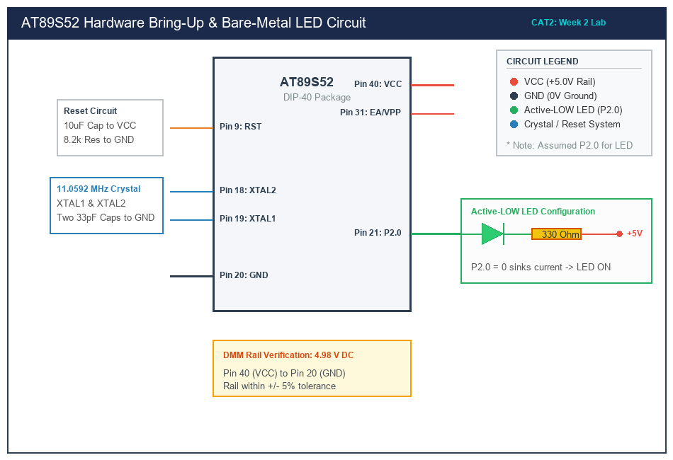

# CAT 2 — 8051 Tool Chain Setup & Bare-Metal Hardware Bring-Up

## 1. Title, CAT, Week, Date
- **Title:** 8051 Tool Chain Setup, Hardware Board Bring-Up, and Bare-Metal GPIO Controller
- **Course:** 25CS2741 Fundamentals of Internet of Things + Lab
- **Evaluation:** Continuous Assessment Test 2 (CAT 2)
- **Academic Week:** Week 2
- **Lab Date:** 20/07/2026
- **Target Platform:** Atmel AT89S52 Microcontroller Development Board

---

## 2. Objective
The primary goals of this laboratory evaluation are:
1. To establish the physical hardware development environment for the MCS-51 architecture, verifying regulated power rails (+5.0V DC) and SPI-based in-system programming (ISP) communication.
2. To compile and flash a minimal bare-metal Embedded C firmware module using direct memory-mapped Special Function Registers (SFRs) without utilizing high-level Arduino libraries, HAL layers, or real-time operating systems.
3. To configure a general-purpose I/O (GPIO) port pin as a digital output in an active-low current-sinking topology and toggle a user diagnostic LED at approximately 1.0 Hz.
4. To design, implement, and validate a reusable board-support delay library (`bsp_delay`) calibrated to the 11.0592 MHz crystal oscillator clock cycles.

---

## 3. Sub-Task Directory Index

This CAT evaluation is structured into three modular, self-contained sub-tasks:

| Sub-Task Folder | Title & Description | Key Deliverables | Relative Link |
|---|---|---|---|
| [`task2_1_bringup/`](task2_1_bringup/) | **Hardware Board Bring-Up** | Hardware verification sheet, DMM power rail probe logs, ISP target signature identification. | [View Sub-Task Documentation](task2_1_bringup/README.md) |
| [`task2_2_blink/`](task2_2_blink/) | **Bare-Metal 1 Hz LED Blink** | Direct SFR port manipulation, calibrated software delay loop, symmetric 1.0 Hz cadence. | [View Sub-Task Documentation](task2_2_blink/README.md) |
| [`task2_3_delay_lib/`](task2_3_delay_lib/) | **Modular Delay Library** | Reusable `bsp_delay.h` / `bsp_delay.c` with millisecond & microsecond timing routines and heartbeat test harness. | [View Sub-Task Documentation](task2_3_delay_lib/README.md) |

---

## 4. Hardware and Software Platform
- **Microcontroller:** Atmel AT89S52-24PU (40-pin Dual In-line Package)
- **Core Architecture:** 8-bit CISC MCS-51 core, 8 KB In-System Programmable Flash, 256 Bytes on-chip RAM
- **Oscillator Circuit:** 11.0592 MHz Quartz Crystal with dual 33 pF ceramic load capacitors
- **Power Supply:** External +9V DC wall adapter regulated to +5.0V DC via onboard LM7805 Linear Regulator
- **Test Equipment:** Digital Multimeter (DMM), Digistep / USB-ASP In-System Programmer
- **Integrated Development Environment (IDE):** Keil µVision / Keil C51 Compiler (compatible with SDCC)
- **Flashing Utility:** ProgISP v1.72 / AVRDUDE

---

## 5. Master Pin Connection Summary

| AT89S52 Pin | Physical Pin # | Connected Subsystem / Signal | Electrical Configuration | Logic State for ON |
|---|---|---|---|---|
| **VCC** | Pin 40 | +5.0V Regulated Bus | Power Rail (Decoupled with 0.1 µF) | 5.0 V DC |
| **GND** | Pin 20 | System Ground Reference (0V) | Ground Plane | 0 V DC |
| **RST** | Pin 9 | Power-On Reset & Manual Tactile Button | 10 µF Cap to VCC, 8.2 kΩ to GND | Active-HIGH Reset pulse |
| **EA/VPP** | Pin 31 | External Access Enable | Hardwired to VCC | High (Internal 8KB Flash) |
| **XTAL1** | Pin 19 | Crystal Input Terminal | Connected to 11.0592 MHz Crystal | Sine / Square Clock |
| **XTAL2** | Pin 18 | Crystal Inverting Amplifier Output | Connected to 11.0592 MHz Crystal | Inverted Clock Output |
| **P2.0** | Pin 21 | Diagnostic User LED Cathode | Open-Drain / Quasi-bidirectional Sink | **Active-LOW (0 = ON)** |
| **P1.5 (MOSI)**| Pin 6 | ISP In-System Programming Data In | Tied to 10-pin ISP Header Pin 1 | SPI MOSI |
| **P1.6 (MISO)**| Pin 7 | ISP In-System Programming Data Out| Tied to 10-pin ISP Header Pin 9 | SPI MISO |
| **P1.7 (SCK)** | Pin 8 | ISP Serial Clock Input | Tied to 10-pin ISP Header Pin 7 | SPI SCK Clock |

---

## 6. Circuit Diagram Overview

*(Vector source available at [`circuit/cat2_overview.svg`](circuit/cat2_overview.svg))*

### Electrical Diagram Explanation
1. **Quasi-Bidirectional Drive Topology:** In standard 8051 variants, Port 0, 1, 2, and 3 use quasi-bidirectional I/O pins. When driven logic HIGH, the internal pull-up FET delivers a weak pull-up current of only ~50–100 µA. However, when driven logic LOW (0), the lower pull-down transistor sinks up to 20 mA. Therefore, connecting the LED in an **Active-LOW** configuration (Anode to +5V through 330 Ω; Cathode to P2.0) ensures safe, full-brightness operation without overloading internal pull-ups.
2. **Current Limiting Calculation:**
   $$\text{Forward Current } I_F = \frac{V_{CC} - V_F - V_{OL}}{R_1} = \frac{5.0\text{ V} - 2.0\text{ V} - 0.4\text{ V}}{330\text{ }\Omega} \approx 7.88\text{ mA}$$
   This current provides bright optical output while staying well within the AT89S52 maximum port sink rating of 20 mA.

---

## 7. Learning Outcomes & Repository Compliance
- Verified power rail tolerances ($4.98\text{ V} \pm 5\%$) using a calibrated multimeter.
- Confirmed bare-metal SFR manipulation adhering strictly to zero Arduino/HAL library constraints.
- Formulated timing calculations grounded in the 12-clock machine cycle architecture of the 8051.
