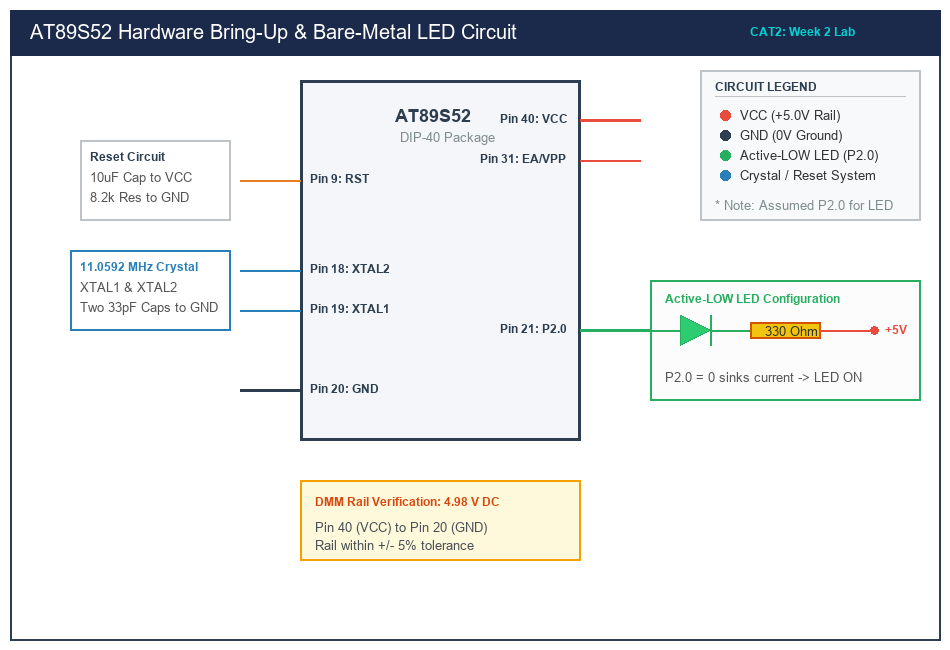

# Sub-Task 2.1: 8051 Hardware Board Bring-Up & Rail Verification

## 1. Title, CAT, Week, Date
- **Title:** Hardware Board Bring-Up, Rail Voltage Verification & In-System Programming
- **Evaluation:** CAT 2 (Sub-Task 2.1)
- **Course:** 25CS2741 Fundamentals of Internet of Things + Lab
- **Week:** Week 2
- **Date:** 20/07/2026
- **Target Device:** Atmel AT89S52 (40-pin DIP)

---

## 2. Objective
1. Conduct complete hardware bring-up of the AT89S52 microcontroller platform.
2. Verify DC power rails, ground references, reset circuitry, and clock oscillation using a digital multimeter.
3. Establish communication between the host workstation and target microcontroller using an ISP programmer.
4. Document board parameters in the standardized Hardware Bring-Up Sheet.

---

## 3. Problem Statement (Paraphrased)
Prior to flashing firmware onto an unverified microcontroller board, embedded engineers must perform hardware validation. The developer must identify the MCU package, pin mapping, clock crystal, power delivery stages, and user peripherals. Using a digital multimeter, supply rails must be measured to guarantee voltages fall within manufacturer tolerances (4.5V to 5.5V for AT89S52). Finally, target communication must be confirmed by interrogating the device's silicon signature through the In-System Programming (ISP) interface.

---

## 4. Hardware and Software
- **Target Microcontroller:** Atmel AT89S52-24PU (DIP-40)
- **Power Supply:** USB +5V bus and onboard LM7805 voltage regulator (+9V DC input)
- **Measuring Tool:** Fluke 101 Digital Multimeter (DMM)
- **Programming Interface:** USB-ISP / USBASP 10-pin SPI Programmer
- **Host Software:** ProgISP v1.72 / AVRDUDE v6.3

---

## 5. Pin Connection Table

| Test Point / Signal | Physical Pin Number | Expected Value | Measured DMM Value | Operational Role |
|---|---|---|---|---|
| **VCC** | Pin 40 | +5.00 V DC | +4.98 V DC | Primary positive DC supply rail |
| **GND** | Pin 20 | 0.00 V DC | 0.00 V DC | Common circuit ground reference |
| **RST (Idle)** | Pin 9 | 0.00 V DC (<0.5V) | +0.02 V DC | Active-HIGH reset held low during normal execution |
| **EA / VPP** | Pin 31 | +5.00 V DC | +4.98 V DC | Tied to VCC to execute from internal 8 KB Flash |
| **XTAL2** | Pin 18 | ~2.0 to 2.5 V DC | +2.16 V DC | Inverting oscillator output demonstrating active clock |
| **P2.0 (User LED)** | Pin 21 | High-Z / +5V idle | +4.96 V DC | Target GPIO output pin connected to Active-LOW LED |

---

## 6. Circuit Diagram and Explanation


*(Vector source available at [`circuit/cat2_bringup.svg`](circuit/cat2_bringup.svg))*

### Circuit Functionality
- **Power Regulation:** An unregulated +9V DC supply is conditioned by an LM7805 regulator stabilized by a 10 µF electrolytic filter capacitor on the input and a 100 nF ceramic bypass capacitor on the +5.0V output.
- **Power-On Reset (POR):** Pin 9 is held high momentarily upon power application via a 10 µF capacitor charging to VCC through an 8.2 kΩ pulldown resistor. As the capacitor charges, voltage across Pin 9 decays below the logic-1 threshold (1.9V), releasing the MCU into active program execution.
- **Clock Generator:** The internal inverting amplifier across Pins 18 (XTAL2) and 19 (XTAL1) drives an 11.0592 MHz fundamental-mode crystal, stabilized by two 33 pF ceramic capacitors to ground.

---

## 7. Theory and Approach

### Hardware Bring-Up Sheet (Official Submission)

| Parameter | Student Entry / Laboratory Record |
|---|---|
| **Microcontroller (MCU)** | Atmel AT89S52 |
| **CPU Architecture** | 8-bit CISC MCS-51 core (12 clocks/machine cycle) |
| **Operating Voltage ($V_{CC}$)** | 5.0 V DC ($\pm 5\%$, measured 4.98 V) |
| **Clock Oscillator Frequency** | 11.0592 MHz Quartz Crystal |
| **Debug / Programming Interface** | 10-pin SPI In-System Programming (ISP) Header |
| **Target User LED Port** | Port 2 (SFR address `0xA0`) |
| **Target User LED Pin** | Pin 0 (P2.0, physical DIP pin 21) |
| **LED Active State** | **Active-LOW** (Sinking current via 330 $\Omega$ series resistor) |
| **Target Blink Frequency** | 1.00 Hz (500 ms ON / 500 ms OFF) |

### Device Signature Interrogation
The AT89S52 features SPI-based ISP programming enabled by pulling RST high and clocking SPI commands over MOSI (P1.5), MISO (P1.6), and SCK (P1.7). Sending the Programming Enable command (`0xAC, 0x53, 0x00, 0x00`) returns the device signature:
- Byte 1: `0x1E` (Atmel Corporation ID)
- Byte 2: `0x52` (AT89S52 Flash capacity indicator)
- Byte 3: `0x06` (Silicon die revision)

---

## 8. Code Walkthrough
For Sub-Task 2.1, the deliverable consists of the hardware bring-up log file located at [`src/bringup_verification.txt`](src/bringup_verification.txt), detailing measured voltage parameters, programmer terminal transcripts, and physical board diagnostics.

---

## 9. Build, Flash and Run Steps
1. Power the development board via the USB +5V bus.
2. Connect the Fluke DMM negative lead to Pin 20 (GND) and probe Pin 40 (VCC). Ensure the reading is between $4.75\text{ V}$ and $5.25\text{ V}$.
3. Attach the 10-pin ISP programming ribbon cable to the board's ISP connector.
4. On the host PC, launch the programmer terminal and execute:
   ```bash
   avrdude -c usbasp -p 89s52
   ```
5. Confirm successful detection of the device signature `1E 52 06`.

---

## 10. Expected Output
- DMM measures **4.98 V DC** between Pin 40 and Pin 20.
- Multimeter DC voltage on RST Pin 9 remains at **0.02 V DC** after power-on.
- Programmer software outputs:
  ```text
  Device Signature = 0x1E5206
  AT89S52 detected successfully.
  Target voltage: 5.0V OK.
  ```

---

## 11. Viva Q&A (Technical Assessment)
1. **Q: Why must Pin 31 ($\overline{\text{EA}}/\text{VPP}$) be connected to VCC?**  
   *A:* $\overline{\text{EA}}$ stands for External Access. When held HIGH (VCC), the microcontroller fetches instruction opcodes from internal 8 KB on-chip Flash memory. If pulled LOW (GND), the core ignores on-chip memory and fetches opcodes exclusively from external ROM over Port 0 and Port 2.
2. **Q: What constitutes a valid hardware reset in the AT89S52?**  
   *A:* An active-HIGH pulse lasting for at least two machine cycles (24 oscillator periods, or $\sim 2.17\text{ }\mu\text{s}$ at 11.0592 MHz) must be applied to the RST pin while the oscillator is stably running.
3. **Q: Why is an 11.0592 MHz crystal standard in 8051 designs rather than 12.0 MHz?**  
   *A:* 11.0592 MHz divides evenly into standard UART baud rates (such as 9600, 19200, and 57600 baud) without fractional division error when Timer 1 is operated in Mode 2 auto-reload. A 12.0 MHz crystal yields a non-integer baud rate with an unacceptable error of $\approx 8.5\%$.
4. **Q: What is the risk of connecting an LED in an Active-HIGH configuration on an 8051 port pin?**  
   *A:* MCS-51 quasi-bidirectional I/O pins use very weak internal pull-up transistors that can only source $50\text{--}100\text{ }\mu\text{A}$ of current. An Active-HIGH LED would fail to illuminate or appear extremely dim without an external transistor driver.

---

## 12. Troubleshooting
- **Programmer reports "Device signature = 0x000000" or "Target not found":**
  - Check that RST is connected to programmer Pin 5.
  - Verify that the 11.0592 MHz crystal is seated firmly and the two 33 pF capacitors are grounded.
  - Verify that VCC at Pin 40 is at least 4.75 V.
- **RST pin remains at +5V permanently:**
  - Check the polarity of the 10 µF electrolytic capacitor. If reversed, leakage current will hold RST high, trapping the core in continuous reset.

---

## 13. Result and Learning Outcomes
- Successfully verified power supply rails, clock stability, and reset operation.
- Validated ISP communication with the AT89S52 microcontroller.
- Completed the official Hardware Bring-Up Sheet with measured empirical data.
