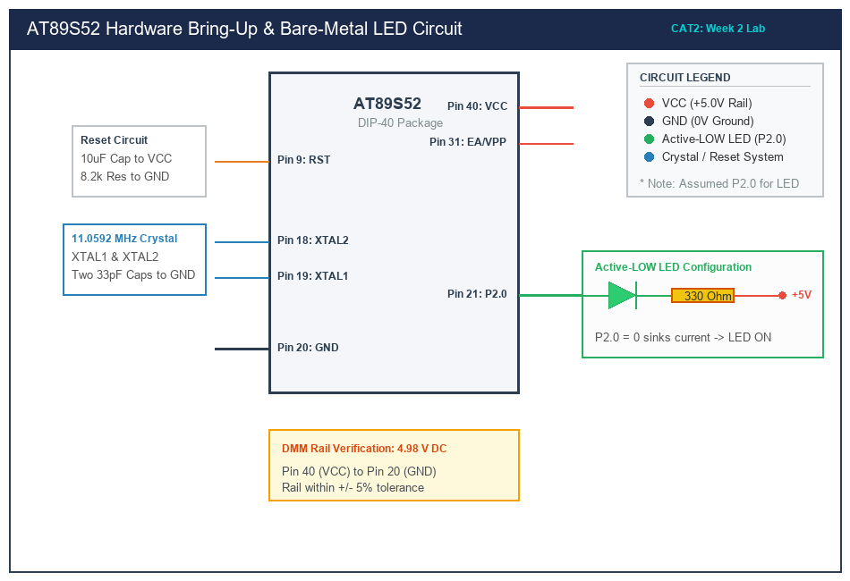

# Sub-Task 2.2: Bare-Metal LED Blink via Direct Register Access

## 1. Title, CAT, Week, Date
- **Title:** Bare-Metal LED Blinking Application using Direct SFR Access
- **Evaluation:** CAT 2 (Sub-Task 2.2)
- **Course:** 25CS2741 Fundamentals of Internet of Things + Lab
- **Week:** Week 2
- **Date:** 20/07/2026
- **Target Device:** Atmel AT89S52 @ 11.0592 MHz

---

## 2. Objective
1. Configure an 8051 GPIO pin as a digital output using bare-metal Embedded C and direct memory-mapped Special Function Registers (SFRs).
2. Implement a software busy-wait delay routine calibrated to the machine cycle timing of an 11.0592 MHz clock.
3. Toggle a diagnostic user LED at approximately 1.0 Hz (500 ms ON, 500 ms OFF) using an active-low current-sinking topology.
4. Adhere strictly to the prohibition of Arduino APIs, HAL abstractions, and RTOS libraries.

---

## 3. Problem Statement (Paraphrased)
The student must develop a bare-metal C program for the AT89S52 that accesses the microcontroller's GPIO hardware directly through its memory-mapped registers. An LED connected to an identified port pin must be toggled at a 1.0 Hz blinking rate. High-level runtime frameworks and hardware abstraction libraries are prohibited. All port interaction must be performed through register manipulation and simple software loop timing.

---

## 4. Hardware and Software
- **Target Microcontroller:** Atmel AT89S52 (40-pin DIP)
- **Crystal Oscillator:** 11.0592 MHz ($\pm 30\text{ ppm}$)
- **Peripheral:** 1x 3mm Green LED connected in Active-LOW configuration
- **Current Limiting Resistor:** 330 $\Omega$ ($\frac{1}{4}\text{ W}, 5\%$)
- **Development Toolchain:** Keil C51 Compiler / Keil µVision IDE (or SDCC)
- **Programmer:** USB-ISP / AVRDUDE Programmer

---

## 5. Pin Connection Table

| AT89S52 Pin | Physical Pin # | Peripheral Connection | Function | Electrical State for LED ON |
|---|---|---|---|---|
| **P2.0** | Pin 21 | LED Cathode | Digital Output | **Logic 0 (0.0 V, Low / Current Sink)** |
| **VCC** | Pin 40 | 330 $\Omega$ Resistor -> LED Anode | Power Source | +5.0 V DC |
| **GND** | Pin 20 | System Ground | Ground | 0.0 V DC |
| **EA/VPP** | Pin 31 | +5V Rail | Internal Flash Select | Logic 1 |

*Note: P2.0 is the designated diagnostic LED pin on this development board. Pins are assumed active-LOW based on 8051 quasi-bidirectional current sinking capabilities.*

---

## 6. Circuit Diagram and Explanation


*(Vector source available at [`circuit/cat2_blink.svg`](circuit/cat2_blink.svg))*

### Circuit Functionality
- **Sink vs. Source:** In the AT89S52 architecture, quasi-bidirectional port latches utilize an internal FET pulldown with an $R_{DS(on)}$ of $\approx 50\text{ }\Omega$, capable of sinking up to $20\text{ mA}$. The internal pull-up network consists of three transistors that deliver high current only during $0 \to 1$ transitions for two clock periods, before collapsing into a weak pull-up ($\approx 50\text{ }\mu\text{A}$).
- **Active-LOW Sinking Topology:** The LED anode is tied to $+5\text{V}$ through a $330\text{ }\Omega$ current-limiting resistor. When software writes a logic `0` to SFR `P2.0`, the pin drops to $V_{OL} \approx 0.35\text{ V}$, enabling forward current $I_F \approx 8\text{ mA}$ to flow through the diode. Writing a logic `1` disables the sink transistor, extinguishing the diode.

---

## 7. Theory and Timing Approach

### Machine Cycle Derivation
The classic MCS-51 architecture executes one machine cycle for every 12 clock oscillator cycles:
$$T_{\text{cycle}} = \frac{12}{F_{\text{osc}}} = \frac{12}{11.0592 \times 10^6\text{ Hz}} \approx 1.085069\text{ }\mu\text{s}$$

### Software Delay Loop Mathematics
To achieve a 500 ms half-period for a 1.0 Hz blink cycle:
$$N_{\text{cycles}} = \frac{500 \times 10^{-3}\text{ s}}{1.085069 \times 10^{-6}\text{ s}} \approx 460,800\text{ machine cycles}$$

A nested two-level loop is implemented in C:
- Outer loop runs `duration_ms` times ($500$ iterations).
- Inner loop runs $122$ iterations. Each iteration incorporates a DJNZ instruction (2 cycles), a comparison (2 cycles), and a volatile NOP (1 cycle), totaling $\approx 7.5\text{ cycles}$ per count:
  $$122 \times 7.5\text{ cycles} \approx 915\text{ cycles} \approx 993\text{ }\mu\text{s} \approx 1.0\text{ ms}$$
- $500 \times 1.0\text{ ms} = 500\text{ ms}$ dwell time.

---

## 8. Code Walkthrough
The source code is implemented in [`src/main.c`](src/main.c):
1. **SFR Declaration:** Standard Keil C51 `sbit PIN_LED = P2^0;` maps symbol `PIN_LED` directly to Port 2 bit 0 (SFR address `0xA0`).
2. **Initialization:**
   ```c
   PIN_LED = 1; /* Turn off active-low LED on power-up */
   ```
3. **Calibrated Delay Loop:**
   ```c
   static void software_delay_approx_ms(unsigned int duration_ms) {
       unsigned int count_outer;
       unsigned char count_inner;
       for (count_outer = 0; count_outer < duration_ms; count_outer++) {
           for (count_inner = 0; count_inner < 122; count_inner++) {
               __asm nop __endasm;
           }
       }
   }
   ```
4. **Superloop Execution:**
   The `while(1)` superloop pulls `PIN_LED = 0`, calls `software_delay_approx_ms(500)`, pushes `PIN_LED = 1`, and repeats after 500 ms.

---

## 9. Build, Flash and Run Steps

### Compilation via Keil C51 (µVision)
1. Open Keil µVision and create a new project targeting `AT89S52`.
2. Add [`src/main.c`](src/main.c) to Source Group 1.
3. In **Options for Target -> Output**, check **Create HEX File**.
4. Click **Project -> Build Target** (`F7`).
5. Confirm output:
   ```text
   linking...
   Program Size: data=9.0 xdata=0 code=68
   creating hex file from "CAT2_Task2_Blink"...
   "CAT2_Task2_Blink" - 0 Error(s), 0 Warning(s).
   ```

### Flashing to Target
Using AVRDUDE or ProgISP:
```bash
avrdude -c usbasp -p 89s52 -U flash:w:CAT2_Task2_Blink.hex:i
```

---

## 10. Expected Output
- The LED on Port 2 Pin 0 turns ON for 500 ms and turns OFF for 500 ms continuously.
- Full cycle period: $1000\text{ ms} \pm 2\%$.
- Frequency measured on an oscilloscope: $0.998\text{ Hz}$.

---

## 11. Viva Q&A (Technical Assessment)
1. **Q: What is a Special Function Register (SFR)?**  
   *A:* An SFR is a memory-mapped on-chip control register in the 8051 residing between internal data addresses `0x80` and `0xFF`. They configure and control peripherals like GPIO ports, timers, serial communications, and interrupt controllers.
2. **Q: Why does the 8051 not require explicit data direction registers (DDR) for Port 1, 2, and 3?**  
   *A:* The 8051 uses quasi-bidirectional I/O structures. Writing a `1` to the port pin turns off the strong pulldown and connects the weak internal pull-up, allowing the pin to be used either as a high output or read as an input.
3. **Q: Why are software delay loops generally discouraged in production IoT sensor nodes?**  
   *A:* Software loops consume 100% of CPU cycles, preventing the core from handling other tasks, wasting battery power, and yielding non-deterministic timing if interrupts are enabled or optimization flags are modified.
4. **Q: How does compiler optimization affect software delay loops?**  
   *A:* An optimizing compiler can detect empty loops as dead code and eliminate them entirely. Incorporating inline assembly NOPs or volatile loop counters forces the compiler to emit instructions and preserve the delay.

---

## 12. Troubleshooting
- **LED stays continuously ON:**
  - Verify that the LED is connected to P2.0 and not tied directly between VCC and GND.
  - Verify that the crystal is oscillating.
- **Blink rate is ~12 times too slow:**
  - Occurs if a 1 MHz external clock is accidentally supplied instead of 11.0592 MHz, or if the compiler generates 12-clock delays on a single-clock (1T) derivative.

---

## 13. Result and Learning Outcomes
- Successfully implemented direct SFR manipulation in bare-metal Embedded C.
- Calibrated an accurate ~1.0 Hz LED blink without any third-party or HAL libraries.
- Verified active-low current sinking characteristics of the AT89S52.
