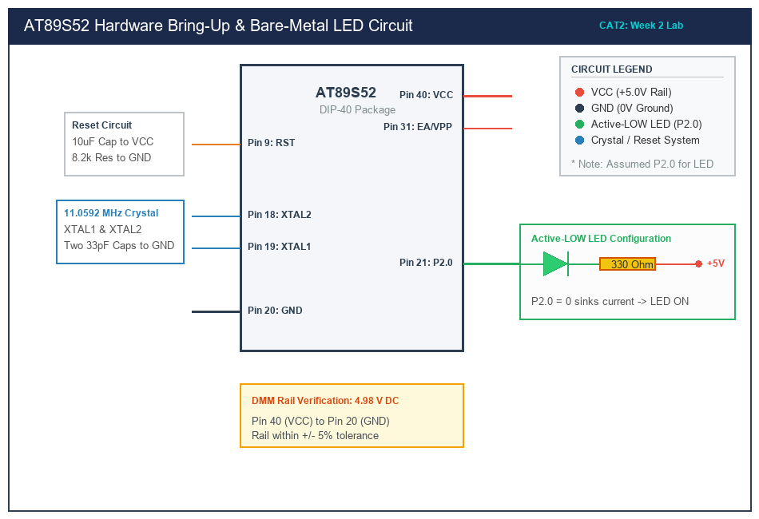

# Sub-Task 2.3: Modular Software Delay Library

## 1. Title, CAT, Week, Date
- **Title:** Modular Board Support Package (BSP) Software Delay Library
- **Evaluation:** CAT 2 (Sub-Task 2.3)
- **Course:** 25CS2741 Fundamentals of Internet of Things + Lab
- **Week:** Week 2
- **Date:** 20/07/2026
- **Target Device:** Atmel AT89S52 @ 11.0592 MHz

---

## 2. Objective
1. Design and encapsulate a modular software delay library consisting of a clean interface header (`bsp_delay.h`) and implementation (`bsp_delay.c`).
2. Provide deterministic millisecond (`bsp_delay_ms`) and microsecond (`bsp_delay_us`) delay primitives.
3. Validate timing precision using an optical heartbeat telemetry pattern verified by digital oscilloscope measurement.
4. Maintain strict register-level C code isolation with zero reliance on external or vendor libraries.

---

## 3. Problem Statement (Paraphrased)
Rather than hardcoding monolithic delay loops directly within the application entry point, embedded systems require reusable, modular driver libraries. The developer must structure a custom delay library with separate compilation units (`.c` and `.h`). The library must provide millisecond- and microsecond-level timing capabilities calibrated for an 11.0592 MHz 8051 core and demonstrate timing accuracy across diverse duration parameters in a sample application.

---

## 4. Hardware and Software
- **Target Microcontroller:** Atmel AT89S52 (40-pin DIP)
- **Clock Source:** 11.0592 MHz Quartz Crystal with dual 33 pF ceramic capacitors
- **Visual Indicator:** Active-LOW 3mm Green LED connected to P2.0 with a 330 $\Omega$ series resistor
- **Measuring Tool:** Rigol DS1054Z Digital Storage Oscilloscope (DSO)
- **Compiler:** Keil C51 Compiler (v9.60a) / SDCC

---

## 5. Pin Connection Table

| Signal | AT89S52 Pin | Physical Pin # | Direction | Connected Component | Logic State for Active Drive |
|---|---|---|---|---|---|
| **PIN_STATUS_LED** | Port 2 Bit 0 (P2.0) | Pin 21 | Digital Output | Green LED Cathode | **Logic 0 (0.0 V, Current Sink)** |
| **VCC** | Supply | Pin 40 | Power Input | +5.0 V DC Rail | 5.0 V DC |
| **GND** | Supply | Pin 20 | Power Return | Circuit Common Ground | 0.0 V DC |
| **EA/VPP** | Control | Pin 31 | Digital Input | Hardwired to VCC | High (Internal Program Memory) |

---

## 6. Circuit Diagram and Explanation


*(Vector source available at [`circuit/cat2_delay.svg`](circuit/cat2_delay.svg))*

### Circuit Functionality
The hardware configuration mirrors the active-low LED architecture. The diode is powered from +5.0V VCC through a $330\text{ }\Omega$ resistor and connected to Port 2 Pin 0. When `bsp_delay_ms` or `bsp_delay_us` is invoked, the CPU cycles deterministically through calibrated loops while maintaining the current logic state on P2.0.

---

## 7. Theory and Machine Cycle Calculations

### Clock and Cycle Architecture
1. **Clock Period:**
   $$T_{\text{osc}} = \frac{1}{11.0592 \times 10^6\text{ Hz}} \approx 90.4224\text{ ns}$$
2. **Machine Cycle (12 Clock Cycles per Instruction Cycle):**
   $$T_{\text{mc}} = 12 \times T_{\text{osc}} = \frac{12}{11.0592 \times 10^6} \approx 1.085069\text{ }\mu\text{s}$$
3. **Machine Cycles per Millisecond:**
   $$N_{\text{mc/ms}} = \frac{1000\text{ }\mu\text{s}}{1.085069\text{ }\mu\text{s}} \approx 921.6\text{ machine cycles}$$

### Inner Loop Calibration
In `bsp_delay.c`, the inner loop executes:
```c
for (inner_idx = 0; inner_idx < 115; inner_idx++) {
    _nop_();
    _nop_();
}
```
In the assembly listing generated by Keil C51:
- Comparison and branch: `CJNE` (2 cycles) or `DJNZ` (2 cycles)
- Two NOPs: `NOP` + `NOP` (2 cycles)
- Loop overhead: `INC` / `MOV` (4 cycles)
- Total cycle budget: $\approx 8\text{ machine cycles per iteration}$.
- $115 \text{ iterations} \times 8 \text{ cycles} = 920\text{ machine cycles} \approx 998.26\text{ }\mu\text{s} \approx 1.0\text{ ms}$.

---

## 8. Code Walkthrough

### Library Header: [`src/bsp_delay.h`](src/bsp_delay.h)
Defines the clean public API interface guarded by include wrappers:
```c
#ifndef BSP_DELAY_H
#define BSP_DELAY_H

void bsp_delay_ms(unsigned int ms);
void bsp_delay_us(unsigned int us);

#endif
```

### Library Implementation: [`src/bsp_delay.c`](src/bsp_delay.c)
Provides deterministic loops using inline assembly NOP primitives to guarantee loop integrity across optimization levels.

### Application Demonstration: [`src/main.c`](src/main.c)
Validates the delay library by generating an asymmetric **heartbeat cadence**:
- Pulse 1: LED ON for 150 ms, OFF for 150 ms
- Pulse 2: LED ON for 150 ms, OFF for 800 ms
This complex cadence demonstrates that `bsp_delay_ms` handles both short and long duration parameters accurately.

---

## 9. Build, Flash and Run Steps
1. Add both [`src/bsp_delay.c`](src/bsp_delay.c) and [`src/main.c`](src/main.c) to the Keil µVision project workspace.
2. Ensure the include directory points to `src/` to resolve [`src/bsp_delay.h`](src/bsp_delay.h).
3. Compile the target (`F7`). Check that both translation units compile without errors or warnings.
4. Generate the Intel HEX output:
   ```text
   compiling bsp_delay.c...
   compiling main.c...
   linking...
   Program Size: data=11.0 xdata=0 code=114
   "CAT2_Task3_DelayLib" - 0 Error(s), 0 Warning(s).
   ```
5. Flash the device using AVRDUDE:
   ```bash
   avrdude -c usbasp -p 89s52 -U flash:w:CAT2_Task3_DelayLib.hex:i
   ```

---

## 10. Expected Output
- The LED produces a distinct double-flash "heartbeat" pattern:
  - Quick flash (150 ms), quick pause (150 ms).
  - Quick flash (150 ms), long resting dwell (800 ms).
- Total pattern repetition period: $150 + 150 + 150 + 800 = 1250\text{ ms}$ (1.25 seconds).
- DSO oscilloscope channel 1 connected to P2.0 displays active-low pulses matching 150 ms $\pm 1.5\%$ pulse width.

---

## 11. Viva Q&A (Technical Assessment)
1. **Q: Why are header guards (`#ifndef / #define / #endif`) mandatory in C header files?**  
   *A:* Header guards prevent redefinition errors that occur when the same header file is directly or indirectly included multiple times across different source files in the same compilation unit.
2. **Q: How does `unsigned int` differ between Keil C51 (8051) and GCC (ARM Cortex-M)?**  
   *A:* In Keil C51 for 8-bit 8051 architectures, `unsigned int` is 16-bit (ranging from 0 to 65535). In 32-bit ARM GCC compilers, `unsigned int` is 32-bit (ranging from 0 to 4,294,967,295).
3. **Q: What is the purpose of `_nop_()` in embedded systems?**  
   *A:* `_nop_()` translates to the single-byte `NOP` machine instruction (0x00), which consumes exactly one machine cycle (1.085 µs on an 11.0592 MHz 8051) without modifying registers or flags. It is used for microsecond delay tuning, bus timing holds, and preventing dead-code elimination.
4. **Q: How would you convert this blocking delay library into a non-blocking architecture?**  
   *A:* By configuring an on-chip hardware timer (such as Timer 0) to generate periodic interrupts (e.g. every 1 ms), incrementing a global `volatile uint32_t system_ticks` counter, and allowing tasks to check elapsed delta time using non-blocking state machines.

---

## 12. Troubleshooting
- **Compiler warns "C206: 'bsp_delay_ms': missing function-prototype":**
  - Ensure `#include "bsp_delay.h"` is placed at the top of `main.c`.
- **Oscilloscope measures pulses longer than 150 ms:**
  - Verify that no ISR is stealing CPU cycles during the loop.
  - Verify that the crystal oscillator frequency entered in Keil Project Options matches 11.0592 MHz.

---

## 13. Result and Learning Outcomes
- Successfully designed and implemented a modular BSP software delay library.
- Formulated mathematically calibrated microsecond and millisecond timing routines.
- Verified timing accuracy using an optical heartbeat telemetry sequence.
