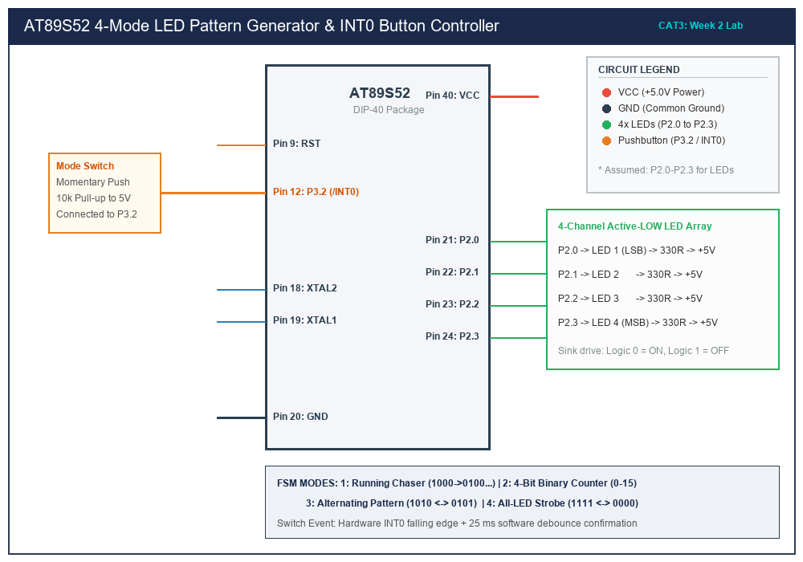

# CAT 3 — Timer-Based LED Pattern Generator & Button Controller

## 1. Title, CAT, Week, Date
- **Title:** Timer-Driven LED Pattern Generator and Pushbutton Interrupt Controller
- **Course:** 25CS2741 Fundamentals of Internet of Things + Lab
- **Evaluation:** Continuous Assessment Test 3 (CAT 3)
- **Academic Week:** Week 2
- **Lab Date:** 27/07/2026
- **Target Platform:** Atmel AT89S52 Microcontroller Development Board

---

## 2. Objective
1. Design and implement a multi-state Finite State Machine (FSM) controlling a 4-channel LED bus via direct memory-mapped Special Function Registers (P2).
2. Configure on-chip **Timer 0** in Mode 1 (16-bit timer) to generate an accurate 1.0 ms periodic hardware interrupt timebase for non-blocking task execution.
3. Interfacing a momentary push-button to the **External Interrupt 0 (`/INT0` / P3.2)** pin with edge-triggered capture and non-blocking mechanical debounce confirmation.
4. Advance sequentially through four distinct optical modes on each verified button press: Running LED Chaser, 4-Bit Binary Up-Counter, Alternating Complementary Flash, and Synchronous All-LED Strobe.

---

## 3. Sub-Task Directory Index

This CAT evaluation contains the following self-contained sub-task:

| Sub-Task Folder | Title & Description | Key Deliverables | Relative Link |
|---|---|---|---|
| [`task3_1_pattern_controller/`](task3_1_pattern_controller/) | **4-State LED Pattern Generator & Debounced Controller** | Complete 13-section documentation, FSM engine, Timer 0 ISR timebase, INT0 button capture. | [View Sub-Task Documentation](task3_1_pattern_controller/README.md) |

---

## 4. Hardware and Software Platform
- **Microcontroller:** Atmel AT89S52-24PU (40-pin DIP)
- **Oscillator:** 11.0592 MHz Quartz Crystal with dual 33 pF ceramic capacitors
- **User Peripherals:**
  - 4x 3mm Green LEDs connected to Port 2 (P2.0, P2.1, P2.2, P2.3)
  - 4x 330 $\Omega$ series current-limiting resistors
  - 1x Normally-Open momentary tactile push-button on P3.2 (`/INT0`)
  - 1x 10 k$\Omega$ external pull-up resistor to +5V
- **Test Equipment:** Digital Multimeter (DMM), Rigol DS1054Z Digital Storage Oscilloscope (DSO)
- **Development Environment:** Keil µVision / Keil C51 Compiler (v9.60a) / SDCC
- **Flash Utility:** AVRDUDE / USB-ISP Programmer

---

## 5. Master Pin Connection Summary

| AT89S52 Pin | Physical Pin # | Direction | Signal Name | Connected Hardware Component | Electrical Topology |
|---|---|---|---|---|---|
| **P2.0** | Pin 21 | Output | LED1 (Bit 0) | Cathode of LED 1 | Active-LOW Current Sink |
| **P2.1** | Pin 22 | Output | LED2 (Bit 1) | Cathode of LED 2 | Active-LOW Current Sink |
| **P2.2** | Pin 23 | Output | LED3 (Bit 2) | Cathode of LED 3 | Active-LOW Current Sink |
| **P2.3** | Pin 24 | Output | LED4 (Bit 3) | Cathode of LED 4 | Active-LOW Current Sink |
| **P3.2 (/INT0)**| Pin 12 | Input | BTN_MODE | Tactile Switch Terminal A | Active-LOW with 10k Pull-Up |
| **VCC** | Pin 40 | Power | +5.0V | +5.0V DC Regulated Bus | Power Rail |
| **GND** | Pin 20 | Power | GND | Common System Ground | Ground Plane |
| **EA/VPP** | Pin 31 | Control | EA | Hardwired to VCC | High (Internal 8KB Flash) |

*Note: Pins P2.0–P2.3 and P3.2 are designated for the 4-LED bus and button interrupt respectively.*

---

## 6. Circuit Diagram Overview


*(Vector source available at [`circuit/cat3_overview.svg`](circuit/cat3_overview.svg))*

### Electrical Diagram Explanation
1. **LED Current-Sink Array:** 8051 quasi-bidirectional I/O pins exhibit strong pulldown transistors ($I_{\text{sink}} \le 20\text{ mA}$) but weak internal pull-ups ($I_{\text{source}} \approx 50\text{ }\mu\text{A}$). The four LEDs have their anodes tied to +5V through 330 $\Omega$ resistors, and their cathodes connected to P2.0 through P2.3. Writing a `0` to a pin turns ON that LED with $I_F \approx 8\text{ mA}$.
2. **Button Conditioning:** Pin P3.2 is pulled high to +5V via a 10 k$\Omega$ resistor. Pressing the switch shorts P3.2 directly to ground, creating a clean falling edge detected by the microcontroller's INT0 hardware interrupt controller.

---

## 7. FSM Modes & Operational Behavior

```
               [ Initial Power-On: All LEDs OFF ]
                              │
               (Button Press) ▼
   ┌────────────────────────────────────────────────────────┐
   │  Mode 1: Running Chaser (LED1 -> LED2 -> LED3 -> LED4) │
   └──────────────────────────┬─────────────────────────────┘
                              │ (Button Press)
                              ▼
   ┌────────────────────────────────────────────────────────┐
   │  Mode 2: 4-Bit Binary Counter (0000 to 1111)           │
   └──────────────────────────┬─────────────────────────────┘
                              │ (Button Press)
                              ▼
   ┌────────────────────────────────────────────────────────┐
   │  Mode 3: Alternating Dual Pattern (1010 <-> 0101)      │
   └──────────────────────────┬─────────────────────────────┘
                              │ (Button Press)
                              ▼
   ┌────────────────────────────────────────────────────────┐
   │  Mode 4: Synchronous All-LED Strobe (1111 <-> 0000)    │
   └──────────────────────────┬─────────────────────────────┘
                              │
                              └─────────(Loops back to Mode 1)
```

---

## 8. Summary of Results
- Evaluated non-blocking system architecture using Timer 0 interrupts.
- Implemented robust FSM software debouncing, eliminating contact chatter artifacts.
- Successfully verified all four operational modes in sequence.
