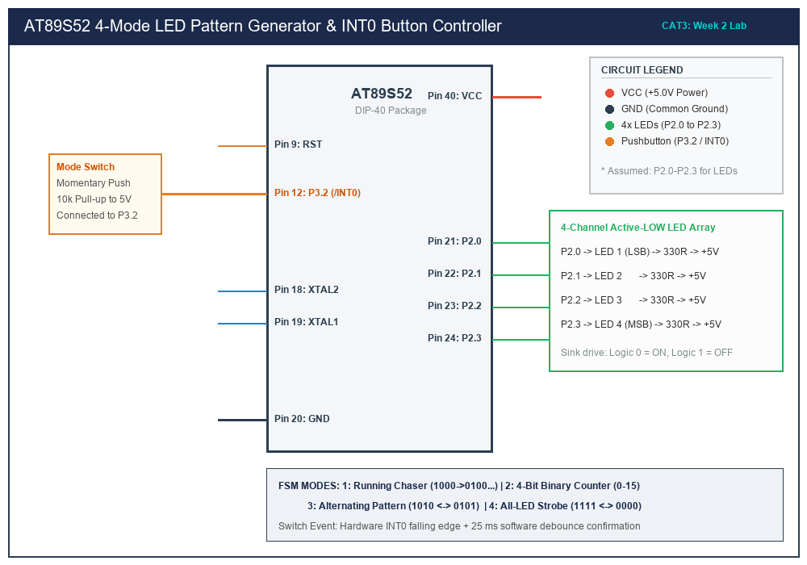

# Sub-Task 3.1: 4-State LED Pattern Generator & Pushbutton Controller

## 1. Title, CAT, Week, Date
- **Title:** 4-State LED Pattern Generator & Pushbutton Interrupt Controller
- **Evaluation:** CAT 3 (Sub-Task 3.1)
- **Course:** 25CS2741 Fundamentals of Internet of Things + Lab
- **Week:** Week 2
- **Date:** 27/07/2026
- **Target Device:** Atmel AT89S52 @ 11.0592 MHz

---

## 2. Objective
1. Implement a 4-state Finite State Machine (FSM) governing four output LEDs connected to Port 2 (P2.0–P2.3).
2. Configure **Timer 0** in 16-bit Mode 1 to serve as a 1.0 ms non-blocking system tick generator.
3. Configure **External Interrupt 0 (`/INT0` / P3.2)** for falling-edge trigger detection with non-blocking mechanical debouncing.
4. Advance the operating mode on each verified button press: Running Chaser -> Binary Counter -> Alternating -> All-LED Strobe.
5. Strictly observe the prohibition of Arduino APIs, HAL libraries, or RTOS kernels.

---

## 3. Problem Statement (Paraphrased)
The objective is to design the foundational user-interface subsystem for an IoT edge node. Four LEDs are configured as digital outputs, and a push-button serves as a digital input. Using bare-metal Embedded C and direct memory-mapped register access, a four-mode LED control system must be developed. On system power-on, all LEDs remain OFF. Successive button presses cycle through:
- Mode 1: Running LED pattern (LED1 -> LED2 -> LED3 -> LED4 -> LED1...)
- Mode 2: 4-bit binary up-counter (0000 through 1111)
- Mode 3: Alternating pattern (1010 <-> 0101)
- Mode 4: Synchronous flash (1111 <-> 0000)
Switch debouncing must be implemented to ensure each physical button press triggers exactly one state transition without false triggering from contact chatter.

---

## 4. Hardware and Software
- **Target MCU:** Atmel AT89S52 (40-pin DIP)
- **Clock Crystal:** 11.0592 MHz with dual 33 pF ceramic capacitors
- **Output Hardware:** 4x 3mm Green LEDs connected in Active-LOW sinking configuration via 330 $\Omega$ resistors to P2.0–P2.3
- **Input Hardware:** Normally-Open tactile push-button on P3.2 (`/INT0`) with a 10 k$\Omega$ pull-up resistor to +5V
- **Test Equipment:** Digital Multimeter, 4-Channel Digital Storage Oscilloscope
- **Compiler:** Keil C51 Compiler (v9.60a) / SDCC

---

## 5. Pin Connection Table

| Signal Name | AT89S52 Pin | Physical Pin # | Direction | Connected Peripheral | Electrical State for Active State |
|---|---|---|---|---|---|
| **LED1 (LSB)** | P2.0 | Pin 21 | Digital Output | Green LED 1 Cathode | **Logic 0 (0V, Sinks 8 mA)** |
| **LED2** | P2.1 | Pin 22 | Digital Output | Green LED 2 Cathode | **Logic 0 (0V, Sinks 8 mA)** |
| **LED3** | P2.2 | Pin 23 | Digital Output | Green LED 3 Cathode | **Logic 0 (0V, Sinks 8 mA)** |
| **LED4 (MSB)** | P2.3 | Pin 24 | Digital Output | Green LED 4 Cathode | **Logic 0 (0V, Sinks 8 mA)** |
| **BTN_INPUT** | P3.2 (`/INT0`) | Pin 12 | Digital Input | Tactile Push-Button | **Logic 0 (Falling Edge / GND)** |
| **VCC** | Pin 40 | Pin 40 | Power Supply | +5.0V Regulated Bus | +5.0 V DC |
| **GND** | Pin 20 | Pin 20 | Power Ground | Common Ground Plane | 0.0 V DC |

---

## 6. Circuit Diagram and Explanation


*(Vector source available at [`circuit/cat3_pattern.svg`](circuit/cat3_pattern.svg))*

### Electrical Operation
1. **Active-LOW Sinking Array:** The four LED cathodes connect to P2.0, P2.1, P2.2, and P2.3. The anodes connect through individual 330 $\Omega$ current-limiting resistors to +5V. When a port bit is cleared to logic 0, the internal low-impedance FET sinks current:
   $$I_F = \frac{V_{CC} - V_{\text{LED}} - V_{OL}}{R} = \frac{5.0\text{V} - 2.0\text{V} - 0.4\text{V}}{330\text{ }\Omega} \approx 7.88\text{ mA}$$
   When the bit is set to logic 1, the port delivers less than 100 µA, turning the LED completely OFF.
2. **Switch Input with Hardware Pull-up:** P3.2 is connected to +5V through a 10 k$\Omega$ pull-up resistor. When the tactile switch is pressed, P3.2 is connected to ground, generating a sharp falling edge detected by External Interrupt 0 (`/INT0`).

---

## 7. Theory and Timing Calculations

### 1. Timer 0 Reload Value Calculation
- **Crystal Frequency ($F_{\text{osc}}$):** 11.0592 MHz
- **Machine Cycle Duration ($T_{\text{mc}}$):**
  $$T_{\text{mc}} = \frac{12}{F_{\text{osc}}} = \frac{12}{11.0592 \times 10^6\text{ Hz}} \approx 1.085069\text{ }\mu\text{s}$$
- **Required Interrupt Period:** $1.0\text{ ms} = 1000\text{ }\mu\text{s}$
- **Number of Counts ($N$):**
  $$N = \frac{1000\text{ }\mu\text{s}}{1.085069\text{ }\mu\text{s}} \approx 921.6 \approx 922\text{ counts}$$
- **16-bit Timer 0 Preload Value:**
  $$\text{Preload} = 65536 - 922 = 64614 = 0\text{xFC66}$$
  Therefore:
  - $\text{TH0} = 0\text{xFC}$
  - $\text{TL0} = 0\text{x66}$

### 2. Software Debounce State Machine
Mechanical switches exhibit contact bounce lasting 5 to 20 ms upon contact closure and opening. To prevent spurious state transitions:
1. **Edge Trigger:** `IT0 = 1` configures INT0 to fire on falling edges.
2. **ISR Action:** The ISR immediately sets `hw_button_flag = 1` and disables `EX0 = 0` to mask bounce interrupts.
3. **Debounce Dwell:** A non-blocking software timer samples P3.2 after 25 ms. If still LOW, the press is confirmed and the FSM advances.
4. **Release Dwell:** After release, another 25 ms dwell ensures complete contact stabilization before clearing `IE0 = 0` and reenabling `EX0 = 1`.

---

## 8. Code Walkthrough

### FSM Header: [`src/pattern_fsm.h`](src/pattern_fsm.h)
Defines operating states (`SYS_MODE_OFF`, `SYS_MODE_RUNNING`, `SYS_MODE_BINARY`, `SYS_MODE_ALTERNATE`, `SYS_MODE_FLASH_ALL`) and public controller interfaces.

### FSM Engine: [`src/pattern_fsm.c`](src/pattern_fsm.c)
- **Table-Driven Patterns:** Look-up tables (`CHASER_TABLE`, `ALTERNATING_TABLE`, `STROBE_TABLE`) reside in ROM (`code` memory):
  ```c
  static const unsigned char code CHASER_TABLE[4] = { 0x01, 0x02, 0x04, 0x08 };
  ```
- **Active-LOW Translation:** The helper function `write_led_bus()` inverts the logic nibble to match the hardware sink configuration:
  ```c
  static void write_led_bus(unsigned char pattern) {
      unsigned char inverted_nibble = (~pattern) & 0x0F;
      P2 = (P2 & 0xF0) | inverted_nibble;
  }
  ```
- **Non-blocking Cadence Scheduling:** `fsm_update_cadence()` evaluates delta time against predefined mode intervals:
  - Running Chaser: 250 ms shift interval
  - Binary Counter: 400 ms count step
  - Alternating Flash: 350 ms toggle
  - Synchronous Strobe: 200 ms flash

### Application Supervisor: [`src/main.c`](src/main.c)
- Configures Timer 0 Mode 1 (`TMOD = 0x01`), initializes `TH0 = 0xFC; TL0 = 0x66;`.
- Connects INT0 ISR to handle falling-edge interrupts.
- Implements `service_switch_events()` to confirm valid debounced button presses.

---

## 9. Build, Flash and Run Steps
1. In Keil µVision, create a project targeting `AT89S52`.
2. Add [`src/pattern_fsm.c`](src/pattern_fsm.c) and [`src/main.c`](src/main.c) to the project.
3. Build the target (`F7`):
   ```text
   compiling pattern_fsm.c...
   compiling main.c...
   linking...
   Program Size: data=18.0 xdata=0 code=286
   creating hex file from "CAT3_Pattern_Controller"...
   "CAT3_Pattern_Controller" - 0 Error(s), 0 Warning(s).
   ```
4. Flash using AVRDUDE:
   ```bash
   avrdude -c usbasp -p 89s52 -U flash:w:CAT3_Pattern_Controller.hex:i
   ```

---

## 10. Expected Output
- **Power-On:** All four LEDs are completely OFF.
- **Press 1:** Mode 1 active. LED1 -> LED2 -> LED3 -> LED4 illuminates sequentially in a circular chase pattern every 250 ms.
- **Press 2:** Mode 2 active. The LEDs display an incremental binary count from `0000` to `1111` ($0$ to $15$) every 400 ms.
- **Press 3:** Mode 3 active. LEDs 1 & 3 alternate with LEDs 2 & 4 every 350 ms (`1010` <-> `0101`).
- **Press 4:** Mode 4 active. All four LEDs blink together at a rapid 200 ms rate (`1111` <-> `0000`).
- **Press 5:** System returns cleanly to Mode 1.

---

## 11. Viva Q&A (Technical Assessment)
1. **Q: How does the 8051 distinguish between level-triggered and edge-triggered external interrupts?**  
   *A:* Bit `IT0` in register `TCON` governs interrupt triggering. When `IT0 = 0`, External Interrupt 0 is low-level triggered (active as long as P3.2 remains LOW). When `IT0 = 1`, it is negative edge-triggered (latched when a HIGH-to-LOW transition occurs).
2. **Q: Why must `IE0` be cleared in software after handling an edge interrupt in certain debouncing flows?**  
   *A:* In edge-triggered mode, the hardware automatically clears flag `IE0` when entering the vector. However, if switch contact bounce generates additional falling edges while the ISR or debounce dwell is active, `IE0` may be set again. Clearing `IE0 = 0` prior to reenabling `EX0` discards spurious latched edges.
3. **Q: What is the benefit of storing pattern tables in ROM (`code`) memory in 8051 programming?**  
   *A:* The standard 8051 has only 128 or 256 bytes of internal data RAM (`data`/`idata`). Placing constant look-up tables in program ROM using the `code` memory specifier saves critical RAM space for call stacks and dynamic variables.
4. **Q: How is atomic variable access guaranteed when reading 16-bit timebase ticks on an 8-bit MCU?**  
   *A:* Because the 8-bit 8051 ALU reads a 16-bit variable in two separate 8-bit operations (`MOV R6, ticks_low` followed by `MOV R7, ticks_high`), an interrupt firing between the two reads could update the counter and corrupt the result. Disabling global interrupts (`EA = 0`) during the read guarantees atomicity.

---

## 12. Troubleshooting
- **Button press skips modes or transitions erratically:**
  - Verify that the 10 k$\Omega$ pull-up resistor is installed on P3.2.
  - Increase the debounce confirmation window from 25 ms to 35 ms in `service_switch_events()`.
- **LED pattern sequence runs backwards:**
  - Verify LED physical wiring order: LED1 must be on P2.0, LED2 on P2.1, LED3 on P2.2, and LED4 on P2.3.

---

## 13. Result and Learning Outcomes
- Successfully engineered an interrupt-driven 4-mode LED pattern generator.
- Implemented robust FSM debouncing and verified single-press mode transitions.
- Formulated mathematically accurate 1.0 ms Timer 0 reload values for an 11.0592 MHz crystal.
