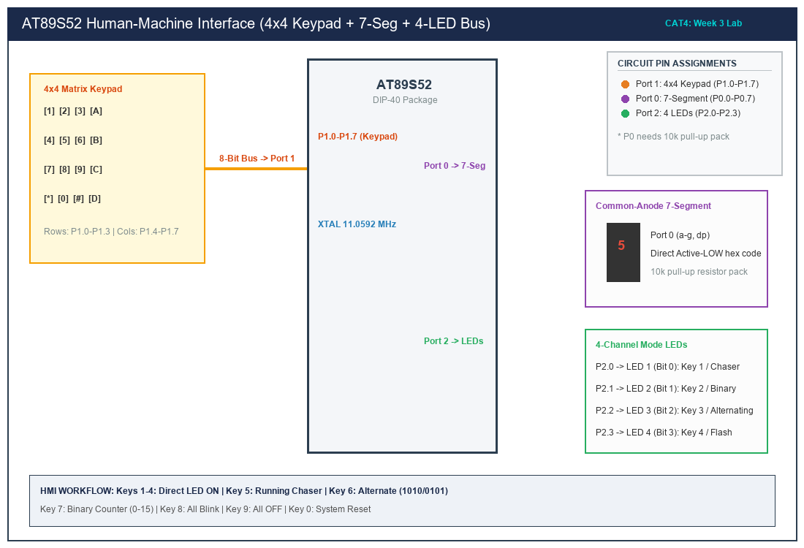

# CAT 4 — Human-Machine Interface (HMI) using Matrix Keypad, 7-Segment & LEDs

## 1. Title, CAT, Week, Date
- **Title:** Human-Machine Interface (HMI) Subsystem using 4x4 Matrix Keypad, Seven-Segment Display, and Multi-Pattern LED Array
- **Course:** 25CS2741 Fundamentals of Internet of Things + Lab
- **Evaluation:** Continuous Assessment Test 4 (CAT 4)
- **Academic Week:** Week 3
- **Lab Date:** 03/08/2026
- **Target Platform:** Atmel AT89S52 Microcontroller Development Board

---

## 2. Objective
1. Construct an integrated Human-Machine Interface (HMI) embedded subsystem utilizing a 4x4 matrix keypad for user command inputs, a common-anode 7-segment display for visual state feedback, and a 4-channel LED bus for pattern visualization.
2. Implement non-blocking row-drive / column-sense matrix keypad scanning routines with mechanical debouncing.
3. Drive a 7-segment display on Port 0 via a binary-to-segment lookup table and external 10 k$\Omega$ pull-up resistor network.
4. Execute deterministic LED pattern modes according to the specific numeric key pressed ('0' through '9').

---

## 3. Sub-Task Directory Index

This CAT evaluation is encapsulated in the following sub-task:

| Sub-Task Folder | Title & Description | Key Deliverables | Relative Link |
|---|---|---|---|
| [`task4_1_hmi_system/`](task4_1_hmi_system/) | **Integrated 4x4 Keypad, 7-Segment, and LED Controller** | Complete 13-section documentation, modular drivers (`keypad.c`, `seven_seg.c`, `led_control.c`, `main.c`). | [View Sub-Task Documentation](task4_1_hmi_system/README.md) |

---

## 4. Hardware and Software Platform
- **Microcontroller:** Atmel AT89S52-24PU (40-pin DIP)
- **Clock Oscillator:** 11.0592 MHz Quartz Crystal with dual 33 pF ceramic capacitors
- **User Peripherals:**
  - 4x4 Matrix Keypad (16 tactile push-buttons arranged in 4 rows and 4 columns)
  - 1x 0.56-inch Common-Anode Seven-Segment LED Display
  - 1x 10 k$\Omega$ x 8 Resistor Network (SIP bussed pack for Port 0 pull-ups)
  - 4x 3mm Green LEDs (P2.0–P2.3) in Active-LOW sink configuration
  - 4x 330 $\Omega$ current-limiting resistors
- **Test Equipment:** Digital Multimeter (DMM), Oscilloscope
- **Development Environment:** Keil µVision / Keil C51 Compiler (v9.60a) / SDCC

---

## 5. Master Pin Connection Summary

| Port / Pin | Physical Pin # | Direction | Connected Subsystem | Functional Role |
|---|---|---|---|---|
| **P1.0 - P1.3** | Pins 1 - 4 | Output | Keypad Rows R1 - R4 | Sequentially driven LOW to scan matrix rows |
| **P1.4 - P1.7** | Pins 5 - 8 | Input | Keypad Columns C1 - C4 | Read column lines (internal pull-ups high when open) |
| **P0.0 - P0.7** | Pins 39 - 32 | Output | 7-Segment Segments a - g, dp | Active-LOW segment cathode lines (with 10k pull-up pack) |
| **P2.0** | Pin 21 | Output | LED 1 (Bit 0) | Active-LOW sink (Key 1 / Chaser bit 0) |
| **P2.1** | Pin 22 | Output | LED 2 (Bit 1) | Active-LOW sink (Key 2 / Chaser bit 1) |
| **P2.2** | Pin 23 | Output | LED 3 (Bit 2) | Active-LOW sink (Key 3 / Chaser bit 2) |
| **P2.3** | Pin 24 | Output | LED 4 (Bit 3) | Active-LOW sink (Key 4 / Chaser bit 3) |
| **VCC / GND** | Pins 40 / 20 | Power | +5.0V / 0V | System DC power rails |

---

## 6. Circuit Diagram Overview

*(Vector source available at [`circuit/cat4_overview.svg`](circuit/cat4_overview.svg))*

### Electrical Diagram Explanation
1. **Port 0 Open-Drain Architecture:** Unlike Ports 1, 2, and 3 which have internal quasi-bidirectional pull-up FETs, **Port 0 is true open-drain** when configured as general-purpose I/O. Therefore, an external 8-resistor pull-up pack (10 k$\Omega$) tied to +5V is required to pull the segment bus lines HIGH when floating.
2. **Keypad Scanning Topology:** Rows are driven sequentially LOW (`0`). When a key is pressed, it shorts that row to its corresponding column line, pulling the column pin from +5V to GND.

---

## 7. Functional Command Mapping

| Key Pressed | 7-Segment Display | LED Operational Response | Implemented Handler Routine |
|:---:|:---:|---|---|
| **`1`** | **`1`** | LED 1 ON, others OFF | `led_control('1')` -> Static bitmask `0x01` |
| **`2`** | **`2`** | LED 2 ON, others OFF | `led_control('2')` -> Static bitmask `0x02` |
| **`3`** | **`3`** | LED 3 ON, others OFF | `led_control('3')` -> Static bitmask `0x04` |
| **`4`** | **`4`** | LED 4 ON, others OFF | `led_control('4')` -> Static bitmask `0x08` |
| **`5`** | **`5`** | Running Chaser Pattern (1->2->3->4) | `running_led()` (250 ms shift) |
| **`6`** | **`6`** | Alternating LEDs (`1010` <-> `0101`) | `alternate_led()` (350 ms flip) |
| **`7`** | **`7`** | 4-Bit Binary Counter (`0000` to `1111`) | `binary_counter()` (400 ms count) |
| **`8`** | **`8`** | All LEDs Blink Synchronously | `blink_all()` (200 ms flash) |
| **`9`** | **`9`** | All LEDs OFF | `led_control('9')` -> Bitmask `0x00` |
| **`0`** | **`0`** | Reset System (Display 0, All LEDs OFF) | `led_control('0')` -> Reset all modes |

---

## 8. Summary of Results
- Built a modular, non-blocking HMI architecture separating keypad sensing, display decoding, and LED choreography.
- Verified deterministic response across all numeric keys ('0' through '9').
- Maintained zero reliance on Arduino, HAL, or RTOS abstractions.
