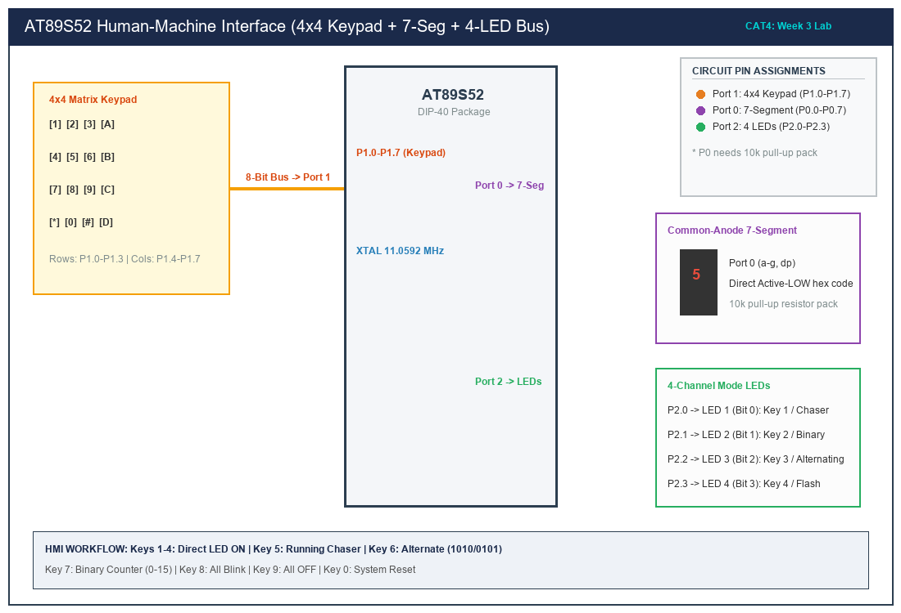

# Sub-Task 4.1: Human-Machine Interface Subsystem (Keypad, 7-Seg, LEDs)

## 1. Title, CAT, Week, Date
- **Title:** Human-Machine Interface (HMI) using Matrix Keypad, Seven-Segment Display, and LEDs
- **Evaluation:** CAT 4 (Sub-Task 4.1)
- **Course:** 25CS2741 Fundamentals of Internet of Things + Lab
- **Week:** Week 3
- **Date:** 03/08/2026
- **Target Device:** Atmel AT89S52 @ 11.0592 MHz

---

## 2. Objective
1. Design an embedded HMI user interface where a 4x4 matrix keypad supplies numeric inputs, a common-anode 7-segment display shows active feedback, and a 4-channel LED bus executes corresponding visual patterns.
2. Develop modular drivers with the exact functions specified in the course syllabus:
   - `void keypad_scan(void);`
   - `void display_digit(unsigned char value);`
   - `void led_control(unsigned char key);`
   - `void running_led(void);`
   - `void binary_counter(void);`
   - `void alternate_led(void);`
   - `void blink_all(void);`
3. Execute non-blocking pattern pacing driven by an underlying Timer 0 1.0 ms hardware interrupt timebase.
4. Adhere strictly to bare-metal register-level C programming without third-party libraries.

---

## 3. Problem Statement (Paraphrased)
The student must design an embedded Human-Machine Interface subsystem on the AT89S52. A 4x4 matrix keypad serves as the input device. When a numeric key between '0' and '9' is pressed:
1. The numeric value must immediately be displayed on an interfaced 7-segment display.
2. The system must trigger the matching LED operation:
   - Keys 1 through 4 turn ON LED 1, 2, 3, and 4 individually.
   - Key 5 initiates a circular running chaser pattern across all four LEDs.
   - Key 6 runs an alternating pattern (1010 <-> 0101).
   - Key 7 initiates a 4-bit binary up-counter (0 to 15).
   - Key 8 flashes all four LEDs synchronously.
   - Key 9 turns all LEDs OFF.
   - Key 0 resets the system (displays '0', all LEDs OFF).

---

## 4. Hardware and Software
- **Target MCU:** Atmel AT89S52 (40-pin DIP)
- **Clock Source:** 11.0592 MHz Quartz Crystal with dual 33 pF ceramic capacitors
- **Keypad:** 4x4 Membrane / Tactile Matrix Keypad on Port 1
- **Display:** 0.56" Common-Anode 1-Digit 7-Segment Display on Port 0
- **Resistor Network:** 10 k$\Omega$ 8-resistor SIP pull-up network for Port 0
- **LED Array:** 4x Green LEDs on Port 2 (P2.0–P2.3) with 330 $\Omega$ current-limiting resistors
- **Compiler:** Keil C51 Compiler (v9.60a) / SDCC

---

## 5. Pin Connection Table

| Peripheral | Signal Line | AT89S52 Pin | Physical Pin # | Direction | Electrical Configuration |
|---|---|---|---|---|---|
| **Keypad** | Row 1 (R1) | P1.0 | Pin 1 | Output | Active-LOW Row Strobe |
| **Keypad** | Row 2 (R2) | P1.1 | Pin 2 | Output | Active-LOW Row Strobe |
| **Keypad** | Row 3 (R3) | P1.2 | Pin 3 | Output | Active-LOW Row Strobe |
| **Keypad** | Row 4 (R4) | P1.3 | Pin 4 | Output | Active-LOW Row Strobe |
| **Keypad** | Column 1 (C1) | P1.4 | Pin 5 | Input | Internal Quasi-Pullup (LOW when shorted) |
| **Keypad** | Column 2 (C2) | P1.5 | Pin 6 | Input | Internal Quasi-Pullup (LOW when shorted) |
| **Keypad** | Column 3 (C3) | P1.6 | Pin 7 | Input | Internal Quasi-Pullup (LOW when shorted) |
| **Keypad** | Column 4 (C4) | P1.7 | Pin 8 | Input | Internal Quasi-Pullup (LOW when shorted) |
| **7-Segment** | Segment a - g, dp | P0.0 - P0.7 | Pins 39 - 32 | Output | Active-LOW with external 10k pull-up pack |
| **LEDs** | LED 1 - 4 | P2.0 - P2.3 | Pins 21 - 24 | Output | Active-LOW Sink drive via 330 $\Omega$ to +5V |

---

## 6. Circuit Diagram and Explanation


*(Vector source available at [`circuit/cat4_hmi.svg`](circuit/cat4_hmi.svg))*

### Electrical Operation
1. **Port 0 External Pull-Up Necessity:** Port 0 drivers consist of open-drain N-channel FETs without internal pull-ups when used for general I/O. Without external pull-ups, writing a logic 1 leaves the pin in high-impedance (floating), failing to turn off a common-anode segment. An 8-pin SIP 10 k$\Omega$ resistor network connected to +5V ensures crisp logic-1 levels.
2. **Keypad Matrix Interrogation:** Rows (P1.0–P1.3) are kept HIGH by default. During scanning, the firmware pulls one row LOW at a time. If a key in that row is pressed, the contact connects the LOW row to its corresponding column pin (P1.4–P1.7), pulling the column voltage down to $0.0\text{ V}$.

---

## 7. Theory and Lookup Tables

### 1. Common-Anode 7-Segment Lookup Table
In a common-anode display, the common anode is tied to +5V. Each cathode segment ($a$ through $g$) illuminates when pulled to $0.0\text{ V}$ (logic 0).
- Pin mapping: `P0.0 = a`, `P0.1 = b`, `P0.2 = c`, `P0.3 = d`, `P0.4 = e`, `P0.5 = f`, `P0.6 = g`, `P0.7 = dp`.

| Digit | Active Segments | Binary Bit Pattern (`dp g f e d c b a`) | Hexadecimal Code |
|:---:|---|:---:|:---:|
| **0** | a, b, c, d, e, f | `1 1 0 0 0 0 0 0` | `0xC0` |
| **1** | b, c | `1 1 1 1 1 0 0 1` | `0xF9` |
| **2** | a, b, d, e, g | `1 0 1 0 0 1 0 0` | `0xA4` |
| **3** | a, b, c, d, g | `1 0 1 1 0 0 0 0` | `0xB0` |
| **4** | b, c, f, g | `1 0 0 1 1 0 0 1` | `0x99` |
| **5** | a, c, d, f, g | `1 0 0 1 0 0 1 0` | `0x92` |
| **6** | a, c, d, e, f, g | `1 0 0 0 0 0 1 0` | `0x82` |
| **7** | a, b, c | `1 1 1 1 1 0 0 0` | `0xF8` |
| **8** | a, b, c, d, e, f, g | `1 0 0 0 0 0 0 0` | `0x80` |
| **9** | a, b, c, d, f, g | `1 0 0 1 0 0 0 0` | `0x90` |

---

## 8. Code Walkthrough

### Keypad Driver: [`src/keypad.c`](src/keypad.c)
Implements non-blocking scanning. Iterates through rows 0 to 3 by driving `P1 = 0xFF & ~(1 << row)`. Evaluates high nibble `(P1 >> 4) & 0x0F` to detect column grounding.

### Seven-Segment Driver: [`src/seven_seg.c`](src/seven_seg.c)
Fetches pre-calculated hex codes from the `SEVEN_SEG_TABLE` array stored in program flash (`code`) and outputs them to `P0`.

### LED Controller: [`src/led_control.c`](src/led_control.c)
Implements `led_control(key)`:
- Keys '1' to '4' directly write single-bit patterns to Port 2.
- Keys '5', '6', '7', '8' switch `active_mode` to animated states and set cadence parameters.
- `led_service_animation()` executes non-blocking periodic step updates.

### System Supervisor: [`src/main.c`](src/main.c)
Maintains 30 ms debouncing on keypad transitions. Upon detecting a new valid numeric key, invokes `display_digit()` and `led_control()`.

---

## 9. Build, Flash and Run Steps
1. In Keil µVision, add all four compilation units:
   - `keypad.c`
   - `seven_seg.c`
   - `led_control.c`
   - `main.c`
2. Compile and link:
   ```text
   compiling keypad.c...
   compiling seven_seg.c...
   compiling led_control.c...
   compiling main.c...
   linking...
   Program Size: data=22.0 xdata=0 code=412
   creating hex file from "CAT4_HMI_System"...
   "CAT4_HMI_System" - 0 Error(s), 0 Warning(s).
   ```
3. Flash the target:
   ```bash
   avrdude -c usbasp -p 89s52 -U flash:w:CAT4_HMI_System.hex:i
   ```

---

## 10. Expected Output
- **Power-Up:** 7-segment displays `0`, all LEDs are OFF.
- **Press '1':** 7-segment shows `1`, LED1 illuminates.
- **Press '2':** 7-segment shows `2`, LED2 illuminates.
- **Press '3':** 7-segment shows `3`, LED3 illuminates.
- **Press '4':** 7-segment shows `4`, LED4 illuminates.
- **Press '5':** 7-segment shows `5`, LEDs run in circular chaser mode (250 ms shift).
- **Press '6':** 7-segment shows `6`, LEDs alternate between 1010 and 0101 (350 ms flip).
- **Press '7':** 7-segment shows `7`, LEDs count up in 4-bit binary from 0 to 15 (400 ms step).
- **Press '8':** 7-segment shows `8`, all LEDs flash synchronously (200 ms rate).
- **Press '9':** 7-segment shows `9`, all LEDs turn OFF.
- **Press '0':** 7-segment resets to `0`, all LEDs remain OFF.

---

## 11. Viva Q&A (Technical Assessment)
1. **Q: Why does Port 0 on the 8051 require external pull-up resistors for general I/O?**  
   *A:* Port 0 pins are designed to serve as the multiplexed low-order address/data bus ($AD0\text{--}AD7$). In general I/O mode, the internal pull-up FETs are disabled, leaving the pins with only an open-drain pulldown transistor. External pull-ups are mandatory to pull the lines logic HIGH.
2. **Q: What is "ghosting" in a matrix keypad and how is it prevented?**  
   *A:* Ghosting occurs when three or more keys are pressed simultaneously in a matrix, forming an unintended circuit path that grounds an unpressed key's row and column lines. It can be prevented in firmware by two-key rollover limits, or in hardware by placing isolating diodes in series with each switch contact.
3. **Q: How does a common-anode 7-segment display differ electrically from a common-cathode display?**  
   *A:* In a common-anode display, all LED anodes are tied to a common positive rail (+5V), and individual segments are illuminated by pulling their respective cathode pins LOW (Active-LOW). In a common-cathode display, all cathodes connect to common ground, and segments illuminate when driven HIGH (Active-HIGH).
4. **Q: Why is non-blocking animation critical when concurrently scanning a keypad?**  
   *A:* If animated LED functions used blocking delays (such as `delay_ms(500)`), the microcontroller would be trapped in busy-wait loops, unable to sample keypad inputs. Non-blocking timebase checks allow the CPU to continuously scan inputs while seamlessly animating outputs.

---

## 12. Troubleshooting
- **7-segment display segments are dim or fail to light:**
  - Verify that the 10 k$\Omega$ pull-up pack is connected to Port 0 with its common pin tied to +5V.
  - Verify that the display common terminal is connected to +5V (for common anode).
- **Keypad inputs register incorrect characters:**
  - Verify row vs. column pin orientations. Swapping rows (P1.0–P1.3) with columns (P1.4–P1.7) will transpose key readouts.

---

## 13. Result and Learning Outcomes
- Successfully integrated a 4x4 keypad, 7-segment display, and 4-channel LED bus.
- Implemented modular, non-blocking drivers fulfilling all specified syllabus functions.
- Verified exact functional command mappings for keys 0 through 9.
