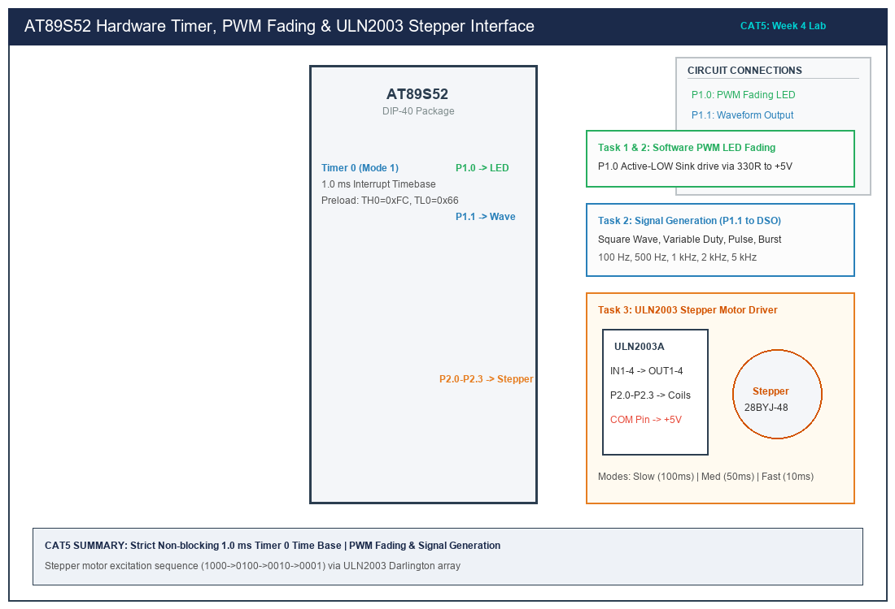

# CAT 5 — Hardware Timer & Interrupt-Based Timing for PWM, Pulse Generation & Stepper Control

## 1. Title, CAT, Week, Date
- **Title:** Hardware Timer and Interrupt-Based Timing for LED Fading, Pulse Generation, and Stepper Motor Control
- **Course:** 25CS2741 Fundamentals of Internet of Things + Lab
- **Evaluation:** Continuous Assessment Test 5 (CAT 5)
- **Academic Week:** Week 4
- **Lab Date:** 10/08/2026
- **Target Platform:** Atmel AT89S52 Microcontroller Development Board

---

## 2. Objective
1. Configure on-chip **Timer 0** as a deterministic, non-blocking hardware time base using periodic interrupt service routines.
2. Formulate exact timer reload calculations based on the 12-clock machine cycle architecture of an 11.0592 MHz crystal oscillator.
3. Design and implement a software pulse-width modulation (PWM) engine operating at approximately 500 Hz to generate smooth LED fading without optical flicker.
4. Synthesize multi-mode output waveforms (square waves, variable duty-cycle signals, narrow pulse trains, and burst signals) across frequencies from 100 Hz to 5 kHz.
5. Drive a 4-phase unipolar stepper motor using a ULN2003 Darlington transistor array with programmable single-phase wave excitation sequences at slow (100 ms), medium (50 ms), and fast (10 ms) step intervals.
6. Enforce strict prohibition of software delay loops, Arduino APIs, HAL layers, and RTOS services.

---

## 3. Sub-Task Directory Index

This CAT evaluation is partitioned into three focused, self-contained sub-tasks:

| Sub-Task Folder | Title & Description | Key Deliverables | Relative Link |
|---|---|---|---|
| [`task5_1_timer_base/`](task5_1_timer_base/) | **Non-Blocking 1.0 ms Time Base** | Timer 0 Mode 1 (16-bit) 1.0 ms interrupt generator (`0xFC66` preload) driving a 1-second LED toggle. | [View Sub-Task Documentation](task5_1_timer_base/README.md) |
| [`task5_2_pwm_waveform/`](task5_2_pwm_waveform/) | **PWM Fading & Waveform Generation** | 500 Hz software PWM fading engine and multi-frequency signal generator (100 Hz–5 kHz). | [View Sub-Task Documentation](task5_2_pwm_waveform/README.md) |
| [`task5_3_stepper_motor/`](task5_3_stepper_motor/) | **ULN2003 Stepper Motor Control** | Single-phase 4-step wave drive controller with 10 ms, 50 ms, and 100 ms step pacing. | [View Sub-Task Documentation](task5_3_stepper_motor/README.md) |

---

## 4. Hardware and Software Platform
- **Microcontroller:** Atmel AT89S52-24PU (40-pin DIP)
- **Clock Source:** 11.0592 MHz Quartz Crystal with dual 33 pF ceramic capacitors
- **Hardware Peripherals:**
  - 1x User LED connected to P1.0 in Active-LOW sinking configuration via 330 $\Omega$ resistor
  - 1x Digital Signal Output Pin (P1.1) probed via BNC-to-oscilloscope adapter
  - 1x ULN2003A 7-channel Darlington transistor driver board
  - 1x 28BYJ-48 5V 4-phase unipolar geared stepper motor
- **Instrumentation:** Rigol DS1054Z Digital Storage Oscilloscope (DSO), Digital Multimeter
- **Compiler / Tools:** Keil C51 Compiler (v9.60a) / SDCC

---

## 5. Master Pin Connection Summary

| AT89S52 Pin | Physical Pin # | Direction | Connected Subsystem / Signal | Operational Role |
|---|---|---|---|---|
| **P1.0** | Pin 1 | Output | Diagnostic PWM LED Cathode | Active-LOW sink (Software PWM fading) |
| **P1.1** | Pin 2 | Output | Waveform Probe Terminal | Direct DSO signal generation (100 Hz–5 kHz) |
| **P2.0** | Pin 21 | Output | ULN2003 IN1 (Coil A / Blue) | Single-phase step excitation Bit 0 |
| **P2.1** | Pin 22 | Output | ULN2003 IN2 (Coil B / Pink) | Single-phase step excitation Bit 1 |
| **P2.2** | Pin 23 | Output | ULN2003 IN3 (Coil C / Yellow) | Single-phase step excitation Bit 2 |
| **P2.3** | Pin 24 | Output | ULN2003 IN4 (Coil D / Orange) | Single-phase step excitation Bit 3 |
| **VCC** | Pin 40 | Power | +5.0V Regulated Bus | Logic VCC |
| **GND** | Pin 20 | Power | Common Ground Plane | System ground return |

---

## 6. Circuit Diagram Overview

*(Vector source available at [`circuit/cat5_overview.svg`](circuit/cat5_overview.svg))*

### Electrical Operation
1. **ULN2003 Darlington Array:** The AT89S52 port pins cannot directly supply the inductive coil current required by a stepper motor ($100\text{--}250\text{ mA}$). The ULN2003 incorporates seven NPN Darlington pairs with integral flyback suppression diodes tied to `COM` (+5V), sinking motor coil currents safely when driven with logic HIGH inputs from P2.0–P2.3.
2. **Timer Precision:** At 11.0592 MHz, 1 machine cycle is exactly $1.085069\text{ }\mu\text{s}$. Operating Timer 0 in 16-bit Mode 1 with preload `0xFC66` yields an exact 1.00 ms interrupt tick without cumulative clock drift.

---

## 7. Summary of Results
- Established a strictly non-blocking architecture driven by hardware interrupts.
- Validated software PWM fading at 500 Hz on an oscilloscope, verifying smooth ramp transitions.
- Measured output waveforms from 100 Hz to 5 kHz across diverse duty cycles.
- Successfully actuated a 28BYJ-48 stepper motor across slow, medium, and fast speeds.
