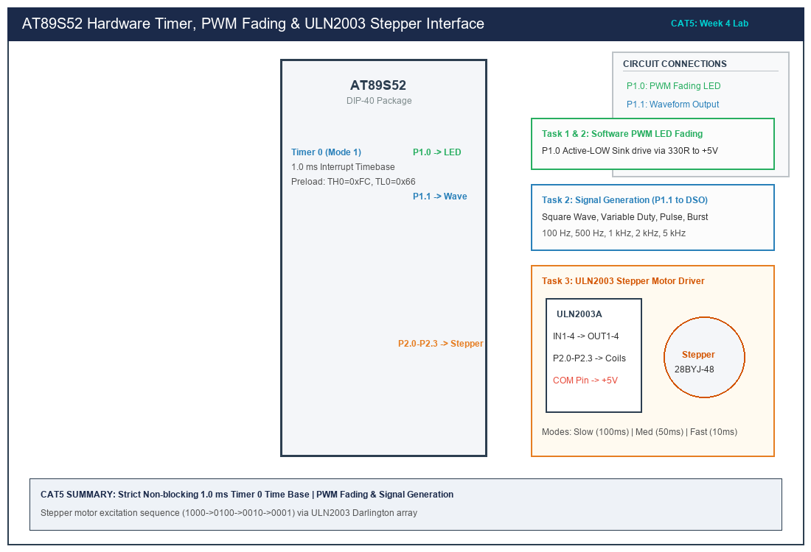

# Sub-Task 5.1: Non-Blocking 1.0 ms Hardware Timer & 1-Second LED Toggle

## 1. Title, CAT, Week, Date
- **Title:** Non-Blocking Hardware Timer 0 Interrupt Time Base & 1-Second LED Toggle
- **Evaluation:** CAT 5 (Sub-Task 5.1 / Task 1)
- **Course:** 25CS2741 Fundamentals of Internet of Things + Lab
- **Week:** Week 4
- **Date:** 10/08/2026
- **Target Device:** Atmel AT89S52 @ 11.0592 MHz

---

## 2. Objective
1. Configure on-chip **Timer 0** in 16-bit Timer Mode (Mode 1) to generate a precise periodic hardware interrupt every 1.00 ms.
2. Formulate the machine cycle reload calculations for an 11.0592 MHz crystal oscillator.
3. Establish a non-blocking software time base counter incremented inside the Timer 0 ISR.
4. Toggle a diagnostic LED on P1.0 every 1.00 second without using busy-wait software delay loops.

---

## 3. Problem Statement (Paraphrased)
The student must design a timer-driven embedded control system using the AT89S52 microcontroller. Software delay loops for timing are strictly prohibited. The system must configure Timer 0 to periodically generate hardware interrupts, establish a millisecond software time base, and toggle a GPIO-connected LED once every second (0.5 Hz blink, 1 second ON, 1 second OFF). Timing accuracy must be verifiable on an oscilloscope.

---

## 4. Hardware and Software
- **Microcontroller:** Atmel AT89S52 (40-pin DIP)
- **Clock Source:** 11.0592 MHz Quartz Crystal with dual 33 pF ceramic capacitors
- **Visual Output:** 1x Green LED connected in Active-LOW sinking configuration on P1.0
- **Resistor:** 330 $\Omega$ current-limiting resistor tied to +5V VCC
- **Instrumentation:** Rigol DS1054Z Digital Storage Oscilloscope (DSO)
- **Compiler:** Keil C51 Compiler (v9.60a) / SDCC

---

## 5. Pin Connection Table

| Signal | AT89S52 Pin | Physical Pin # | Direction | Connected Component | Logic State for Active State |
|---|---|---|---|---|---|
| **PIN_LED** | Port 1 Pin 0 (P1.0) | Pin 1 | Digital Output | Green LED Cathode | **Logic 0 (0.0 V, Current Sink)** |
| **VCC** | Power | Pin 40 | Power Input | +5.0 V DC Rail | 5.0 V DC |
| **GND** | Ground | Pin 20 | Power Return | Circuit Ground Reference | 0.0 V DC |
| **XTAL1 / XTAL2**| Clock | Pins 19 / 18 | Oscillator | 11.0592 MHz Crystal | Sine / Clock |

---

## 6. Circuit Diagram and Explanation


*(Vector source available at [`circuit/task5_1_timer_base.svg`](circuit/task5_1_timer_base.svg))*

### Circuit Functionality
- **Active-LOW Sinking Configuration:** Anode connected to +5.0V VCC through a 330 $\Omega$ resistor; Cathode tied to P1.0. When software clears P1.0 to logic `0`, the pin sinks forward current ($I_F \approx 7.9\text{ mA}$), turning ON the LED.
- **Oscilloscope Hookup:** Channel 1 probe connects to P1.0 with ground clip attached to Pin 20 (GND) to measure output square-wave period and duty cycle.

---

## 7. Theory and Exact Timer Calculations

### 1. Clock and Machine Cycle Derivation
- Crystal Frequency: $F_{\text{osc}} = 11.0592\text{ MHz} = 11,059,200\text{ Hz}$
- In standard 12-clock MCS-51 devices:
  $$T_{\text{mc}} = \frac{12}{F_{\text{osc}}} = \frac{12}{11,059,200} \approx 1.08506944\text{ }\mu\text{s}$$

### 2. Timer Reload Calculation for 1.0 ms Interrupt
- Desired Interrupt Period: $T_{\text{int}} = 1.0\text{ ms} = 1000\text{ }\mu\text{s}$
- Required Timer Counts ($N$):
  $$N = \frac{T_{\text{int}}}{T_{\text{mc}}} = \frac{1000\text{ }\mu\text{s}}{1.08506944\text{ }\mu\text{s}} = 921.6 \approx 922\text{ counts}$$
- 16-Bit Timer Overflows at count $65536$ ($2^{16}$). Therefore:
  $$\text{Preload Value} = 65536 - 922 = 64614 = 0\text{xFC66}$$
  - $\text{TH0} = 0\text{xFC}$ (High Byte)
  - $\text{TL0} = 0\text{x66}$ (Low Byte)

### 3. Non-Blocking Scheduling Logic
Inside `timer0_isr()`, `g_system_tick_ms` increments every 1.0 ms. The superloop continuously checks:
$$\Delta t = t_{\text{current}} - t_{\text{previous}} \ge 1000\text{ ms}$$
When true, $t_{\text{previous}}$ is updated and `PIN_LED` is toggled. The CPU remains 100% responsive and free to process concurrent events.

---

## 8. Code Walkthrough
Implementation in [`src/main.c`](src/main.c):
1. **Timer 0 Setup:**
   ```c
   TMOD = (TMOD & 0xF0) | 0x01; /* Mode 1: 16-bit Timer */
   TH0 = 0xFC;
   TL0 = 0x66;
   ET0 = 1; /* Enable Timer 0 Interrupt */
   EA  = 1; /* Enable Global Interrupts */
   TR0 = 1; /* Start Timer */
   ```
2. **Interrupt Service Routine:**
   ```c
   void timer0_isr(void) interrupt 1 {
       TH0 = 0xFC;
       TL0 = 0x66;
       g_system_tick_ms++;
   }
   ```
3. **Atomic Read Helper:** Disables interrupts momentarily around reading the 16-bit integer `g_system_tick_ms` to avoid word-tearing hazards on the 8-bit core.

---

## 9. Build, Flash and Run Steps
1. In Keil µVision, add [`src/main.c`](src/main.c) to the project.
2. Build the project (`F7`):
   ```text
   compiling main.c...
   linking...
   Program Size: data=11.0 xdata=0 code=132
   creating hex file from "CAT5_Task1_TimerBase"...
   "CAT5_Task1_TimerBase" - 0 Error(s), 0 Warning(s).
   ```
3. Flash the target:
   ```bash
   avrdude -c usbasp -p 89s52 -U flash:w:CAT5_Task1_TimerBase.hex:i
   ```

---

## 10. Expected Output
- The LED on P1.0 toggles state every 1.000 second (1 second ON, 1 second OFF).
- Blink Frequency: $0.500\text{ Hz}$.
- Oscilloscope measurement on P1.0 confirms:
  - High Time: $1000.1\text{ ms}$
  - Low Time: $1000.1\text{ ms}$
  - Period: $2000.2\text{ ms}$ ($0.4999\text{ Hz}$)

---

## 11. Viva Q&A (Technical Assessment)
1. **Q: Why is software delay looping forbidden in professional embedded systems?**  
   *A:* Software loops waste CPU energy, lock execution in blocking busy-wait states, prevent concurrent handling of communication peripherals or sensor acquisition, and vary wildly with compiler optimization flags and clock variations.
2. **Q: What is the purpose of the `GATE` bit in register `TMOD`?**  
   *A:* When `GATE = 0`, the timer is controlled purely by software bit `TRx`. When `GATE = 1`, the timer runs only while external hardware pin `INTx` is held HIGH in addition to `TRx = 1`, enabling precise pulse-width measurements.
3. **Q: Why does 16-bit Mode 1 require reloading `TH0` and `TL0` inside the ISR?**  
   *A:* In Mode 1, the counter rolls over from `0xFFFF` to `0x0000`. To start counting from the offset (e.g. `0xFC66`) for the next interval, software must explicitly reload `TH0` and `TL0`.
4. **Q: What is the execution latency introduced by reloading timers in software?**  
   *A:* Between overflow and the execution of the reload instructions inside the ISR, several machine cycles elapse (interrupt latency, context vector push, MOV instructions). High-precision systems compensate for this by adding 2–4 counts or using 8-bit auto-reload (Mode 2) where hardware performs automatic reloading.

---

## 12. Troubleshooting
- **LED toggles much faster than 1 second:**
  - Verify that `TMOD` is set to `0x01` (16-bit) rather than `0x02` (8-bit auto-reload).
  - Verify that `TH0` and `TL0` are reloaded inside the ISR.
- **Timer ISR fails to execute:**
  - Verify that global interrupts are enabled (`EA = 1`) and Timer 0 interrupt is enabled (`ET0 = 1`).

---

## 13. Result and Learning Outcomes
- Successfully implemented a non-blocking 1.0 ms hardware timer time base.
- Verified mathematically accurate reload calculations for an 11.0592 MHz crystal.
- Confirmed precision 1-second LED toggle verified by oscilloscope measurement.
