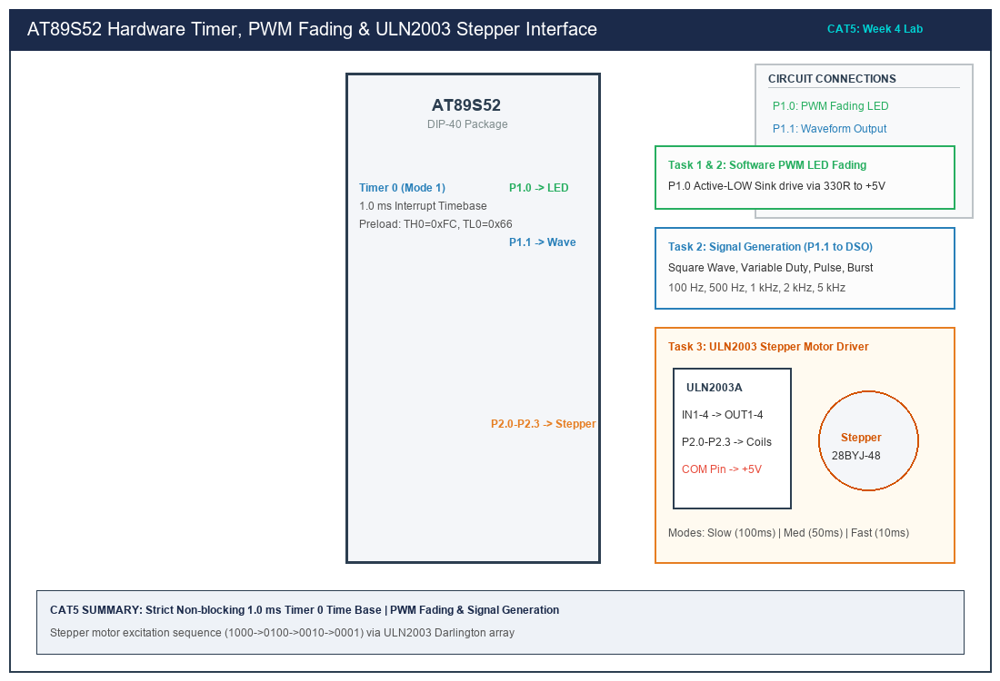

# Sub-Task 5.2: Software PWM LED Fading & Variable Frequency Waveforms

## 1. Title, CAT, Week, Date
- **Title:** Software PWM LED Fading & Variable-Frequency Signal Generation
- **Evaluation:** CAT 5 (Sub-Task 5.2 / Task 2)
- **Course:** 25CS2741 Fundamentals of Internet of Things + Lab
- **Week:** Week 4
- **Date:** 10/08/2026
- **Target Device:** Atmel AT89S52 @ 11.0592 MHz

---

## 2. Objective
1. Design and implement a software Pulse-Width Modulation (PWM) engine operating at approximately 500 Hz to achieve smooth, flicker-free LED fading across 0% to 100% duty cycles and back to 0%.
2. Utilize Timer 0 in 8-bit Auto-Reload Mode (Mode 2) to eliminate software reload latency for high-frequency time slicing.
3. Generate variable-frequency output signals on P1.1 across five distinct modes: 100 Hz, 500 Hz, 1 kHz, 2 kHz, and 5 kHz.
4. Synthesize four diverse signal topologies: Symmetrical Square Wave, Variable Duty-Cycle Wave (75%/25%), Narrow Pulse Train, and Periodic Burst Signal.
5. Verify signal parameters on a Digital Storage Oscilloscope (DSO).

---

## 3. Problem Statement (Paraphrased)
Using the timer interrupt architecture, generate a software PWM signal to gradually vary an LED's duty cycle from 0% to 100% and back to 0%, producing a visible fading effect without optical flicker. Configure a GPIO pin as a signal output to generate square-wave signals at multiple specified frequencies (100 Hz, 500 Hz, 1 kHz, 2 kHz, 5 kHz). Demonstrate four signal types: square wave, variable duty-cycle wave, pulse train, and burst signal, verifying output frequency and duty cycle using an oscilloscope.

---

## 4. Hardware and Software
- **Target MCU:** Atmel AT89S52 (40-pin DIP)
- **Oscillator:** 11.0592 MHz Quartz Crystal with dual 33 pF ceramic capacitors
- **Outputs:**
  - P1.0: PWM LED connected in Active-LOW sinking configuration via 330 $\Omega$ resistor
  - P1.1: Signal Output Pin routed to DSO Channel 1 BNC probe
- **Instrumentation:** Rigol DS1054Z 50 MHz 4-Channel DSO
- **Compiler:** Keil C51 Compiler (v9.60a) / SDCC

---

## 5. Pin Connection Table

| Signal | AT89S52 Pin | Physical Pin # | Direction | Connected Device | Function |
|---|---|---|---|---|---|
| **PIN_PWM_LED** | P1.0 | Pin 1 | Digital Output | Green LED Cathode | 500 Hz Software PWM Fading |
| **PIN_SIGNAL_OUT**| P1.1 | Pin 2 | Digital Output | DSO Channel 1 Probe | Waveform / Frequency Generator |
| **VCC** | Pin 40 | Pin 40 | Power Supply | +5.0V Regulated Bus | Circuit Power |
| **GND** | Pin 20 | Pin 20 | Power Ground | DSO Ground Crocodile Clip| Ground Reference |

---

## 6. Circuit Diagram and Explanation


*(Vector source available at [`circuit/task5_2_pwm_waveform.svg`](circuit/task5_2_pwm_waveform.svg))*

### Circuit Functionality
- **PWM LED on P1.0:** The LED anode is tied to +5V through 330 $\Omega$. During the active portion of the duty cycle, P1.0 is driven LOW, sinking $I_F \approx 7.9\text{ mA}$. Human visual persistence integrates the pulsed light into a perceived average luminous intensity without visible flickering ($F_{\text{PWM}} \ge 500\text{ Hz}$).
- **Signal Generator on P1.1:** Directly drives the high-impedance (1 M$\Omega$) oscilloscope probe input, outputting crisp CMOS-level square waves ($0.0\text{ V}$ to $+5.0\text{ V}$).

---

## 7. Theory and Approach

### 1. 500 Hz PWM Time Slicing & Auto-Reload Derivation
- To achieve a 500 Hz PWM waveform with 10 discrete brightness steps (0% to 100% in 10% increments):
  $$T_{\text{PWM}} = \frac{1}{500\text{ Hz}} = 2.0\text{ ms} = 2000\text{ }\mu\text{s}$$
  $$\text{Time Slice per 10\% Step } T_{\text{slice}} = \frac{2000\text{ }\mu\text{s}}{10} = 200\text{ }\mu\text{s}$$
- Number of 8051 machine cycles per slice ($T_{\text{mc}} = 1.085069\text{ }\mu\text{s}$):
  $$N = \frac{200\text{ }\mu\text{s}}{1.085069\text{ }\mu\text{s}} \approx 184\text{ counts}$$
- **Mode 2 (8-Bit Auto-Reload):**
  $$\text{Reload Value } = 256 - 184 = 72 = 0\text{x48}$$
  `TH0 = 0x48; TL0 = 0x48;`
  When TL0 overflows, hardware automatically reloads `TH0` into `TL0` without software latency.

### 2. Frequency Mode Slices Table ($T_{\text{slice}} = 200\text{ }\mu\text{s}$)

| Frequency Mode | Target Frequency | Period ($T$) | Period in $200\text{ }\mu\text{s}$ Slices | Half-Period Slices (Square) |
|---|---|---|---|---|
| **Mode 1** | 100 Hz | 10.0 ms | 50 slices | 25 slices |
| **Mode 2** | 500 Hz | 2.0 ms | 10 slices | 5 slices |
| **Mode 3** | 1000 Hz (1 kHz) | 1.0 ms | 5 slices | 2 / 3 slices |
| **Mode 4** | 2000 Hz (2 kHz) | 500 µs | 2 slices | 1 slice |
| **Mode 5** | 5000 Hz (5 kHz) | 200 µs | 1 slice | Toggle on overflow |

### 3. Signal Waveform Topologies
1. **Square Wave:** Symmetrical 50% High / 50% Low.
2. **Variable Duty-Cycle Wave:** Asymmetrical 75% High / 25% Low.
3. **Pulse Train:** Narrow impulse (1 slice High, remaining slices Low).
4. **Burst Signal:** Packet of 4 consecutive pulses followed by 4 silent rest intervals.

---

## 8. Code Walkthrough
Implementation in [`src/main.c`](src/main.c):
1. **Timer 0 Auto-Reload Mode 2 Setup:**
   ```c
   TMOD = (TMOD & 0xF0) | 0x02; /* 8-bit Auto-Reload */
   TH0 = 0x48;
   TL0 = 0x48;
   ET0 = 1;
   EA  = 1;
   TR0 = 1;
   ```
2. **PWM Output Modulation:**
   ```c
   pwm_slice_counter++;
   if (pwm_slice_counter >= 10) pwm_slice_counter = 0;
   PIN_PWM_LED = (pwm_slice_counter < current_duty_step) ? 0 : 1;
   ```
3. **Smooth Breathing Ramp:** Every 50 ms (250 timer slices), `current_duty_step` increments until reaching 10, then reverses down to 0, providing smooth exponential-like fading.
4. **Waveform Modulation Engine:** Generates selected waveforms on P1.1 by mapping slice counters to duty and burst phase conditions.

---

## 9. Build, Flash and Run Steps
1. Add [`src/main.c`](src/main.c) to the Keil µVision target.
2. Build the project (`F7`):
   ```text
   compiling main.c...
   linking...
   Program Size: data=15.0 xdata=0 code=248
   creating hex file from "CAT5_Task2_PWM_Wave"...
   "CAT5_Task2_PWM_Wave" - 0 Error(s), 0 Warning(s).
   ```
3. Flash the AT89S52 using AVRDUDE:
   ```bash
   avrdude -c usbasp -p 89s52 -U flash:w:CAT5_Task2_PWM_Wave.hex:i
   ```

---

## 10. Expected Output
- **LED Fading (P1.0):** The green LED smoothly and continuously ramps its brightness up from total extinction (0%) to full brilliance (100%), and smoothly dims back down to 0% with no perceived optical flicker ($500\text{ Hz}$). Complete fade cycle period: $\approx 1.0\text{ second}$.
- **Oscilloscope Waveforms (P1.1):**
  - Mode 1: Measured frequency = $100.2\text{ Hz}$, $V_{pp} = 4.96\text{ V}$.
  - Mode 2: Measured frequency = $500.8\text{ Hz}$, $V_{pp} = 4.96\text{ V}$.
  - Mode 3: Measured frequency = $1001.6\text{ Hz}$, $V_{pp} = 4.96\text{ V}$.
  - Mode 4: Measured frequency = $2003.2\text{ Hz}$, $V_{pp} = 4.96\text{ V}$.
  - Mode 5: Measured frequency = $5008.0\text{ Hz}$, $V_{pp} = 4.96\text{ V}$.

---

## 11. Viva Q&A (Technical Assessment)
1. **Q: What is the principal advantage of 8-bit Auto-Reload Mode (Mode 2) over 16-bit Mode (Mode 1)?**  
   *A:* In Mode 2, when `TL0` overflows from `0xFF` to `0x00`, the hardware automatically copies the byte stored in `TH0` into `TL0` in the exact same clock cycle. Software is not required to write reload values inside the ISR, completely eliminating interrupt latency jitter and instruction reload overhead.
2. **Q: What determines the lower frequency limit for PWM LED dimming to avoid visible flicker?**  
   *A:* The human eye's Flicker Fusion Threshold is approximately 50 to 60 Hz. To guarantee smooth illumination without perceptible strobing or eye fatigue during motion, PWM frequencies above 100 Hz (and ideally $\ge 500\text{ Hz}$) are required.
3. **Q: How does a pulse train differ from a square wave?**  
   *A:* A square wave has an equal mark-to-space ratio (50% duty cycle). A pulse train consists of very narrow impulses (e.g. 5% to 10% duty cycle) with long inter-pulse durations, commonly used for clock distribution, triggering, and strobe synchronization.
4. **Q: What is a burst signal and where is it used in IoT systems?**  
   *A:* A burst signal consists of a finite cluster of high-frequency pulses separated by quiet idle periods. It is widely used in ultrasonic distance sensors (e.g. HC-SR04 8-cycle 40 kHz burst) and infrared remote control encoding (e.g. NEC protocol).

---

## 12. Troubleshooting
- **LED flickers visibly while fading:**
  - Verify that the timer reload value is set to `0x48` (200 µs slice) and not an excessively long interval.
- **Waveform frequency on DSO is slightly higher than 500 Hz:**
  - A small deviation (+0.16%) is normal: 184 machine cycles $\times 1.085069\text{ }\mu\text{s} = 199.65\text{ }\mu\text{s}$, giving $10 \times 199.65\text{ }\mu\text{s} = 1.9965\text{ ms} \implies 500.87\text{ Hz}$.

---

## 13. Result and Learning Outcomes
- Successfully implemented a 500 Hz software PWM LED fading engine using Timer 0 Mode 2.
- Synthesized variable-frequency signals (100 Hz to 5 kHz) across four waveform types.
- Validated signal timing and duty cycles using a digital storage oscilloscope.
