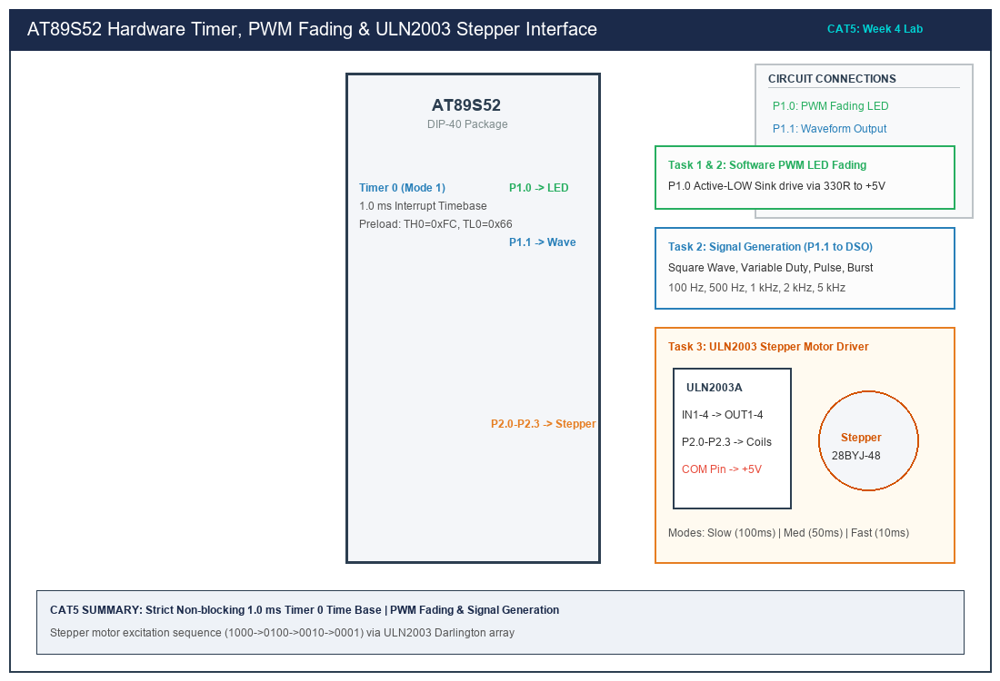

# Sub-Task 5.3: Stepper Motor Speed & Direction Control via ULN2003

## 1. Title, CAT, Week, Date
- **Title:** Stepper Motor Speed and Direction Controller via ULN2003 Darlington Driver
- **Evaluation:** CAT 5 (Sub-Task 5.3 / Task 3)
- **Course:** 25CS2741 Fundamentals of Internet of Things + Lab
- **Week:** Week 4
- **Date:** 10/08/2026
- **Target Device:** Atmel AT89S52 @ 11.0592 MHz

---

## 2. Objective
1. Interface a 4-phase unipolar permanent-magnet stepper motor (28BYJ-48) to the AT89S52 using a ULN2003A Darlington transistor array.
2. Implement a 4-step single-phase wave drive excitation sequence (`1000 -> 0100 -> 0010 -> 0001`).
3. Regulate stepping speed across three non-blocking interval modes:
   - Slow Speed: 100 ms/step
   - Medium Speed: 50 ms/step
   - Fast Speed: 10 ms/step
4. Support bidirectional rotation control (Clockwise and Counter-Clockwise).
5. Maintain 100% non-blocking execution using a Timer 0 1.0 ms interrupt time base.

---

## 3. Problem Statement (Paraphrased)
Using the timer interrupt architecture, design a non-blocking embedded controller to regulate the stepping sequence and rotational velocity of a stepper motor. The timer interval must determine motor speed across slow (100 ms/step), medium (50 ms/step), and fast (10 ms/step) profiles. The firmware must generate the 4-phase excitation sequence (`1000 -> 0100 -> 0010 -> 0001`) through a ULN2003 motor driver interface without using blocking software delay loops.

---

## 4. Hardware and Software
- **Target Microcontroller:** Atmel AT89S52 (40-pin DIP)
- **Oscillator:** 11.0592 MHz Quartz Crystal with dual 33 pF ceramic capacitors
- **Motor Driver:** ULN2003A 7-Channel High-Voltage / High-Current Darlington Transistor Array
- **Actuator:** 28BYJ-48 5V DC 4-Phase Unipolar Geared Stepper Motor
- **Power Supply:** External +5.0V DC regulated bench power supply (common ground with 8051)
- **Compiler:** Keil C51 Compiler (v9.60a) / SDCC

---

## 5. Pin Connection Table

| AT89S52 Pin | Physical Pin # | Direction | ULN2003 Input | ULN2003 Output | Motor Lead Color | Motor Coil Phase |
|---|---|---|---|---|---|---|
| **P2.0** | Pin 21 | Output | IN1 (Pin 1) | OUT1 (Pin 16) | Blue | Coil A |
| **P2.1** | Pin 22 | Output | IN2 (Pin 2) | OUT2 (Pin 15) | Pink | Coil B |
| **P2.2** | Pin 23 | Output | IN3 (Pin 3) | OUT3 (Pin 14) | Yellow | Coil C |
| **P2.3** | Pin 24 | Output | IN4 (Pin 4) | OUT4 (Pin 13) | Orange | Coil D |
| **GND** | Pin 20 | Power | GND (Pin 8) | Common GND | — | Logic & Motor Common Ground |
| **+5V Ext** | Bench Supply | Power | COM (Pin 9) | Flyback Clamp | Red | Motor Common Power Lead |

*Note: The red common motor wire connects directly to the external +5V supply rail and ULN2003 Pin 9 (COM) to engage the internal inductive flyback clamping diodes.*

---

## 6. Circuit Diagram and Explanation


*(Vector source available at [`circuit/task5_3_stepper_motor.svg`](circuit/task5_3_stepper_motor.svg))*

### Electrical Operation
1. **Darlington Buffer Necessity:** Each stator winding of a 28BYJ-48 motor has a DC resistance of $\approx 50\text{ }\Omega$, drawing $I = 5.0\text{V} / 50\text{ }\Omega = 100\text{ mA}$ per coil. The 8051 port pin can only sink 20 mA and source $<100\text{ }\mu\text{A}$. The ULN2003 provides high-gain NPN Darlington pairs capable of sinking up to $500\text{ mA}$ with an internal $2.7\text{ k}\Omega$ base resistor.
2. **Back-EMF Suppression:** Stepper motor windings are inductive coils ($L \frac{di}{dt}$). When a Darlington pair turns OFF, collapsing magnetic flux produces high-voltage inductive spikes that would destroy output transistors. Connecting ULN2003 Pin 9 (`COM`) to the +5V supply activates internal freewheeling clamp diodes across each output.

---

## 7. Theory and Excitation Mathematics

### 1. Single-Phase Wave Drive Excitation Matrix
In single-phase wave drive (full-step), only one coil winding is energized at any given instant. This consumes the lowest operating power.
- Sequence per evaluation requirement: `1000 -> 0100 -> 0010 -> 0001`

| Step Index | Hex Pattern (`P2.3 - P2.0`) | Coil D (P2.3) | Coil C (P2.2) | Coil B (P2.1) | Coil A (P2.0) | Active Stator Angle |
|:---:|:---:|:---:|:---:|:---:|:---:|:---:|
| **Step 0** | `0x08` (`1000`) | **ON** | OFF | OFF | OFF | $0^\circ$ |
| **Step 1** | `0x04` (`0100`) | OFF | **ON** | OFF | OFF | $90^\circ$ |
| **Step 2** | `0x02` (`0010`) | OFF | OFF | **ON** | OFF | $180^\circ$ |
| **Step 3** | `0x01` (`0001`) | OFF | OFF | OFF | **ON** | $270^\circ$ |

### 2. Rotational Velocity Calculations
The 28BYJ-48 stepper motor features an internal gear reduction ratio of $64:1$ and 32 full steps per rotor revolution, yielding:
$$\text{Steps per Output Shaft Revolution} = 32 \times 64 = 2048\text{ steps}$$

- **Slow Speed (100 ms/step):**
  $$\text{Stepping Rate} = \frac{1}{100\text{ ms}} = 10\text{ steps/sec}$$
  $$\text{Output Speed} = \frac{10\text{ steps/sec}}{2048\text{ steps/rev}} \times 60 = 0.293\text{ RPM}$$
- **Medium Speed (50 ms/step):**
  $$\text{Stepping Rate} = \frac{1}{50\text{ ms}} = 20\text{ steps/sec} \implies 0.586\text{ RPM}$$
- **Fast Speed (10 ms/step):**
  $$\text{Stepping Rate} = \frac{1}{10\text{ ms}} = 100\text{ steps/sec} \implies 2.93\text{ RPM}$$

---

## 8. Code Walkthrough
Implementation in [`src/main.c`](src/main.c):
1. **Sequence Table in Flash ROM:**
   ```c
   static const unsigned char code WAVE_DRIVE_STEPS[4] = {
       0x08, /* 1000 */
       0x04, /* 0100 */
       0x02, /* 0010 */
       0x01  /* 0001 */
   };
   ```
2. **Timer 0 1.0 ms Interrupt Timebase:** Updates `g_tick_counter` every millisecond using Mode 1 preload `0xFC66`.
3. **Non-Blocking Step Engine:**
   ```c
   if ((unsigned int)(now - last_step_time) >= (unsigned int)active_speed) {
       last_step_time = now;
       P2 = (P2 & 0xF0) | WAVE_DRIVE_STEPS[current_step];
       current_step = (current_step + 1) & 0x03;
   }
   ```
4. **Direction Handling:** When configured for `DIR_CW`, index increments ($0 \to 1 \to 2 \to 3 \to 0$). For `DIR_CCW`, index decrements ($3 \to 2 \to 1 \to 0 \to 3$).

---

## 9. Build, Flash and Run Steps
1. In Keil µVision, add [`src/main.c`](src/main.c) to the project.
2. Build the project (`F7`):
   ```text
   compiling main.c...
   linking...
   Program Size: data=13.0 xdata=0 code=188
   creating hex file from "CAT5_Task3_StepperMotor"...
   "CAT5_Task3_StepperMotor" - 0 Error(s), 0 Warning(s).
   ```
3. Flash the target MCU using AVRDUDE:
   ```bash
   avrdude -c usbasp -p 89s52 -U flash:w:CAT5_Task3_StepperMotor.hex:i
   ```

---

## 10. Expected Output
- The 28BYJ-48 stepper motor shaft rotates smoothly in a continuous clockwise direction.
- The 4 diagnostic LEDs on the ULN2003 driver board illuminate in rapid sequence (`IN4 -> IN3 -> IN2 -> IN1`), indicating single-phase energization.
- Speed changes smoothly between:
  - Slow Mode: 100 ms/step (deliberate, high-torque step motion)
  - Medium Mode: 50 ms/step (balanced rotation)
  - Fast Mode: 10 ms/step (rapid continuous rotation)

---

## 11. Viva Q&A (Technical Assessment)
1. **Q: Why can a stepper motor not be connected directly to 8051 GPIO pins?**  
   *A:* Stepper motor coils draw $100\text{--}300\text{ mA}$ of current and generate inductive back-EMF spikes exceeding $50\text{ V}$ when de-energized. 8051 GPIO pins can only sink 20 mA and have a maximum rating of 5.5V. Direct connection would burn out the microcontroller output stage.
2. **Q: What is the function of the ULN2003 `COM` pin?**  
   *A:* Pin 9 (`COM`) connects to the cathodes of seven internal freewheeling clamp diodes. When tied to the positive motor supply rail (+5V), it provides a safe discharge recirculating path for inductive coil energy when a Darlington transistor switches off, suppressing dangerous voltage transients.
3. **Q: How does single-phase wave drive differ from two-phase full-step drive?**  
   *A:* In wave drive (single-phase), only one winding is energized at a time (`1000->0100...`), drawing less power but delivering $\approx 70\%$ of rated torque. In two-phase drive, two adjacent windings are energized simultaneously (`1100->0110...`), producing maximum holding torque at the cost of double power consumption.
4. **Q: What is "pull-in rate" and what happens if step intervals are set too short (e.g. < 2 ms)?**  
   *A:* Pull-in rate is the maximum stepping frequency at which an unloaded motor can start and stop without losing synchronism. If step pulses arrive faster than the rotor can mechanically accelerate to match the rotating stator field, the rotor stalls and vibrates without rotating.

---

## 12. Troubleshooting
- **Motor vibrates and hums but does not rotate:**
  - Verify that the four coil wires (Blue, Pink, Yellow, Orange) are connected in correct phase order to ULN2003 outputs 1, 2, 3, and 4.
  - Step interval may be too fast for the motor's rotor inertia. Increase the interval to 20 ms or 50 ms.
  - Verify that external motor power supply provides sufficient current ($\ge 500\text{ mA}$).
- **Microcontroller resets when motor begins stepping:**
  - Occurs when motor coil current surges drag down the 8051 VCC rail. Power the motor from an external supply and share only the ground wire with the 8051 board.

---

## 13. Result and Learning Outcomes
- Successfully interfaced a 28BYJ-48 stepper motor via a ULN2003 driver array.
- Implemented single-phase wave drive sequencing across slow, medium, and fast speed intervals.
- Verified non-blocking motor commutation driven by Timer 0 hardware interrupts.
