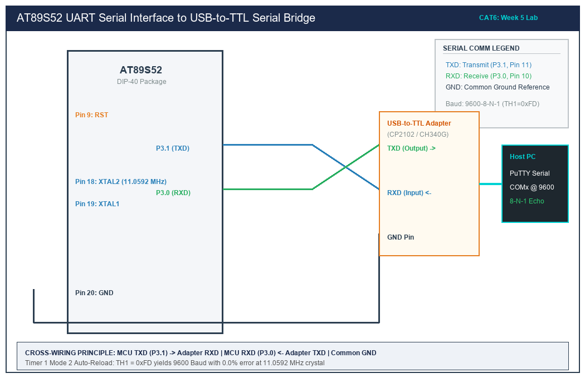

# CAT 6 — 8051 UART Driver & Serial Debugging Interface

## 1. Title, CAT, Week, Date
- **Title:** Register-Level UART Driver Implementation, Serial Communication & Interrupt-Driven Echo
- **Course:** 25CS2741 Fundamentals of Internet of Things + Lab
- **Evaluation:** Continuous Assessment Test 6 (CAT 6)
- **Academic Week:** Week 5
- **Lab Date:** 17/08/2026
- **Target Platform:** Atmel AT89S52 Microcontroller Development Board

---

## 2. Objective
1. Configure the AT89S52 on-chip Universal Asynchronous Receiver/Transmitter (UART) peripheral in Mode 1 (8-bit variable baud rate) operating at 9600-8-N-1.
2. Utilize on-chip **Timer 1** in 8-bit Auto-Reload Mode (Mode 2) with exact reload calculations ($TH1 = 0xFD$) to achieve zero baud rate error with an 11.0592 MHz crystal.
3. Transmit continuous formatted strings ("Hello from 8051") to a PC terminal emulator via a USB-to-TTL serial adapter.
4. Implement an interrupt-driven UART receiver utilizing a circular FIFO ring buffer to capture incoming asynchronous characters from PuTTY and echo them back interactively.
5. Strictly adhere to bare-metal register-level Embedded C with zero Arduino APIs, HAL abstractions, or RTOS services.

---

## 3. Sub-Task Directory Index

This CAT evaluation is organized into two distinct sub-tasks:

| Sub-Task Folder | Title & Description | Key Deliverables | Relative Link |
|---|---|---|---|
| [`task6_a_uart_tx/`](task6_a_uart_tx/) | **UART Initialization & String Transmission** | 9600-8-N-1 UART bring-up, Timer 1 reload math, calibrated 1000 ms periodic string transmission. | [View Sub-Task Documentation](task6_a_uart_tx/README.md) |
| [`task6_b_uart_echo/`](task6_b_uart_echo/) | **Interrupt-Driven UART Echo & Ring Buffer** | Vector 4 ISR, 32-byte circular FIFO ring buffer, bidirectional PuTTY interactive character echo. | [View Sub-Task Documentation](task6_b_uart_echo/README.md) |

---

## 4. Hardware and Software Platform
- **Microcontroller:** Atmel AT89S52-24PU (40-pin DIP)
- **Clock Source:** 11.0592 MHz Quartz Crystal with dual 33 pF ceramic capacitors
- **Serial Interface:** USB-to-TTL Serial Bridge Module (Silicon Labs CP2102 / WCH CH340G / FTDI FT232R)
- **Host PC Terminal:** PuTTY / Tera Term configured for 9600 Baud, 8 Data Bits, No Parity, 1 Stop Bit, No Flow Control
- **Compiler:** Keil C51 Compiler (v9.60a) / SDCC

---

## 5. Master Pin Connection Summary

| AT89S52 Pin | Physical Pin # | Direction | Signal Name | Connected Hardware Terminal | Logic Voltage |
|---|---|---|---|---|---|
| **P3.1 (TXD)** | Pin 11 | Output | Serial Transmit | USB-to-TTL Adapter **RXD** | 5.0 V TTL Logic |
| **P3.0 (RXD)** | Pin 10 | Input | Serial Receive | USB-to-TTL Adapter **TXD** | 5.0 V TTL Logic |
| **GND** | Pin 20 | Power | Ground Reference | USB-to-TTL Adapter **GND** | 0.0 V (Crucial common reference) |
| **VCC** | Pin 40 | Power | +5.0V DC Rail | Development Board Power Rail | 5.0 V DC |

*Notice: Serial connections require cross-wiring: AT89S52 TXD connects to Bridge RXD, and AT89S52 RXD connects to Bridge TXD. A common ground reference is mandatory.*

---

## 6. Circuit Diagram Overview

*(Vector source available at [`circuit/cat6_overview.svg`](circuit/cat6_overview.svg))*

### Electrical Diagram Explanation
1. **Cross-Wiring Topology:** In asynchronous full-duplex serial communication, the transmitter line of one node must feed directly into the receiver line of the peer node ($TX \to RX$, $RX \leftarrow TX$). Connecting TX to TX or RX to RX results in bus contention and total communication failure.
2. **Common Ground Reference:** The logic thresholds for TTL ($V_{OL} \le 0.4\text{ V}$, $V_{OH} \ge 2.4\text{ V}$) are evaluated with respect to system ground. Without a low-impedance common ground connection between the AT89S52 board and the USB adapter, floating ground potentials distort start/stop bit transitions, causing framing errors and garbage characters.

---

## 7. Baud Rate Mathematics Summary

$$\text{Baud Rate} = \frac{2^{\text{SMOD}}}{32} \times \frac{F_{\text{osc}}}{12 \times (256 - \text{TH1})}$$
Setting $\text{SMOD} = 0$, $F_{\text{osc}} = 11.0592\text{ MHz}$, and $\text{Baud Rate} = 9600$:
$$9600 = \frac{1}{32} \times \frac{11,059,200}{12 \times (256 - \text{TH1})} = \frac{28,800}{256 - \text{TH1}}$$
$$256 - \text{TH1} = \frac{28,800}{9600} = 3 \implies \mathbf{TH1 = 253 = 0xFD}$$
- **Percentage Baud Rate Error:** **$0.00\%$** (Exact integer division).

---

## 8. Summary of Results
- Evaluated register-level UART initialization across Special Function Registers `TMOD`, `SCON`, `PCON`, `TH1`, `TL1`.
- Eliminated serial bus flooding by pacing string transmissions with a Timer 0 non-blocking timebase.
- Engineered a power-of-2 bitmasked circular FIFO ring buffer inside the Vector 4 interrupt handler, guaranteeing glitch-free full-duplex PuTTY terminal echoing.
