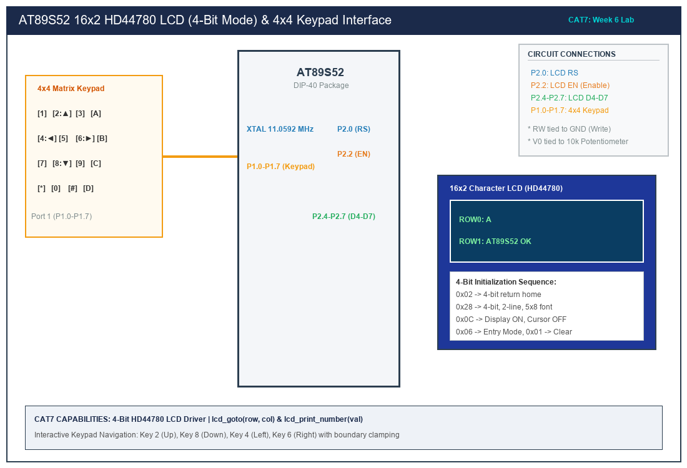

# CAT 7 — 16x2 HD44780 LCD Driver Development & Keypad Movement

## 1. Title, CAT, Week, Date
- **Title:** 16x2 Character LCD Driver Development, Dynamic Value Updating & Interactive Keypad Navigation
- **Course:** 25CS2741 Fundamentals of Internet of Things + Lab
- **Evaluation:** Continuous Assessment Test 7 (CAT 7)
- **Academic Week:** Week 6
- **Lab Date:** 24/08/2026
- **Target Platform:** Atmel AT89S52 Microcontroller Development Board

---

## 2. Objective
1. Engineer a register-level Embedded C peripheral driver for the Hitachi HD44780 (and compatible) 16x2 dot-matrix liquid crystal display.
2. Interface the LCD using the 4-bit bus architecture to economize microcontroller I/O pin consumption.
3. Formulate the precise datasheet command initialization sequence (`0x33, 0x32, 0x28, 0x0C, 0x06, 0x01`).
4. Develop core driver primitives: `lcd_init()`, `lcd_cmd()`, `lcd_data()`, `lcd_goto()`, `lcd_puts()`, and `lcd_print_number()`.
5. Integrate a 4x4 matrix keypad on Port 1 to dynamically navigate a character sprite across the 2-row by 16-column matrix grid with boundary safety clamping.
6. Strictly adhere to bare-metal register C restrictions without using vendor or third-party libraries.

---

## 3. Sub-Task Directory Index

This CAT evaluation is structured into three progressive sub-tasks:

| Sub-Task Folder | Title & Description | Key Deliverables | Relative Link |
|---|---|---|---|
| [`task7_a_lcd_init/`](task7_a_lcd_init/) | **4-Bit LCD Initialization & String Display** | 4-bit HD44780 initialization, `lcd_cmd`, `lcd_data`, multi-line string display on Rows 1 & 2. | [View Sub-Task Documentation](task7_a_lcd_init/README.md) |
| [`task7_b_lcd_cursor/`](task7_b_lcd_cursor/) | **Cursor Positioning & Telemetry Update** | `lcd_goto(row, col)`, `lcd_print_number(val)`, live real-time decimal telemetry rendering. | [View Sub-Task Documentation](task7_b_lcd_cursor/README.md) |
| [`task7_c_keypad_nav/`](task7_c_keypad_nav/) | **4x4 Keypad-Based Character Navigation** | Matrix keypad integration: Keys 2 (Up), 8 (Down), 4 (Left), 6 (Right) driving cursor movement on 16x2 grid. | [View Sub-Task Documentation](task7_c_keypad_nav/README.md) |

---

## 4. Hardware and Software Platform
- **Microcontroller:** Atmel AT89S52-24PU (40-pin DIP)
- **Clock Source:** 11.0592 MHz Quartz Crystal with dual 33 pF ceramic capacitors
- **Display:** 16x2 Character Alphanumeric LCD Module (Hitachi HD44780 / Sitronix ST7066U controller)
- **Contrast Potentiometer:** 10 k$\Omega$ linear trimmer (wiper to Pin 3 / V0)
- **Input Hardware:** 4x4 Matrix Keypad (16 tactile switches connected to Port 1)
- **Compiler:** Keil C51 Compiler (v9.60a) / SDCC

---

## 5. Master Pin Connection Summary

| AT89S52 Pin | Physical Pin # | Direction | Connected LCD Pin | Signal Description | Function |
|---|---|---|---|---|---|
| **P2.0** | Pin 21 | Output | Pin 4 (RS) | Register Select | 0 = Command Register, 1 = Data Register |
| **GND** | Pin 20 | Power | Pin 5 (RW) | Read/Write Select | Tied to Ground (Write Mode exclusively) |
| **P2.2** | Pin 23 | Output | Pin 6 (EN) | Enable Strobe | High-to-Low pulse latches data nibble |
| **P2.4** | Pin 25 | Output | Pin 11 (D4) | Data Bus Bit 4 | High nibble bit 0 |
| **P2.5** | Pin 26 | Output | Pin 12 (D5) | Data Bus Bit 5 | High nibble bit 1 |
| **P2.6** | Pin 27 | Output | Pin 13 (D6) | Data Bus Bit 6 | High nibble bit 2 |
| **P2.7** | Pin 28 | Output | Pin 14 (D7) | Data Bus Bit 7 | High nibble bit 3 (Busy flag in read mode) |
| **P1.0 - P1.3** | Pins 1 - 4 | Output | Keypad Rows R1 - R4| Keypad Scan Row Strobe |
| **P1.4 - P1.7** | Pins 5 - 8 | Input | Keypad Cols C1 - C4| Keypad Scan Column Sense |
| **VCC / GND** | Pins 40 / 20 | Power | Pin 2 (VDD) / Pin 1 (VSS) | Display Power Rails | +5.0 V DC / Ground |

---

## 6. Circuit Diagram Overview

*(Vector source available at [`circuit/cat7_overview.svg`](circuit/cat7_overview.svg))*

### Electrical Diagram Explanation
1. **4-Bit Bus Operation:** By wiring only data pins D4 through D7, four precious microcontroller I/O pins (D0–D3) are saved for other peripherals. The HD44780 receives each 8-bit command or ASCII character as two successive 4-bit nibbles (most significant nibble first, followed by least significant nibble), each latched on the falling edge of `EN`.
2. **Contrast Adjustment (V0):** Pin 3 (V0) sets the liquid crystal bias voltage. Connecting V0 to a 10 k$\Omega$ potentiometer wiper positioned between +5V and GND provides variable contrast between character pixels and the background matrix.

---

## 7. DDRAM Addressing & Command Sequences

### DDRAM Line Addresses
The HD44780 maintains internal display data RAM (DDRAM) where character codes are stored:
- **Line 1 (Row 0):** Base address `0x00` $\implies$ Command `0x80 | 0x00 = 0x80` to `0x8F` (16 positions).
- **Line 2 (Row 1):** Base address `0x40` $\implies$ Command `0x80 | 0x40 = 0xC0` to `0xCF` (16 positions).

### Required Initialization Commands
- `0x28`: Function Set (4-bit interface, 2 display lines, 5x8 character font matrix).
- `0x0C`: Display Control (Display ON, cursor invisible, cursor blink disabled).
- `0x06`: Entry Mode Set (Auto-increment DDRAM address pointer rightward, display freeze).
- `0x01`: Clear Display (Clears all DDRAM contents with space `0x20` and returns cursor home).

---

## 8. Summary of Results
- Built a modular HD44780 driver in 4-bit mode.
- Validated multi-line string display and dynamic decimal number printing.
- Implemented real-time interactive character movement using the 4x4 matrix keypad with boundary safety clamping.
