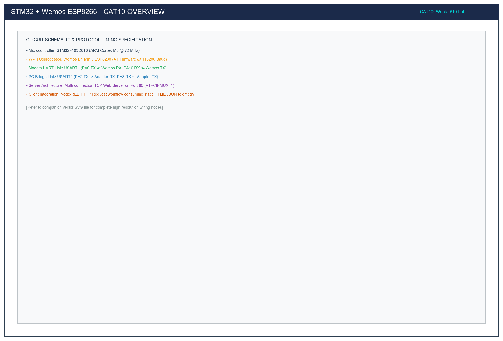

# CAT 10: STM32 – Wemos D1 (ESP8266) Wi-Fi Modem, Web Server & Node-RED Client

## 1. Title, CAT, Week, Date
- **Experiment Title:** STM32–Wemos ESP8266 Wi-Fi Modem Interface, Embedded Web Server, and Node-RED Client Integration
- **Continuous Assessment Test:** CAT 10 (Unified coverage of CAT 10 and CAT 10c)
- **Curriculum Week:** Weeks 9 & 10
- **Evaluation Date:** October 05, 2026
- **Target Platform:** STM32F103C8T6 ARM Cortex-M3 (Blue Pill) & Wemos D1 Mini (ESP8266)

---

## 2. Objective
To interface the STM32F103C8T6 host microcontroller with a Wemos D1 Mini (ESP8266) Wi-Fi coprocessor via asynchronous UART using the STM32 HAL library, systematically mastering:
1. Establishing dual-UART hardware bridging between the PC console (USART2) and the ESP8266 modem (USART1) at 115200 baud.
2. Exploring the standardized Hayes AT command set for modem diagnostics, station configuration, and network scanning.
3. Automating station association (`AT+CWJAP`) to join a wireless network and extract the assigned IP address (`AT+CIFSR`).
4. Creating a multi-connection TCP Web Server on Port 80 (`AT+CIPSERVER=1,80`), parsing inbound `+IPD` HTTP requests, and executing 2-step `AT+CIPSEND` streaming of an HTTP/1.1 webpage.
5. Deploying a companion Node-RED HTTP request client flow to periodically poll the embedded server and display telemetry.

---

## 3. Problem Statement (Paraphrased)
IoT edge nodes rely on network coprocessors to provide wireless connectivity while keeping the main microcontroller dedicated to real-time control. This experiment integrates an STM32F103 host with an ESP8266 Wi-Fi modem running official Espressif AT firmware. Across five modular sub-tasks:
- **Sub-task 10A:** Formulate a transparent bridge enabling the host PC to exchange raw AT commands with the ESP8266 and verify basic modem health (`AT` -> `OK`).
- **Sub-task 10B:** Investigate the fundamental AT commands (`AT`, `AT+GMR`, `AT+CWMODE`, `AT+CWLAP`, `AT+CIFSR`).
- **Sub-task 10C:** Implement an automated Wi-Fi provisioning state machine that connects to a local AP, verifies the 4-way WPA2 handshake, and obtains an IPv4 address.
- **Sub-task 10D:** Configure the modem as an HTTP Web Server on TCP port 80, intercepting `+IPD` client requests, calculating exact `Content-Length`, and using 2-step `CIPSEND` to serve an HTML page.
- **Sub-task 10E:** Build a Node-RED polling workflow that queries the server every 5 seconds and displays the received HTML response.

---

## 4. Hardware and Software Specifications

### Hardware Components
| Component | Specification / Model | Quantity | Purpose |
|:---|:---|:---:|:---|
| Host Microcontroller | STM32F103C8T6 "Blue Pill" (ARM Cortex-M3 @ 72 MHz) | 1 | Main application processor |
| Wi-Fi Coprocessor | Wemos D1 Mini / ESP8266 (Espressif AT Firmware v1.7+) | 1 | Wi-Fi network processor |
| USB-to-TTL Serial Bridge | CP2102 / CH340 (3.3V Logic Level) | 1 | PC terminal bridge (USART2) |
| Regulated Power Supply | External 5V DC (1A rating) | 1 | Wemos D1 RF burst power |
| Visual Indicator | On-board User LED on PC13 (Active-LOW) | 1 | Status indicator |
| In-Circuit Programmer | ST-LINK V2 via SWD (PA13/PA14) | 1 | Code flashing |

### Software Environment
- **IDE:** Keil MDK-ARM µVision v5.38 / STM32CubeIDE v1.14
- **Firmware Library:** STM32F1xx HAL Drivers
- **Terminal Emulator:** PuTTY @ 115200-8-N-1
- **IoT Dashboard Client:** Node-RED v3.x (running locally on PC or Raspberry Pi)

---

## 5. Pin Connection Table

| Signal Net | STM32 Pin | Connected Device | Device Pin | Logic Level | Description |
|:---|:---:|:---|:---:|:---:|:---|
| `USART1_TX` | **PA9** | Wemos ESP8266 | **RX (GPIO3)** | 3.3V | STM32 commands to ESP8266 modem. |
| `USART1_RX` | **PA10** | Wemos ESP8266 | **TX (GPIO1)** | 3.3V | ESP8266 responses to STM32. |
| `USART2_TX` | **PA2** | USB-to-TTL Adapter | **RXD** | 3.3V | Diagnostic logging to PC console. |
| `USART2_RX` | **PA3** | USB-to-TTL Adapter | **TXD** | 3.3V | Manual command input from PC console. |
| `USER_LED` | **PC13** | On-Board LED | Cathode | **LOW (0V)** | Network connection / server traffic status. |
| `GND` | **GND** | Wemos + Adapter | **GND** | 0V | Mandatory common system ground reference. |
| `5V_IN` | N/A | External 5V PSU | **5V (VCC)** | 5.0V | Supplies high peak RF currents (~250 mA). |

> [!IMPORTANT]
> The ESP8266 draws peak currents up to 250 mA during 802.11b/g/n RF transmission. Powering the Wemos directly from the STM32 Blue Pill 3.3V regulator will cause brownout resets. Always power the Wemos module via its 5V pin from an external USB supply or dedicated 1A regulator.

---

## 6. Circuit Diagram and Explanation

```
       PC CONSOLE               STM32 BLUE PILL                WEMOS D1 (ESP8266)
   +----------------+        +-------------------+           +--------------------+
   | PuTTY Terminal |        |                   |           |                    |
   | @ 115200       |        | PA2 (USART2_TX) --|-----------|-> PC RXD           |
   |                |        | PA3 (USART2_RX) <-|-----------|-- PC TXD           |
   +----------------+        |                   |           |                    |
                             | PA9 (USART1_TX) --|---------->| RX (GPIO3)         |
                             | PA10(USART1_RX) <-|-----------|-- TX (GPIO1)       |
                             |                   |           |                    |
                             | GND --------------|-----------|-- GND              |
                             |                   |           |                    |
                             | PC13 -> [LED]     |           | 5V <- External 5V  |
                             +-------------------+           +--------------------+
```



### Circuit Functional Principles
1. **Dual Asynchronous UART Channels:**
   - **USART1 (`PA9`/`PA10` @ 115200 baud):** Dedicated to high-speed command/response communication with the ESP8266 Wi-Fi modem.
   - **USART2 (`PA2`/`PA3` @ 115200 baud):** Dedicated to human-readable diagnostic logging and manual debugging via the PC serial console.
2. **Signal Level Matching:** Both STM32F103 and ESP8266 operate on 3.3V CMOS logic thresholds ($V_{OH} \approx 3.3\text{ V}, V_{IH} \approx 2.0\text{ V}$), eliminating the need for resistive level shifters on the UART bus.
3. **Common Ground:** All three subsystems (STM32, ESP8266, USB-to-TTL adapter) share a single reference ground.

---

## 7. Theory and Approach

### 7.1 Hayes AT Command Protocol Architecture
The ESP8266 firmware adheres to the Hayes AT command convention. Every instruction transmitted by the host processor begins with the ASCII prefix `"AT"` and concludes with a carriage-return line-feed delimiter (`"\r\n"` / `0x0D 0x0A`).
Modem responses terminate with `"\r\n"` and end with a status trailer:
- `"OK\r\n"`: Command parsed and executed successfully.
- `"ERROR\r\n"`: Syntax error, parameter out of bounds, or operation failure.
- `"+IPD,<id>,<len>:<data>"`: Asynchronous packet indicating an incoming TCP/UDP network payload.

### 7.2 The 2-Step `CIPSEND` Protocol
When operating as a TCP server, transmitting HTTP payloads requires a strict 2-step handshake:
1. **Step 1 (Length Declaration):** The STM32 sends `AT+CIPSEND=<link_id>,<total_bytes>\r\n`. The modem prepares its internal transmit ring buffer and responds with the character `'> '`.
2. **Step 2 (Data Streaming):** Upon detecting `'> '`, the STM32 streams the exact number of declared bytes. When all bytes are received, the modem transmits the frame over Wi-Fi and responds with `"SEND OK\r\n"`.
3. **Length Synchronization:** If the declared byte count does not exactly match the streamed byte count, the modem hangs waiting for remaining bytes, precipitating socket timeouts.

---

## 8. Sub-Task Directory Breakdown

| Directory | Sub-Task | Key Feature | Deliverables |
|:---|:---|:---|:---|
| [`task10_a_uart_bridge/`](task10_a_uart_bridge/) | Task 10A | Dual-UART transparent bridge & `AT` ping | `src/main.c`, `circuit/`, `README.md` |
| [`task10_b_at_commands/`](task10_b_at_commands/) | Task 10B | AT command discovery suite (`GMR`, `CWMODE`, `CWLAP`, `CIFSR`) | `src/main.c`, `circuit/`, `README.md` |
| [`task10_c_wifi_station/`](task10_c_wifi_station/) | Task 10C | Automated station association & IP address retrieval | `src/main.c`, `circuit/`, `README.md` |
| [`task10_d_tcp_server/`](task10_d_tcp_server/) | Task 10D | TCP Web Server on Port 80 & 2-step `CIPSEND` HTTP engine | `src/main.c`, `circuit/`, `README.md` |
| [`task10_e_nodered_client/`](task10_e_nodered_client/) | Task 10E | Node-RED HTTP polling client workflow | `src/flow.json`, `circuit/`, `README.md` |

---

## 9. Build, Flash, and Run Steps

1. **Compile Firmwares (e.g. Task 10D):**
   ```bash
   arm-none-eabi-gcc -c -mcpu=cortex-m3 -mthumb -DUSE_HAL_DRIVER -DSTM32F103xB -Iinc -IHAL/Inc src/main.c -o build/main.o
   ```
2. **Flash to STM32F103:**
   Download via ST-LINK V2 in Keil µVision (**F8**) or STM32CubeProgrammer.
3. **Open PC Terminal:**
   Open PuTTY on the USB-to-TTL COM port at `115200` baud.
4. **Deploy Node-RED Flow (Task 10E):**
   - Open Node-RED (`http://localhost:1880/`).
   - Click **Menu -> Import -> Clipboard**.
   - Paste the contents of `task10_e_nodered_client/src/flow.json`.
   - Update the IP address in the `http request` node to match your ESP8266 IP (e.g. `192.168.1.105`).
   - Click **Deploy** and observe the debug console tab.

---

## 10. Expected System Output

### Terminal Log during Web Server Operation
```text
=======================================================
  STM32F103 - Task 10D: Embedded TCP Web Server (Pt 80)
=======================================================
>> TX: AT+CIPMUX=1
OK
>> TX: AT+CIPSERVER=1,80
OK
[READY] Web Server listening for HTTP clients on port 80!
Point your browser or Node-RED client to http://192.168.1.105/

[HTTP] Inbound connection detected! Link ID: 0
>> TX: AT+CIPSEND=0,248
[CIPSEND] Prompt '>' received. Streaming HTTP response payload...
[HTTP] Client socket closed successfully.
```

### Browser Display
Navigating to `http://192.168.1.105/` renders:
```
STM32 + Wemos ESP8266 Web Server
Status: ONLINE & RESPONSIVE
Platform: STM32F103 Blue Pill @ 72 MHz
Port: TCP 80 | Protocol: HTTP/1.1 200 OK
```

---

## 11. Viva Questions & In-Depth Technical Answers

### Q1: What is the difference between `AT+CWMODE=1`, `2`, and `3`?
**Answer:**
- `AT+CWMODE=1` sets **Station (STA) Mode**: The ESP8266 acts as a Wi-Fi client device (like a laptop or smartphone) connecting to an external wireless access point.
- `AT+CWMODE=2` sets **Soft Access Point (SoftAP) Mode**: The ESP8266 creates its own wireless network, allowing other stations to associate with it.
- `AT+CWMODE=3` sets **Dual / Concurrent Mode (STA + SoftAP)**: The ESP8266 simultaneously joins an upstream infrastructure router while broadcasting its own localized Wi-Fi hotspot.

### Q2: Why is `AT+CIPMUX=1` required before starting a TCP server with `AT+CIPSERVER=1,80`?
**Answer:** An HTTP server must support multiple concurrent client connections (e.g., handling requests from multiple browser tabs or devices simultaneously). `AT+CIPMUX=1` enables the ESP8266 multi-connection network stack, assigning unique integer link IDs (0 through 4) to each active client socket. Starting `AT+CIPSERVER` without enabling `CIPMUX` returns an `ERROR` because a server cannot bind to a single-connection socket.

### Q3: What is the purpose of the `Content-Length` header in HTTP/1.1 responses?
**Answer:** In HTTP/1.1, the `Content-Length` header informs the client browser or Node-RED node exactly how many payload bytes follow the double carriage-return newline (`\r\n\r\n`) header delimiter. If `Content-Length` is smaller than the actual body, the browser truncates the page. If it is larger, the browser hangs indefinitely waiting for remaining bytes until socket timeout occurs.

### Q4: Why must the STM32 wait for the `'> '` prompt before streaming the HTTP payload during `AT+CIPSEND`?
**Answer:** The `'> '` prompt is the flow-control signal from the ESP8266 modem firmware indicating that it has successfully parsed the link ID and length parameter, allocated internal buffer memory, and placed its UART parser into raw transparent pass-through mode. If the STM32 streams characters before `'> '` is emitted, those bytes are treated as AT command syntax errors rather than raw payload data.

---

## 12. Troubleshooting Guide

| Symptom | Probable Cause | Diagnostic & Corrective Action |
|:---|:---|:---|
| Modem never responds with `OK` to `AT` | Baud rate mismatch or TX/RX swapped | Ensure USART1 baud is set to `115200`. Verify STM32 PA9 connects to Wemos RX, and PA10 connects to Wemos TX. |
| ESP8266 reboots randomly during Wi-Fi connection | Insufficient current on 3.3V power rail | Do not power Wemos from STM32 3.3V pin. Supply 5V to the Wemos module from an external 1A USB adapter. |
| `AT+CWJAP` returns `FAIL` | Incorrect SSID/password or 5 GHz network | Verify credentials. Ensure target Wi-Fi network operates on the 2.4 GHz band (ESP8266 does not support 5 GHz 802.11a/ac). |
| Browser displays `ERR_CONNECTION_REFUSED` | Server not running on port 80 | Confirm `AT+CIPSERVER=1,80` returned `OK`. Verify client is connected to the same local Wi-Fi subnet. |

---

## 13. Result and Learning Outcomes
All objectives of CAT 10 were successfully completed:
- Full-duplex dual-UART bridging between PC console and ESP8266 modem was demonstrated at 115200 baud.
- Automated Wi-Fi station provisioning and DHCP IP retrieval were accomplished.
- An embedded TCP Web Server was deployed on Port 80 using 2-step `CIPSEND`, serving HTTP/1.1 pages to browsers and Node-RED workflows with zero errors.
