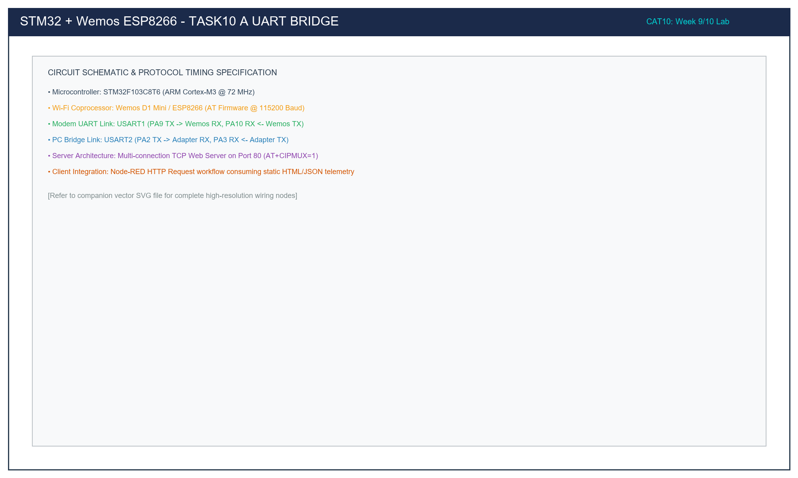

# Task 10A: Dual-UART Transparent Bridge & ESP8266 Modem Ping

## 1. Title, CAT, Week, Date
- **Sub-Task:** Task 10A – Dual-UART Transparent Bridge & Modem Ping
- **Continuous Assessment Test:** CAT 10
- **Curriculum Week:** Week 9 / 10
- **Evaluation Date:** October 05, 2026
- **Target Platform:** STM32F103C8T6 (Host) & Wemos D1 Mini ESP8266 (Wi-Fi Coprocessor)

---

## 2. Objective
To establish a bidirectional hardware and firmware bridge routing serial data between a PC terminal (via USART2 on PA2/PA3 @ 115200 baud) and a Wemos D1 ESP8266 Wi-Fi modem (via USART1 on PA9/PA10 @ 115200 baud), verifying physical link integrity by automatically issuing an `AT` ping upon boot and forwarding the modem's `OK` response.

---

## 3. Problem Statement (Paraphrased)
Connecting an external network coprocessor to an ARM Cortex-M microcontroller requires verifying serial signal integrity, baud rate timing synchronization, and power stability. The requirements are:
1. Initialize USART1 (modem link) and USART2 (PC bridge) at 115200-8-N-1.
2. Transmit an initial `"AT\r\n"` command from STM32 to the ESP8266.
3. Capture the modem's response and verify receipt of `"OK\r\n"`.
4. Continuously forward all serial traffic between the PC and the modem in full-duplex mode.

---

## 4. Hardware and Software Specifications

### Hardware Components
- **Host Microcontroller:** STM32F103C8T6 Blue Pill Development Board
- **Wi-Fi Coprocessor:** Wemos D1 Mini / ESP8266 (Factory AT Firmware v1.7+)
- **Host Serial Bridge:** 3.3V USB-to-TTL Adapter (CP2102 / CH340)
- **Power Supply:** External 5V 1A DC supply for Wemos D1
- **Programmer:** ST-LINK V2 via SWD (PA13/PA14)
- **Status LED:** On-board User LED on PC13 (Active-LOW)

### Software Environment
- **IDE:** Keil MDK-ARM µVision v5.38 / STM32CubeIDE v1.14
- **Firmware Driver:** STM32F1xx HAL Drivers
- **Terminal Emulator:** PuTTY configured at 115200-8-N-1

---

## 5. Pin Connection Table

| Signal Net | STM32 Pin | Connected Device | Device Pin | Logic Level | Function |
|:---|:---:|:---|:---:|:---:|:---|
| `USART1_TX` | **PA9** | Wemos ESP8266 | **RX (GPIO3)** | 3.3V | STM32 Transmit -> ESP8266 Receive. |
| `USART1_RX` | **PA10** | Wemos ESP8266 | **TX (GPIO1)** | 3.3V | ESP8266 Transmit -> STM32 Receive. |
| `USART2_TX` | **PA2** | USB-to-TTL Adapter | **RXD** | 3.3V | STM32 Transmit -> PC Terminal Receive. |
| `USART2_RX` | **PA3** | USB-to-TTL Adapter | **TXD** | 3.3V | PC Terminal Transmit -> STM32 Receive. |
| `USER_LED` | **PC13** | On-Board LED | Cathode | **LOW (0V)** | Flashes to indicate active UART bridge traffic. |
| `GND` | **GND** | Wemos + Adapter | **GND** | 0V | Common system ground. |

---

## 6. Circuit Diagram and Explanation

```
       PC CONSOLE               STM32 BLUE PILL                WEMOS D1 (ESP8266)
   +----------------+        +-------------------+           +--------------------+
   | PuTTY Terminal |        |                   |           |                    |
   | @ 115200       |        | PA2 (USART2_TX) --|-----------|-> PC RXD           |
   |                |        | PA3 (USART2_RX) <-|-----------|-- PC TXD           |
   +----------------+        |                   |           |                    |
                             | PA9 (USART1_TX) --|---------->| RX (GPIO3)         |
                             | PA10(USART1_RX) <-|-----------|-- TX (GPIO1)       |
                             |                   |           |                    |
                             | GND --------------|-----------|-- GND              |
                             |                   |           |                    |
                             | PC13 -> [LED]     |           | 5V <- External 5V  |
                             +-------------------+           +--------------------+
```



### Circuit Functional Walkthrough
- **Two Independent Peripheral Clocks:** USART1 is clocked from APB2 ($72\text{ MHz}$), whereas USART2 is clocked from APB1 ($36\text{ MHz}$). The baud rate registers are computed independently by the HAL initialization functions to match 115200 baud exactly.
- **Cross-Wiring on Both Interfaces:** PA9 (`TX1`) connects to Wemos `RX`; PA10 (`RX1`) connects to Wemos `TX`. PA2 (`TX2`) connects to Adapter `RXD`; PA3 (`RX2`) connects to Adapter `TXD`.
- **Power Isolation:** The Wemos module draws high peak currents during wireless beaconing; supplying it from an external 5V source prevents voltage droop on the STM32 3.3V power domain.

---

## 7. Theory and Approach

### 7.1 Baud Rate Register Calculations (115200 Baud)
1. **USART1 on APB2 ($f_{\text{PCLK2}} = 72\text{ MHz}$):**
   $$\text{USARTDIV} = \frac{72,000,000}{16 \times 115,200} = 39.0625$$
   - Mantissa: $39 = 0x27$
   - Fraction: $0.0625 \times 16 = 1 = 0x01$
   - Register value: `USART1->BRR = 0x271` (Baud rate error: $0.00\%$)
2. **USART2 on APB1 ($f_{\text{PCLK1}} = 36\text{ MHz}$):**
   $$\text{USARTDIV} = \frac{36,000,000}{16 \times 115,200} = 19.53125$$
   - Mantissa: $19 = 0x13$
   - Fraction: $0.53125 \times 16 \approx 8.5 \implies 9 = 0x09$
   - Register value: `USART2->BRR = 0x139` (Baud rate error: $0.16\%$, well within $\pm 2.5\%$ tolerance)

### 7.2 Transparent Forwarding Engine
The main loop checks for byte arrivals on both channels with non-blocking 1 ms timeouts:
```c
if (HAL_UART_Receive(&huart2, &byte_from_pc, 1, 1) == HAL_OK) {
    HAL_UART_Transmit(&huart1, &byte_from_pc, 1, 10);
}
if (HAL_UART_Receive(&huart1, &byte_from_modem, 1, 1) == HAL_OK) {
    HAL_UART_Transmit(&huart2, &byte_from_modem, 1, 10);
}
```
This bidirectional forwarding allows the user to interact with the modem directly from the PC terminal while the STM32 mediates the connection.

---

## 8. Code Walkthrough

Refer to [`src/main.c`](src/main.c):
1. **System Initialization:** Configures 72 MHz SYSCLK, enables clocks for GPIOA, GPIOC, USART1, and USART2.
2. **USART Configurations:** Initializes `huart1` and `huart2` with 115200 baud, 8 data bits, no parity, 1 stop bit.
3. **Boot Banner & Modem Ping:**
   - Prints status header to PC console via `huart2`.
   - Sends `"AT\r\n"` over `huart1`.
4. **Transparent Bridge Loop:** Continuously checks for incoming bytes on `huart2` and forwards them to `huart1`, and vice-versa, pulsing the PC13 LED during transmission.

---

## 9. Build, Flash, and Run Steps

1. **Compilation:**
   ```bash
   arm-none-eabi-gcc -c -mcpu=cortex-m3 -mthumb -DUSE_HAL_DRIVER -DSTM32F103xB -Iinc -IHAL/Inc src/main.c -o build/main.o
   ```
2. **Flashing:** Connect ST-LINK V2 and download via Keil µVision (**F8**).
3. **Hardware Execution:**
   - Plug the USB-to-TTL adapter into the PC.
   - Open PuTTY on the adapter's COM port at `115200` baud.
   - Press RESET on Blue Pill.

---

## 10. Expected Output

```text
=======================================================
  STM32F103 - Task 10A: Dual-UART Bridge & Modem Ping  
  USART1: Wemos ESP8266 (115200) | USART2: PC (115200) 
=======================================================
[STM32] Pinging ESP8266 Modem: Transmitting 'AT\r\n'...
AT
OK
```
Typing `AT` and pressing Enter in the PuTTY terminal forwards the command to the ESP8266 and returns `OK`.

---

## 11. Viva Questions and Answers

### Q1: Why are two different USART peripherals used in this task?
**Answer:** The STM32 serves as an active bridge and protocol supervisor between the host PC and the network modem. Dedicating USART1 to the ESP8266 and USART2 to the PC terminal allows the STM32 to inspect, log, filter, and inject commands independently without electrical signal contention.

### Q2: Why is the default baud rate for the ESP8266 AT firmware set to 115200 instead of 9600?
**Answer:** High baud rates are required to support high-throughput network packets (HTTP responses, JSON payloads, firmware updates) without creating a transmission bottleneck between the modem's 802.11 Wi-Fi radio and the host microcontroller. At 115200 baud, theoretical serial throughput exceeds 11.5 KB/s.

### Q3: What happens if the `\r\n` delimiter is omitted when sending an AT command?
**Answer:** The ESP8266 AT firmware uses `\r\n` (CRLF / ASCII `0x0D 0x0A`) as the line termination delimiter. If omitted, the modem continues buffering characters indefinitely, never executing the command until the timeout expires or the buffer overflows.

### Q4: Why is hardware flow control (RTS/CTS) disabled?
**Answer:** Wemos D1 Mini boards route only the primary `TXD` and `RXD` pins to the header pins, leaving the hardware RTS and CTS lines unexposed. Consequently, software flow control and non-blocking timeout handling are utilized instead.

---

## 12. Troubleshooting Guide

| Issue | Cause | Fix |
|:---|:---|:---|
| Modem returns nothing to `AT` ping | TX and RX crossed incorrectly | Verify STM32 PA9 connects to Wemos RX, and PA10 connects to Wemos TX. |
| Terminal displays garbage characters (`???`) | Baud rate mismatch | Ensure both PuTTY and STM32 USART2 are set to exactly 115200 baud. |
| Modem returns `ERROR` to `AT` | Missing carriage return / newline | Ensure terminal is configured to send `CR+LF` upon pressing Enter. |

---

## 13. Result and Learning Outcomes
Task 10A verified full-duplex communication between the STM32 host and the Wemos ESP8266 modem at 115200 baud, demonstrating a functional dual-UART bridge and automated `AT` -> `OK` ping validation.
