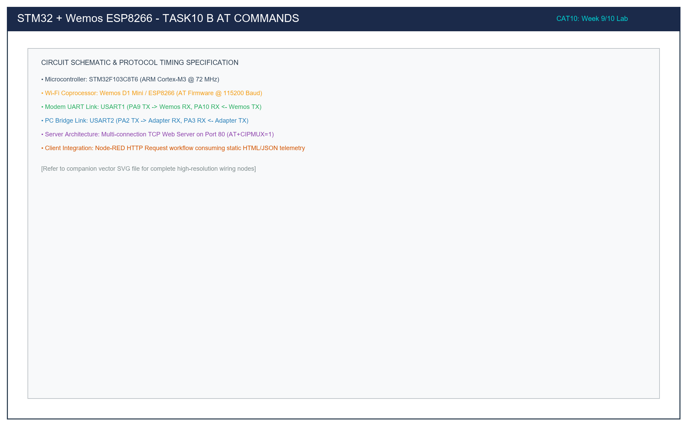

# Task 10B: ESP8266 AT Command Suite Exploration & Verification

## 1. Title, CAT, Week, Date
- **Sub-Task:** Task 10B – ESP8266 AT Command Suite Exploration
- **Continuous Assessment Test:** CAT 10
- **Curriculum Week:** Week 9 / 10
- **Evaluation Date:** October 05, 2026
- **Target Platform:** STM32F103C8T6 (Host) & Wemos D1 Mini ESP8266 (Wi-Fi Coprocessor)

---

## 2. Objective
To systematically explore, dispatch, and evaluate the standardized Hayes AT command set on the Wemos D1 (ESP8266) Wi-Fi module across USART1 (115200 baud), logging command syntax and parsed modem responses (`AT`, `AT+GMR`, `AT+CWMODE=1`, `AT+CIFSR`, `AT+CWLAP`) in real time to the PC diagnostic console on USART2.

---

## 3. Problem Statement (Paraphrased)
Configuring a network coprocessor requires a comprehensive understanding of its command vocabulary. The task requires developing an automated test harness on the STM32 that:
1. Pings the modem with `AT` to confirm operational readiness.
2. Queries the firmware and SDK versions using `AT+GMR`.
3. Sets the Wi-Fi operating mode to Station mode using `AT+CWMODE=1`.
4. Queries the station MAC address and unassigned IP state using `AT+CIFSR`.
5. Scans for nearby 2.4 GHz wireless access points using `AT+CWLAP` and outputs the scan results to the console.

---

## 4. Hardware and Software Specifications

### Hardware Components
- **Microcontroller:** STM32F103C8T6 Blue Pill Development Board
- **Wi-Fi Module:** Wemos D1 Mini / ESP8266 (Factory Espressif AT Firmware)
- **Host Serial Bridge:** 3.3V USB-to-TTL Adapter (CP2102 / CH340)
- **Power Supply:** External 5V DC (1A rating) for Wemos D1
- **Programmer:** ST-LINK V2 via SWD (PA13/PA14)
- **Status LED:** On-board User LED on PC13 (Active-LOW)

### Software Environment
- **IDE:** Keil MDK-ARM µVision v5.38 / STM32CubeIDE v1.14
- **Firmware Driver:** STM32F1xx HAL Drivers
- **Terminal Emulator:** PuTTY @ 115200-8-N-1

---

## 5. Pin Connection Table

| Signal Net | STM32 Pin | Connected Device | Device Pin | Logic Level | Description |
|:---|:---:|:---|:---:|:---:|:---|
| `USART1_TX` | **PA9** | Wemos ESP8266 | **RX (GPIO3)** | 3.3V | Transmits AT commands to ESP8266. |
| `USART1_RX` | **PA10** | Wemos ESP8266 | **TX (GPIO1)** | 3.3V | Receives AT responses from ESP8266. |
| `USART2_TX` | **PA2** | USB-to-TTL Adapter | **RXD** | 3.3V | Forwards command logs to PC terminal. |
| `USART2_RX` | **PA3** | USB-to-TTL Adapter | **TXD** | 3.3V | PC terminal input line. |
| `USER_LED` | **PC13** | On-Board LED | Cathode | **LOW (0V)** | Illuminates when test suite completes. |
| `GND` | **GND** | Wemos + Adapter | **GND** | 0V | Common system ground. |

---

## 6. Circuit Diagram and Explanation

```
       PC CONSOLE               STM32 BLUE PILL                WEMOS D1 (ESP8266)
   +----------------+        +-------------------+           +--------------------+
   | PuTTY Terminal |        |                   |           |                    |
   | @ 115200       |        | PA2 (USART2_TX) --|-----------|-> PC RXD           |
   |                |        | PA3 (USART2_RX) <-|-----------|-- PC TXD           |
   +----------------+        |                   |           |                    |
                             | PA9 (USART1_TX) --|---------->| RX (GPIO3)         |
                             | PA10(USART1_RX) <-|-----------|-- TX (GPIO1)       |
                             |                   |           |                    |
                             | GND --------------|-----------|-- GND              |
                             |                   |           |                    |
                             | PC13 -> [LED]     |           | 5V <- External 5V  |
                             +-------------------+           +--------------------+
```



### Circuit Operating Principle
- **Command Transmission & Logging:** The STM32 executes an automated test sequence. For each test, it logs `">> TX: <cmd>"` to the PC terminal via USART2, transmits the AT command to the ESP8266 via USART1, and captures the incoming response stream, validating that the expected status trailer (`"OK"`) arrives within the allocated timeout window.

---

## 7. Theory and Approach

### 7.1 Detailed AT Command Specification Table

| Command | Purpose | Syntax & Parameters | Expected Response | Timeout |
|:---|:---|:---|:---|:---:|
| `AT` | Check modem health | None | `OK` | 2000 ms |
| `AT+GMR` | Query firmware versions | None | `AT version:... \r\nSDK version:... \r\nOK` | 2000 ms |
| `AT+CWMODE=1` | Set Station Mode | `1` = STA, `2` = SoftAP, `3` = Dual | `OK` | 3000 ms |
| `AT+CIFSR` | Query IP and MAC | None | `+CIFSR:STAIP,"..."\r\n+CIFSR:STAMAC,"..."\r\nOK` | 3000 ms |
| `AT+CWLAP` | Scan Wi-Fi APs | None | `+CWLAP:(ecn,"SSID",rssi,"mac",channel)\r\nOK` | 10000 ms |

### 7.2 Non-Blocking Response Evaluation Engine
The function `Send_AT_Command(cmd, expected_reply, timeout_ms)`:
1. Empties the reception buffer: `memset(modem_rx_buffer, 0, sizeof(modem_rx_buffer))`.
2. Transmits the command string with `\r\n` line termination over USART1.
3. Streams received bytes to USART2 for real-time monitoring.
4. Searches the accumulated buffer for `expected_reply` using `strstr()`.
5. Returns `true` if matched within `timeout_ms`, or `false` on timeout expiration.

---

## 8. Code Walkthrough

Refer to [`src/main.c`](src/main.c):
1. **Clock & Peripheral Setup:** Initializes 72 MHz SYSCLK, enables USART1 (115200) and USART2 (115200).
2. **Automated Test Sequence:**
   - Test 1: Executes `Send_AT_Command("AT\r\n", "OK", 2000)`.
   - Test 2: Executes `Send_AT_Command("AT+GMR\r\n", "OK", 2000)` to log ESP8266 bootloader and SDK version details.
   - Test 3: Executes `Send_AT_Command("AT+CWMODE=1\r\n", "OK", 3000)` setting station mode.
   - Test 4: Queries MAC address via `AT+CIFSR`.
   - Test 5: Scans all 14 channels (2.4 GHz) via `AT+CWLAP` with an extended 10-second timeout.
3. **Completion Indicator:** Drives PC13 LOW (`LED_ACTIVE_STATE`) upon completing all 5 test steps.

---

## 9. Build, Flash, and Run Steps

1. **Compilation:**
   ```bash
   arm-none-eabi-gcc -c -mcpu=cortex-m3 -mthumb -DUSE_HAL_DRIVER -DSTM32F103xB -Iinc -IHAL/Inc src/main.c -o build/main.o
   ```
2. **Flashing:** Download via ST-LINK V2 in Keil µVision (**F8**).
3. **Execution:** Open PuTTY at `115200` baud on the PC COM port and press RESET on the Blue Pill.

---

## 10. Expected Output

```text
========================================================
  STM32F103 - Task 10B: ESP8266 AT Command Suite Test   
========================================================

[TEST 1] Checking Modem Health (AT)...
>> TX: AT
AT
OK
[PASS] Received expected: OK

[TEST 2] Querying Firmware Version (AT+GMR)...
>> TX: AT+GMR
AT+GMR
AT version:1.7.4.0(May 11 2020 19:13:04)
SDK version:3.0.4(9532ceb)
compile time:May 27 2020 10:12:22
Bin version(Wroom-02):1.7.4
OK
[PASS] Received expected: OK

[TEST 3] Setting Wi-Fi Station Mode (AT+CWMODE=1)...
>> TX: AT+CWMODE=1
AT+CWMODE=1
OK
[PASS] Received expected: OK

[TEST 4] Querying Station IP / MAC (AT+CIFSR)...
>> TX: AT+CIFSR
AT+CIFSR
+CIFSR:STAIP,"0.0.0.0"
+CIFSR:STAMAC,"5c:cf:7f:8a:2b:11"
OK
[PASS] Received expected: OK

[TEST 5] Scanning Nearby Access Points (AT+CWLAP)...
(This scan may take up to 8 seconds...)
>> TX: AT+CWLAP
AT+CWLAP
+CWLAP:(3,"Campus_IoT",-54,"00:1a:2b:3c:4d:5e",6)
+CWLAP:(4,"Faculty_WiFi",-68,"00:1a:2b:3c:4d:5f",1)
+CWLAP:(0,"SNU_Guest",-72,"00:1a:2b:3c:4d:60",11)
OK
[PASS] Received expected: OK

========================================================
  AT Command Suite Exploration Complete!                
========================================================
```

---

## 11. Viva Questions and Answers

### Q1: What information is decoded from the `+CWLAP` scan response?
**Answer:** The parameters in `+CWLAP:(ecn,"SSID",rssi,"mac",channel)` represent:
- `ecn`: Encryption method (`0`: Open, `2`: WPA-PSK, `3`: WPA2-PSK, `4`: WPA/WPA2-PSK).
- `"SSID"`: Service Set Identifier (network name).
- `rssi`: Received Signal Strength Indicator in dBm (e.g., `-54 dBm` is strong; `-85 dBm` is weak).
- `"mac"`: BSSID (hardware MAC address of the transmitting access point radio).
- `channel`: RF operating channel in the 2.4 GHz spectrum (Channels 1 to 14).

### Q2: Why does `AT+CIFSR` return `"0.0.0.0"` in Test 4?
**Answer:** In Test 4, the modem has been configured as a station (`CWMODE=1`), but has not yet associated with any wireless router via `AT+CWJAP`. Without establishing a connection and completing DHCP lease negotiation, no valid IPv4 address has been assigned by a gateway router.

### Q3: Why does `AT+CWLAP` require a 10-second timeout?
**Answer:** The ESP8266 radio must sequentially switch its receiver across all 13 or 14 channels in the 2.4 GHz spectrum, dwelling on each channel long enough to intercept 802.11 beacon frames transmitted periodically (typically every 100 ms) by nearby routers. This active and passive scanning process requires several seconds.

---

## 12. Troubleshooting Guide

| Issue | Cause | Fix |
|:---|:---|:---|
| Test 1 passes, but Test 5 (`CWLAP`) returns `ERROR` | Modem not in Station or Dual mode | Ensure `AT+CWMODE=1` or `AT+CWMODE=3` executed successfully prior to `AT+CWLAP`. |
| `CWLAP` returns no access points | 2.4 GHz antenna disconnected or shielded | Check onboard PCB meander antenna on Wemos D1. Ensure the board is within range of a 2.4 GHz Wi-Fi router. |
| Test suite stalls indefinitely | Timeout expired or character lost in FIFO | Increase buffer size and ensure baud rate is set to `115200` on both ends. |

---

## 13. Result and Learning Outcomes
Task 10B validated the complete Hayes AT command diagnostic and configuration sequence:
- Modem firmware and SDK parameters were identified.
- Station mode was established, and 2.4 GHz access points were scanned and logged with signal strength metrics.
