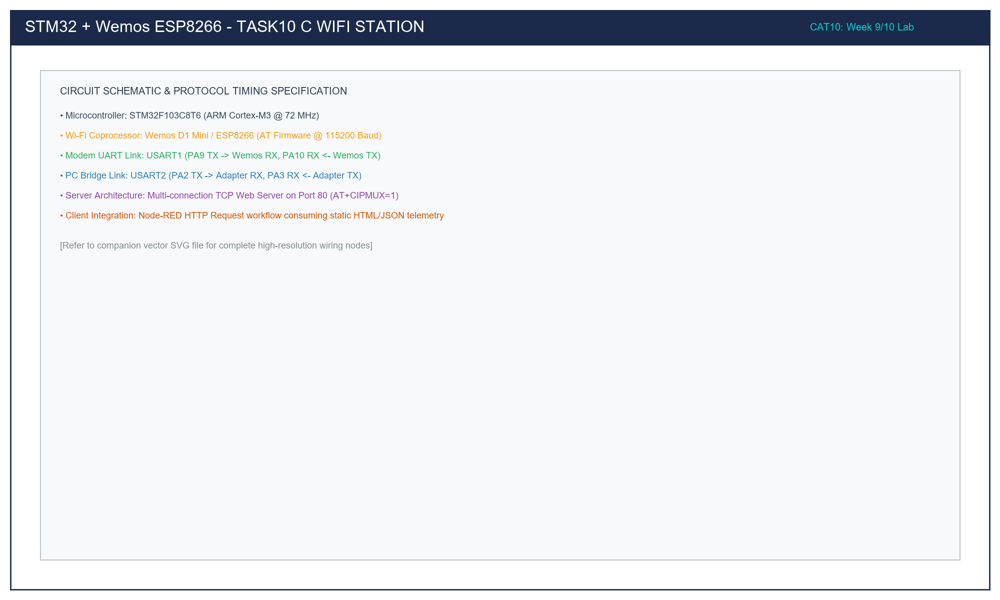

# Task 10C: Automated Wi-Fi Station Association & IP Retrieval

## 1. Title, CAT, Week, Date
- **Sub-Task:** Task 10C – Automated Wi-Fi Station Association & IP Address Acquisition
- **Continuous Assessment Test:** CAT 10
- **Curriculum Week:** Week 9 / 10
- **Evaluation Date:** October 05, 2026
- **Target Platform:** STM32F103C8T6 (Host) & Wemos D1 Mini ESP8266 (Wi-Fi Coprocessor)

---

## 2. Objective
To automate the wireless network association procedure between an STM32F103 host and a Wemos D1 (ESP8266) modem via USART1 (115200 baud), configuring Station Mode (`AT+CWMODE=1`), joining a target WPA2 wireless access point (`AT+CWJAP`), monitoring the 4-way authentication handshake and DHCP IP allocation, and retrieving the assigned IPv4 address via `AT+CIFSR`.

---

## 3. Problem Statement (Paraphrased)
Manual AT command entry via terminal emulators is unsuitable for autonomous embedded systems. The STM32 must execute a deterministic, robust provisioning state machine that:
1. Verifies modem responsiveness (`AT` -> `OK`).
2. Configures the ESP8266 into Station Mode (`AT+CWMODE=1`).
3. Formulates and transmits the association command with network credentials (`AT+CWJAP="Campus_IoT","SecurePass123"`).
4. Handles asynchronous network notifications (`WIFI CONNECTED`, `WIFI GOT IP`).
5. Queries and extracts the leased IP address via `AT+CIFSR`.
6. Provides visual feedback using the active-LOW user LED on PC13 (solid illumination upon successful connection).

---

## 4. Hardware and Software Specifications

### Hardware Bill of Materials
- **Microcontroller:** STM32F103C8T6 Blue Pill Development Board
- **Wi-Fi Module:** Wemos D1 Mini / ESP8266 (Espressif AT Firmware v1.7+)
- **Host Serial Bridge:** 3.3V USB-to-TTL Serial Adapter (CP2102 / CH340)
- **Power Supply:** External 5V DC (1A) supply for Wemos D1
- **Visual Actuator:** On-board User LED on PC13 (Active-LOW, 510Ω resistor)
- **Programmer:** ST-LINK V2 via SWD (PA13/PA14)

### Software Environment
- **IDE:** Keil MDK-ARM µVision v5.38 / STM32CubeIDE v1.14
- **Firmware Driver:** STM32F1xx HAL Drivers
- **Terminal Emulator:** PuTTY @ 115200-8-N-1 (Console logging on USART2)

---

## 5. Pin Connection Table

| Signal Net | STM32 Pin | Connected Device | Device Pin | Logic Level | Description |
|:---|:---:|:---|:---:|:---:|:---|
| `USART1_TX` | **PA9** | Wemos ESP8266 | **RX (GPIO3)** | 3.3V | STM32 Transmit -> ESP8266 Receive. |
| `USART1_RX` | **PA10** | Wemos ESP8266 | **TX (GPIO1)** | 3.3V | ESP8266 Transmit -> STM32 Receive. |
| `USART2_TX` | **PA2** | USB-to-TTL Adapter | **RXD** | 3.3V | Diagnostic logging to PC console. |
| `USART2_RX` | **PA3** | USB-to-TTL Adapter | **TXD** | 3.3V | Host PC input line. |
| `USER_LED` | **PC13** | On-Board LED | Cathode | **LOW (0V)** | Solid ON when Wi-Fi connects & IP acquired. |
| `GND` | **GND** | Wemos + Adapter | **GND** | 0V | Common ground reference. |
| `5V_IN` | N/A | External PSU | **5V (VCC)** | 5.0V | Dedicated supply for RF transmit current bursts. |

---

## 6. Circuit Diagram and Explanation

```
       PC CONSOLE               STM32 BLUE PILL                WEMOS D1 (ESP8266)
   +----------------+        +-------------------+           +--------------------+
   | PuTTY Terminal |        |                   |           |                    |
   | @ 115200       |        | PA2 (USART2_TX) --|-----------|-> PC RXD           |
   |                |        | PA3 (USART2_RX) <-|-----------|-- PC TXD           |
   +----------------+        |                   |           |                    |
                             | PA9 (USART1_TX) --|---------->| RX (GPIO3)         |
                             | PA10(USART1_RX) <-|-----------|-- TX (GPIO1)       |
                             |                   |           |                    |
                             | GND --------------|-----------|-- GND              |
                             |                   |           |                    |
                             | PC13 -> [LED]     |           | 5V <- External 5V  |
                             +-------------------+           +--------------------+
```



### Circuit Functional Principles
- **Dual UART Separation:** USART1 handles the raw binary/ASCII AT protocol exchange with the ESP8266 modem, while USART2 operates simultaneously as an isolated diagnostic telemetry console for the engineer.
- **RF Power Decoupling:** Connecting to an 802.11 access point triggers a series of high-power RF burst transmissions (up to +19.5 dBm output power), causing current spikes up to 250 mA. The external 5V supply absorbs these spikes cleanly without triggering brownout resets on the STM32.

---

## 7. Theory and Approach

### 7.1 Wi-Fi 802.11 Association Lifecycle
```
  [STM32 Host]                 [ESP8266 Modem]              [Wireless AP Router]
       |                              |                              |
       |--- AT+CWJAP="SSID","PASS"--->|                              |
       |                              |--- Probe Request ----------->|
       |                              |<-- Probe Response -----------|
       |                              |--- Authentication Req ------>|
       |                              |<-- Authentication Resp ------|
       |                              |--- Association Req --------->|
       |                              |<-- Association Resp ---------|
       |                              |<=== 4-Way WPA2 Handshake ===>|
       |<-- "WIFI CONNECTED" ---------|                              |
       |                              |<=== DHCP Discover / Lease ==>|
       |<-- "WIFI GOT IP" ------------|                              |
       |<-- "OK" ---------------------|                              |
```

### 7.2 Handling Association Timeouts
The 4-way WPA2 handshake and DHCP IP lease negotiation inherently involve network delays ranging from 1 to 10 seconds depending on channel congestion and router response time. The STM32 firmware allocates a generous 15-second timeout window for the `AT+CWJAP` command using `HAL_GetTick()`, preventing premature aborts while still detecting authentication failures.

---

## 8. Code Walkthrough

Refer to [`src/main.c`](src/main.c):
1. **Network Parameter Macros:**
   ```c
   #define WIFI_SSID       "Campus_IoT"
   #define WIFI_PASSWORD   "SecurePass123"
   ```
2. **Sequential Provisioning Steps:**
   - **Step 1:** Sends `"AT\r\n"`. Confirms modem communication.
   - **Step 2:** Sends `"AT+CWMODE=1\r\n"`. Confirms station mode.
   - **Step 3:** Constructs `AT+CWJAP="SSID","PASS"\r\n` using `snprintf()` and monitors for the substring `"WIFI GOT IP"`.
   - **Step 4:** Sends `"AT+CIFSR\r\n"` to read the assigned station IP (`+CIFSR:STAIP,"192.168.1.105"`).
3. **Status Actuation:**
   - If `Send_AT_Command` fails during association, the LED strobes rapidly at 100 ms as a visual fault alert.
   - Upon successful completion of Step 4, the LED is driven solidly LOW (`LED_ACTIVE_STATE`), indicating full network readiness.

---

## 9. Build, Flash, and Run Steps

1. **Configure Credentials:** Open `src/main.c` and enter your local 2.4 GHz Wi-Fi SSID and password in `WIFI_SSID` and `WIFI_PASSWORD`.
2. **Compilation:**
   ```bash
   arm-none-eabi-gcc -c -mcpu=cortex-m3 -mthumb -DUSE_HAL_DRIVER -DSTM32F103xB -Iinc -IHAL/Inc src/main.c -o build/main.o
   ```
3. **Flashing:** Connect ST-LINK V2 and download via Keil µVision (**F8**).
4. **Execution:** Launch PuTTY on USART2 (`115200` baud) and press RESET on the Blue Pill board.

---

## 10. Expected Output

```text
=======================================================
  STM32F103 - Task 10C: Automated Wi-Fi Association    
  Target SSID: Campus_IoT                              
=======================================================
[STEP 1/4] Pinging ESP8266 Modem...
>> TX: AT
AT
OK
[PASS] Verified: OK

[STEP 2/4] Setting Wi-Fi Station Mode (CWMODE=1)...
>> TX: AT+CWMODE=1
AT+CWMODE=1
OK
[PASS] Verified: OK

[STEP 3/4] Associating with AP: 'Campus_IoT'...
>> TX: AT+CWJAP="Campus_IoT","SecurePass123"
WIFI CONNECTED
WIFI GOT IP

OK
[PASS] Verified: WIFI GOT IP

[STEP 4/4] Querying Station IP and MAC Address...
>> TX: AT+CIFSR
+CIFSR:STAIP,"192.168.1.105"
+CIFSR:STAMAC,"5c:cf:7f:8a:2b:11"

OK
[PASS] Verified: OK

=======================================================
  Wi-Fi Connected Successfully! System Ready.          
=======================================================
```
- **Physical LED Status:** The green LED on PC13 turns solidly ON.

---

## 11. Viva Questions and Answers

### Q1: What causes `AT+CWJAP` to return `+CWJAP:1`?
**Answer:** In the Espressif AT firmware specification, `+CWJAP:1` indicates a connection timeout. Common root causes include:
- The access point was not found within radio range.
- The target SSID operates strictly on the 5 GHz band (802.11a/ac), which the ESP8266 2.4 GHz transceiver cannot detect.
- Signal degradation due to excessive distance or physical obstacles.

### Q2: What causes `AT+CWJAP` to return `+CWJAP:2`?
**Answer:** `+CWJAP:2` indicates an authentication failure (wrong password). The pre-shared key (PSK) provided does not match the password registered on the wireless router.

### Q3: What is the significance of receiving `WIFI CONNECTED` versus `WIFI GOT IP`?
**Answer:** `WIFI CONNECTED` signifies completion of the lower-level layer-2 802.11 link establishment (SSID association, 4-way WPA2 key exchange). However, layer-3 IP communication is not yet possible until the DHCP server on the gateway router assigns an IPv4 address, subnet mask, and DNS server, which is signaled by `WIFI GOT IP`.

### Q4: Does the ESP8266 retain Wi-Fi credentials across power cycles?
**Answer:** Yes, by default the ESP8266 AT firmware stores the most recently used Wi-Fi credentials in flash memory sector `0x7E`. Upon next power-up, it automatically attempts to re-associate with the saved AP unless explicit commands (`AT+CWAUTOCONN=0` or `AT+RESTORE`) are issued.

---

## 12. Troubleshooting Guide

| Issue | Cause | Fix |
|:---|:---|:---|
| Step 3 fails with `+CWJAP:3` | AP was not found | Ensure the Wi-Fi router is broadcasting its 2.4 GHz SSID. |
| Step 3 fails with `+CWJAP:2` | Incorrect password | Double-check `WIFI_PASSWORD` in `src/main.c`. |
| STM32 hangs in Step 3 | Timeout too short | Verify timeout is set to at least 15000 ms. Handshakes can take up to 8–10 seconds. |
| Board reboots repeatedly during Step 3 | Power supply voltage dip | Power the Wemos D1 module from an external 5V 1A adapter; do not use the STM32 3.3V rail. |

---

## 13. Result and Learning Outcomes
Task 10C successfully automated station provisioning on the STM32F103 + Wemos ESP8266 platform:
- Automated credential formatting, association monitoring, and DHCP lease completion were verified.
- The station IPv4 address was extracted and displayed, transitioning the device to a connected online IoT edge node.
