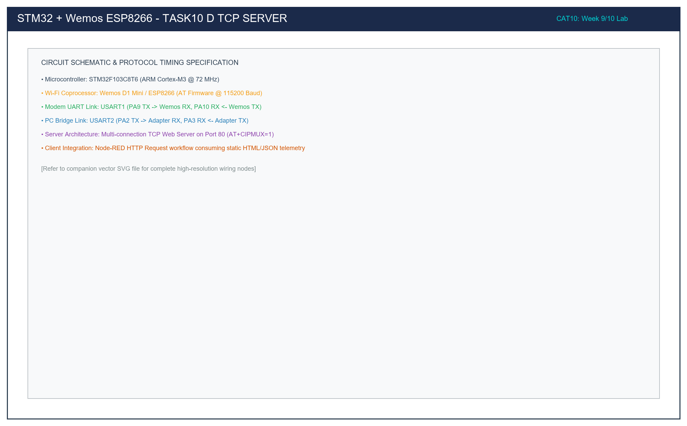

# Task 10D: Multi-Connection TCP Web Server & 2-Step CIPSEND HTTP Response

## 1. Title, CAT, Week, Date
- **Sub-Task:** Task 10D – Embedded TCP Web Server & 2-Step CIPSEND HTTP Processing
- **Continuous Assessment Test:** CAT 10
- **Curriculum Week:** Week 9 / 10
- **Evaluation Date:** October 05, 2026
- **Target Platform:** STM32F103C8T6 (Host) & Wemos D1 Mini ESP8266 (Wi-Fi Coprocessor)

---

## 2. Objective
To configure the Wemos D1 (ESP8266) modem into a multi-connection TCP Web Server listening on standard HTTP Port 80 (`AT+CIPMUX=1`, `AT+CIPSERVER=1,80`), monitor incoming client socket connections (`+IPD`), calculate the accurate `Content-Length` of dynamic HTML payloads, and execute the strict 2-step `AT+CIPSEND` streaming transaction to serve web pages to browsers and IoT clients.

---

## 3. Problem Statement (Paraphrased)
Developing an embedded HTTP server on resource-constrained microcontrollers requires managing asynchronous network sockets over serial lines. The application must:
1. Initialize the ESP8266 modem into multi-connection mode (`AT+CIPMUX=1`).
2. Bind and activate a TCP listening socket on port 80 (`AT+CIPSERVER=1,80`).
3. Intercept inbound HTTP `GET` requests signaled via modem `+IPD` frames.
4. Extract the active connection ID (0 to 4).
5. Build an HTTP/1.1 200 OK response with an HTML document and compute its exact byte length.
6. Execute the 2-step `CIPSEND` sequence: declare the byte length, await the `'> '` modem prompt, and stream the raw payload.
7. Terminate the socket cleanly via `AT+CIPCLOSE=<id>`.

---

## 4. Hardware and Software Specifications

### Hardware Components
- **Microcontroller:** STM32F103C8T6 Blue Pill Development Board
- **Wi-Fi Coprocessor:** Wemos D1 Mini / ESP8266 (Espressif AT Firmware)
- **Host Serial Bridge:** 3.3V USB-to-TTL Serial Adapter (CP2102 / CH340)
- **Power Supply:** External 5V DC (1A rating) for Wemos D1
- **Programmer:** ST-LINK V2 via SWD (PA13/PA14)
- **Actuator:** On-board User LED on PC13 (Active-LOW, toggles on HTTP request)

### Software Environment
- **IDE:** Keil MDK-ARM µVision v5.38 / STM32CubeIDE v1.14
- **Firmware Driver:** STM32F1xx HAL Drivers
- **Web Browser:** Google Chrome / Mozilla Firefox / Microsoft Edge
- **Terminal Emulator:** PuTTY @ 115200-8-N-1 (USART2 console monitoring)

---

## 5. Pin Connection Table

| Signal Net | STM32 Pin | Connected Device | Device Pin | Logic Level | Description |
|:---|:---:|:---|:---:|:---:|:---|
| `USART1_TX` | **PA9** | Wemos ESP8266 | **RX (GPIO3)** | 3.3V | STM32 HTTP responses to ESP8266. |
| `USART1_RX` | **PA10** | Wemos ESP8266 | **TX (GPIO1)** | 3.3V | ESP8266 client requests (`+IPD`) to STM32. |
| `USART2_TX` | **PA2** | USB-to-TTL Adapter | **RXD** | 3.3V | Diagnostic logging to PC terminal. |
| `USART2_RX` | **PA3** | USB-to-TTL Adapter | **TXD** | 3.3V | PC terminal input line. |
| `USER_LED` | **PC13** | On-Board LED | Cathode | **LOW (0V)** | Toggles whenever an HTTP request is serviced. |
| `GND` | **GND** | Wemos + Adapter | **GND** | 0V | Common ground reference. |
| `5V_IN` | N/A | External PSU | **5V (VCC)** | 5.0V | High-current power rail for RF transmissions. |

---

## 6. Circuit Diagram and Explanation

```
   WEB BROWSER (CLIENT)             WEMOS D1 (ESP8266)                 STM32F103 (SERVER)
  +--------------------+         +-----------------------+           +----------------------+
  | Chrome / Firefox   |         | TCP Port 80 Server    |           |                      |
  | http://192.168.x.x | ===Wi-Fi| Parses GET request    |           |                      |
  |                    |         | Emits: +IPD,0,len:GET |---USART1->| Intercepts +IPD      |
  |                    |         |                       |           | Computes HTML length |
  |                    |         | Awaits CIPSEND=0,len  |<-USART1---| Sends CIPSEND=0,len  |
  |                    |         | Emits prompt: '> '    |---USART1->| Detects '> '         |
  |                    |         | Ingests raw HTTP body |<-USART1---| Streams HTTP payload |
  | Displays Webpage   |<=Wi-Fi==| Transmits HTTP/1.1    |           | Closes socket:       |
  | "Status: ONLINE"   |         | Closes TCP link       |<-USART1---| CIPCLOSE=0           |
  +--------------------+         +-----------------------+           +----------------------+
```



### Circuit Operating Principle
1. When a browser initiates a connection to `http://<ESP_IP>/`, the ESP8266 TCP stack accepts the connection on port 80, allocates link ID `0`, and forwards the HTTP request header over USART1 as `+IPD,0,385:GET / HTTP/1.1...`.
2. The STM32 parses the link ID (`0`), formats an HTTP/1.1 response with strict `Content-Length`, executes the 2-step `CIPSEND` handshake, and streams the webpage data back to the client.

---

## 7. Theory and Approach

### 7.1 Detailed 2-Step `CIPSEND` Protocol Mechanics
```
  [STM32 Host]                            [ESP8266 Modem]                [Remote Client]
       |                                         |                              |
       |<-- "+IPD,0,385:GET / HTTP/1.1\r\n..." --|                              |
       |                                         |                              |
       |--- "AT+CIPSEND=0,285\r\n" ------------->|                              |
       |    (Declares 285 bytes to transmit)     |                              |
       |                                         |                              |
       |<-- "\r\nOK\r\n> " ----------------------|                              |
       |    (Modem is ready for raw data)        |                              |
       |                                         |                              |
       |--- [Stream 285 raw HTTP bytes] -------->|                              |
       |                                         |=== Stream HTTP to Client ===>|
       |<-- "SEND OK\r\n" -----------------------|                              |
       |                                         |                              |
       |--- "AT+CIPCLOSE=0\r\n" ---------------->|                              |
       |                                         |=== FIN / ACK Handshake =====>|
```

### 7.2 Content-Length Synchronization
HTTP/1.1 requires accurate byte-level payload accounting:
$$\text{Total CIPSEND Length} = \text{strlen(HTTP\_Headers)} + \text{strlen(HTML\_Body)}$$
If the declared length in `AT+CIPSEND` does not match the actual number of streamed characters byte-for-byte, the modem either hangs indefinitely awaiting more bytes or truncates the HTML document, causing socket stalls.

---

## 8. Code Walkthrough

Refer to [`src/main.c`](src/main.c):
1. **Server Setup:**
   - Dispatches `AT+CIPMUX=1` to allow up to 5 concurrent socket connections (IDs 0–4).
   - Dispatches `AT+CIPSERVER=1,80` to bind TCP port 80.
2. **Inbound Request Processing:**
   - Scans incoming buffer for `+IPD,`.
   - Extracts link ID using `sscanf(ipd_ptr, "+IPD,%d,", &link_id)`.
3. **HTTP Response Generation (`Handle_HTTP_Client`):**
   - Populates `html_body` with responsive HTML code including an auto-refresh tag (`<meta http-equiv='refresh' content='5'>`).
   - Uses `snprintf` to format the full response, automatically injecting `Content-Length: %d`.
   - Sends `AT+CIPSEND=<id>,<len>\r\n`.
   - Awaits the `'> '` prompt within a 2-second timeout.
   - Streams `http_payload` over `huart1`.
   - Issues `AT+CIPCLOSE=<id>\r\n` to complete the transaction and release socket resources.

---

## 9. Build, Flash, and Run Steps

1. **Compilation:**
   ```bash
   arm-none-eabi-gcc -c -mcpu=cortex-m3 -mthumb -DUSE_HAL_DRIVER -DSTM32F103xB -Iinc -IHAL/Inc src/main.c -o build/main.o
   ```
2. **Flashing:** Connect ST-LINK V2 and download via Keil µVision (**F8**).
3. **Execution & Access:**
   - Observe the station IP address printed in PuTTY (e.g. `192.168.1.105`).
   - Open any browser on the same Wi-Fi network and navigate to `http://192.168.1.105/`.
   - Observe the HTML status page rendering on screen, and observe the PC13 LED toggling with each reload.

---

## 10. Expected Output

### Terminal Log during Inbound Request
```text
=======================================================
  STM32F103 - Task 10D: Embedded TCP Web Server (Pt 80)
=======================================================
[SETUP] Enabling Multiple Connections (CIPMUX=1)...
>> TX: AT+CIPMUX=1
OK
[SETUP] Starting TCP Web Server on Port 80 (CIPSERVER=1,80)...
>> TX: AT+CIPSERVER=1,80
OK
[READY] Web Server listening for HTTP clients on port 80!
Point your browser or Node-RED client to http://192.168.1.105/

[HTTP] Inbound connection detected! Link ID: 0
>> TX: AT+CIPSEND=0,384
[CIPSEND] Prompt '>' received. Streaming HTTP response payload...
[HTTP] Client socket closed successfully.
```

### Browser Rendered Webpage
```html
STM32 + Wemos ESP8266 Web Server
Status: ONLINE & RESPONSIVE
Platform: STM32F103 Blue Pill @ 72 MHz
Port: TCP 80 | Protocol: HTTP/1.1 200 OK
```

---

## 11. Viva Questions and Answers

### Q1: Why does `AT+CIPSERVER` fail if `AT+CIPMUX=1` was not called beforehand?
**Answer:** The ESP8266 AT firmware requires multiple-connection mode (`CIPMUX=1`) for server operation so that the listening daemon can accept incoming connections and spawn distinct socket channels (link IDs 0 to 4) for each client. In single-connection mode (`CIPMUX=0`), the modem can only act as a single client, causing `AT+CIPSERVER` to reject configuration with an `ERROR`.

### Q2: Why is `AT+CIPCLOSE` explicitly executed after transmitting the payload?
**Answer:** HTTP/1.0 and non-persistent HTTP/1.1 connections rely on server-side connection closure to signal the end of the HTTP transaction. If `AT+CIPCLOSE` is omitted, the client browser maintains an open TCP socket waiting for possible additional data, causing the browser loading spinner to persist until a network timeout occurs.

### Q3: What is the maximum payload size supported in a single `AT+CIPSEND` command?
**Answer:** In the standard Espressif AT firmware, a single `AT+CIPSEND` frame can transmit up to 2048 bytes ($2\text{ KB}$). For payloads exceeding 2048 bytes, the data must be segmented into multiple sequential `CIPSEND` packets before closing the connection.

### Q4: How does the server handle multiple browsers connecting at the same instant?
**Answer:** Because `CIPMUX=1` is active, the ESP8266 hardware accepts up to 5 concurrent sockets, allocating distinct link IDs (0, 1, 2, 3, 4). The STM32 parses the specific link ID embedded in the `+IPD,<id>,<len>:` header and directs the `CIPSEND` response to that specific client channel.

---

## 12. Troubleshooting Guide

| Issue | Cause | Fix |
|:---|:---|:---|
| Browser shows "This site can’t be reached" | IP address changed or Wi-Fi disconnected | Run Task 10C or query `AT+CIFSR` to verify current IP address; verify PC is on same Wi-Fi subnet. |
| Page renders half-way or hangs loading | Mismatch in `Content-Length` | Verify `body_length` calculation; ensure `Content-Length` matches exact byte count of HTML body. |
| `CIPSEND` returns `busy p...` | Modem busy servicing prior transaction | Increase timeout before subsequent `CIPSEND` or ensure socket is closed via `AT+CIPCLOSE`. |

---

## 13. Result and Learning Outcomes
Task 10D deployed a multi-connection HTTP Web Server on the STM32F103 + Wemos ESP8266 platform:
- Inbound `+IPD` socket events were parsed on TCP port 80.
- The 2-step `CIPSEND` protocol was implemented with accurate `Content-Length` headers, serving responsive HTML pages to client browsers.
