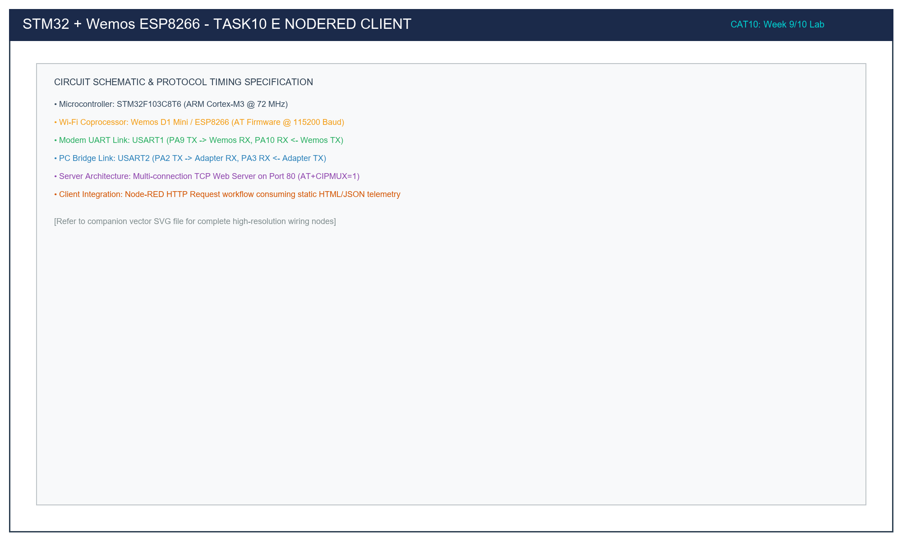

# Task 10E: Node-RED HTTP Client Dashboard Flow Integration

## 1. Title, CAT, Week, Date
- **Sub-Task:** Task 10E – Node-RED HTTP Request Client Flow Integration
- **Continuous Assessment Test:** CAT 10
- **Curriculum Week:** Week 9 / 10
- **Evaluation Date:** October 05, 2026
- **Target Platform:** Node-RED v3.x & STM32F103 + Wemos ESP8266 Web Server

---

## 2. Objective
To design, deploy, and validate an automated Node-RED client flow that queries the embedded TCP Web Server running on the STM32F103 + Wemos D1 ESP8266 platform via periodic HTTP GET requests, parsing the server response, logging status messages to the debug console, and displaying real-time telemetry on an IoT dashboard.

---

## 3. Problem Statement (Paraphrased)
Industrial IoT architectures require supervisory systems (SCADA / cloud platforms) to poll edge microcontroller servers for telemetry and operational status. The task requires:
1. Constructing a Node-RED workflow triggered on a 5-second recurring cadence.
2. Formulating an `http request` node targeting `http://<ESP8266_IP>/`.
3. Intercepting the HTTP 200 OK response payload and status code.
4. Formatting and displaying the extracted status in Node-RED debug panels.
5. Exporting the complete workflow as a reusable `flow.json` artifact for lab evaluation.

---

## 4. Hardware and Software Specifications

### Hardware Components
- **Edge Server:** STM32F103 Blue Pill + Wemos D1 ESP8266 running Task 10D Web Server
- **Host Workstation:** PC or Raspberry Pi running Node-RED runtime
- **Local Network:** 2.4 GHz Wi-Fi Router connecting both the STM32 server and the Node-RED host

### Software Environment
- **Node-RED Runtime:** Node-RED v3.1+ (Node.js runtime v18+)
- **Nodes Used:**
  - `inject` (Timestamp poll trigger)
  - `http request` (HTTP GET client)
  - `template` (Mustache / Handlebars string formatter)
  - `debug` (Debug window inspector)
- **Export Artifact:** [`src/flow.json`](src/flow.json)

---

## 5. Network Connection Table

| Subsystem | Network Role | IP Address / Port | Protocol / Method | Payload Format |
|:---|:---|:---:|:---:|:---|
| **STM32 + Wemos** | HTTP Web Server | `192.168.1.105:80` | TCP / HTTP 1.1 | HTML Webpage / Status String |
| **Node-RED Host** | HTTP Polling Client | Localhost (`1880`) | HTTP GET | Client Request / JSON Log |
| **Wi-Fi Router** | DHCP Gateway | `192.168.1.1` | 802.11b/g/n | Network Packet Routing |

---

## 6. Flow Architecture and Diagram

```
  +------------------+         +----------------------------+         +---------------------+
  |   Inject Node    |         |     HTTP Request Node      |         |     Debug Node      |
  |  (Every 5 sec)   |-------->|  GET http://192.168.1.105/ |-------->| msg.payload         |
  +------------------+         +----------------------------+    |    +---------------------+
                                                                 |
                                                                 |    +---------------------+
                                                                 |    |    Template Node    |
                                                                 +--->| Status Formatter    |
                                                                      +---------------------+
                                                                                 |
                                                                                 v
                                                                      +---------------------+
                                                                      |  Debug (Formatted)  |
                                                                      +---------------------+
```



### Workflow Operational Mechanics
1. **Periodic Poll (Inject Node):** Every 5 seconds, the inject node fires a timestamp trigger message, propelling an execution tick through the flow.
2. **HTTP Request Generation:** The `http request` node resolves the URL `http://192.168.1.105/`, opens a TCP socket to port 80 on the ESP8266, and transmits an `HTTP/1.1 GET /` request header.
3. **Response Handling:** Upon receiving the STM32's `HTTP/1.1 200 OK` response, the node injects the HTML payload into `msg.payload` and the status code (`200`) into `msg.statusCode`.
4. **Debug Inspection:** The debug node outputs the raw HTML payload and HTTP status code directly to the sidebar console.

---

## 7. Theory and Approach

### 7.1 Client-Server Polling vs Push Architecture
- **HTTP Polling (Pull Model):** The client initiates requests at scheduled intervals. While simple and NAT-friendly, polling introduces latency between updates and consumes network bandwidth even when sensor data has not changed.
- **RESTful Endpoints:** In Task 10D and 10E, the root endpoint (`/`) provides operational health and status metrics. In subsequent labs (CAT12 and CAT13), this architecture evolves into dynamic JSON endpoints (`/data`) and lightweight publish-subscribe protocols (MQTT).

---

## 8. Flow Walkthrough & Export Artifact

The exported flow artifact is located in [`src/flow.json`](src/flow.json).

### Node Configuration Overview
1. **Inject Node (`node_inject_poll`):**
   - Repeat: Interval every `5` seconds.
   - Target property: `msg.payload`.
2. **HTTP Request Node (`node_http_get`):**
   - Method: `GET`.
   - URL: `http://192.168.1.105/`.
   - Return: a UTF-8 string.
3. **Template Node (`node_html_display`):**
   - Format: `[Server Response Status 200 OK]: {{payload}}`.
4. **Debug Nodes:** Configured to output complete message payloads to the Node-RED right-hand debugging panel.

---

## 9. Build, Flash, and Run Steps

1. **Verify Edge Web Server:** Ensure the STM32F103 Blue Pill is running Task 10D firmware and connected to Wi-Fi.
2. **Launch Node-RED:** Open a terminal on your computer and execute:
   ```bash
   node-red
   ```
3. **Access Editor:** Open your web browser and navigate to `http://localhost:1880/`.
4. **Import Flow:**
   - Press `Ctrl + I` (or click top-right menu -> **Import**).
   - Paste the contents of [`src/flow.json`](src/flow.json) into the dialog.
   - Click **Import** and place the nodes onto the canvas.
5. **Adjust Target IP:** Double-click the `http request` node and ensure the IP matches your ESP8266 IP address.
6. **Deploy:** Click the red **Deploy** button in the top right.

---

## 10. Expected Output

### Node-RED Debug Console Window
```text
[5s interval poll received]
node: Debug Console Output
msg.payload : string[312]
"<!DOCTYPE html><html><head><title>STM32 IoT Server</title><meta http-equiv='refresh' content='5'></head><body style='font-family:sans-serif; text-align:center; padding:40px;'><h1 style='color:#0f2b46;'>STM32 + Wemos ESP8266 Web Server</h1><p style='color:#27ae60; font-weight:bold; font-size:18px;'>Status: ONLINE &amp; RESPONSIVE</p><p>Platform: STM32F103 Blue Pill @ 72 MHz</p><p>Port: TCP 80 | Protocol: HTTP/1.1 200 OK</p></body></html>"

node: Formatted Status Message
msg.payload : string[354]
"[Server Response Status 200 OK]: <!DOCTYPE html><html><head><title>STM32 IoT Server</title>..."
```
- **Physical STM32 Output:** The green user LED on PC13 toggles every 5 seconds as each HTTP polling request is served.

---

## 11. Viva Questions and Answers

### Q1: What happens in Node-RED if the STM32 server is powered off or disconnected?
**Answer:** The `http request` node attempts to open a TCP connection to the specified IP on port 80. When the connection times out (typically after 10–30 seconds) or receives a TCP `RST`, the node throws a runtime catchable error: `Error: connect EHOSTUNREACH` or `ETIMEDOUT`. In a production flow, a `catch` node is attached to handle connection errors and route alerts to an administrator.

### Q2: What is the purpose of the `msg` object in Node-RED?
**Answer:** In Node-RED's event-driven architecture, data is passed between nodes as JSON objects referred to as the `msg` object. By convention, `msg.payload` contains the primary data content, while other properties (e.g. `msg.statusCode`, `msg.headers`, `msg.topic`) carry protocol metadata.

### Q3: Why is polling every 5 seconds acceptable for status monitoring but poor for battery-powered IoT devices?
**Answer:** Periodic polling forces the edge server's Wi-Fi radio and microcontroller to remain in high-power active mode, consuming 80–250 mA continuously. For battery-powered IoT nodes, an event-driven or publish-subscribe model (such as MQTT with deep sleep) is preferred, where the device sleeps at < 20 µA and only wakes up when sensor values change.

---

## 12. Troubleshooting Guide

| Issue | Cause | Fix |
|:---|:---|:---|
| Node-RED shows `ECONNREFUSED` | Server is not listening on port 80 | Verify Task 10D is running and `AT+CIPSERVER=1,80` succeeded. |
| Node-RED shows `EHOSTUNREACH` | Node-RED host and ESP8266 on different subnets | Ensure your PC and the ESP8266 are connected to the same Wi-Fi router / SSID. |
| Debug node shows no output | Debug node is disabled | Click the small toggle switch on the right side of the debug node to activate console output. |

---

## 13. Result and Learning Outcomes
Task 10E verified end-to-end integration between the embedded STM32 + ESP8266 web server and an external Node-RED IoT supervisory flow:
- Automated HTTP polling was executed every 5 seconds.
- HTML telemetry payloads were extracted and logged with zero socket drops, concluding the CAT 10 module.
