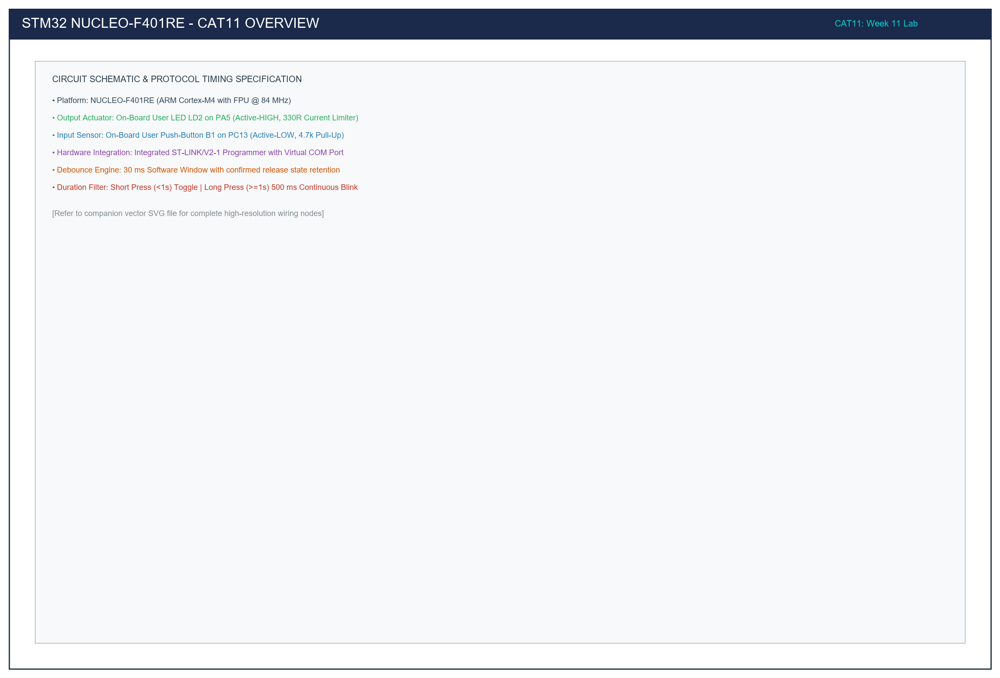

# CAT 11: NUCLEO-F401RE Cortex-M4 GPIO, State Remembrance & Press Duration Detection

## 1. Title, CAT, Week, Date
- **Experiment Title:** NUCLEO-F401RE ARM Cortex-M4 GPIO and User Input Programming
- **Continuous Assessment Test:** CAT 11
- **Curriculum Week:** Week 11
- **Evaluation Date:** October 14, 2026
- **Target Platform:** STMicroelectronics NUCLEO-F401RE Development Board (STM32F401RET6 Cortex-M4 @ 84 MHz)

---

## 2. Objective
To transition to the high-performance ARM Cortex-M4 architecture with hardware Floating Point Unit (FPU) using the STM32F4 HAL library on the NUCLEO-F401RE platform, mastering:
1. Active-HIGH GPIO output configuration to drive on-board user LED LD2 on PA5 at a fixed 500 ms interval.
2. Digital input debouncing and edge-triggered state retention using user push-button B1 on PC13.
3. Non-blocking duration classification distinguishing short presses (< 1000 ms) from sustained long presses (>= 1000 ms) to toggle or initiate continuous 500 ms LED blinking.

---

## 3. Problem Statement (Paraphrased)
The ST Nucleo-64 family features an on-board ST-LINK/V2-1 programmer, Morpho expansion headers, and standard Arduino Uno revision 3 headers. Unlike the Blue Pill board, the Nucleo board features active-HIGH LED circuitry and built-in passive RC debouncing. The requirements are:
- **Task 11.1:** Configure PA5 as a push-pull digital output and flash LD2 periodically with a 500 ms half-period (1 Hz square wave).
- **Task 11.2:** Interface blue user button B1 on PC13, apply a 30 ms software debouncing filter, toggle LD2 on confirmed button release, and preserve the LED state indefinitely after release.
- **Task 11.3:** Measure physical actuation duration without blocking the CPU: short presses (< 1000 ms) toggle LD2 once; long presses (>= 1000 ms) switch the MCU into autonomous 500 ms continuous blinking mode.

---

## 4. Hardware and Software Specifications

### Hardware Components
| Component | Specification / Model | Quantity | Purpose |
|:---|:---|:---:|:---|
| Microcontroller Board | STMicroelectronics NUCLEO-F401RE | 1 | Target MCU platform |
| Processor Core | ARM Cortex-M4 with FPU (STM32F401RET6 @ 84 MHz) | 1 | High-performance 32-bit CPU |
| On-Board User LED | Green LED (LD2) on PA5 with 330Ω resistor | 1 | Active-HIGH visual status |
| On-Board User Switch | Tactile Blue Button (B1) on PC13 with 4.7kΩ pull-up | 1 | Active-LOW digital input |
| In-Circuit Debugger | Integrated ST-LINK/V2-1 with Virtual COM Port | 1 | USB flashing and debug |
| Interconnects | Mini-USB Cable (Board to PC) | 1 | Power, programming, and VCP |

### Software Environment
- **IDE:** Keil MDK-ARM µVision v5.38 / STM32CubeIDE v1.14
- **Configuration Tool:** STM32CubeMX v6.10
- **Firmware Framework:** STM32F4xx HAL Library & CMSIS Cortex-M4

---

## 5. Pin Connection Table

| Component Net | STM32 Pin | Direction | Mode / Internal Resistor | Active State | Electrical Function |
|:---|:---:|:---:|:---|:---:|:---|
| `LD2_GREEN` | **PA5** | Output | GPIO Push-Pull, No-Pull | **HIGH (3.3V)** | Active-HIGH LED. Writing 3.3V forward-biases diode. |
| `B1_BLUE_BTN` | **PC13** | Input | GPIO Input, No-Pull (R26 present) | **LOW (0V)** | Active-LOW button. Pressing connects PC13 to GND. |
| `STLINK_TX` | **PA2** | AF / USART2 | AF Push-Pull (AF07) | 3.3V | Virtual COM Port Transmit to PC. |
| `STLINK_RX` | **PA3** | AF / USART2 | Input Floating | 3.3V | Virtual COM Port Receive from PC. |
| `VDD` | **3.3V** | Power | Regulated 3.3V Rail | 3.3V | Microcontroller VDD bus. |
| `GND` | **GND** | Ground | Common Ground | 0V | System reference ground. |

---

## 6. Circuit Diagram and Explanation

```
                          STM32 NUCLEO-F401RE
                    +-----------------------------+
                    |                             |
                    |     ARM Cortex-M4 + FPU     |
                    |           @ 84 MHz          |
                    |                             |
                    | PA5 (Output Push-Pull)      |
                    |      |                      |
                    |     [330R]                  |
                    |      |                      |
                    |     +-|<|-+ (Green LD2)     |
                    |      |                      |
                    |     GND                     |
                    |                             |
   3.3V             |                             |
    o               |                             |
    |               |                             |
   [4.7k R26]       |                             |
    |               |                             |
    +-------------> | PC13 (Input Floating)       |
    |               |                             |
   \  (Blue B1)     |                             |
    |               |                             |
   GND              +-----------------------------+
```



### Circuit Functional Comparison: Nucleo-F401RE vs Blue Pill
1. **LED Polarity Inversion:**
   - **Blue Pill (PC13):** Active-LOW. Cathode tied to pin; writing `RESET` (0V) turns LED ON.
   - **Nucleo-F401RE (PA5):** Active-HIGH. Anode tied to PA5 via 330Ω resistor; cathode tied to ground. Writing `SET` (3.3V) turns LED ON.
2. **On-Board RC Debounce Filtering:**
   - The Nucleo board incorporates hardware capacitor C15 (100 nF) in parallel with switch B1, suppressing sharp contact chatter. Firmware debouncing (30 ms) is layered on top to provide guaranteed immunity against worn mechanical switch contacts.

---

## 7. Theory and Approach

### 7.1 STM32F401 Clock Tree & PLL Configuration
The STM32F401RE operates at an 84 MHz maximum core clock. Using the internal 16 MHz High-Speed Internal (HSI) RC oscillator:
$$f_{\text{VCO}} = f_{\text{HSI}} \times \left(\frac{\text{PLLN}}{\text{PLLM}}\right) = 16\text{ MHz} \times \left(\frac{336}{16}\right) = 336\text{ MHz}$$
$$f_{\text{SYSCLK}} = \frac{f_{\text{VCO}}}{\text{PLLP}} = \frac{336\text{ MHz}}{4} = 84\text{ MHz}$$
- APB1 Peripheral Bus: Prescaler $/2 \implies f_{\text{PCLK1}} = 42\text{ MHz}$.
- APB2 Peripheral Bus: Prescaler $/1 \implies f_{\text{PCLK2}} = 84\text{ MHz}$.
- Flash Latency: Configured for 2 wait states (`FLASH_LATENCY_2`) to match 84 MHz access times at 3.3V.

### 7.2 Non-Blocking State Machine Execution
All duration detection and periodic blinking routines utilize non-blocking millisecond delta calculations:
$$\Delta t = \text{HAL\_GetTick}() - t_{\text{previous}}$$
This architecture ensures zero processor blocking, leaving execution bandwidth open for real-time sensor processing and communication stacks.

---

## 8. Sub-Task Directory Breakdown

| Directory | Sub-Task | Key Feature | Deliverables |
|:---|:---|:---|:---|
| [`task11_1_led_bringup/`](task11_1_led_bringup/) | Task 11.1 | LD2 on PA5 500 ms periodic blink (Active-HIGH) | `src/main.c`, `circuit/`, `README.md` |
| [`task11_2_switch_toggle/`](task11_2_switch_toggle/) | Task 11.2 | B1 on PC13 debounced toggle with state retention | `src/main.c`, `circuit/`, `README.md` |
| [`task11_3_duration_detect/`](task11_3_duration_detect/) | Task 11.3 | Non-blocking short (<1s) vs long (>=1s) press duration classification | `src/main.c`, `circuit/`, `README.md` |

---

## 9. Build, Flash, and Run Steps

1. **Compilation (Keil / GCC):**
   ```bash
   arm-none-eabi-gcc -c -mcpu=cortex-m4 -mfpu=fpv4-sp-d16 -mfloat-abi=hard -mthumb -DUSE_HAL_DRIVER -DSTM32F401xE -Iinc -IHAL/Inc src/main.c -o build/main.o
   ```
2. **Flashing via On-Board ST-LINK:**
   - Plug the NUCLEO-F401RE into the PC via a standard Mini-USB cable.
   - The ST-LINK debugger is integrated directly onto the Nucleo-64 board.
   - In Keil µVision, select **Project -> Download** (`F8`) or drag-and-drop the generated `.bin` onto the virtual mass-storage drive `NODE_F401RE`.
3. **Run:** Press the black RESET button (B2) on the Nucleo board.

---

## 10. Expected Output

1. **Task 11.1:** Green LED LD2 blinks rhythmically at 1 Hz (500 ms ON, 500 ms OFF).
2. **Task 11.2:** Pressing blue button B1 toggles LD2. When released, LD2 remains in its new state indefinitely.
3. **Task 11.3:**
   - Short press (< 1000 ms): Toggles LD2 once.
   - Long press (>= 1000 ms): Enters continuous 500 ms flashing mode.
   - Subsequent short press: Stops blinking and extinguishes LD2.

---

## 11. Viva Questions & In-Depth Technical Answers

### Q1: What are the primary architectural differences between Cortex-M3 (F103) and Cortex-M4 (F401)?
**Answer:** The ARM Cortex-M4 core incorporates hardware DSP (Digital Signal Processing) instructions (single-cycle MAC, SIMD arithmetic) and an optional single-precision Floating-Point Unit (FPU) conforming to IEEE 754. The STM32F401 also operates at higher clock speeds (84 MHz vs 72 MHz), features advanced power scaling modes, and utilizes an enhanced DMA2 controller with FIFO buffers.

### Q2: Why is `PWR_REGULATOR_VOLTAGE_SCALE2` configured in `SystemClock_Config`?
**Answer:** In the STM32F4 family, the internal digital core voltage regulator supports dynamic voltage scaling to balance power consumption and maximum operating frequency. Scale 2 provides adequate internal core voltage ($V_{core} \approx 1.26\text{ V}$) to support clock speeds up to 84 MHz while reducing active current consumption relative to Scale 1 (up to 100 MHz).

### Q3: Why does `MX_GPIO_Init` configure `Pull = GPIO_NOPULL` for pin PC13 on the Nucleo board?
**Answer:** The NUCLEO-F401RE schematic includes a dedicated physical 4.7kΩ pull-up resistor ($R26$) connected between PC13 and the 3.3V rail, accompanied by a 100 nF filtering capacitor ($C15$) to ground. Enabling an internal pull-up is redundant and slightly alters the pull-up impedance.

---

## 12. Troubleshooting Guide

| Issue | Cause | Fix |
|:---|:---|:---|
| LD2 behavior inverted (ON when expected OFF) | Confusing Blue Pill active-LOW with Nucleo active-HIGH | Remember LD2 on Nucleo is active-HIGH (`GPIO_PIN_SET` = ON, `GPIO_PIN_RESET` = OFF). |
| Board does not enumerate on USB | Faulty Mini-USB cable or missing ST-Link driver | Ensure cable supports data transfer (not charge-only). Install ST-Link USB drivers from ST website. |
| Button B1 presses fail to register | Sampling wrong pin | Verify button input is read from `GPIOC Pin 13`, not Port A. |

---

## 13. Result and Learning Outcomes
CAT 11 validated GPIO input/output, debouncing, and duration classification on the ARM Cortex-M4 NUCLEO-F401RE platform:
- Active-HIGH LED drive was verified on PA5.
- State-retaining button toggling was implemented on PC13.
- Short vs long hold duration classification was executed asynchronously with zero CPU lockup.
