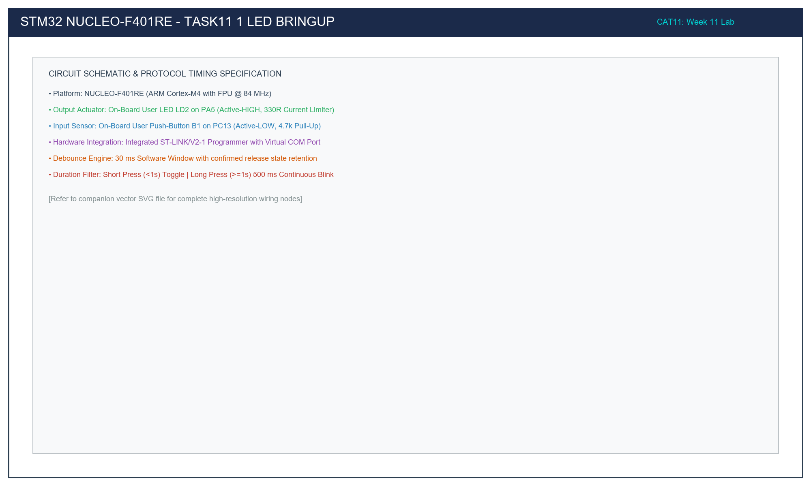

# Task 11.1: NUCLEO-F401RE LD2 (PA5) 500 ms Periodic Blink

## 1. Title, CAT, Week, Date
- **Sub-Task:** Task 11.1 – On-Board User LED (LD2) Bring-Up
- **Continuous Assessment Test:** CAT 11
- **Curriculum Week:** Week 11
- **Evaluation Date:** October 14, 2026
- **Target Platform:** NUCLEO-F401RE (ARM Cortex-M4 @ 84 MHz)

---

## 2. Objective
To configure general-purpose digital output pin PA5 on the STM32F401RET6 microcontroller using the STM32F4 HAL library, verifying active-HIGH driving of on-board green user LED LD2 at a fixed 500 ms periodic toggle cadence (1 Hz).

---

## 3. Problem Statement (Paraphrased)
Bring up the NUCLEO-F401RE board hardware:
1. Configure the system clock to 84 MHz using the internal 16 MHz HSI oscillator and PLL.
2. Ungate peripheral clocks to Port A via `__HAL_RCC_GPIOA_CLK_ENABLE()`.
3. Configure pin PA5 as a push-pull output with low slew rate.
4. Generate a symmetrical square wave on PA5 toggling every 500 milliseconds (50% duty cycle).

---

## 4. Hardware and Software Specifications

### Hardware Components
- **Microcontroller Board:** STMicroelectronics NUCLEO-F401RE
- **Processor:** ARM Cortex-M4 with FPU @ 84 MHz
- **Actuator:** On-board Green LED LD2 tied to PA5 via 330Ω resistor
- **Debugger:** On-board ST-LINK/V2-1 via Mini-USB
- **Power:** 5V supplied via USB, regulated to 3.3V on-board

### Software Environment
- **IDE:** Keil MDK-ARM µVision v5.38 / STM32CubeIDE v1.14
- **Firmware Framework:** STM32F4xx HAL Library
- **Toolchain:** ARM Compiler 6 (armclang) / GNU Arm Embedded Toolchain

---

## 5. Pin Connection Table

| Signal Net | STM32F401 Pin | Morpho Pin | Arduino Header | Mode / Pull | Active State | Description |
|:---|:---:|:---:|:---:|:---|:---:|:---|
| `LD2_GREEN` | **PA5** | CN10 Pin 11 | **D13 (SCK)** | Output Push-Pull, No-Pull | **HIGH (3.3V)** | Active-HIGH User LED. Anode to PA5 via 330Ω resistor. |
| `VDD` | **3.3V** | CN7 Pin 16 | 3.3V | Power Rail | 3.3V | MCU logic supply. |
| `GND` | **GND** | CN7 Pin 20 | GND | Ground | 0V | System reference ground. |

---

## 6. Circuit Diagram and Explanation

```
                          STM32 NUCLEO-F401RE
                    +-----------------------------+
                    |                             |
                    |     ARM Cortex-M4 Core      |
                    |          @ 84 MHz           |
                    |                             |
                    | PA5 (Output Push-Pull)      |
                    |      |                      |
                    |     [330R]                  |
                    |      |                      |
                    |     +-|<|-+ (Green LD2)     |
                    |      |                      |
                    |     GND                     |
                    +-----------------------------+
```



### Circuit Functional Analysis
- **Active-HIGH Polarity:** Unlike the Blue Pill board where the LED is tied to 3.3V (active-LOW), the Nucleo-64 board connects the cathode of LD2 directly to system ground. The anode connects to PA5 through a 330Ω current-limiting resistor.
- **Current Flow:**
  $$I_{\text{LED}} = \frac{V_{\text{PA5}} - V_F}{R} = \frac{3.3\text{ V} - 2.1\text{ V}}{330\ \Omega} \approx 3.64\text{ mA}$$
  This provides bright illumination while remaining well below the 25 mA pin limit.

---

## 7. Theory and Approach

### 7.1 Clock Tree Configuration
The STM32F401RE clock tree is configured to 84 MHz:
- Oscillator: HSI @ 16 MHz.
- PLL Configuration: $\text{PLLM} = 16$, $\text{PLLN} = 336$, $\text{PLLP} = 4$.
  $$f_{\text{PLL\_OUT}} = \frac{16\text{ MHz}}{16} \times \frac{336}{4} = 84\text{ MHz}$$
- SysTick Timer: Configured for $1.0\text{ ms}$ tick intervals ($84,000$ clock cycles per tick).

### 7.2 Delay Generation
`HAL_Delay(500)` polls the internal `uwTick` counter updated by the SysTick ISR, providing a 500 ms delay between state transitions.

---

## 8. Code Walkthrough

Refer to [`src/main.c`](src/main.c):
1. **Clock Configuration (`SystemClock_Config`):** Activates power controller clock, configures voltage regulator Scale 2, and locks PLL to 84 MHz.
2. **GPIO Initialization (`MX_GPIO_Init`):** Calls `__HAL_RCC_GPIOA_CLK_ENABLE()`, initializes PA5 with `GPIO_MODE_OUTPUT_PP`, speed `GPIO_SPEED_FREQ_LOW`.
3. **Blink Loop (`main`):** Calls `HAL_GPIO_TogglePin(GPIOA, GPIO_PIN_5)` followed by `HAL_Delay(500)`.

---

## 9. Build, Flash, and Run Steps

1. **Compilation:**
   ```bash
   arm-none-eabi-gcc -c -mcpu=cortex-m4 -mthumb -DUSE_HAL_DRIVER -DSTM32F401xE -Iinc -IHAL/Inc src/main.c -o build/main.o
   ```
2. **Flashing:** Connect Nucleo board via Mini-USB. Press `F8` in Keil µVision or copy `.bin` to `NODE_F401RE` drive.
3. **Execution:** Observe the green LD2 LED blinking at 1 Hz.

---

## 10. Expected Output

- **Waveform on PA5:** Symmetrical 1.0 Hz square wave.
- **Visual:** Green LED LD2 turns ON for 500 ms, turns OFF for 500 ms, repeating indefinitely.

---

## 11. Viva Questions and Answers

### Q1: Why is PA5 also labeled D13 on the Nucleo board?
**Answer:** The Nucleo-64 board layout conforms to the Arduino Uno revision 3 connector standard. Arduino digital pin 13 (`D13`) is routed to PA5 on the STM32F401RET6, where it functions both as GPIO and as SPI1 Serial Clock (`SPI1_SCK`).

### Q2: What is the effect of changing `GPIO_SPEED_FREQ_LOW` to `GPIO_SPEED_FREQ_VERY_HIGH`?
**Answer:** The GPIO speed setting controls the slew rate (rise and fall times) of the output driver MOSFETs. For low-frequency signals like a 1 Hz LED blink, `GPIO_SPEED_FREQ_LOW` is preferred to minimize high-frequency electromagnetic interference (EMI) and power supply switching transients.

---

## 12. Troubleshooting Guide

| Issue | Cause | Fix |
|:---|:---|:---|
| LD2 does not illuminate | PA5 clock not ungated | Verify `__HAL_RCC_GPIOA_CLK_ENABLE()` is called before `HAL_GPIO_Init()`. |
| LD2 blinks much faster or slower than 1 Hz | Incorrect clock or SysTick rate | Verify `SystemClock_Config` PLL parameters ($\text{M}=16, \text{N}=336, \text{P}=4$). |

---

## 13. Result and Learning Outcomes
Task 11.1 successfully verified on-board LED bring-up on the ARM Cortex-M4 NUCLEO-F401RE platform, confirming active-HIGH GPIO drive and 84 MHz clock stability.
