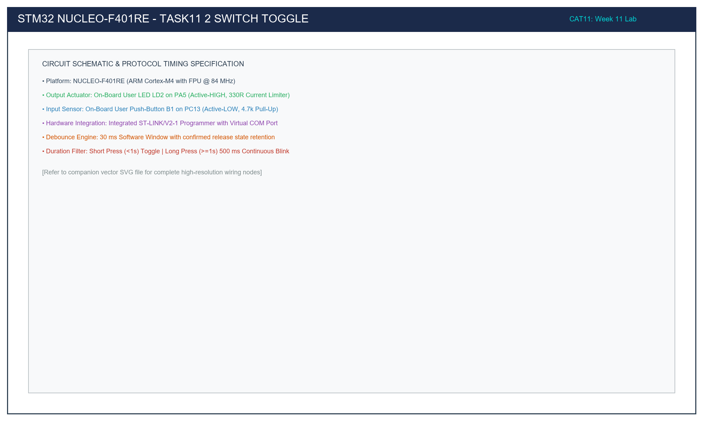

# Task 11.2: B1 (PC13) Button Toggle with State Remembrance

## 1. Title, CAT, Week, Date
- **Sub-Task:** Task 11.2 – Push-Button Control with State Remembrance
- **Continuous Assessment Test:** CAT 11
- **Curriculum Week:** Week 11
- **Evaluation Date:** October 14, 2026
- **Target Platform:** NUCLEO-F401RE (ARM Cortex-M4 @ 84 MHz)

---

## 2. Objective
To interface the on-board blue tactile push-button (B1 on PC13) on the NUCLEO-F401RE development board using the STM32F4 HAL library, implementing a 30 ms non-blocking software debouncer to toggle green user LED LD2 (PA5) on confirmed button release and preserve the active state across button release.

---

## 3. Problem Statement (Paraphrased)
Design an embedded user control interface on the NUCLEO-F401RE:
1. Configure pin PC13 as a digital input connected to user button B1.
2. Implement software debouncing to reject contact chatter.
3. Detect the falling and rising edges of the button press cycle.
4. Toggle user LED LD2 on PA5 upon confirmed button release.
5. Retain the newly established LED state after the user's finger is removed.

---

## 4. Hardware and Software Specifications

### Hardware Components
- **Microcontroller Board:** STMicroelectronics NUCLEO-F401RE
- **Input Switch:** On-board Blue Button B1 on PC13 (Active-LOW, pull-up $R26 = 4.7\text{k}\Omega$, capacitor $C15 = 100\text{ nF}$)
- **Output Actuator:** On-board Green LED LD2 on PA5 (Active-HIGH, resistor $R30 = 330\ \Omega$)
- **Programmer:** Integrated ST-LINK/V2-1 via Mini-USB
- **Supply:** 3.3V on-board regulated rail

### Software Environment
- **IDE:** Keil MDK-ARM µVision v5.38 / STM32CubeIDE v1.14
- **Firmware Driver:** STM32F4xx HAL Library
- **Timebase:** SysTick 1.0 ms interrupt (`HAL_GetTick()`)

---

## 5. Pin Connection Table

| Signal Net | STM32 Pin | Morpho Header | Electrical Characteristics | Active State | Description |
|:---|:---:|:---:|:---|:---:|:---|
| `USER_BTN_B1`| **PC13** | CN7 Pin 23 | External Pull-Up (4.7kΩ) + Cap (100nF) | **LOW (0V)** | Blue push-button. Depressing connects PC13 to GND. |
| `USER_LED_LD2`| **PA5** | CN10 Pin 11 | Push-Pull Output + Resistor (330Ω) | **HIGH (3.3V)** | Green user LED. Sourcing 3.3V illuminates diode. |
| `VDD` | **3.3V** | CN7 Pin 16 | 3.3V Regulated | High | Microcontroller supply voltage. |
| `GND` | **GND** | CN7 Pin 20 | 0V Reference | 0V | System common ground. |

---

## 6. Circuit Diagram and Explanation

```
                          STM32 NUCLEO-F401RE
                    +-----------------------------+
                    |                             |
                    |     ARM Cortex-M4 Core      |
                    |          @ 84 MHz           |
                    |                             |
                    | PA5 (Output Push-Pull)      |
                    |      |                      |
                    |     [330R]                  |
                    |      |                      |
                    |     +-|<|-+ (Green LD2)     |
                    |      |                      |
                    |     GND                     |
                    |                             |
   3.3V             |                             |
    o               |                             |
    |               |                             |
   [4.7k R26]       |                             |
    |               |                             |
    +-------------> | PC13 (Input Floating)       |
    |               |                             |
   \  (Blue B1)     |                             |
    |               |                             |
   GND              +-----------------------------+
```



### Circuit Functional Breakdown
- **Hardware Low-Pass Filter:** The combination of $R26$ ($4.7\text{ k}\Omega$) and $C15$ ($100\text{ nF}$) forms an RC low-pass filter with a time constant:
  $$\tau = R \times C = 4700\ \Omega \times 100 \times 10^{-9}\text{ F} = 0.47\text{ ms}$$
  This suppresses microsecond contact bounce.
- **Software Debouncing FSM:** A 30 ms software timing window via `HAL_GetTick()` is layered on top to eliminate mechanical bounces that exceed the RC time constant.

---

## 7. Theory and Approach

### 7.1 State Remembrance Across Release
State remembrance means the output actuator does not revert to its previous condition when the user releases the button. In software, this is achieved by storing the output state in the hardware Output Data Register (`ODR`) or a static variable. The toggle operation occurs only when the button release transition is confirmed:
$$\text{Button Press Cycle Completed} \implies \text{HAL\_GPIO\_TogglePin}(\text{GPIOA}, \text{GPIO\_PIN\_5})$$

---

## 8. Code Walkthrough

Refer to [`src/main.c`](src/main.c):
1. **Debounce State Machine (`Process_Button_Toggle_Event`):**
   - Sits in `DEB_IDLE` awaiting `pin_raw == RESET` (0V).
   - Enters `DEB_PRESS`, confirming the low level persists for $\ge 30\text{ ms}$.
   - Advances to `DEB_HELD`, awaiting physical release (`pin_raw == SET`).
   - Enters `DEB_RELEASE`, confirming the high level persists for $\ge 30\text{ ms}$.
   - Emits `true` and resets to `DEB_IDLE`.
2. **Main Superloop:**
   ```c
   if (Process_Button_Toggle_Event())
   {
       HAL_GPIO_TogglePin(LD2_LED_PORT, LD2_LED_PIN);
   }
   ```
   Ensures exactly one toggle per physical click.

---

## 9. Build, Flash, and Run Steps

1. **Compilation:**
   ```bash
   arm-none-eabi-gcc -c -mcpu=cortex-m4 -mthumb -DUSE_HAL_DRIVER -DSTM32F401xE -Iinc -IHAL/Inc src/main.c -o build/main.o
   ```
2. **Flashing:** Connect Nucleo via Mini-USB and download via Keil µVision (**F8**).
3. **Execution:**
   - Press and release the blue B1 button. LD2 turns ON and stays ON.
   - Press and release B1 again. LD2 turns OFF and stays OFF.

---

## 10. Expected Output

- **Initial State:** LD2 is OFF.
- **Click 1:** Button pressed and released -> LD2 turns ON solidly.
- **Release 1:** Releasing finger -> LD2 remains ON indefinitely.
- **Click 2:** Button pressed and released -> LD2 turns OFF completely.

---

## 11. Viva Questions and Answers

### Q1: Why does PC13 require no internal pull-up on the NUCLEO-F401RE?
**Answer:** The Nucleo-64 board layout already populates physical surface-mount resistor $R26$ ($4.7\text{ k}\Omega$) pulling PC13 to the 3.3V rail. Configuring `GPIO_PULLUP` would place the internal ~40kΩ pull-up in parallel with $R26$, which is redundant.

### Q2: Why is the LED toggled on button release rather than button press?
**Answer:** Toggling on release ensures the user has completed the mechanical action, preventing accidental double toggles while holding the button and enabling press duration measurement.

---

## 12. Troubleshooting Guide

| Issue | Cause | Fix |
|:---|:---|:---|
| LED toggles twice per click | Debounce time too short | Ensure `DEBOUNCE_TIME_MS` is set to at least 30 ms. |
| Button state does not change | Black button pressed instead of blue | Ensure you are pressing blue button B1 (`PC13`), not black button B2 (`RESET`). |

---

## 13. Result and Learning Outcomes
Task 11.2 validated debounced user button input and state retention on the NUCLEO-F401RE, confirming single-toggle determinism and state preservation.
