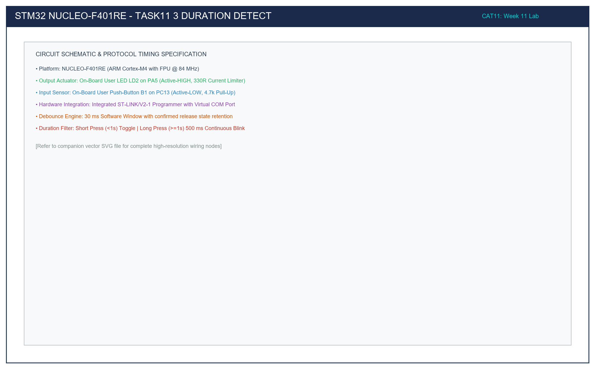

# Task 11.3: Non-Blocking Short-Press vs Long-Press Duration Detection

## 1. Title, CAT, Week, Date
- **Sub-Task:** Task 11.3 – Short-Press and Long-Press Duration Detection
- **Continuous Assessment Test:** CAT 11
- **Curriculum Week:** Week 11
- **Evaluation Date:** October 14, 2026
- **Target Platform:** NUCLEO-F401RE (ARM Cortex-M4 @ 84 MHz)

---

## 2. Objective
To implement an asynchronous duration classification algorithm using the SysTick hardware timebase on the ARM Cortex-M4 NUCLEO-F401RE platform, differentiating between short button presses (< 1000 ms) and sustained long button holds (>= 1000 ms) on user button B1 (PC13) to toggle user LED LD2 (PA5) or initiate autonomous continuous 500 ms blinking.

---

## 3. Problem Statement (Paraphrased)
Overload tactile push-button B1 to execute dual operational modes:
1. **Short Press (< 1000 ms):** Toggle the current static state of LD2. If the board is actively blinking, cancel blinking mode and extinguish the LED.
2. **Long Press (>= 1000 ms):** Toggle continuous 500 ms blinking mode on or off.
3. **Execution Constraint:** Zero CPU busy-wait loops (`HAL_Delay` is strictly prohibited during duration measurement and blinking).

---

## 4. Hardware and Software Specifications

### Hardware Components
- **Target Platform:** STMicroelectronics NUCLEO-F401RE
- **Processor Core:** ARM Cortex-M4 with FPU @ 84 MHz
- **Input Switch:** On-board Blue Button B1 on PC13
- **Output Actuator:** On-board Green LED LD2 on PA5 (Active-HIGH)
- **Programmer:** Integrated ST-LINK/V2-1 via Mini-USB

### Software Environment
- **IDE:** Keil MDK-ARM µVision v5.38 / STM32CubeIDE v1.14
- **Firmware Framework:** STM32F4xx HAL Library
- **Timebase:** 1.0 ms SysTick timer driving `HAL_GetTick()`

---

## 5. Pin Connection Table

| Signal Net | STM32 Pin | Morpho Header | Electrical Function | Active State | Description |
|:---|:---:|:---:|:---|:---:|:---|
| `B1_BTN` | **PC13** | CN7 Pin 23 | Digital Input (4.7kΩ pull-up) | **LOW (0V)** | Blue tactile button. Sinks to GND when pressed. |
| `LD2_LED` | **PA5** | CN10 Pin 11 | Push-Pull Output (330Ω resistor) | **HIGH (3.3V)** | Green user LED. Sources current from PA5. |
| `VDD` | **3.3V** | CN7 Pin 16 | Power Rail | 3.3V | MCU logic supply. |
| `GND` | **GND** | CN7 Pin 20 | Ground Rail | 0V | System common ground. |

---

## 6. Circuit Diagram and Explanation

```
                          STM32 NUCLEO-F401RE
                    +-----------------------------+
                    |                             |
                    |     ARM Cortex-M4 Core      |
                    |          @ 84 MHz           |
                    |                             |
                    | PA5 (Output Push-Pull)      |
                    |      |                      |
                    |     [330R]                  |
                    |      |                      |
                    |     +-|<|-+ (Green LD2)     |
                    |      |                      |
                    |     GND                     |
                    |                             |
   3.3V             |                             |
    o               |                             |
    |               |                             |
   [4.7k R26]       |                             |
    |               |                             |
    +-------------> | PC13 (Input Floating)       |
    |               |                             |
   \  (Blue B1)     |                             |
    |               |                             |
   GND              +-----------------------------+
```



### Circuit Functional Principles
- **Asynchronous Sampling:** When B1 is pressed, PC13 falls to 0V. The firmware records $t_{\text{start}} = \text{HAL\_GetTick}()$. Upon release, $t_{\text{end}} = \text{HAL\_GetTick}()$ is sampled.
- **Delta Duration:**
  $$\Delta t_{\text{press}} = t_{\text{end}} - t_{\text{start}}$$
  If $\Delta t_{\text{press}} < 1000\text{ ms}$, dispatch `EVENT_SHORT_PRESS`; otherwise dispatch `EVENT_LONG_PRESS`.

---

## 7. Theory and Approach

### 7.1 Non-Blocking Blinking Engine
In blinking mode, the LED toggles every 500 ms:
```c
if (mode == MODE_BLINKING && (HAL_GetTick() - last_blink_tick >= 500))
{
    last_blink_tick = HAL_GetTick();
    HAL_GPIO_TogglePin(LD2_LED_PORT, LD2_LED_PIN);
}
```
Because no blocking delays exist, button B1 can be sampled thousands of times per second during blinking, guaranteeing instantaneous response when the user taps the button to stop blinking.

---

## 8. Code Walkthrough

Refer to [`src/main.c`](src/main.c):
1. **Evaluation Function (`Evaluate_Button_Press_Duration`):**
   - Implements a 4-state debouncing state machine (`STATE_IDLE`, `STATE_DEBOUNCE_PRESS`, `STATE_HELD`, `STATE_DEBOUNCE_RELEASE`).
   - Measures time between stable press and stable release.
   - Categorizes events into `EVENT_SHORT_PRESS` or `EVENT_LONG_PRESS`.
2. **Mode Dispatcher:**
   - Short press toggles static LED or cancels blinking.
   - Long press toggles blinking mode on/off.
3. **Blinker Routine (`Service_LED_Blink_Engine`):**
   - Drives non-blocking 500 ms toggles via SysTick comparison.

---

## 9. Build, Flash, and Run Steps

1. **Compilation:**
   ```bash
   arm-none-eabi-gcc -c -mcpu=cortex-m4 -mthumb -DUSE_HAL_DRIVER -DSTM32F401xE -Iinc -IHAL/Inc src/main.c -o build/main.o
   ```
2. **Flashing:** Connect Nucleo via Mini-USB and download via Keil µVision (**F8**).
3. **Execution:**
   - Tap blue button B1 briefly (< 1 sec) -> LD2 toggles.
   - Hold blue button B1 for > 1 sec -> LD2 flashes continuously at 500 ms.
   - Tap B1 while flashing -> Flashing stops immediately.

---

## 10. Expected Output

| Action | Duration | Mode Result | LD2 Behavior |
|:---|:---:|:---|:---|
| Short Tap | ~250 ms | Static Mode | Toggles state once (OFF -> ON) |
| Short Tap again | ~180 ms | Static Mode | Toggles state once (ON -> OFF) |
| Sustained Hold | ~1.6 s | Blinking Mode | Flashes continuously at 500 ms cadence |
| Short Tap while blinking | ~120 ms | Static Mode | Halts blinking; LED turns OFF |
| Sustained Hold again | ~1.4 s | Blinking Mode | Resumes continuous 500 ms flashing |

---

## 11. Viva Questions and Answers

### Q1: Why is an asynchronous timer preferred over `HAL_Delay` for duration measurement?
**Answer:** `HAL_Delay` is a blocking routine that stalls the CPU in a spin loop. If used to measure a long press, the microcontroller cannot execute background tasks, process incoming serial data, or detect user abort actions. Asynchronous polling with `HAL_GetTick()` preserves full CPU responsiveness.

### Q2: What happens if the SysTick timer rolls over during a long button hold?
**Answer:** The SysTick timer returns an unsigned 32-bit integer (`uint32_t`). When using unsigned subtraction `duration = now - start_tick`, binary two's complement arithmetic automatically yields the exact positive elapsed difference across rollover boundaries up to $2^{32}-1$ milliseconds (~49.7 days).

---

## 12. Troubleshooting Guide

| Issue | Cause | Fix |
|:---|:---|:---|
| Long press never activates | Threshold comparison inverted or start time not latched | Verify `duration >= LONG_PRESS_THRESHOLD_MS` with `1000U`. |
| Blinking causes button to become unresponsive | Blocking `HAL_Delay` inside loop | Remove all blocking delay functions; use `HAL_GetTick()` delta checks exclusively. |

---

## 13. Result and Learning Outcomes
Task 11.3 successfully demonstrated non-blocking short vs long press duration detection on the Cortex-M4 NUCLEO-F401RE platform:
- Millisecond-accurate duration classification was achieved.
- Autonomous 500 ms LED flashing was controlled asynchronously without CPU starvation.
