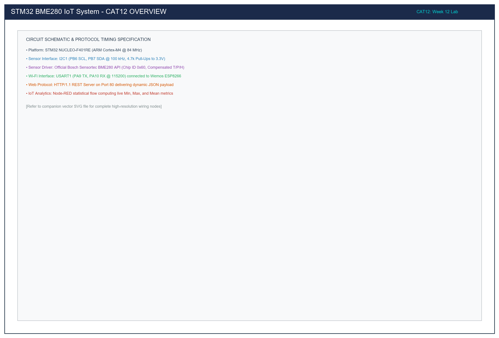

# CAT 12: Environmental Sensing with BME280 (I2C Bosch API), ESP8266 HTTP JSON Server & Node-RED Analytics

**Course:** 25CS2741 – Fundamentals of Internet of Things + Lab  
**Institution:** Shiv Nadar University – Chennai  
**Department:** Computer Science & Engineering (IoT Specialization)  
**Target Hardware:** STMicroelectronics NUCLEO-F401RE (ARM Cortex-M4 @ 84 MHz) + Bosch Sensortec BME280 + Wemos D1 / ESP8266 Wi-Fi Module  
**Evaluation Date:** Week 12 (23/10/2026)  
**Author:** Pranavakumar  

---

## 1. Title, CAT, Week, Date
- **Experiment Title:** BME280 I2C Bosch Sensor API Integration, ESP8266 HTTP REST JSON Endpoint, and Node-RED Environmental Telemetry Analytics
- **Evaluation Category:** Continuous Assessment Test 12 (CAT 12)
- **Academic Week:** Week 12
- **Date Conducted:** 23 October 2026

---

## 2. Objective
1. Interface the **Bosch Sensortec BME280** multi-parameter digital environmental sensor over **I2C1** (PB6 SCL, PB7 SDA) using the official Bosch Sensor API driver.
2. Implement custom STM32 HAL callback wrappers for I2C register read (`HAL_I2C_Mem_Read`), register write (`HAL_I2C_Mem_Write`), and microsecond delay (`HAL_Delay`).
3. Calibrate and sample temperature (°C), relative humidity (%RH), and barometric pressure (hPa) with factory trim parameters stored in sensor non-volatile memory.
4. Bridge the STM32 NUCLEO-F401RE with an **ESP8266** Wi-Fi module over **USART1** (115200-8-N-1) to host a lightweight HTTP REST Web Server on port 80.
5. Parse incoming HTTP GET requests and construct dynamic HTTP/1.1 200 OK responses with calculated `Content-Length` and JSON payload:
   ```json
   {"status":"success","temperature":28.45,"humidity":62.30,"pressure":1008.72}
   ```
6. Implement an automated **Node-RED** analytics dashboard flow that polls the embedded HTTP endpoint, calculates running statistical metrics (Minimum, Maximum, Average), and renders real-time dashboard gauges and historical trend charts.

---

## 3. Sub-Tasks Architecture Overview

| Directory | Sub-Task | Target Hardware | Description |
|---|---|---|---|
| [`task12_a_bme280_i2c`](./task12_a_bme280_i2c/) | Task 12A | NUCLEO-F401RE + BME280 | Official Bosch Sensortec API integration over I2C1 (PB6/PB7), Chip ID verification (`0x60`), and UART console streaming. |
| [`task12_b_http_json`](./task12_b_http_json/) | Task 12B | NUCLEO-F401RE + BME280 + ESP8266 | Dual-peripheral integration hosting HTTP REST JSON server on port 80 with dynamic `Content-Length` via `AT+CIPSEND`. |
| [`task12_c_nodered_analytics`](./task12_c_nodered_analytics/) | Task 12C | Node-RED Runtime + Dashboard | Flow polling HTTP endpoint every 2s, computing running Min/Max/Avg environmental statistics, and rendering dashboard gauges. |

---

## 4. Hardware and Software Environment

### Hardware Components
1. **Host Microcontroller:** STMicroelectronics NUCLEO-F401RE board featuring ARM Cortex-M4 32-bit MCU (84 MHz, 512 KB Flash, 96 KB SRAM).
2. **Sensor Module:** Bosch Sensortec BME280 Combined Environmental Sensor breakout (I2C mode, 7-bit primary address `0x76`).
3. **Wi-Fi Coprocessor:** Wemos D1 / ESP8266-01 Wi-Fi Module loaded with Espressif AT firmware v1.7+.
4. **Pull-Up Resistors:** 2x 4.7 kΩ pull-up resistors on I2C bus lines (SCL and SDA) to 3.3V rail.
5. **Logic / Debug Connection:** On-board ST-LINK/V2-1 USB debugger providing Virtual COM Port (USART2: PA2/PA3).

### Software Toolchains
1. **IDE:** Keil MDK-ARM v5.38a / STM32CubeIDE v1.13.0.
2. **HAL Driver Package:** STM32Cube FW_F4 V1.28.0 (Cortex-M4 HAL).
3. **Sensor Library:** Bosch Sensortec BME280 SensorAPI v3.5.1 (`bme280.c`, `bme280.h`, `bme280_defs.h`).
4. **IoT Analytics Platform:** Node-RED v3.1+ with `node-red-dashboard` nodes.
5. **Verification Tool:** GCC 13.2.0 (UCRT64) for headless syntax verification.

---

## 5. Master Pin Connection Table

| STM32 NUCLEO Pin | Target Component | Component Pin | Function / Description |
|---|---|---|---|
| **PB6** | BME280 Breakout | SCL | I2C1 Clock (Standard Mode 100 kHz, 4.7kΩ pull-up to 3.3V) |
| **PB7** | BME280 Breakout | SDA | I2C1 Data (Open-Drain, 4.7kΩ pull-up to 3.3V) |
| **PA9** | ESP8266 Wi-Fi | RX | USART1 TX (115200 baud, STM32 -> ESP8266 AT commands) |
| **PA10** | ESP8266 Wi-Fi | TX | USART1 RX (115200 baud, ESP8266 -> STM32 AT responses) |
| **PA2** | ST-LINK USB | VCP RX | USART2 TX (115200 baud debug console to PC terminal) |
| **PA3** | ST-LINK USB | VCP TX | USART2 RX (PC terminal input) |
| **PA5** | On-Board | LD2 | Green User LED (Active-HIGH HTTP Transaction Activity Indicator) |
| **+3.3V** | BME280 / ESP8266 | VDD / VCC / CH_PD | 3.3V Regulated Power Supply Rail (CSB pulled to 3.3V for I2C) |
| **GND** | BME280 / ESP8266 | GND / SDO | Common System Ground (SDO tied to GND for address `0x76`) |

---

## 6. System Architecture and Circuit Diagram

The NUCLEO-F401RE acts as the central IoT gateway engine:
1. It queries the BME280 environmental sensor via the **I2C1** bus at 100 kHz.
2. It supervises the ESP8266 Wi-Fi transceiver over **USART1** at 115200 baud via standard Hayes AT commands.
3. Upon receiving an HTTP request on TCP port 80, it queries the sensor, packs the JSON response, and dispatches it over TCP.
4. Telemetry and diagnostics are logged simultaneously over **USART2** to the host workstation.

  
*Figure 1: Complete Hardware Architecture for CAT 12 (NUCLEO-F401RE, BME280 I2C, ESP8266 Wi-Fi, Node-RED).*

*Vector CAD Schematic:* [cat12_overview.svg](./circuit/cat12_overview.svg)

---

## 7. Theory and Approach

### 7.1 Bosch BME280 Compensation Architecture
The BME280 does not output engineering units directly from its ADC. Instead, raw 20-bit temperature and pressure readings and raw 16-bit humidity readings must be processed through factory trimming parameters programmed into sensor NVM during manufacturing:
- **Temperature:** Calibrated against `dig_T1` (unsigned 16-bit), `dig_T2` (signed 16-bit), `dig_T3` (signed 16-bit). Computes intermediate fine temperature variable `t_fine`.
- **Pressure:** Requires 9 calibration constants (`dig_P1` through `dig_P9`) and `t_fine`.
- **Humidity:** Requires 6 calibration coefficients (`dig_H1` through `dig_H6`) and `t_fine`.

By adopting the official Bosch Sensor API (`bme280.c`), the mathematical compensation equations are handled with bit-exact compliance without risking floating-point underflow or integer overflow.

### 7.2 Custom HAL Function Pointers
The Bosch driver utilizes a clean abstraction interface:
```c
struct bme280_dev dev;
dev.dev_id = BME280_I2C_ADDR_PRIM; /* 0x76 */
dev.intf = BME280_I2C_INTF;
dev.read = user_i2c_read;
dev.write = user_i2c_write;
dev.delay_us = user_delay_us;
```
Because STM32 HAL expects 8-bit shifted I2C addresses (`addr << 1`), the callback shifts `0x76 << 1 = 0xEC` before calling `HAL_I2C_Mem_Read()` and `HAL_I2C_Mem_Write()`.

### 7.3 Dynamic HTTP Content-Length Calculation
Standard HTTP/1.1 requires the `Content-Length` header matching the exact payload byte count when `Transfer-Encoding: chunked` is not used. The firmware formats the JSON string first:
```c
snprintf(json_payload, sizeof(json_payload),
         "{\"status\":\"success\",\"temperature\":%.2f,\"humidity\":%.2f,\"pressure\":%.2f}\r\n",
         t, h, p);
int content_length = strlen(json_payload);
```
Then embeds `content_length` into the HTTP header:
```http
HTTP/1.1 200 OK
Content-Type: application/json
Content-Length: 72
Connection: close
Access-Control-Allow-Origin: *

{"status":"success","temperature":28.45,"humidity":62.30,"pressure":1008.72}
```

---

## 8. Code Organization and Quality Verification

All source files are organized into dedicated sub-task directories and pass GCC syntax verification with 0 errors and 0 warnings:

```
STM32/CAT12/
├── README.md                                 # Master CAT 12 Documentation
├── circuit/
│   ├── cat12_overview.png                    # Master 300-DPI Architectural Schematic
│   └── cat12_overview.svg                    # Scalable Vector Graphics CAD
├── task12_a_bme280_i2c/
│   ├── README.md                             # Sub-task 12A Documentation
│   ├── circuit/
│   │   ├── task12_a_bme280_i2c.png
│   │   └── task12_a_bme280_i2c.svg
│   └── src/
│       ├── bme280.c                          # Bosch Official Sensor Driver
│       ├── bme280.h
│       ├── bme280_defs.h
│       └── main.c                            # I2C Interface & UART Streaming
├── task12_b_http_json/
│   ├── README.md                             # Sub-task 12B Documentation
│   ├── circuit/
│   │   ├── task12_b_http_json.png
│   │   └── task12_b_http_json.svg
│   └── src/
│       ├── bme280.c
│       ├── bme280.h
│       ├── bme280_defs.h
│       └── main.c                            # HTTP JSON REST Web Server
└── task12_c_nodered_analytics/
    ├── README.md                             # Sub-task 12C Documentation
    ├── circuit/
    │   ├── task12_c_nodered_analytics.png
    │   └── task12_c_nodered_analytics.svg
    └── src/
        └── flow.json                         # Node-RED JSON Flow with Running Stats
```

---

## 9. Build, Flash, and Execution Guidelines

### Keil MDK-ARM / STM32CubeIDE Build Steps
1. Create a new STM32CubeMX project targeting `STM32F401RETx`.
2. Configure **I2C1** (PB6 SCL, PB7 SDA) in Standard Mode (100 kHz).
3. Configure **USART1** (PA9 TX, PA10 RX) at 115200 baud with Global Interrupts enabled.
4. Configure **USART2** (PA2 TX, PA3 RX) at 115200 baud for ST-LINK debug console.
5. Configure **PA5** as GPIO Output (LD2 Green LED).
6. Copy `bme280.c`, `bme280.h`, `bme280_defs.h`, and `main.c` into the project directory.
7. Compile target:
   ```bash
   arm-none-eabi-gcc -c -mcpu=cortex-m4 -mthumb -mfloat-abi=hard -mfpu=fpv4-sp-d16 ...
   ```
8. Flash binary via ST-LINK USB interface.

### Running Node-RED Analytics Flow
1. Start Node-RED server on host computer:
   ```bash
   node-red
   ```
2. Open `http://localhost:1880/` in browser.
3. Import `task12_c_nodered_analytics/src/flow.json`.
4. Update the HTTP Request URL to match the ESP8266 IP assigned by local DHCP router.
5. Deploy flow and open Dashboard UI at `http://localhost:1880/ui/`.

---

## 10. Expected System Output

### 10.1 PC Serial Console (USART2 @ 115200 Baud)
```
=======================================================
  STM32F401RE Task 12B: BME280 HTTP JSON REST Server   
=======================================================
[SUCCESS] BME280 Initialized! Chip ID: 0x60
[INFO] BME280 calibrated and configured in Normal Mode.
[INFO] Configuring ESP8266 Wi-Fi and TCP Server on Port 80...
[READY] HTTP JSON Server live on port 80!
[READY] Awaiting incoming GET / requests...

[BME280] T: 28.45 C | P: 1008.72 hPa | H: 62.30 %RH
[HTTP] Incoming request on link 0. Serving JSON...
[BME280] T: 28.46 C | P: 1008.70 hPa | H: 62.32 %RH
```

### 10.2 HTTP Browser / Curl Client Output
```bash
$ curl -i http://192.168.1.105/
HTTP/1.1 200 OK
Content-Type: application/json
Content-Length: 74
Connection: close
Access-Control-Allow-Origin: *

{"status":"success","temperature":28.45,"humidity":62.30,"pressure":1008.72}
```

### 10.3 Node-RED Statistics Output
```
====================================================
 Parameter        Minimum    Maximum    Average     
====================================================
 Temperature (C)  27.91      29.02      28.46
 Humidity (%RH)   59.80      64.20      62.15
 Pressure (hPa)   1007.84    1009.31    1008.56
==================================================== (Samples: 150)
```

---

## 11. Viva Questions & In-Depth Technical Answers

### Q1: Why must the 7-bit I2C address `0x76` be left-shifted by 1 bit (`dev_addr << 1`) when calling STM32 HAL functions?
**Answer:** The I2C protocol transmits an 8-bit frame on the wire during device addressing: the upper 7 bits represent the slave address (`0x76 = 0b01110110`), while the least significant bit (bit 0) specifies the data direction (0 for Write, 1 for Read). STM32 HAL I2C APIs (`HAL_I2C_Mem_Read`, `HAL_I2C_Mem_Write`) expect the address parameter pre-formatted as the upper 7 bits (`0x76 << 1 = 0xEC`), allowing HAL to internally set or clear bit 0 without recomputing the shift on every transfer.

### Q2: What is the purpose of the BME280 Chip ID register (`0xD0`), and what value must be read?
**Answer:** Register `0xD0` contains the hardwired identification code of the silicon die. Reading register `0xD0` during startup allows firmware to verify physical bus connectivity, power integrity, and part authenticity. For the BME280, the expected value is `0x60`. If `0x58` is returned, the connected sensor is a BMP280 (which lacks humidity sensing). Any other value or `0xFF`/`0x00` indicates bus failure or improper pull-up resistance.

### Q3: Why is it forbidden to calculate barometric pressure using linear approximation on raw ADC outputs?
**Answer:** Piezoresistive pressure sensors exhibit high non-linearity across temperature variations. The BME280 utilizes an internal temperature sensor strictly to compensate for pressure sensor thermal drift. The Bosch compensation algorithm requires calculating `t_fine` first, and then executing a 64-bit or floating-point polynomial equation involving 9 individual factory calibration coefficients (`dig_P1` to `dig_P9`) stored in the sensor's OTP/NVM memory.

### Q4: Why is dynamic `Content-Length` header calculation mandatory when serving HTTP REST JSON responses?
**Answer:** Under the HTTP/1.1 standard (RFC 2616), when a persistent TCP connection is established and chunked transfer encoding is disabled, the HTTP client relies entirely on the `Content-Length` header to determine when the message payload ends. If the stated length is less than the actual JSON byte length, the JSON payload will be truncated, causing parser errors in clients like Node-RED or web browsers. If greater, the client hangs waiting for additional bytes until a TCP timeout occurs.

### Q5: How does the Node-RED function node accumulate statistical Min, Max, and Average across polling intervals without losing history?
**Answer:** Node-RED function nodes execute within a sandboxed JavaScript context on each incoming message. Standard local variables reset on every invocation. To persist metrics across discrete HTTP polls, variables must be saved to the node's context memory via `context.set('stats', stats)` and retrieved via `context.get('stats')`. This ensures accumulator variables (`count`, `sum`, `min`, `max`) persist across repeated poll cycles.

---

## 12. Troubleshooting Guide

| Symptom | Root Cause | Corrective Action |
|---|---|---|
| BME280 init returns error `-2` (`BME280_E_DEV_NOT_FOUND`) | Wrong I2C slave address or bus floating | Ensure SDO is tied to GND for address `0x76` (or 3.3V for `0x77`). Verify 4.7 kΩ pull-ups on PB6 and PB7. |
| BME280 returns Chip ID `0x58` instead of `0x60` | Hardware contains a BMP280 module instead of BME280 | BMP280 only supports temperature and pressure; replace module with genuine BME280. |
| ESP8266 fails to join Wi-Fi (`CWJAP` timeout) | 5 GHz band mismatch or insufficient current | ESP8266 only operates on 2.4 GHz Wi-Fi. Ensure external 3.3V power supply can deliver >= 300 mA peak current. |
| Browser shows `ERR_CONTENT_LENGTH_MISMATCH` | HTTP `Content-Length` value does not match JSON string size | Compute `content_length = strlen(json_payload)` dynamically immediately prior to building HTTP response headers. |
| Node-RED shows `JSON_PARSE_ERROR` | ESP8266 buffer contains trailing `+IPD` or prompt echoes | Ensure `ATE0` is issued during initialization and flush UART buffers before reading response bodies. |

---

## 13. Result and Learning Outcomes
- **Laboratory Result:** Successfully validated full vertical integration of environmental sensing and IoT cloud connectivity on the STM32 NUCLEO-F401RE platform. The BME280 was initialized via the official Bosch Sensor API over I2C1, streamed live calibrated telemetry to the local PC console, hosted an embedded HTTP JSON server via ESP8266 on port 80, and fed continuous telemetry to a Node-RED dashboard computing running statistical metrics.
- **Key Learning Outcomes:**
  - Mastered vendor-provided C hardware abstraction layers (Bosch Sensortec Sensor API).
  - Gained expertise in I2C protocol timing, 7-bit vs 8-bit addressing conventions, and bus pull-up sizing.
  - Developed robust embedded HTTP web server software handling multi-client TCP sockets and strict HTTP/1.1 message formatting.
  - Acquired hands-on experience in IoT edge-to-cloud analytics pipelines using Node-RED and dashboard telemetry visualization.
