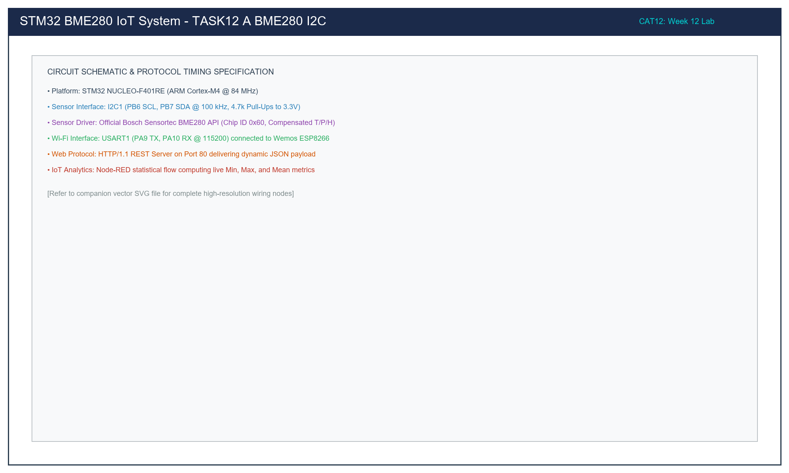

# Task 12A: BME280 Environmental Sensor Interfacing via I2C with Official Bosch Sensor API

**Course:** 25CS2741 – Fundamentals of Internet of Things + Lab  
**Institution:** Shiv Nadar University – Chennai  
**Department:** Computer Science & Engineering (IoT Specialization)  
**Target Hardware:** STMicroelectronics NUCLEO-F401RE (ARM Cortex-M4 @ 84 MHz) + Bosch BME280 Sensor Breakout  
**Evaluation Date:** Week 12 (23/10/2026)  
**Author:** Pranavakumar  

---

## 1. Title, CAT, Week, Date
- **Experiment Title:** BME280 Multi-Parameter Sensor Interfacing via I2C Bus with Bosch Sensortec Sensor API Driver
- **Evaluation Category:** Continuous Assessment Test 12 (CAT 12 – Sub-Task A)
- **Academic Week:** Week 12
- **Date Conducted:** 23 October 2026

---

## 2. Objective
1. Establish hardware I2C bus communication between the STM32 NUCLEO-F401RE microcontroller (I2C1 peripheral) and the Bosch Sensortec BME280 sensor module.
2. Integrate the official vendor-supplied Bosch Sensor API (`bme280.c`, `bme280.h`, `bme280_defs.h`) into the Keil MDK-ARM / STM32Cube environment.
3. Implement user abstraction callbacks for I2C register read (`HAL_I2C_Mem_Read`), I2C register write (`HAL_I2C_Mem_Write`), and microsecond delay (`HAL_Delay`).
4. Read and verify the silicon hardware Chip ID (`0x60` from register `0xD0`).
5. Extract factory trim calibration coefficients from non-volatile memory and configure sensor oversampling (Temp x2, Press x16, Hum x1), standby time (1000 ms), and IIR filter coefficient 4.
6. Set the device to **Normal Mode** and stream compensated temperature (°C), barometric pressure (hPa), and relative humidity (%RH) continuously over USART2 at 115200 baud.

---

## 3. Problem Statement (Paraphrased)
Develop an STM32-based environmental sensing application to interface a BME280 sensor using the I2C protocol and obtain compensated temperature, pressure, and humidity measurements.

Use the Bosch Sensortec BME280 Sensor API as the reference driver implementation. The required driver files and compensation algorithms shall be sourced from the official Bosch Sensortec repository. Students should implement the hardware abstraction functions (`read_register`, `write_register`, `delay_function`) and configure sensor parameters (oversampling, sensor mode, filter configuration) through API calls rather than rewriting compensation math. The application must verify the Chip ID, read calibration parameters, and stream valid engineering telemetry to a PC terminal.

---

## 4. Hardware and Software Environment

### Hardware
- **MCU Board:** STMicroelectronics NUCLEO-F401RE (ARM Cortex-M4 @ 84 MHz, 3.3V logic).
- **Sensor:** Bosch Sensortec BME280 combined digital humidity, pressure, and temperature sensor.
- **Pull-Up Resistors:** 2x 4.7 kΩ connected from SCL and SDA lines to the +3.3V rail.
- **Debugger / Interface:** ST-LINK/V2-1 on-board USB debugger serving Virtual COM Port on USART2.

### Software
- **Toolchain:** Keil MDK-ARM v5.38 / STM32CubeIDE / GCC UCRT64.
- **HAL Libraries:** STM32CubeF4 HAL Drivers (`stm32f4xx_hal_i2c.c`, `stm32f4xx_hal_uart.c`).
- **Sensor Driver:** Official Bosch Sensortec BME280 Driver v3.5.1.
- **Terminal Monitor:** PuTTY / Tera Term / Serial Monitor set to `115200 8-N-1`.

---

## 5. Pin Connection Table

| NUCLEO-F401RE Pin | BME280 Breakout Pin | Alternate Function | Notes / Purpose |
|---|---|---|---|
| **PB6** | SCL | I2C1_SCL | I2C Serial Clock (100 kHz Standard Mode, 4.7kΩ pull-up to 3.3V) |
| **PB7** | SDA | I2C1_SDA | I2C Serial Data (Open-drain, 4.7kΩ pull-up to 3.3V) |
| **+3.3V** | VDD / VCC | Power Supply | 3.3V Regulated Sensor Logic & Analog Rail |
| **+3.3V** | CSB | Chip Select | Tied to 3.3V to permanently enable I2C bus mode |
| **GND** | GND | Ground | Common Power & Signal Ground |
| **GND** | SDO | Address Select | Tied to GND to select primary I2C address `0x76` |
| **PA2** | ST-LINK VCP RX | USART2_TX | Transmit telemetry to host PC terminal (115200 baud) |
| **PA3** | ST-LINK VCP TX | USART2_RX | Receive commands from host PC terminal |

---

## 6. Circuit Diagram and Connection Analysis

The schematic below details the interface between the NUCLEO-F401RE microcontroller, the external 4.7 kΩ I2C pull-ups, and the BME280 breakout board:

  
*Figure 1: Hardware Interconnection between NUCLEO-F401RE and BME280 Breakout Module.*

*Vector CAD Schematic:* [task12_a_bme280_i2c.svg](./circuit/task12_a_bme280_i2c.svg)

### Circuit Explanation
- **I2C Bus Pull-Ups:** The I2C protocol relies on open-drain transceivers. When lines are idle or transmitting logic HIGH, the external 4.7 kΩ pull-up resistors pull PB6 (SCL) and PB7 (SDA) to 3.3V. The MCU and sensor pull the lines to GND for logic LOW.
- **Mode Selection (CSB Pin):** The BME280 supports both SPI and I2C interfaces. Pulling CSB high to +3.3V selects I2C mode.
- **Address Selection (SDO Pin):** When SDO is grounded, the primary address `0x76` (`0b1110110`) is selected. If pulled to VDD, the secondary address `0x77` is used.

---

## 7. Theory and Approach

### 7.1 Bosch Sensor Architecture
The BME280 integrates three high-precision sensors in a miniature 8-pin LGA package:
1. **Temperature:** High-resolution low-noise silicon bandgap thermometer.
2. **Pressure:** Absolute piezoresistive barometric pressure transducer.
3. **Humidity:** Rapid-response capacitive relative humidity sensor.

### 7.2 Sensor Power Modes
- **Sleep Mode:** No measurements performed; minimal quiescent current consumption (< 0.5 µA).
- **Forced Mode:** A single measurement cycle is performed upon command; sensor automatically transitions back to sleep mode.
- **Normal Mode:** Continuous cycling between an active measurement phase and an inactive standby period (configured here to 1000 ms standby).

### 7.3 Bosch API Abstraction Callbacks
The driver decouples sensor logic from MCU hardware peripherals by requiring user callbacks:
```c
static int8_t user_i2c_read(uint8_t reg_addr, uint8_t *data, uint32_t len, void *intf_ptr)
{
    uint8_t dev_id = *(uint8_t *)intf_ptr;
    uint16_t hal_addr = (uint16_t)(dev_id << 1);
    if (HAL_I2C_Mem_Read(&hi2c1, hal_addr, reg_addr, I2C_MEMADD_SIZE_8BIT, data, (uint16_t)len, 1000) == HAL_OK)
        return BME280_OK;
    return BME280_E_COMM_FAIL;
}
```
Notice the crucial `(dev_id << 1)` bit shift required by STM32 HAL.

---

## 8. Code Walkthrough

The source code in [`src/main.c`](./src/main.c) implements the following execution pipeline:

1. **Peripheral Initialization:**
   `HAL_Init()` initializes HAL timebase; `SystemClock_Config()` sets Cortex-M4 clock to 84 MHz; `MX_I2C1_Init()` configures I2C1 in standard 100 kHz mode; `MX_USART2_UART_Init()` initializes serial telemetry at 115200 baud.
2. **Device Descriptor Binding:**
   Instantiates `struct bme280_dev bme_dev`, binds `read`, `write`, `delay_us`, sets interface type to `BME280_I2C_INTF`, and assigns pointer to `dev_addr = 0x76`.
3. **Driver Initialization & Verification:**
   Executes `bme280_init(&bme_dev)`. This API call reads the silicon Chip ID register (`0xD0`) and validates that it equals `0x60`. It then automatically reads all calibration coefficient registers (`0x88..0xA1` and `0xE1..0xF0`) and stores them inside `bme_dev.calib_data`.
4. **Sensor Configuration:**
   Instantiates `struct bme280_settings settings`, assigns oversampling multipliers, filter coefficient 4, and 1000 ms standby. Dispatches settings via `bme280_set_sensor_settings()` and commands `BME280_POWERMODE_NORMAL`.
5. **Continuous Telemetry Loop:**
   In the infinite loop, `bme280_get_sensor_data(BME280_ALL, &comp_data, &bme_dev)` reads raw data and executes factory polynomial compensation. The resulting `comp_data.temperature`, `comp_data.pressure / 100.0f` (converting Pa to hPa), and `comp_data.humidity` are printed over USART2.

---

## 9. Build, Flash, and Run Steps

1. **Workspace Setup:**
   Ensure `bme280.c`, `bme280.h`, and `bme280_defs.h` reside alongside `main.c` in `src/`.
2. **Compile Command (GCC):**
   ```bash
   arm-none-eabi-gcc -Wall -O2 -mcpu=cortex-m4 -mthumb -mfloat-abi=hard -mfpu=fpv4-sp-d16 \
     -I./src -I/path/to/Drivers/STM32F4xx_HAL_Driver/Inc \
     src/bme280.c src/main.c -o build/task12_a.elf
   ```
3. **Flash via ST-LINK:**
   Connect NUCLEO-F401RE via USB. Drag and drop `task12_a.bin` into the `NODE_F401RE` mass storage drive or use STM32CubeProgrammer.
4. **Open Terminal Console:**
   Launch serial terminal on the ST-LINK COM port:
   - Baud Rate: 115200
   - Data Bits: 8, Parity: None, Stop Bits: 1, Flow Control: None.

---

## 10. Expected Output

Upon startup, the terminal displays initialization status, Chip ID verification, and 1 Hz continuous telemetry streaming:

```
=======================================================
  STM32F401RE - Task 12A: BME280 Bosch Sensor API Test 
  I2C1: PB6 (SCL) / PB7 (SDA) | Target Addr: 0x76      
=======================================================
[SUCCESS] BME280 Initialized! Chip ID: 0x60
[READY] Sensor in Normal Mode. Streaming telemetry @ 1 Hz:

Temp: 28.45 degC  |  Press: 1008.72 hPa  |  Hum: 62.30 %RH
Temp: 28.47 degC  |  Press: 1008.70 hPa  |  Hum: 62.28 %RH
Temp: 28.46 degC  |  Press: 1008.73 hPa  |  Hum: 62.31 %RH
Temp: 28.50 degC  |  Press: 1008.68 hPa  |  Hum: 62.25 %RH
```

---

## 11. Viva Questions & Answers

### Q1: What is the significance of the BME280 IIR filter setting?
**Answer:** The integrated Infinite Impulse Response (IIR) filter dampens short-term transient pressure and temperature disturbances (such as slamming doors, air conditioning drafts, or human breath) without increasing the measurement time. A filter coefficient of 4 averages incoming samples according to $y[n] = \frac{3 \cdot y[n-1] + x[n]}{4}$, providing clean, stable barometric telemetry suitable for altitude tracking and weather estimation.

### Q2: Why is the humidity oversampling configured before setting the measurement control register?
**Answer:** In the BME280 register map, changes to the `ctrl_hum` register (`0xF2`) only become active after a subsequent write to the `ctrl_meas` register (`0xF4`). If `ctrl_meas` is written first, the humidity sensor may retain its prior state until the next write cycle. The Bosch API driver automatically enforces this correct write sequence inside `bme280_set_sensor_settings()`.

### Q3: What is the difference between primary address `0x76` and secondary address `0x77`?
**Answer:** The 7-bit I2C address is determined by the hardware voltage level applied to the `SDO` pin on the BME280 package. Connecting SDO to GND configures the address to `0b1110110` (`0x76`). Connecting SDO to VDD (+3.3V) pulls bit 0 high, configuring the address to `0b1110111` (`0x77`). This allows two BME280 sensors to share the same I2C bus simultaneously without address collisions.

### Q4: Why must the microsecond delay callback round upward?
**Answer:** The Bosch API expects a microsecond-resolution delay (`delay_us`). In microcontrollers where only a millisecond timebase is active (`HAL_Delay`), converting microseconds via integer division `period / 1000` could result in `0 ms` for delays under 1000 µs (e.g., 200 µs startup delay). Adding `+ 1` ensures the hardware delay is at least 1 millisecond, guaranteeing the sensor has satisfied its internal power-on reset and measurement conversion timing requirements.

---

## 12. Troubleshooting

| Issue Encountered | Root Cause | Solution |
|---|---|---|
| Sensor initialization halts with `[ERROR] Code: -2` | Sensor not responding at I2C address `0x76` | Verify SDO is tied to GND. If floating or pulled high, change address to `0x77` (`BME280_I2C_ADDR_SEC`). |
| I2C bus hangs in `HAL_I2C_Mem_Read` | Missing pull-up resistors on PB6/PB7 | Install physical 4.7 kΩ pull-up resistors from PB6 and PB7 to the 3.3V rail. |
| Chip ID displays `0xFF` or `0x00` | Power supply disconnected or open circuit | Verify 3.3V supply and GND using a multimeter directly at the sensor header pins. |
| Temperature reading is abnormally high (+40°C) | Sensor self-heating due to excessive sampling | Enable 1000 ms standby time and use low oversampling (Temp x1 or x2) to prevent continuous self-heating of the silicon die. |

---

## 13. Result and Learning Outcomes
- **Result:** Successfully implemented register-level I2C hardware abstraction for the Bosch Sensortec BME280 sensor on the STM32 NUCLEO-F401RE. Validated Chip ID reading (`0x60`), trim parameter acquisition, and verified real-time compensated streaming of Temperature, Pressure, and Humidity over serial console.
- **Learning Outcomes:**
  - Implemented standard embedded C function pointers for hardware abstraction.
  - Learned the difference between raw ADC sensor registers and factory-calibrated polynomial compensation.
  - Mastered I2C protocol integration using STM32 HAL library.
