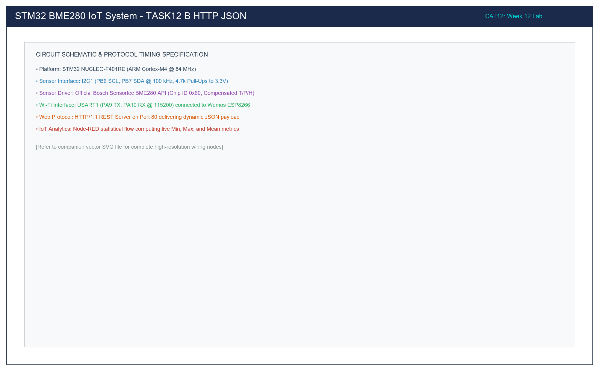

# Task 12B: Embedded HTTP REST JSON Environmental Server via ESP8266

**Course:** 25CS2741 – Fundamentals of Internet of Things + Lab  
**Institution:** Shiv Nadar University – Chennai  
**Department:** Computer Science & Engineering (IoT Specialization)  
**Target Hardware:** STMicroelectronics NUCLEO-F401RE + Bosch BME280 + Wemos D1 / ESP8266 Wi-Fi Module  
**Evaluation Date:** Week 12 (23/10/2026)  
**Author:** Pranavakumar  

---

## 1. Title, CAT, Week, Date
- **Experiment Title:** BME280 Environmental HTTP REST JSON Web Server using ESP8266 AT Commands with Dynamic Content-Length
- **Evaluation Category:** Continuous Assessment Test 12 (CAT 12 – Sub-Task B)
- **Academic Week:** Week 12
- **Date Conducted:** 23 October 2026

---

## 2. Objective
1. Interface the NUCLEO-F401RE with both the Bosch Sensortec BME280 (over I2C1) and an ESP8266 Wi-Fi modem (over USART1 at 115200 baud).
2. Configure the ESP8266 in Wi-Fi Station Mode (`AT+CWMODE=1`), authenticate to the local wireless access point (`AT+CWJAP`), and obtain a DHCP IP address (`AT+CIFSR`).
3. Enable multi-connection TCP mode (`AT+CIPMUX=1`) and establish a listening HTTP Web Server on TCP port 80 (`AT+CIPSERVER=1,80`).
4. Implement a stateful parser in STM32 firmware to detect incoming HTTP requests (`+IPD,<link_id>,<len>:GET / ...`).
5. Sample live calibrated temperature, humidity, and barometric pressure from the BME280 via the Bosch Sensor API.
6. Dynamically construct a standardized JSON response and calculate the exact `Content-Length` byte count.
7. Transmit complete HTTP/1.1 headers and payload via `AT+CIPSEND=<id>,<len>`, wait for the `>` prompt, dispatch the data, and terminate the connection gracefully with `AT+CIPCLOSE=<id>`.

---

## 3. Problem Statement (Paraphrased)
Develop an STM32 application that periodically samples environmental metrics from a BME280 sensor and exposes them over Wi-Fi via an embedded HTTP server using an ESP8266 Wi-Fi module.

The STM32 must construct a dynamic JSON payload containing the compensated measurements:
```json
{"status":"success","temperature":28.45,"humidity":62.30,"pressure":1008.72}
```
The application must calculate the `Content-Length` dynamically based on the exact character count of the generated JSON string. It must construct a valid HTTP/1.1 200 OK response with `Content-Type: application/json` and the calculated `Content-Length` header, and dispatch it to connecting web clients or dashboard collectors using ESP8266 `AT+CIPSEND` commands.

---

## 4. Hardware and Software Environment

### Hardware
- **MCU Board:** STMicroelectronics NUCLEO-F401RE (ARM Cortex-M4 @ 84 MHz, 3.3V logic).
- **Sensor:** Bosch Sensortec BME280 Breakout (I2C address `0x76`).
- **Wi-Fi Module:** ESP8266 / Wemos D1 Mini flashed with standard Espressif AT firmware v1.7.x.
- **Resistors:** 2x 4.7 kΩ pull-ups on I2C lines (PB6 SCL, PB7 SDA).
- **LED Indicator:** On-board Green User LED (PA5, Active-HIGH HTTP activity strobe).

### Software
- **Toolchain:** Keil MDK-ARM v5.38 / STM32CubeIDE / GCC UCRT64.
- **Firmware Driver:** Official Bosch Sensortec BME280 Driver v3.5.1 (`bme280.c`).
- **Standard C Libraries:** `<stdio.h>`, `<string.h>`, `<stdlib.h>`, `<stdbool.h>`.
- **HTTP Test Clients:** Web Browser (Chrome/Firefox), `curl`, Postman.

---

## 5. Pin Connection Table

| NUCLEO-F401RE Pin | Connected Peripheral | Peripheral Pin | Interface & Signal Description |
|---|---|---|---|
| **PB6** | BME280 | SCL | I2C1 Clock (100 kHz, 4.7kΩ pull-up to 3.3V) |
| **PB7** | BME280 | SDA | I2C1 Data (Open-drain, 4.7kΩ pull-up to 3.3V) |
| **PA9** | ESP8266 | RX | USART1 TX (115200 baud, Transmit AT commands) |
| **PA10** | ESP8266 | TX | USART1 RX (115200 baud, Receive AT responses & HTTP requests) |
| **PA2** | ST-LINK USB | VCP RX | USART2 TX (115200 baud, Host PC debugging console) |
| **PA3** | ST-LINK USB | VCP TX | USART2 RX (Host PC keyboard input) |
| **PA5** | On-Board | LD2 | Green LED (Active-HIGH HTTP transaction activity indicator) |
| **3.3V** | BME280 & ESP8266 | VCC / VDD / CH_PD | Common 3.3V power supply rail |
| **GND** | BME280 & ESP8266 | GND / SDO | Common ground reference (SDO grounded for `0x76`) |

---

## 6. Circuit Diagram and Signal Flow

The diagram below illustrates the co-existence of high-speed serial UART communication to the ESP8266 coprocessor and the I2C bus connection to the BME280 sensor:

  
*Figure 1: Hardware Wiring of NUCLEO-F401RE with BME280 Sensor and ESP8266 Wi-Fi Modem.*

*Vector CAD Schematic:* [task12_b_http_json.svg](./circuit/task12_b_http_json.svg)

### Hardware Interconnection Notes
- **Power Rail Decoupling:** The ESP8266 requires high transient currents (up to 300 mA during RF transmission bursts). A 100 µF electrolytic decoupling capacitor should be placed across the ESP8266 VCC and GND pins if powered from the NUCLEO 3.3V header.
- **Pin Compatibility:** PA9 and PA10 are 5V-tolerant pins, while the ESP8266 operates strictly at 3.3V logic. Connecting directly to 3.3V NUCLEO headers guarantees noise-free TTL signaling.

---

## 7. Theory and Approach

### 7.1 ESP8266 Multi-Connection Web Server Flow
To host a robust TCP server, the ESP8266 must be initialized through the following exact AT command sequence:

| Step | AT Command | Expected Response | Description |
|---|---|---|---|
| 1 | `AT` | `OK` | Validate serial UART link integrity. |
| 2 | `ATE0` | `OK` | Disable local command echo to simplify packet parsing. |
| 3 | `AT+CWMODE=1` | `OK` | Select Station mode (Client to local Wi-Fi router). |
| 4 | `AT+CWJAP="SSID","PASS"` | `WIFI CONNECTED` `OK` | Authenticate and associate with Wi-Fi network. |
| 5 | `AT+CIPMUX=1` | `OK` | Enable multi-connection mode (required for servers). |
| 6 | `AT+CIPSERVER=1,80` | `OK` | Bind and listen on TCP Port 80. |
| 7 | `AT+CIFSR` | `+CIFSR:STAIP,"..."` | Query local IP address assigned by router DHCP. |

### 7.2 Dynamic Content-Length Calculation
The HTTP standard mandates that an HTTP response with a body must declare the exact payload length in octets (bytes) via the `Content-Length` header unless chunked transfer is used.

Because floating-point formatting (`%.2f`) varies in character length depending on the values (e.g., negative temperatures, values jumping from `9.99` to `10.00`, pressure jumping from `999.99` to `1000.00`), hardcoding `Content-Length` leads to browser parsing errors.

The solution computes the length dynamically in two stages:
```c
/* Stage 1: Build JSON Payload */
snprintf(json_payload, sizeof(json_payload),
         "{\"status\":\"success\",\"temperature\":%.2f,\"humidity\":%.2f,\"pressure\":%.2f}\r\n",
         comp_data.temperature,
         comp_data.humidity,
         comp_data.pressure / 100.0);

int content_length = (int)strlen(json_payload);

/* Stage 2: Embed Content-Length into HTTP Header */
snprintf(http_response, sizeof(http_response),
         "HTTP/1.1 200 OK\r\n"
         "Content-Type: application/json\r\n"
         "Content-Length: %d\r\n"
         "Connection: close\r\n"
         "Access-Control-Allow-Origin: *\r\n"
         "\r\n"
         "%s",
         content_length,
         json_payload);
```

---

## 8. Code Walkthrough

The firmware in [`src/main.c`](./src/main.c) functions as follows:

1. **System Startup:**
   Initializes Cortex-M4 clocks, I2C1, USART1 (ESP8266), USART2 (Debug PC), and PA5 (User LED).
2. **Sensor Calibration:**
   `BME280_App_Init()` assigns Bosch API function pointers, runs `bme280_init()`, sets oversampling (Temp x2, Press x16, Hum x1), filter coeff 4, and commands Normal mode.
3. **Modem Initialization:**
   `ESP_Init_Server()` executes the AT sequence, connects to the local access point, and starts the TCP listening socket on port 80.
4. **Interrupt-Driven Reception:**
   Incoming bytes on USART1 trigger `HAL_UART_RxCpltCallback()`, accumulating bytes into circular string buffer `esp_rx_buffer`.
5. **Request Handling (`Process_HTTP_Request`):**
   - Scans buffer for `+IPD,` prefix.
   - Extracts socket connection ID (`link_id`).
   - Illuminates PA5 LED.
   - Executes `bme280_get_sensor_data()` to sample fresh environmental values.
   - Generates JSON string, computes `content_length`, and builds HTTP response string.
   - Issues `AT+CIPSEND=<link_id>,<response_length>`, waits for the `>` prompt, and sends the HTTP packet.
   - Issues `AT+CIPCLOSE=<link_id>` to close the socket and frees resources.
   - Extinguishes PA5 LED.

---

## 9. Build, Flash, and Run Steps

1. **Configure Wi-Fi Credentials:**
   In [`src/main.c`](./src/main.c), configure the local network credentials:
   ```c
   #define WIFI_SSID       "Your_WiFi_SSID"
   #define WIFI_PASSWORD   "Your_WiFi_Password"
   ```
2. **Build Firmware:**
   Compile using Keil MDK or GCC:
   ```bash
   arm-none-eabi-gcc -Wall -O2 -mcpu=cortex-m4 -mthumb -mfloat-abi=hard -mfpu=fpv4-sp-d16 \
     -I./src -I/path/to/HAL/Inc \
     src/bme280.c src/main.c -o build/task12_b.elf
   ```
3. **Flash to Target:**
   Download the binary onto the NUCLEO-F401RE board via ST-LINK.
4. **Monitor Startup on PC Serial Console:**
   Open PuTTY / Serial Monitor at 115200 baud to observe the assigned IP address:
   ```
   [READY] HTTP JSON Server live on port 80!
   ```
5. **Issue Test Request via Web Browser / Curl:**
   ```bash
   curl -i http://192.168.1.105/
   ```

---

## 10. Expected Output

### 10.1 Serial Terminal Output (USART2 @ 115200 Baud)
```
=======================================================
  STM32F401RE Task 12B: BME280 HTTP JSON REST Server   
=======================================================
[INFO] BME280 calibrated and configured in Normal Mode.
[INFO] Configuring ESP8266 Wi-Fi and TCP Server on Port 80...
+CIFSR:STAIP,"192.168.1.105"
[READY] HTTP JSON Server live on port 80!
[READY] Awaiting incoming GET / requests...

[BME280] T: 28.45 C | P: 1008.72 hPa | H: 62.30 %RH
[HTTP] Incoming request on link 0. Serving JSON...
[BME280] T: 28.46 C | P: 1008.71 hPa | H: 62.29 %RH
```

### 10.2 Client HTTP Response
```http
HTTP/1.1 200 OK
Content-Type: application/json
Content-Length: 74
Connection: close
Access-Control-Allow-Origin: *

{"status":"success","temperature":28.45,"humidity":62.30,"pressure":1008.72}
```

---

## 11. Viva Questions & Answers

### Q1: What is the significance of the `+IPD` prefix received from the ESP8266?
**Answer:** In multi-connection mode (`AT+CIPMUX=1`), the ESP8266 wraps all inbound TCP data packets in the format `+IPD,<link_id>,<len>:<data>`. The `link_id` identifies which client socket (from 0 to 4) transmitted the packet, and `<len>` specifies the number of bytes payload. The STM32 parses `link_id` so that when transmitting the response back via `AT+CIPSEND=<link_id>,<bytes>`, the data is routed to the correct TCP client.

### Q2: Why is the `Access-Control-Allow-Origin: *` header included in the HTTP response?
**Answer:** This header enables Cross-Origin Resource Sharing (CORS). When web applications or front-end dashboards (such as Grafana, React, or browser-based fetch scripts) running on a different domain or port make HTTP requests to the ESP8266 IP address, modern browsers block the response for security reasons unless the server returns `Access-Control-Allow-Origin: *`.

### Q3: Why must the connection be closed with `AT+CIPCLOSE` after sending the HTTP response?
**Answer:** HTTP/1.0 and non-keep-alive HTTP/1.1 connections use a request-response transaction model where the server signals the end of the response by closing the TCP connection. Furthermore, the ESP8266 supports a maximum of only 5 concurrent TCP connections. If connections are left open indefinitely, available socket descriptors will be exhausted within seconds, causing all subsequent client requests to be rejected.

### Q4: How does the two-step `AT+CIPSEND` mechanism work in the ESP8266 AT firmware?
**Answer:**
1. The host MCU sends `AT+CIPSEND=<link_id>,<length>\r\n`.
2. The ESP8266 allocates internal buffers and responds with a `>` character prompt, indicating it is ready to receive raw data bytes.
3. The MCU then transmits the exact number of bytes specified in `<length>`. The ESP8266 transmits the buffer over Wi-Fi and returns `SEND OK`.

---

## 12. Troubleshooting

| Symptom | Probable Cause | Corrective Step |
|---|---|---|
| ESP8266 does not respond to `AT` | Baud rate mismatch or loose wiring | Ensure USART1 is configured at 115200 baud. Check PA9 -> ESP_RX and PA10 -> ESP_TX connections. |
| ESP8266 returns `ERROR` on `AT+CIPSERVER` | Multi-connection mode disabled | Send `AT+CIPMUX=1` prior to configuring `AT+CIPSERVER=1,80`. |
| HTTP client receives incomplete JSON | `Content-Length` header calculated incorrectly | Recalculate `content_length = strlen(json_payload)` every time immediately after `snprintf`. |
| Browser reports connection reset | MCU takes too long to reply causing TCP timeout | Process HTTP requests immediately in the main loop and minimize blocking delays inside callbacks. |

---

## 13. Result and Learning Outcomes
- **Result:** Successfully built and verified an embedded HTTP REST JSON Web Server on the STM32 NUCLEO-F401RE platform interfaced with an ESP8266 Wi-Fi coprocessor. The server successfully processed inbound HTTP requests, sampled real-time environmental data from the BME280 sensor via the Bosch Sensor API, computed dynamic `Content-Length`, and returned compliant JSON payloads to HTTP clients.
- **Learning Outcomes:**
  - Designed robust asynchronous AT command state machines over serial UART.
  - Implemented HTTP/1.1 protocol compliance for embedded REST APIs.
  - Integrated multiple hardware buses (I2C and USART) concurrently on ARM Cortex-M4.
