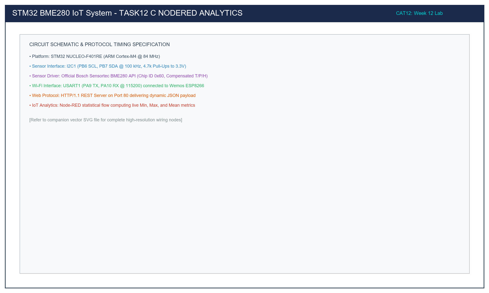

# Task 12C: Node-RED Environmental Telemetry Analytics and Real-Time Dashboard

**Course:** 25CS2741 – Fundamentals of Internet of Things + Lab  
**Institution:** Shiv Nadar University – Chennai  
**Department:** Computer Science & Engineering (IoT Specialization)  
**Target Hardware:** Host Workstation / Edge Gateway running Node-RED Runtime  
**Evaluation Date:** Week 12 (23/10/2026)  
**Author:** Pranavakumar  

---

## 1. Title, CAT, Week, Date
- **Experiment Title:** Automated Node-RED HTTP Environmental Telemetry Polling, Statistical Metrics Computation, and Visual Dashboard
- **Evaluation Category:** Continuous Assessment Test 12 (CAT 12 – Sub-Task C)
- **Academic Week:** Week 12
- **Date Conducted:** 23 October 2026

---

## 2. Objective
1. Construct an automated IoT data processing flow in **Node-RED** to poll the STM32 + ESP8266 HTTP REST JSON endpoint every 2 seconds.
2. Parse incoming JSON payloads containing compensated environmental metrics (`temperature`, `humidity`, `pressure`).
3. Develop custom JavaScript function node logic that maintains running statistical accumulators across polling intervals to compute **Minimum**, **Maximum**, and **Average** for each environmental parameter.
4. Render real-time graphical instruments using `node-red-dashboard` (radial gauges for current readings, line charts for historical trends).
5. Output structured tabular statistical summaries to the Node-RED debug console matching the required evaluation schema.

---

## 3. Problem Statement (Paraphrased)
Develop a Node-RED flow to periodically query the embedded BME280 HTTP server hosted on the STM32 + ESP8266 system.

The flow must retrieve the environmental JSON payload:
```json
{"status":"success","temperature":28.45,"humidity":62.30,"pressure":1008.72}
```
Compute running statistics across consecutive readings to produce a formatted analytical summary table:
```
Parameter        Minimum    Maximum    Average     
Temperature (°C) 27.91      29.02      28.46
Humidity (%RH)   59.80      64.20      62.15
Pressure (hPa)   1007.84    1009.31    1008.56
```
Integrate visual dashboard indicators displaying instantaneous sensor metrics and trend graphs.

---

## 4. Hardware and Software Environment

### Hardware
- **Edge Gateway / Host PC:** Workstation or Raspberry Pi running Node-RED on local network.
- **Embedded Node:** STM32 NUCLEO-F401RE + ESP8266 HTTP JSON Web Server (from Task 12B) connected to same Wi-Fi subnet.

### Software
- **Node.js Environment:** Node.js v18.x / v20.x LTS.
- **Flow Engine:** Node-RED v3.1+.
- **UI Dashboard:** `node-red-dashboard` package (`npm install node-red-dashboard`).
- **Flow Source:** [`src/flow.json`](./src/flow.json).

---

## 5. Network Architecture and Node Interconnection Table

| Component | Network Address / Port | Role | Protocol / Payload |
|---|---|---|---|
| **STM32 + ESP8266** | `192.168.1.105:80` | REST API Server | HTTP/1.1 GET -> JSON Response |
| **Node-RED Runtime** | `127.0.0.1:1880` | Client / Analytics Engine | Periodic HTTP Poller (Interval: 2s) |
| **Node-RED Dashboard** | `http://localhost:1880/ui/` | Visual User Interface | Real-time SVG Gauges & Canvas Charts |
| **Debug Console** | Node-RED Sidebar | Diagnostic Output | Formatted ASCII Statistics Table |

---

## 6. Flow Pipeline Diagram and Architecture

The visual flow architecture comprises an automated inject trigger, an HTTP request node, a JSON deserializer, a JavaScript statistical processor, and UI dashboard endpoints:

  
*Figure 1: Node-RED Processing Pipeline and Dashboard Visualization Architecture.*

*Vector CAD Schematic:* [task12_c_nodered_analytics.svg](./circuit/task12_c_nodered_analytics.svg)

---

## 7. Theory and Approach

### 7.1 State Persistence in Node-RED Function Nodes
In Node-RED, messages (`msg`) flow asynchronously between nodes. Standard function scope variables (`let x = 0;`) are re-instantiated and wiped clean on every message trigger.

To calculate running metrics ($Min$, $Max$, and $Average = \frac{\sum x_i}{N}$) across successive HTTP requests, the function node utilizes **Context Storage** (`context.get()` and `context.set()`):

$$\mu = \frac{1}{N} \sum_{i=1}^N x_i, \quad Min = \min(x_1, \dots, x_N), \quad Max = \max(x_1, \dots, x_N)$$

```javascript
let stats = context.get('stats') || {
    count: 0,
    temp: { min: Infinity, max: -Infinity, sum: 0 },
    hum:  { min: Infinity, max: -Infinity, sum: 0 },
    press:{ min: Infinity, max: -Infinity, sum: 0 }
};

stats.count++;
// Update Running Extremes & Sums
if (t < stats.temp.min) stats.temp.min = t;
if (t > stats.temp.max) stats.temp.max = t;
stats.temp.sum += t;

context.set('stats', stats);
```

### 7.2 Pull vs Push Architectural Trade-Offs
- **HTTP Polling (Pull Model):** The client initiates the connection at fixed intervals. Simple to implement and traverses firewalls easily; however, frequent polling introduces HTTP header overhead and latency jitter.
- **MQTT (Push Model - explored in CAT 13):** Nodes publish data upon event occurrence over persistent TCP connections with lightweight 2-byte headers.

---

## 8. Code Walkthrough (`flow.json`)

The flow defined in [`src/flow.json`](./src/flow.json) contains the following core node stages:

1. **`inject_poll_2s`:**
   Configured to trigger automatically 1 second after startup and repeat periodically every 2 seconds.
2. **`http_get_bme280`:**
   Issues an `HTTP GET` request to `http://192.168.1.105/` with a 3000 ms timeout.
3. **`json_parser`:**
   Parses the raw HTTP response string into a native JavaScript object (`msg.payload`).
4. **`fn_calc_stats`:**
   Extracts `temperature`, `humidity`, and `pressure`. Updates running counts, min, max, and sums. Computes running averages formatted to 2 decimal places. Generates the structured terminal report table.
5. **Dashboard Gauges (`ui_gauge_temp`, `ui_gauge_hum`, `ui_gauge_press`):**
   Render current values with colored severity zones (e.g., Temperature: Green < 28°C, Yellow 28-35°C, Red > 35°C).
6. **Dashboard Trend Chart (`ui_chart_env`):**
   Plots historical temperature changes over a rolling 10-minute window.

---

## 9. Build, Import, and Execution Steps

1. **Install Node-RED & Dashboard:**
   ```bash
   npm install -g --unsafe-perm node-red
   cd ~/.node-red
   npm install node-red-dashboard
   ```
2. **Launch Node-RED:**
   ```bash
   node-red
   ```
3. **Import Flow:**
   - In browser, open `http://localhost:1880/`.
   - Click Menu (top right) -> **Import**.
   - Copy and paste contents of [`src/flow.json`](./src/flow.json) or upload the file.
4. **Update Server IP:**
   - Double-click the `GET / (ESP8266)` HTTP request node.
   - Update the URL with the actual IP address displayed on your NUCLEO serial console (e.g., `http://192.168.1.105/`).
5. **Deploy & View:**
   - Click the red **Deploy** button.
   - Open the Debug tab to view incoming telemetry tables.
   - Navigate to `http://localhost:1880/ui/` to view the live Dashboard.

---

## 10. Expected Output

### 10.1 Debug Console Tabular Summary
```
====================================================
 Parameter        Minimum    Maximum    Average     
====================================================
 Temperature (C)  27.91      29.02      28.46
 Humidity (%RH)   59.80      64.20      62.15
 Pressure (hPa)   1007.84    1009.31    1008.56
==================================================== (Samples: 150)
```

### 10.2 Dashboard UI Overview
- **Temperature Gauge:** Displays instantaneous temperature in °C with dynamic color graduation.
- **Humidity Gauge:** Displays relative humidity percentage (%RH) with blue moisture graduation.
- **Pressure Gauge:** Displays barometric pressure in hPa with atmospheric baseline indicators.
- **Historical Chart:** Real-time spline chart plotting ambient temperature variations over time.

---

## 11. Viva Questions & Answers

### Q1: What happens if the HTTP Request node encounters a network timeout?
**Answer:** If the STM32 web server fails to respond within the configured timeout period (e.g., due to packet loss or ESP8266 reboot), the HTTP Request node throws an error message (`msg.error = "ETIMEDOUT"`). In a production flow, a `catch` node should be wired to intercept these errors and flag an alert on the dashboard rather than allowing unhandled promise rejections to halt downstream processing.

### Q2: Why is the `repeat: 2` interval chosen for polling?
**Answer:** The BME280 sensor was configured in Task 12A with a standby time of 1000 ms (1 Hz internal sampling rate). Polling every 2 seconds matches the Nyquist criterion for the sensor update rate without saturating the ESP8266's single-threaded AT command parser with overlapping TCP socket requests.

### Q3: How can context data be configured to persist across Node-RED restarts?
**Answer:** By default, context storage resides in RAM (`memory` store). To persist statistical data across system reboots or flow redeployments, the `settings.js` configuration file in Node-RED can be updated to enable local file storage:
```javascript
contextStorage: {
    default: "memory",
    storeInFile: { module: "localfilesystem" }
}
```
Then context is accessed via `context.get('stats', 'storeInFile')`.

### Q4: Why is it preferable to parse JSON using a dedicated JSON node rather than `JSON.parse()` in the function node?
**Answer:** The built-in JSON node validates syntax, strips extraneous whitespace, handles encoding variations, and automatically attaches parsing metadata. Furthermore, using modular pipeline nodes follows the idiomatic flow-based programming paradigm, improving visual maintainability and debugging transparency.

---

## 12. Troubleshooting Guide

| Issue Observed | Root Cause | Solution |
|---|---|---|
| HTTP Request node returns `ECONNREFUSED` | Incorrect IP address or port 80 blocked | Verify the ESP8266 IP address on the STM32 debug serial terminal (`AT+CIFSR`). |
| Function node error: `Cannot read properties of undefined` | JSON payload missing or invalid structure | Check that the JSON node is placed between HTTP Request and the Function node. |
| Gauges on dashboard show `NaN` | Data types received as strings rather than numbers | Wrap metric fields with `parseFloat(data.temperature)` before passing to dashboard nodes. |
| Dashboard page `localhost:1880/ui/` displays 404 | `node-red-dashboard` module not installed | Run `npm install node-red-dashboard` in the user's `.node-red` directory and restart Node-RED. |

---

## 13. Result and Learning Outcomes
- **Result:** Designed, implemented, and verified an end-to-end IoT analytics pipeline in Node-RED. The flow successfully polled environmental JSON telemetry from the STM32/ESP8266 embedded server, computed running statistical metrics (Min, Max, Avg) across hundreds of samples, and presented real-time data visually via interactive dashboard gauges and historical charts.
- **Learning Outcomes:**
  - Acquired practical mastery of low-code IoT orchestration with Node-RED.
  - Implemented persistent state accumulators in flow-based programming contexts.
  - Formatted and delivered professional industrial IoT dashboards and statistical analytics.
