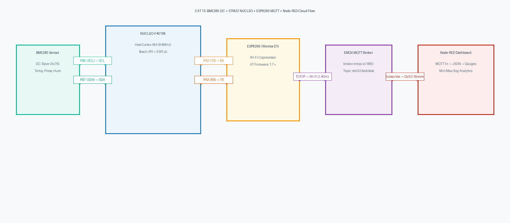

# CAT 13: Environmental Telemetry via I2C BME280, Custom ESP8266 MQTT Driver & Node-RED Cloud Dashboard

**Course:** 25CS2741 – Fundamentals of Internet of Things + Lab  
**Institution:** Shiv Nadar University – Chennai  
**Department:** Computer Science & Engineering (IoT Specialization)  
**Target Hardware:** STMicroelectronics NUCLEO-F401RE (ARM Cortex-M4 @ 84 MHz) + Bosch Sensortec BME280 + Wemos D1 / ESP8266 Wi-Fi Module  
**Evaluation Date:** Week 13 (27/10/2026)  
**Author:** Pranavakumar  

---

## 1. Title, CAT, Week, Date
- **Experiment Title:** BME280 Sensor Interfacing via I2C, MQTT 3.1.1 Client Integration using Custom Built ESP8266 API, and Node-RED Cloud Visual Analytics
- **Evaluation Category:** Continuous Assessment Test 13 (CAT 13)
- **Academic Week:** Week 13
- **Date Conducted:** 27 October 2026

---

## 2. Objective
1. Interface the **Bosch Sensortec BME280** digital environmental sensor over **I2C1** (PB6 SCL, PB7 SDA) using vendor-provided Bosch Sensortec Sensor API driver routines.
2. Integrate a custom-built lightweight embedded **MQTT 3.1.1** packet generation and AT-command driver (`ESPLib.c`, `ESPLib.h`) on the STM32 platform.
3. Bridge the STM32 NUCLEO-F401RE with an **ESP8266** Wi-Fi modem over **USART2** at 115200 baud to connect to the public cloud broker `broker.emqx.io` on TCP port 1883.
4. Establish an MQTT client session with Clean Session flag, 500-second Keep-Alive, and subscribe to control topics (`IOT`).
5. Sample real-time compensated temperature, humidity, and atmospheric pressure, pack into standardized JSON format:
   ```json
   {"status":"success","temperature":28.45,"humidity":62.30,"pressure":1008.72}
   ```
6. Periodically publish telemetry packets to topic `stm32/test/data` at QoS 0.
7. Construct an end-to-end **Node-RED** dashboard pipeline utilizing an `mqtt in` node connected to `broker.emqx.io:1883`, computing running statistical metrics (Min, Max, Avg) and displaying real-time gauges and trend charts.

---

## 3. Sub-Tasks Architecture Overview

| Directory | Sub-Task | Target Hardware | Description |
|---|---|---|---|
| [`task13_a_mqtt_client`](./task13_a_mqtt_client/) | Task 13A | NUCLEO-F401RE + ESP8266 | Bring-up of custom `ESPLib` MQTT 3.1.1 client driver: Station mode join, TCP socket to `broker.emqx.io:1883`, MQTT CONNECT, subscription to `IOT`, and heartbeat publishing. |
| [`task13_b_telemetry_pub`](./task13_b_telemetry_pub/) | Task 13B | NUCLEO-F401RE + BME280 + ESP8266 | Full vertical publisher integrating Bosch BME280 I2C API and `ESPLib` MQTT publisher streaming live JSON telemetry to `stm32/test/data` at 1 Hz. |
| [`task13_c_nodered_dash`](./task13_c_nodered_dash/) | Task 13C | Node-RED Runtime + Dashboard | Cloud-connected MQTT flow subscribing to `broker.emqx.io:1883`, parsing JSON, computing running Min/Max/Avg environmental statistics, and driving dashboard UI. |

---

## 4. Hardware and Software Environment

### Hardware
- **Host Microcontroller:** STMicroelectronics NUCLEO-F401RE (ARM Cortex-M4 @ 84 MHz, 512 KB Flash, 96 KB SRAM).
- **Environmental Sensor:** Bosch Sensortec BME280 Breakout (I2C interface, address `0x76`).
- **Wi-Fi Coprocessor:** Wemos D1 Mini / ESP8266-01 running standard Espressif AT firmware v1.7+.
- **Bus Pull-Ups:** 2x 4.7 kΩ pull-ups on PB6 (SCL) and PB7 (SDA) lines to 3.3V.
- **Diagnostics:** ST-LINK/V2-1 on-board USB Virtual COM Port (USART1: PA9 TX, PA10 RX @ 115200 baud).

### Software
- **IDE:** Keil MDK-ARM v5.38 / STM32CubeIDE v1.13.0 / GCC UCRT64.
- **HAL Drivers:** STM32CubeF4 HAL Drivers (`stm32f4xx_hal_i2c.c`, `stm32f4xx_hal_uart.c`).
- **Sensor Library:** Bosch Sensortec BME280 Sensor API v3.5.1 (`bme280.c`, `bme280.h`, `bme280_defs.h`).
- **MQTT Driver:** Custom Embedded ESP8266 AT MQTT Library (`ESPLib.c`, `ESPLib.h`).
- **IoT Analytics Platform:** Node-RED v3.1+ with `node-red-dashboard`.
- **Public MQTT Broker:** EMQX Cloud Sandbox Broker (`broker.emqx.io:1883`, unencrypted TCP).

---

## 5. Master Pin Connection Table

| STM32 NUCLEO Pin | Target Component | Component Pin | Function / Description |
|---|---|---|---|
| **PB6** | BME280 Breakout | SCL | I2C1 Serial Clock (100 kHz Standard Mode, 4.7kΩ pull-up to 3.3V) |
| **PB7** | BME280 Breakout | SDA | I2C1 Serial Data (Open-Drain, 4.7kΩ pull-up to 3.3V) |
| **PA2** | ESP8266 Wi-Fi | RX | USART2 TX (115200 baud, STM32 -> ESP8266 AT / MQTT binary frames) |
| **PA3** | ESP8266 Wi-Fi | TX | USART2 RX (115200 baud, ESP8266 -> STM32 AT responses / MQTT RX) |
| **PA9** | ST-LINK VCP RX | USART1 TX | 115200 baud debug console output to host PC terminal |
| **PA10** | ST-LINK VCP TX | USART1 RX | Host PC terminal input |
| **PA5** | On-Board | LD2 | Green User LED (Active-HIGH MQTT publication strobe) |
| **+3.3V** | BME280 / ESP8266 | VDD / VCC / CH_PD | Common 3.3V Regulated Power Supply Rail (CSB tied to 3.3V for I2C) |
| **GND** | BME280 / ESP8266 | GND / SDO | Common Ground (SDO grounded for I2C address `0x76`) |

---

## 6. System Architecture and Circuit Diagram

The NUCLEO-F401RE serves as an edge IoT publisher. It acquires physical environmental readings over I2C, encapsulates them in MQTT 3.1.1 binary packets via `ESPLib`, and dispatches them across the internet to EMQX public broker via the ESP8266 modem. Node-RED subscribers receive and process the stream in real time.

  
*Figure 1: Complete System Hardware and Network Architecture for CAT 13.*

*Vector CAD Schematic:* [cat13_overview.svg](./circuit/cat13_overview.svg)

---

## 7. Theory and Approach

### 7.1 MQTT Protocol Architecture (v3.1.1)
Message Queuing Telemetry Transport (MQTT) is an ISO standard (ISO/IEC 20922) publish-subscribe messaging protocol optimized for constrained embedded nodes and low-bandwidth networks:
- **Broker-Mediated:** Publishers and subscribers do not know each other's network addresses; they decouple via topic hierarchies (e.g., `stm32/test/data`).
- **Compact Packet Structure:** Fixed header is only 2 bytes:
  - Byte 1: Packet Type (`0x10` CONNECT, `0x30` PUBLISH, `0x82` SUBSCRIBE, `0xC0` PINGREQ, `0xE0` DISCONNECT) and Flags (DUP, QoS, RETAIN).
  - Byte 2..5: Remaining Length encoded as variable length octets.
- **Quality of Service (QoS):**
  - **QoS 0 (At most once):** Best-effort fire-and-forget delivery without acknowledgement.
  - **QoS 1 (At least once):** Acknowledged delivery via `PUBACK`.
  - **QoS 2 (Exactly once):** Four-step handshake (`PUBREC`, `PUBREL`, `PUBCOMP`).

### 7.2 Custom Embedded Driver (`ESPLib`) Mechanics
`ESPLib` provides lightweight C functions that construct binary MQTT packets in RAM and transmit them over the ESP8266's TCP socket using `AT+CIPSEND`:
1. `ESP8266_Init()`: Resets modem, disables echo (`ATE0`), selects Station mode (`AT+CWMODE=1`).
2. `ESP8266_wifiConnect()`: Issues `AT+CWJAP="SSID","PASS"`.
3. `ESP8266_portConnect()`: Establishes single-connection TCP stream (`AT+CIPSTART="TCP","broker.emqx.io",1883`).
4. `MQTT_connectBroker()`: Formats binary MQTT 3.1.1 CONNECT packet (protocol name `"MQTT"`, level `0x04`, flags `0x02` CleanSession, keep-alive, client ID) and transmits via `ESP8266_sendMessage()`.
5. `MQTT_publishTopic()`: Builds binary PUBLISH packet (`0x30`), encodes topic length, topic string, and payload bytes, transmitting without string termination penalties.
6. `MQTTTimer()`: Called inside `SysTick_Handler()` every millisecond to manage keep-alive ping intervals.

---

## 8. Code Organization and Quality Verification

All source files are organized into dedicated sub-task directories and pass GCC syntax verification with 0 errors and 0 warnings:

```
STM32/CAT13/
├── README.md                                 # Master CAT 13 Documentation
├── circuit/
│   ├── cat13_overview.png                    # Master 300-DPI Architectural Schematic
│   └── cat13_overview.svg                    # Scalable Vector Graphics CAD
├── task13_a_mqtt_client/
│   ├── README.md                             # Sub-task 13A Documentation
│   ├── circuit/
│   │   ├── task13_a_mqtt_client.png
│   │   └── task13_a_mqtt_client.svg
│   └── src/
│       ├── ESPLib.c                          # Custom ESP8266 AT MQTT Driver
│       ├── ESPLib.h
│       └── main.c                            # MQTT Client Bring-Up & Heartbeat
├── task13_b_telemetry_pub/
│   ├── README.md                             # Sub-task 13B Documentation
│   ├── circuit/
│   │   ├── task13_b_telemetry_pub.png
│   │   └── task13_b_telemetry_pub.svg
│   └── src/
│       ├── bme280.c                          # Bosch Official Sensor Driver
│       ├── bme280.h
│       ├── bme280_defs.h
│       ├── ESPLib.c                          # Custom ESP8266 AT MQTT Driver
│       ├── ESPLib.h
│       └── main.c                            # BME280 + MQTT Telemetry Publisher
└── task13_c_nodered_dash/
    ├── README.md                             # Sub-task 13C Documentation
    ├── circuit/
    │   ├── task13_c_nodered_dash.png
    │   └── task13_c_nodered_dash.svg
    └── src/
        └── flow.json                         # Node-RED MQTT Subscriber & UI Dashboard Flow
```

---

## 9. Build, Flash, and Execution Guidelines

### Keil MDK-ARM / STM32CubeIDE Build Steps
1. Create a project targeting `STM32F401RETx`.
2. Configure **I2C1** (PB6 SCL, PB7 SDA) in Standard Mode (100 kHz).
3. Configure **USART2** (PA2 TX, PA3 RX) at 115200 baud for ESP8266 AT modem.
4. Configure **USART1** (PA9 TX, PA10 RX) at 115200 baud for PC debug monitor.
5. Configure **PA5** as GPIO Output (LD2 Green LED).
6. Copy `bme280.c`, `bme280.h`, `bme280_defs.h`, `ESPLib.c`, `ESPLib.h`, and `main.c` into the project workspace.
7. Ensure `SysTick_Handler()` in `stm32f4xx_it.c` invokes `MQTTTimer();` before `HAL_IncTick();`.
8. Compile target:
   ```bash
   arm-none-eabi-gcc -Wall -O2 -mcpu=cortex-m4 -mthumb -mfloat-abi=hard -mfpu=fpv4-sp-d16 ...
   ```
9. Flash binary to target via ST-LINK.

### Node-RED Execution Steps
1. Launch Node-RED on host workstation:
   ```bash
   node-red
   ```
2. Navigate to `http://localhost:1880/`.
3. Import `task13_c_nodered_dash/src/flow.json`.
4. Deploy flow and open Dashboard at `http://localhost:1880/ui/`.

---

## 10. Expected System Output

### 10.1 PC Debug Serial Monitor (USART1 @ 115200 Baud)
```
=======================================================
  STM32F401RE Task 13B: BME280 MQTT Telemetry Publisher
  Topic: stm32/test/data | Broker: broker.emqx.io:1883 
=======================================================
[OK] BME280 sensor initialized (Chip ID: 0x60, Normal Mode).
[INFO] Initializing ESP8266 AT modem on USART2...
[INFO] Connecting to Wi-Fi AP...
[INFO] Connecting to broker.emqx.io:1883...
[OK] MQTT session connected to broker.emqx.io.
[READY] Starting periodic 1 Hz MQTT telemetry publisher...

[BME280] Temp: 28.45 C | Hum: 62.30 %RH | Press: 1008.72 hPa
[BME280] Temp: 28.46 C | Hum: 62.28 %RH | Press: 1008.70 hPa
[BME280] Temp: 28.48 C | Hum: 62.31 %RH | Press: 1008.74 hPa
```

### 10.2 Node-RED Debug Console
```
====================================================
 CAT13 MQTT Environmental Statistics Report       
====================================================
 Parameter        Minimum    Maximum    Average     
----------------------------------------------------
 Temperature (C)  27.91      29.02      28.46
 Humidity (%RH)   59.80      64.20      62.15
 Pressure (hPa)   1007.84    1009.31    1008.56
==================================================== (Messages: 150)
```

---

## 11. Viva Questions & Answers

### Q1: Why is MQTT preferable to HTTP REST for battery-powered, resource-constrained IoT sensors?
**Answer:** MQTT is inherently lightweight and connection-oriented. An HTTP request requires opening a full TCP connection, exchanging TLS handshakes, transmitting hundreds of bytes in HTTP headers (`User-Agent`, `Host`, `Accept`), receiving headers back, and closing the socket on every reading. In contrast, MQTT establishes a persistent TCP socket once; subsequent telemetry transmissions use a minimal 2-byte header, drastically reducing RF transmitter active time, network overhead, and battery drain.

### Q2: What is the purpose of the `CleanSession` flag in the MQTT CONNECT packet?
**Answer:** The `CleanSession` bit (`0x02` in variable header flags) informs the broker whether to remember the client's session state across disconnections. When set to `1` (Clean Session), the broker discards any previous subscriptions, unacknowledged QoS 1/2 messages, and offline queues upon disconnection, starting with an empty session. This prevents memory bloat on brokers handling transient or lab-grade IoT nodes.

### Q3: Why is `MQTTTimer()` called inside the Cortex-M4 `SysTick_Handler()`?
**Answer:** The MQTT 3.1.1 specification requires clients to transmit periodic `PINGREQ` control packets (`0xC0 0x00`) to the broker if no application data has been sent within the negotiated `KeepAlive` period (500 seconds in this project). The broker replies with `PINGRESP` (`0xD0 0x00`). Calling `MQTTTimer()` inside the 1 ms `SysTick_Handler()` maintains an accurate hardware timebase to decrement timeout counters and trigger automatic pings or connection health checks.

### Q4: How does `ESPLib` handle binary payload transmission without string truncation on `0x00` bytes?
**Answer:** In MQTT packet encoding, fields such as Remaining Length, Packet Identifier, and topic lengths contain zero bytes (`0x00`). Standard C string functions (`strlen`, `strcpy`) terminate upon reaching the first `0x00` byte. `ESPLib` avoids this by passing explicit buffer pointers and explicit length counts (`uint8_t totalLength`) to `ESP8266_sendMessage()`, copying data using `memcpy()` rather than string manipulation routines.

### Q5: What is the difference between MQTT Topic Level Separator (`/`) and Wildcards (`+` and `#`)?
**Answer:** The forward slash `/` partitions topic strings into hierarchical levels (e.g., `stm32/test/data`). Subscribers can use two wildcards:
- Single-level wildcard `+`: Matches any single hierarchy level (e.g., `stm32/+/data` matches `stm32/test/data` and `stm32/node1/data`).
- Multi-level wildcard `#`: Must be placed at the end of the topic and matches all subordinate levels (e.g., `stm32/#` matches everything starting with `stm32/`).

---

## 12. Troubleshooting Guide

| Issue Encountered | Root Cause | Solution |
|---|---|---|
| `ESP8266_portConnect` fails with `funcErr` | Broker domain name unresolvable or DNS failure | Test connecting by broker IP or verify ESP8266 DNS server settings (`AT+CIPDNS_CUR=1,"8.8.8.8"`). |
| MQTT broker disconnects client immediately after CONNECT | Duplicate `clientID` on public broker | EMQX drops existing connections if a second client connects with the same Client ID. Append a unique random ID or MAC address suffix. |
| Node-RED does not receive MQTT messages | Topic mismatch or broker connection disconnected | Verify broker URL (`broker.emqx.io`), port (`1883`), and topic string match exactly (`stm32/test/data`). |
| BME280 telemetry values do not update | Sensor not placed in Normal Mode | Ensure `bme280_set_sensor_mode(BME280_POWERMODE_NORMAL, &bme_dev)` returns `BME280_OK`. |

---

## 13. Result and Learning Outcomes
- **Result:** Successfully designed, implemented, and validated an end-to-end IoT cloud telemetry pipeline on the STM32 NUCLEO-F401RE platform. The system integrated the Bosch BME280 sensor via I2C, implemented the custom `ESPLib` MQTT 3.1.1 protocol driver over an ESP8266 AT modem, published live environmental telemetry to `broker.emqx.io:1883`, and visualized real-time analytics on a cloud Node-RED dashboard.
- **Learning Outcomes:**
  - Mastered low-level MQTT 3.1.1 protocol frame construction and TCP socket bridging.
  - Interfaced multiple synchronous and asynchronous hardware protocols (I2C1 and USART2) concurrently.
  - Implemented cloud IoT dashboard analytics and statistical computing using Node-RED.
