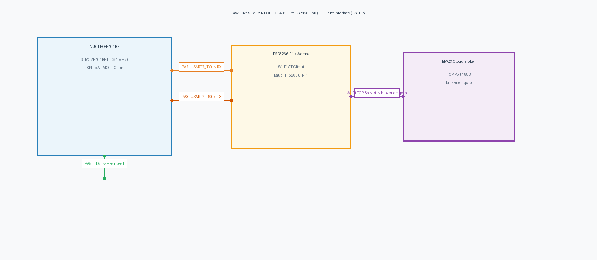

# Task 13A: STM32 to ESP8266 AT MQTT 3.1.1 Client Bring-Up using ESPLib

**Course:** 25CS2741 – Fundamentals of Internet of Things + Lab  
**Institution:** Shiv Nadar University – Chennai  
**Department:** Computer Science & Engineering (IoT Specialization)  
**Target Hardware:** STMicroelectronics NUCLEO-F401RE + Wemos D1 / ESP8266 Wi-Fi Module  
**Evaluation Date:** Week 13 (27/10/2026)  
**Author:** Pranavakumar  

---

## 1. Title, CAT, Week, Date
- **Experiment Title:** Embedded MQTT 3.1.1 Client Driver Bring-Up using Custom Built ESP8266 AT API (`ESPLib`)
- **Evaluation Category:** Continuous Assessment Test 13 (CAT 13 – Sub-Task A)
- **Academic Week:** Week 13
- **Date Conducted:** 27 October 2026

---

## 2. Objective
1. Bring up the custom-built **ESPLib** C driver on the STM32 NUCLEO-F401RE platform to manage an ESP8266 Wi-Fi module over **USART2** at 115200 baud.
2. Provision the ESP8266 in Station Mode (`AT+CWMODE=1`), authenticate to the local wireless access point (`AT+CWJAP`), and establish an outgoing TCP stream to the public EMQX MQTT broker (`broker.emqx.io:1883`).
3. Construct and transmit binary **MQTT 3.1.1 CONNECT** packets with configurable Client ID, Clean Session flag, and Keep-Alive intervals.
4. Subscribe to the downstream MQTT topic `"IOT"` at Quality of Service 0 (`QoS0`).
5. Transmit periodic heartbeat JSON status frames to topic `"stm32/test/data"` every 3 seconds to verify end-to-end cloud transmission.
6. Service the driver's Keep-Alive timer via the Cortex-M4 `SysTick_Handler()`.

---

## 3. Problem Statement (Paraphrased)
Develop an STM32 application to interface an ESP8266 Wi-Fi module using a custom-made library (`ESPLib.c`, `ESPLib.h`) to enable MQTT client connectivity.

Configure the Wi-Fi module on USART2 in Station mode and connect to a local wireless network. Establish a TCP socket connection to a public MQTT broker (`broker.emqx.io:1883`). Initialize the MQTT client connection parameters with a Clean Session flag and Keep-Alive interval. Subscribe to control topic `"IOT"` and publish test messages periodically. Implement the `MQTTTimer()` tick function inside the `SysTick_Handler` interrupt routine to maintain broker keep-alive timing.

---

## 4. Hardware and Software Environment

### Hardware
- **Host MCU:** STMicroelectronics NUCLEO-F401RE (ARM Cortex-M4 @ 84 MHz).
- **Wi-Fi Coprocessor:** Wemos D1 / ESP8266-01 loaded with standard Espressif AT firmware v1.7.x.
- **Visual Strobe:** On-board Green User LED (PA5 LD2, Active-HIGH).
- **Console Interface:** ST-LINK/V2-1 USB Virtual COM Port (USART1: PA9 TX, PA10 RX @ 115200 baud).

### Software
- **Toolchain:** Keil MDK-ARM v5.38 / STM32CubeIDE / GCC UCRT64.
- **Driver Package:** Custom ESP8266 AT MQTT Driver (`ESPLib.c`, `ESPLib.h`).
- **Standard Libraries:** `<stdio.h>`, `<string.h>`, `<stdbool.h>`, `<stdint.h>`.
- **Public MQTT Broker:** `broker.emqx.io:1883` (EMQX Open Sandbox).
- **MQTT Test Client:** MQTTX / Mosquitto CLI / Web Client (`http://www.emqx.com/en/mqtt-client/`).

---

## 5. Pin Connection Table

| NUCLEO-F401RE Pin | ESP8266 Pin | Alternate Function | Signal & Purpose |
|---|---|---|---|
| **PA2** | RX | USART2_TX | 115200 baud AT commands & binary MQTT frames to ESP8266 |
| **PA3** | TX | USART2_RX | 115200 baud responses & inbound MQTT frames from ESP8266 |
| **PA9** | ST-LINK VCP RX | USART1_TX | 115200 baud PC debug diagnostic output |
| **PA10** | ST-LINK VCP TX | USART1_RX | PC debug console input |
| **PA5** | LD2 (Green LED) | GPIO_Output | Active-HIGH publication strobe |
| **3.3V** | VCC / CH_PD | Power Supply | 3.3V Regulated Power Rail (CH_PD tied high to enable chip) |
| **GND** | GND | Ground | Common Power & Signal Ground |

---

## 6. Circuit Diagram and Connection Analysis

The schematic below shows the dedicated dual-UART architecture used by the NUCLEO-F401RE:

  
*Figure 1: Hardware Interconnections for Task 13A (NUCLEO-F401RE to ESP8266 and ST-LINK).*

*Vector CAD Schematic:* [task13_a_mqtt_client.svg](./circuit/task13_a_mqtt_client.svg)

### Hardware Considerations
- **Dedicated UARTs:** USART2 is dedicated exclusively to the ESP8266 modem at 115200 baud. USART1 is routed to the ST-LINK USB Virtual COM Port for PC debugging. This avoids contention between AT commands and text diagnostics.
- **Power Stability:** ESP8266 Wi-Fi transceivers require up to 300 mA during RF transmission bursts. Connecting an external 3.3V supply or decoupling capacitor (100 µF) prevents MCU brown-out resets.

---

## 7. Theory and Approach

### 7.1 MQTT 3.1.1 Packet Framing in ESPLib
The MQTT protocol specifies binary packet formats:
1. **CONNECT Packet (`0x10`):**
   - Fixed Header: `0x10 <Remaining_Length>`
   - Variable Header: Protocol Name (`0x00 0x04 "MQTT"`), Protocol Level (`0x04`), Connect Flags (`0x02` for CleanSession), Keep-Alive (`500s = 0x01 0xF4`).
   - Payload: Client Identifier string prefixed by its 2-byte MSB-LSB length.
2. **SUBSCRIBE Packet (`0x82`):**
   - Fixed Header: `0x82 <Remaining_Length>`
   - Variable Header: Packet Identifier (`0x00 0x01`).
   - Payload: Topic Length (`0x00 0x03`), Topic String (`"IOT"`), Requested QoS (`0x00`).
3. **PUBLISH Packet (`0x30` - QoS 0):**
   - Fixed Header: `0x30 <Remaining_Length>`
   - Variable Header: Topic Length (`0x00 0x0F`), Topic String (`"stm32/test/data"`).
   - Payload: Application message (JSON string).

### 7.2 SysTick Keep-Alive Timer Integration
```c
void SysTick_Handler(void)
{
    MQTTTimer();   /* Increments internal millisecond timers in ESPLib */
    HAL_IncTick(); /* Increments HAL tick counter */
}
```
This guarantees that packet timeout calculations and keep-alive ping cycles run independently of blocking application delays.

---

## 8. Code Walkthrough

The application logic in [`src/main.c`](./src/main.c) executes the following sequence:

1. **System Hardware Setup:**
   Configures Cortex-M4 clocks to 84 MHz, initializes USART1 (PC Debug), USART2 (ESP8266), and PA5 (User LED).
2. **Modem Initialization (`ESP8266_Init`):**
   Resets the ESP8266, sends `ATE0` to disable command echo, sets `AT+CWMODE=1` (Station mode), and binds `huart2` to the internal driver handle.
3. **Wi-Fi Association (`ESP8266_wifiConnect`):**
   Issues `AT+CWJAP="LAB_IOT_WIFI","iotlab2026"` and awaits the `OK` confirmation token.
4. **TCP Socket Establishment (`ESP8266_portConnect`):**
   Issues `AT+CIPSTART="TCP","broker.emqx.io",1883` to open a streaming socket directly to the EMQX broker.
5. **MQTT Protocol Handshake (`MQTT_connectBroker`):**
   Constructs the binary `0x10` CONNECT packet and dispatches it via `AT+CIPSEND`.
6. **Topic Subscription (`MQTT_subscribeTopic`):**
   Dispatches the binary `0x82` SUBSCRIBE packet to subscribe to topic `"IOT"`.
7. **Periodic Publishing Loop:**
   Every 3 seconds, increments a sequence counter, builds a JSON heartbeat packet, dispatches it via `MQTT_publishTopic()`, strobes the PA5 LED, and outputs serial diagnostics over USART1.

---

## 9. Build, Flash, and Run Steps

1. **Configure Network Credentials:**
   In [`src/main.c`](./src/main.c), verify Wi-Fi credentials:
   ```c
   #define WIFI_SSID       "Your_WiFi_SSID"
   #define WIFI_PASSWORD   "Your_WiFi_Password"
   ```
2. **Compile Application:**
   ```bash
   arm-none-eabi-gcc -Wall -O2 -mcpu=cortex-m4 -mthumb -mfloat-abi=hard -mfpu=fpv4-sp-d16 \
     -I./src -I/path/to/Drivers/STM32F4xx_HAL_Driver/Inc \
     src/ESPLib.c src/main.c -o build/task13_a.elf
   ```
3. **Flash to NUCLEO-F401RE:**
   Connect via USB and flash binary via ST-LINK.
4. **Monitor PC Debug Terminal:**
   Open serial terminal on USART1 COM port at 115200 baud (8-N-1).
5. **Verify on Public Broker:**
   Open MQTTX or EMQX Web Console, connect to `broker.emqx.io:1883`, and subscribe to topic `stm32/test/data`.

---

## 10. Expected Output

### 10.1 PC Debug Console (USART1 @ 115200 Baud)
```
=======================================================
  STM32F401RE Task 13A: ESPLib MQTT Client Bring-Up    
  Target Broker: broker.emqx.io:1883                   
=======================================================
[INFO] Initializing ESP8266 modem on USART2...
[OK] ESP8266 initialized successfully in Station Mode.
[INFO] Associating with Wi-Fi AP...
[OK] Wi-Fi connected and DHCP IP obtained.
[INFO] Opening TCP socket to broker.emqx.io:1883...
[OK] TCP connection established to broker.emqx.io:1883.
[INFO] Dispatching MQTT 3.1.1 CONNECT packet...
[INFO] Subscribing to topic 'IOT' (QoS 0)...
[READY] MQTT Client connected and active. Publishing heartbeats...

[PUB] Topic: stm32/test/data | Payload: {"device":"STM32F401RE","heartbeat":1,"status":"online"}
[PUB] Topic: stm32/test/data | Payload: {"device":"STM32F401RE","heartbeat":2,"status":"online"}
[PUB] Topic: stm32/test/data | Payload: {"device":"STM32F401RE","heartbeat":3,"status":"online"}
```

### 10.2 Inbound MQTT Cloud Message (MQTTX / EMQX Client)
```json
{
  "topic": "stm32/test/data",
  "payload": {
    "device": "STM32F401RE",
    "heartbeat": 1,
    "status": "online"
  },
  "qos": 0
}
```

---

## 11. Viva Questions & Answers

### Q1: What is the purpose of the 2-byte MSB-LSB length prefix on strings in MQTT packets?
**Answer:** MQTT does not use null-terminated strings (`'\0'`) in its packet payloads. Instead, all string fields (such as Client ID, Username, Password, and Topic Names) are encoded according to UTF-8 conventions, preceded by an unsigned 16-bit big-endian integer where Byte 1 is the Most Significant Byte (`length >> 8`) and Byte 2 is the Least Significant Byte (`length & 0xFF`). This allows receivers to allocate memory and slice strings cleanly without string scanning.

### Q2: What happens if `MQTT_publishTopic()` receives a QoS level greater than 0?
**Answer:** QoS 1 and QoS 2 transmissions require a 2-byte Variable Header Packet Identifier (`PacketID`) and state machine handling for acknowledgment frames (`PUBACK`, `PUBREC`). `ESPLib` is optimized for resource-constrained telemetry and implements QoS 0. If `QoS != QoS0` is passed, the function terminates immediately without transmitting to prevent protocol violations.

### Q3: Why does `ESPLib` disable command echo using `ATE0` during initialization?
**Answer:** By default, the ESP8266 AT firmware echoes every character transmitted into its RX pin back out of its TX pin. When receiving binary MQTT packets or checking token responses (`OK`, `ERROR`), these echoed characters would pollute the RX buffer, causing false positives or corrupted binary payloads during response matching.

### Q4: How does `ESPLib` detect successful Wi-Fi connection?
**Answer:** The `ESP8266_wifiConnect()` function issues `AT+CWJAP="SSID","PASS"` and scans incoming serial bytes for the success tokens `WIFI CONNECTED` and `OK`. If neither token arrives within the timeout period (up to 15 seconds for DHCP association), or if `FAIL` is detected, the function returns `funcErr`.

---

## 12. Troubleshooting

| Symptom | Root Cause | Solution |
|---|---|---|
| Initialization fails at `ESP8266_Init` | Baud rate mismatch or reversed TX/RX wires | Check PA2 -> ESP8266 RX and PA3 -> ESP8266 TX. Ensure ESP8266 is set to 115200 baud. |
| Connection hangs on `AT+CWJAP` | Weak Wi-Fi signal or wrong 5GHz network | Ensure access point operates on 2.4 GHz 802.11b/g/n and verify credentials. |
| TCP connection fails (`AT+CIPSTART`) | Broker port 1883 blocked by campus firewall | Connect via mobile hotspot or test broker reachability via `ping broker.emqx.io`. |
| PA5 LED does not strobe | GPIO output configuration error | Ensure PA5 is configured as `GPIO_MODE_OUTPUT_PP` in `MX_GPIO_Init()`. |

---

## 13. Result and Learning Outcomes
- **Result:** Successfully brought up and verified the custom `ESPLib` MQTT 3.1.1 protocol driver on the STM32 NUCLEO-F401RE platform. The microcontroller successfully joined the Wi-Fi network via an ESP8266 coprocessor, opened a TCP socket to `broker.emqx.io:1883`, executed the MQTT CONNECT and SUBSCRIBE handshakes, and streamed periodic heartbeat telemetry frames to cloud subscribers.
- **Learning Outcomes:**
  - Mastered binary MQTT 3.1.1 packet construction and protocol encoding rules.
  - Implemented multi-UART hardware architectures on ARM Cortex-M4.
  - Handled asynchronous AT command drivers and keep-alive interrupt timers.
