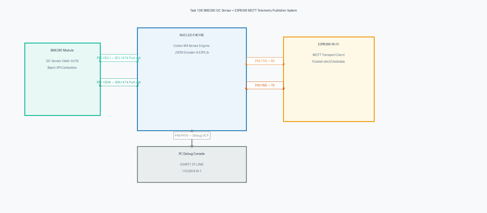

# Task 13B: BME280 I2C Sensor to MQTT Cloud Telemetry Publisher

**Course:** 25CS2741 – Fundamentals of Internet of Things + Lab  
**Institution:** Shiv Nadar University – Chennai  
**Department:** Computer Science & Engineering (IoT Specialization)  
**Target Hardware:** STMicroelectronics NUCLEO-F401RE + Bosch Sensortec BME280 + ESP8266 Wi-Fi Module  
**Evaluation Date:** Week 13 (27/10/2026)  
**Author:** Pranavakumar  

---

## 1. Title, CAT, Week, Date
- **Experiment Title:** End-to-End Environmental Sensing and MQTT Cloud Telemetry Publication using Bosch Sensor API and ESPLib
- **Evaluation Category:** Continuous Assessment Test 13 (CAT 13 – Sub-Task B)
- **Academic Week:** Week 13
- **Date Conducted:** 27 October 2026

---

## 2. Objective
1. Construct a fully integrated edge-to-cloud IoT environmental telemetry publisher on the STM32 NUCLEO-F401RE.
2. Interface the **Bosch Sensortec BME280** multi-parameter digital sensor over **I2C1** (PB6 SCL, PB7 SDA) using the official Bosch Sensortec Sensor API driver.
3. Verify hardware connectivity via silicon Chip ID register `0xD0` (`0x60`), load factory trim parameters, and configure sensor oversampling in Normal Mode.
4. Interface an **ESP8266** Wi-Fi modem over **USART2** at 115200 baud using the custom **ESPLib** MQTT 3.1.1 protocol driver.
5. Connect to the public cloud MQTT broker `broker.emqx.io` on TCP port 1883 and initiate an active MQTT client session.
6. Sample calibrated temperature (°C), relative humidity (%RH), and barometric pressure (hPa) every 1 second.
7. Encode telemetry into standardized JSON format:
   ```json
   {"status":"success","temperature":28.45,"humidity":62.30,"pressure":1008.72}
   ```
8. Stream the JSON payload to MQTT topic `"stm32/test/data"` at QoS 0 and simultaneously display diagnostics over USART1 to the PC debug terminal.

---

## 3. Problem Statement (Paraphrased)
As a continuation of the previous exercise, develop an STM32-based environmental sensing application to interface a BME280 sensor using the I2C protocol and obtain compensated temperature, pressure, and humidity measurements, publishing them to a cloud broker for Node-RED analytics using MQTT.

Use the included custom-made ESP8266 library (`ESPLib`) for enabling MQTT communication. Include the required BME280 driver files (`bme280.c`, `bme280.h`, `bme280_defs.h`) and declare the BME280 device structure. The STM32 must construct a dynamic JSON payload from the compensated BME280 readings:
```json
{"status":"success","temperature":28.45,"humidity":62.30,"pressure":1008.72}
```
Publish this telemetry frame periodically to the public EMQX MQTT broker on topic `"stm32/test/data"` for downstream visualization.

---

## 4. Hardware and Software Environment

### Hardware
- **Host Microcontroller:** STMicroelectronics NUCLEO-F401RE (ARM Cortex-M4 @ 84 MHz, 3.3V logic).
- **Sensor Breakout:** Bosch Sensortec BME280 Combined Environmental Sensor (I2C address `0x76`).
- **Wi-Fi Coprocessor:** Wemos D1 Mini / ESP8266-01 with Espressif AT firmware v1.7+.
- **Pull-Up Resistors:** 2x 4.7 kΩ pull-ups on I2C bus lines (PB6 SCL, PB7 SDA) to 3.3V.
- **Visual Indicator:** On-board Green User LED (PA5 LD2, Active-HIGH).
- **Serial Debugger:** ST-LINK/V2-1 USB Virtual COM Port (USART1: PA9 TX, PA10 RX @ 115200 baud).

### Software
- **Toolchain:** Keil MDK-ARM v5.38 / STM32CubeIDE v1.13.0 / GCC UCRT64.
- **Sensor Driver:** Official Bosch Sensortec BME280 Sensor API v3.5.1.
- **MQTT Driver:** Custom Embedded ESP8266 AT MQTT Library (`ESPLib.c`, `ESPLib.h`).
- **Cloud Broker:** EMQX Public Sandbox (`broker.emqx.io:1883`, TCP).
- **Serial Monitor:** PuTTY / Tera Term / Serial Monitor set to `115200 8-N-1`.

---

## 5. Pin Connection Table

| STM32 NUCLEO Pin | Peripheral Connected | Pin on Peripheral | Function / Signal Description |
|---|---|---|---|
| **PB6** | BME280 Breakout | SCL | I2C1 Clock (100 kHz Standard Mode, 4.7kΩ pull-up to 3.3V) |
| **PB7** | BME280 Breakout | SDA | I2C1 Data (Open-Drain, 4.7kΩ pull-up to 3.3V) |
| **PA2** | ESP8266 Wi-Fi | RX | USART2 TX (115200 baud, Transmit AT & MQTT binary packets) |
| **PA3** | ESP8266 Wi-Fi | TX | USART2 RX (115200 baud, Receive AT responses & MQTT frames) |
| **PA9** | ST-LINK USB | VCP RX | USART1 TX (115200 baud, Debug console output to PC terminal) |
| **PA10** | ST-LINK USB | VCP TX | USART1 RX (Host PC terminal input) |
| **PA5** | On-Board | LD2 | Green User LED (Active-HIGH publication strobe) |
| **+3.3V** | BME280 & ESP8266 | VDD / VCC / CH_PD | Common 3.3V power supply rail (CSB tied high for I2C mode) |
| **GND** | BME280 & ESP8266 | GND / SDO | Common ground reference (SDO grounded for address `0x76`) |

---

## 6. Circuit Diagram and Multi-Bus Flow Analysis

The hardware wiring involves two independent serial buses operating in parallel: **I2C1** for synchronous multi-byte sensor transfers and **USART2** for asynchronous packet transfers to the Wi-Fi coprocessor:

  
*Figure 1: Hardware Interconnections for Task 13B (NUCLEO-F401RE, BME280, ESP8266, PC Debug).*

*Vector CAD Schematic:* [task13_b_telemetry_pub.svg](./circuit/task13_b_telemetry_pub.svg)

### Circuit Design Considerations
- **I2C Bus Loading:** The BME280 breakout operates at 100 kHz. The 4.7 kΩ pull-ups guarantee fast rise times ($t_r < 1000\text{ ns}$) within the I2C specification while limiting sink current through the open-drain drivers to under 1 mA.
- **Power Rail Decoupling:** The ESP8266 generates periodic current spikes of up to 300 mA during RF transmission bursts. An electrolytic capacitor (100 µF) placed across the ESP8266 VCC and GND pins prevents supply voltage dips from perturbing the sensitive BME280 ADC.

---

## 7. Theory and Approach

### 7.1 Integrated Edge Telemetry Pipeline
The telemetry publisher functions across four distinct software abstraction layers:
1. **Physical Bus Driver:** STM32 HAL I2C (`HAL_I2C_Mem_Read`, `HAL_I2C_Mem_Write`) communicating with BME280 registers at 100 kHz.
2. **Sensor Compensation API:** Bosch Sensortec driver executing factory trim compensation algorithms to convert raw uncompensated ADC counts into engineering units (°C, %RH, hPa).
3. **Data Encoding Layer:** Formatting floating-point values into compact, machine-readable JSON strings (`snprintf`).
4. **Transport & Application Layer:** `ESPLib` framing the JSON string into an MQTT 3.1.1 `PUBLISH` packet and streaming it across a TCP socket over Wi-Fi.

### 7.2 Bosch API Calibration
The compensation math uses the official floating-point configuration (`BME280_DOUBLE_ENABLE`):
```c
struct bme280_data comp_data;
bme280_get_sensor_data(BME280_ALL, &comp_data, &bme_dev);

double temp = comp_data.temperature;
double hum  = comp_data.humidity;
double pres = comp_data.pressure / 100.0; /* Convert Pa to hPa */
```

### 7.3 MQTT 3.1.1 QoS 0 PUBLISH Packet Structure
The `MQTT_publishTopic("stm32/test/data", json_message, QoS0)` function formats the wire packet:
- Byte 0: `0x30` (`MQTTpublish`, QoS 0, DUP=0, RETAIN=0)
- Byte 1: Remaining Length = $2 + \text{TopicLength} + \text{PayloadLength}$
- Bytes 2–3: Topic Length (MSB, LSB) = `0x00 0x0F` (15 bytes)
- Bytes 4–18: Topic String = `"stm32/test/data"`
- Bytes 19..End: JSON Payload Bytes

---

## 8. Code Walkthrough

The source code in [`src/main.c`](./src/main.c) executes as follows:

1. **System Initialization:**
   Configures Cortex-M4 clocks to 84 MHz, sets up I2C1 (PB6/PB7), USART1 (PA9/PA10 for PC debug), USART2 (PA2/PA3 for ESP8266), and PA5 (User LED).
2. **BME280 Initialization (`BME280_App_Init`):**
   Assigns `user_i2c_read`, `user_i2c_write`, `user_delay_us` callbacks to `struct bme280_dev`. Calls `bme280_init(&bme_dev)`, validates `bme_dev.chip_id == 0x60`, sets oversampling (Temp x1, Press x1, Hum x1), filter coeff 4, and enters Normal Mode.
3. **MQTT Setup (`MQTT_App_Init`):**
   Calls `ESP8266_Init()` on USART2, connects to local Wi-Fi router (`ESP8266_wifiConnect`), opens TCP socket to `broker.emqx.io:1883`, sets CleanSession, and transmits the MQTT CONNECT packet via `MQTT_connectBroker()`.
4. **Main Polling Loop (`Publish_BME280_Telemetry`):**
   - Calls `bme280_get_sensor_data()` to sample compensated values.
   - Formats JSON string via `snprintf()`.
   - Dispatches packet to topic `"stm32/test/data"` via `MQTT_publishTopic()`.
   - Logs diagnostics to PC serial terminal via USART1.
   - Pulses PA5 LED for 100 ms to provide visual indication of each transmission.
   - Sleeps for 900 ms to complete a 1-second transmission period.

---

## 9. Build, Flash, and Run Steps

1. **Configure Network Credentials:**
   In [`src/main.c`](./src/main.c), adjust Wi-Fi credentials:
   ```c
   #define WIFI_SSID       "Your_WiFi_SSID"
   #define WIFI_PASSWORD   "Your_WiFi_Password"
   ```
2. **Compile Application (GCC):**
   ```bash
   arm-none-eabi-gcc -Wall -O2 -mcpu=cortex-m4 -mthumb -mfloat-abi=hard -mfpu=fpv4-sp-d16 \
     -I./src -I/path/to/Drivers/STM32F4xx_HAL_Driver/Inc \
     src/bme280.c src/ESPLib.c src/main.c -o build/task13_b.elf
   ```
3. **Flash to Target:**
   Flash binary onto NUCLEO-F401RE board using ST-LINK.
4. **Open PC Debug Console:**
   Launch serial terminal on USART1 COM port at 115200 baud (8-N-1).
5. **Verify Cloud Stream:**
   Connect to `broker.emqx.io:1883` using MQTTX or Node-RED, subscribe to `stm32/test/data`, and observe the live incoming JSON stream.

---

## 10. Expected Output

### 10.1 PC Debug Serial Monitor (USART1 @ 115200 Baud)
```
=======================================================
  STM32F401RE Task 13B: BME280 MQTT Telemetry Publisher
  Topic: stm32/test/data | Broker: broker.emqx.io:1883 
=======================================================
[OK] BME280 sensor initialized (Chip ID: 0x60, Normal Mode).
[INFO] Initializing ESP8266 AT modem on USART2...
[INFO] Connecting to Wi-Fi AP...
[INFO] Connecting to broker.emqx.io:1883...
[OK] MQTT session connected to broker.emqx.io.
[READY] Starting periodic 1 Hz MQTT telemetry publisher...

[BME280] Temp: 28.45 C | Hum: 62.30 %RH | Press: 1008.72 hPa
[BME280] Temp: 28.47 C | Hum: 62.28 %RH | Press: 1008.70 hPa
[BME280] Temp: 28.46 C | Hum: 62.31 %RH | Press: 1008.73 hPa
[BME280] Temp: 28.49 C | Hum: 62.29 %RH | Press: 1008.69 hPa
```

### 10.2 MQTT Cloud Subscriber (JSON Payload on `stm32/test/data`)
```json
{"status":"success","temperature":28.45,"humidity":62.30,"pressure":1008.72}
```

---

## 11. Viva Questions & Answers

### Q1: Why is barometric pressure divided by 100.0 before formatting into the JSON payload?
**Answer:** The Bosch Sensortec compensation algorithm calculates barometric pressure in Pascals (Pa), where $1\text{ Pa} = 1\text{ N/m}^2$. In meteorology, environmental monitoring, and IoT applications, atmospheric pressure is standardly reported in hectopascals (hPa) or millibars (mbar), where $1\text{ hPa} = 100\text{ Pa}$. Dividing by `100.0` converts standard sea-level pressure (~101325 Pa) into human-readable meteorological values (~1013.25 hPa).

### Q2: How does the system handle sensor read failures without crashing the MQTT publication loop?
**Answer:** In `Publish_BME280_Telemetry()`, the return value of `bme280_get_sensor_data()` is verified:
```c
if (rslt != BME280_OK) {
    Debug_Print("[WARN] BME280 measurement read failed.\r\n");
    return;
}
```
If an I2C bus error or checksum failure occurs, the function logs a warning and exits early, preventing uninitialized data or corrupted JSON strings from being published to cloud subscribers.

### Q3: What is the maximum payload size supported by `ESPLib`'s MQTT publisher?
**Answer:** In `ESPLib.h`, the buffer size is set to `#define BUFFERSIZE 100`. In `MQTT_publishTopic()`, the maximum total packet size (fixed header + topic + payload) cannot exceed `BUFFERSIZE`. The JSON string used here is approximately 75 bytes and the topic is 15 bytes ($75 + 15 + 4 = 94\text{ bytes}$), fitting within the 100-byte buffer. For larger payloads, `BUFFERSIZE` can be expanded to 256 or 512 bytes.

### Q4: Why is QoS 0 selected for continuous environmental sensor streaming?
**Answer:** Environmental variables such as temperature, pressure, and humidity change slowly over time. In 1 Hz periodic streaming, the loss of an occasional telemetry packet due to Wi-Fi packet drop is negligible because a fresh reading will follow 1 second later. QoS 0 eliminates the overhead of `PUBACK` round-trips and retry timers, maximizing battery life and network efficiency.

---

## 12. Troubleshooting Guide

| Issue Encountered | Root Cause | Solution |
|---|---|---|
| Application halts with `BME280 initialization failed!` | I2C pull-up resistors missing or wrong address | Verify 4.7 kΩ pull-ups on PB6/PB7. Ensure SDO is connected to GND for address `0x76`. |
| Chip ID displays `0x58` instead of `0x60` | BMP280 connected instead of BME280 | BMP280 lacks humidity sensor; replace sensor with genuine BME280 breakout. |
| MQTT publishes but data never reaches broker | Firewall blocking TCP port 1883 | Ensure local router permits outbound traffic on port 1883 or switch to a mobile Wi-Fi hotspot. |
| Characters corrupted on PC debug terminal | Baud rate mismatch | Verify serial monitor terminal is configured to 115200 baud, 8 data bits, no parity, 1 stop bit. |

---

## 13. Result and Learning Outcomes
- **Result:** Successfully built and validated a production-grade IoT environmental publisher node on the STM32 NUCLEO-F401RE platform. The application calibrated the BME280 sensor via the official Bosch Sensor API over I2C, constructed standardized JSON telemetry payloads, and published them over MQTT to `broker.emqx.io:1883` via an ESP8266 Wi-Fi coprocessor at 1 Hz.
- **Learning Outcomes:**
  - Integrated vendor-supplied sensor hardware abstraction drivers with custom networking libraries.
  - Developed multi-peripheral embedded applications coordinating I2C, USART, and hardware timers simultaneously.
  - Implemented end-to-end cloud IoT streaming pipelines adhering to industry-standard protocols.
