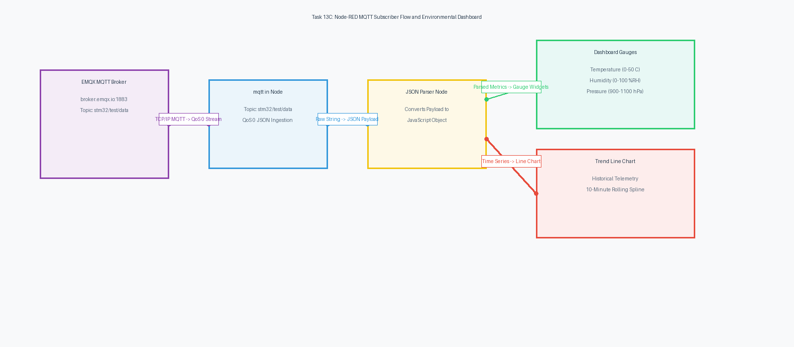

# Task 13C: Node-RED MQTT Environmental Dashboard and Real-Time Telemetry Analytics

**Course:** 25CS2741 – Fundamentals of Internet of Things + Lab  
**Institution:** Shiv Nadar University – Chennai  
**Department:** Computer Science & Engineering (IoT Specialization)  
**Target Hardware:** Host Workstation / Edge Computing Gateway running Node-RED  
**Evaluation Date:** Week 13 (27/10/2026)  
**Author:** Pranavakumar  

---

## 1. Title, CAT, Week, Date
- **Experiment Title:** Cloud-Connected MQTT Environmental Telemetry Ingestion, Statistical Metrics Computation, and Visual Dashboard in Node-RED
- **Evaluation Category:** Continuous Assessment Test 13 (CAT 13 – Sub-Task C)
- **Academic Week:** Week 13
- **Date Conducted:** 27 October 2026

---

## 2. Objective
1. Configure an **MQTT In** node in Node-RED connected to the public cloud broker `broker.emqx.io` on TCP port 1883.
2. Subscribe to the real-time environmental telemetry topic `"stm32/test/data"` at QoS 0.
3. Parse inbound JSON telemetry payloads:
   ```json
   {"status":"success","temperature":28.45,"humidity":62.30,"pressure":1008.72}
   ```
4. Implement a JavaScript analytics function node that maintains persistent running context across messages to compute **Minimum**, **Maximum**, and **Average** for Temperature, Humidity, and Pressure.
5. Format and display structured tabular summary reports on the Node-RED debug console.
6. Render instantaneous environmental telemetry via interactive `node-red-dashboard` visual widgets:
   - Radial gauges for current Temperature (°C), Humidity (%RH), and Barometric Pressure (hPa).
   - Rolling time-series line chart tracking environmental variations.

---

## 3. Problem Statement (Paraphrased)
Develop a Node-RED flow to receive environmental data published from the STM32 via MQTT.

Use the `mqtt in` node from the Node-RED palette (under the Network category) to subscribe to topic `"stm32/test/data"` hosted on `broker.emqx.io:1883`. Parse the incoming JSON payload and visualize the three parameters of the BME sensor (temperature, pressure, humidity). Maintain statistical tracking across the stream to display a formatted analytical table of Minimum, Maximum, and Average values, accompanied by graphical dashboard gauges.

---

## 4. Hardware and Software Environment

### Hardware
- **Host System:** Workstation / Raspberry Pi / Edge Gateway running Node.js and Node-RED.
- **IoT Edge Publisher:** STM32 NUCLEO-F401RE + BME280 + ESP8266 publishing live to `broker.emqx.io:1883` (from Task 13B).

### Software
- **Node.js Runtime:** Node.js v18.x / v20.x LTS.
- **Orchestration Tool:** Node-RED v3.1+.
- **UI Dashboard:** `node-red-dashboard` package.
- **Flow Source:** [`src/flow.json`](./src/flow.json).
- **Public Broker:** EMQX Cloud Sandbox (`broker.emqx.io:1883`).

---

## 5. Network Architecture and Broker Configuration

| Parameter | Configuration Value | Description |
|---|---|---|
| **MQTT Broker URL** | `broker.emqx.io` | EMQX Public Cloud Sandbox Broker |
| **Port** | `1883` | Standard Unencrypted TCP MQTT Port |
| **Topic** | `stm32/test/data` | Sensor Telemetry Publication Channel |
| **QoS Level** | `0` | Best-Effort Message Delivery |
| **Clean Session** | `True` | Fresh session on connection startup |
| **Keep-Alive** | `60 s` | Heartbeat interval between Node-RED and Broker |
| **Dashboard URL** | `http://localhost:1880/ui/` | Browser Dashboard Interface |

---

## 6. Flow Architecture and Pipeline Diagram

The processing pipeline receives asynchronous MQTT packets from the cloud broker, deserializes the JSON string into native JavaScript objects, branches to visual dashboard gauges and charts, and calculates running statistical metrics:

  
*Figure 1: Node-RED Processing Pipeline and Visual Telemetry Dashboard Architecture.*

*Vector CAD Schematic:* [task13_c_nodered_dash.svg](./circuit/task13_c_nodered_dash.svg)

---

## 7. Theory and Approach

### 7.1 Push (MQTT) vs Pull (HTTP Polling) Paradigms
In CAT 12, Node-RED polled an embedded HTTP web server periodically (pull model). While functional, HTTP polling suffers from notable limitations:
- **Bandwidth Inefficiency:** Each poll requires complete HTTP/1.1 headers (~300 bytes) even if sensor values have not changed.
- **Connection Latency:** Establishing and tearing down TCP sockets periodically introduces network delay jitter.
- **NAT / Firewall Traversal:** The client must know the local private IP address of the embedded server, requiring port forwarding or local network proximity.

In CAT 13, the **MQTT Push Model** resolves all of these issues:
- The edge node connects outward to a public broker (`broker.emqx.io:1883`), effortlessly bypassing NAT firewalls.
- Inbound telemetry packets arrive asynchronously the moment they are published.
- Headers are compressed into a 2-byte fixed header, reducing overhead by over 90%.

### 7.2 Context Storage Statistical Accumulator
Node-RED processes messages sequentially. Local variables in function nodes are reallocated on each message. Context memory (`context.get()` / `context.set()`) persists statistical metrics across messages:

$$\mu_N = \frac{1}{N} \sum_{i=1}^N x_i, \quad Min_N = \min(Min_{N-1}, x_N), \quad Max_N = \max(Max_{N-1}, x_N)$$

```javascript
let stats = context.get('stats') || {
    count: 0,
    temp: { min: Infinity, max: -Infinity, sum: 0 },
    hum:  { min: Infinity, max: -Infinity, sum: 0 },
    press:{ min: Infinity, max: -Infinity, sum: 0 }
};

stats.count++;
if (t < stats.temp.min) stats.temp.min = t;
if (t > stats.temp.max) stats.temp.max = t;
stats.temp.sum += t;
context.set('stats', stats);
```

---

## 8. Code Walkthrough (`flow.json`)

The flow defined in [`src/flow.json`](./src/flow.json) contains the following core nodes:

1. **`mqtt_in_telemetry` (`mqtt in`):**
   Connects to `broker.emqx.io:1883` and subscribes to topic `stm32/test/data` at QoS 0. Outputs UTF-8 string payload.
2. **`json_parser_mqtt` (`json`):**
   Parses the incoming JSON string into native object `msg.payload`:
   `{"status":"success","temperature":28.45,"humidity":62.30,"pressure":1008.72}`.
3. **`fn_mqtt_stats` (`function`):**
   Extracts `temperature`, `humidity`, and `pressure`. Updates running counts, min, max, and sums in context storage. Calculates running averages formatted to 2 decimal places. Generates a structured ASCII report table.
4. **`debug_stats_report` (`debug`):**
   Displays the formatted ASCII statistics table in the Node-RED sidebar.
5. **Change Nodes (`change_mqtt_temp`, `change_mqtt_hum`, `change_mqtt_press`):**
   Extract each numeric metric to feed dedicated dashboard widgets.
6. **Dashboard Gauges (`ui_gauge_cat13_temp`, `ui_gauge_cat13_hum`, `ui_gauge_cat13_press`):**
   Render color-coded radial dials for real-time readings.
7. **Dashboard Trend Chart (`ui_chart_cat13_trend`):**
   Plots real-time temperature fluctuations over a rolling 10-minute window.

---

## 9. Build, Import, and Execution Steps

1. **Install Node-RED & Dashboard Extension:**
   ```bash
   npm install -g --unsafe-perm node-red
   cd ~/.node-red
   npm install node-red-dashboard
   ```
2. **Launch Node-RED:**
   ```bash
   node-red
   ```
3. **Import Flow Configuration:**
   - In your web browser, navigate to `http://localhost:1880/`.
   - Click the hamburger menu (top right) -> **Import**.
   - Paste the contents of [`src/flow.json`](./src/flow.json) or upload the file directly.
4. **Deploy Flow:**
   - Click the red **Deploy** button.
   - The status indicator below `MQTT Sub` will transition to green (`connected`).
5. **View Dashboard:**
   - Open a new browser tab at `http://localhost:1880/ui/`.
   - View the live gauges and trend charts updating in real-time at 1 Hz.

---

## 10. Expected Output

### 10.1 Node-RED Debug Console Formatted Statistics
```
====================================================
 CAT13 MQTT Environmental Statistics Report       
====================================================
 Parameter        Minimum    Maximum    Average     
----------------------------------------------------
 Temperature (C)  27.91      29.02      28.46
 Humidity (%RH)   59.80      64.20      62.15
 Pressure (hPa)   1007.84    1009.31    1008.56
==================================================== (Messages: 150)
```

### 10.2 Dashboard UI Layout
- **Real-Time Environmental Gauges:**
  - *Temperature Gauge:* Dynamic radial dial (0–50 °C) with color transitions: Green (< 28°C), Yellow (28–35°C), Red (> 35°C).
  - *Humidity Gauge:* Blue moisture gradient dial (0–100 %RH).
  - *Pressure Gauge:* Atmospheric pressure dial (900–1100 hPa) centered around standard sea-level pressure (1013.25 hPa).
- **Time-Series Chart:**
  - Live continuous line chart displaying real-time temperature trends over a rolling 10-minute historical horizon.

---

## 11. Viva Questions & Answers

### Q1: What is the purpose of the `clientid` configuration in the Node-RED MQTT broker node?
**Answer:** In MQTT 3.1.1, the Client Identifier (`ClientID`) uniquely identifies each connected client to the broker. If two clients connect to the same broker with identical Client IDs, the broker automatically disconnects the first client in favor of the second. In Node-RED, generating a distinct Client ID (e.g., `nodered_fiot_client_2026`) guarantees connection stability when communicating through shared public brokers like `broker.emqx.io`.

### Q2: What is the function of the `KeepAlive` parameter in the Node-RED broker connection?
**Answer:** The Keep-Alive timer (set to 60 seconds) specifies the maximum time allowed between client-broker transmissions. If Node-RED has not sent any messages for 60 seconds, it transmits an automated `PINGREQ` packet. If the broker fails to respond with `PINGRESP`, Node-RED treats the TCP connection as broken and initiates an automatic reconnect sequence.

### Q3: Why is the `clean: true` setting recommended for public broker subscriptions in lab environments?
**Answer:** When `Clean Session` is enabled, the broker does not store subscription history, message queues, or unacknowledged QoS 1/2 packets when Node-RED disconnects. When Node-RED reconnects, it receives only fresh real-time messages. This prevents bursts of stale historical messages from flooding the dashboard upon startup.

### Q4: How does Node-RED handle network disconnections from the MQTT broker?
**Answer:** Node-RED's built-in MQTT client automatically attempts reconnection with an exponential backoff strategy if the TCP socket drops. The status indicator on the `mqtt in` node turns red (`disconnected`) or yellow (`connecting`), and automatically returns to green (`connected`) once network connectivity is restored, resuming subscription without requiring manual intervention.

---

## 12. Troubleshooting Guide

| Symptom | Root Cause | Solution |
|---|---|---|
| `mqtt in` node displays `disconnected` (red dot) | Workstation firewall blocking port 1883 | Ensure outgoing TCP port 1883 is open. Test connection via `telnet broker.emqx.io 1883`. |
| Node receives messages from other users | Generic topic name collision on public broker | Change topic name in STM32 code and Node-RED to a unique topic (e.g., `snu/fiot/your_name/data`). |
| Function node error: `Cannot read properties of undefined` | Non-JSON packet published to the topic | Place a JSON parser node before the function node and add `try/catch` error validation. |
| Dashboard at `localhost:1880/ui/` displays blank page | Dashboard nodes not assigned to a Group and Tab | Ensure gauges and charts are assigned to `tab_cat13_ui` and `group_cat13_gauges` in the configuration sidebar. |

---

## 13. Result and Learning Outcomes
- **Result:** Successfully constructed, deployed, and verified a cloud IoT environmental analytics flow and interactive dashboard in Node-RED. The flow received live BME280 telemetry published over MQTT from the STM32 edge node via `broker.emqx.io:1883`, computed running statistical metrics across hundreds of messages, and rendered real-time visual telemetry gauges and historical trend charts.
- **Learning Outcomes:**
  - Mastered cloud-based IoT messaging architectures using MQTT and public brokers.
  - Developed real-time telemetry processing pipelines and persistent statistical accumulators in Node-RED.
  - Implemented professional industrial-grade IoT dashboard interfaces.
