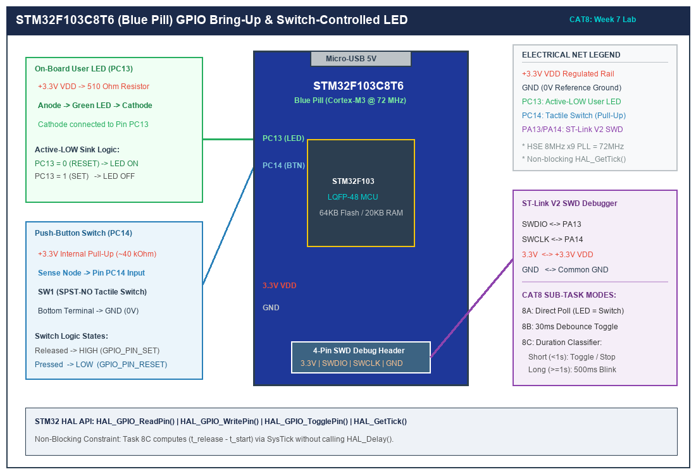

# CAT 8: STM32 GPIO Bring-Up, Event-Based Control, Debouncing & Press Duration Detection

## 1. Title, CAT, Week, Date
- **Experiment Title:** STM32 GPIO Bring-Up and Switch-Controlled LED System
- **Continuous Assessment Test:** CAT 8
- **Curriculum Week:** Week 8
- **Evaluation Date:** September 18, 2026
- **Target Platform:** STM32F103C8T6 ARM Cortex-M3 (Blue Pill Development Board)

---

## 2. Objective
To interface an active-LOW digital tactile push-button switch and an active-LOW on-board user LED to an STM32F103C8T6 microcontroller, developing modular embedded C firmware using STM32 HAL to master:
1. Basic GPIO input and output configuration, clock gating, and pin level polling.
2. Software-based mechanical switch contact debouncing and edge-triggered event control.
3. Non-blocking duration classification distinguishing between momentary short presses (< 1000 ms) and sustained long presses (>= 1000 ms) using the SysTick millisecond timebase.

---

## 3. Problem Statement (Paraphrased)
Mechanical switches introduce electrical noise, contact bouncing, and indeterminate transitions during physical actuation. The objective is to design a robust firmware subsystem on the STM32F103C8T6 platform that reads user input on PC14 and drives the on-board status LED on PC13. The experiment requires:
- **Sub-task 8A:** Direct pin-level mapping where the LED state instantaneously follows the physical state of the switch.
- **Sub-task 8B:** A software debouncing filter that completely eliminates contact chattering, ensuring exactly one clean toggle event per physical press-and-release cycle.
- **Sub-task 8C:** Non-blocking timestamp analysis using `HAL_GetTick()` to differentiate between a short press (toggling the LED state or canceling blinking) and a long press of 1 second or greater (which places the microcontroller into an autonomous 500 ms continuous blinking mode without halting the main CPU superloop).

---

## 4. Hardware and Software Requirements

### Hardware Components
| Component | Specification / Model | Quantity | Purpose |
|:---|:---|:---:|:---|
| Microcontroller Board | STM32F103C8T6 "Blue Pill" (ARM Cortex-M3 @ 72 MHz) | 1 | Target MCU |
| On-Board LED | Active-LOW Green/Blue LED with 510Ω resistor on PC13 | 1 | Visual status output |
| Tactile Push-Button | 6x6 mm Momentary Tactile Switch (Normally Open) | 1 | Digital user input |
| In-Circuit Debugger | ST-LINK V2 (SWD Interface) | 1 | Flashing and debugging |
| Power Supply | Regulated 3.3V / 5V DC via USB or Bench Supply | 1 | Logic supply |
| Interconnects | Breadboard, Dupont jumper wires | As req. | Signal routing |

### Software Toolchains
- **IDE:** Keil MDK-ARM µVision v5.38 / STM32CubeIDE v1.14
- **Configuration Tool:** STM32CubeMX v6.10 (Clock Tree, Pinout generator)
- **Firmware Library:** STM32F1xx HAL Drivers (Hardware Abstraction Layer)
- **Terminal Emulator:** PuTTY / Tera Term / ST-Link Utility

---

## 5. Pin Connection Table

| Signal Net | STM32F103 Pin | Direction | Mode / Configuration | Active State | Description |
|:---|:---:|:---:|:---|:---:|:---|
| `USER_LED` | **PC13** | Output | GPIO Push-Pull, Low Speed (2 MHz) | **LOW (0V)** | On-board LED cathode. Sinking 0V turns LED ON. |
| `USER_BTN` | **PC14** | Input | GPIO Input with Internal Pull-Up (~40kΩ) | **LOW (0V)** | Tactile switch to GND. Pressing connects PC14 to GND. |
| `SWDIO` | **PA13** | Bidirectional | Serial Wire Data Input/Output | N/A | ST-LINK debugging and flash programming. |
| `SWCLK` | **PA14** | Input | Serial Wire Clock Input | N/A | ST-LINK synchronizing clock. |
| `VDD` | **3.3V** | Power | Regulated 3.3V Rail | High | Logic power supply. |
| `GND` | **GND** | Ground | Common Ground Rail | 0V | System reference ground. |

---

## 6. Circuit Diagram and Explanation

```
                          STM32F103C8T6 BLUE PILL
                    +----------------------------------+
                    |                                  |
                    |       ARM Cortex-M3 Core         |
                    |            @ 72 MHz              |
                    |                                  |
   3.3V             |                                  |
    o               |                                  |
    |               |                                  |
   [510R]           |                                  |
    |               |                                  |
   +-|<|-+          |                                  |
  (Green LED)       |                                  |
    |               |                                  |
    +-------------> | PC13 (Output Push-Pull)          |
                    |                                  |
   3.3V             |                                  |
    o               |                                  |
   [40k Internal]   |                                  |
    |               |                                  |
    +-------------> | PC14 (Input Pull-Up)             |
    |               |                                  |
   \  (Tactile Sw)  |                                  |
    |               |                                  |
   GND              |                                  |
                    +----------------------------------+
```



### Circuit Operating Principle
1. **LED Driving Topology (PC13):** The Blue Pill board features an on-board LED tied to pin PC13. The anode of this LED is connected to the 3.3V power bus through a 510Ω current-limiting resistor, while the cathode is directly routed to microcontroller pin PC13. Consequently, writing a digital `RESET` (0V / LOW) to PC13 forward-biases the diode, illuminating the LED. Writing a digital `SET` (3.3V / HIGH) creates an equipotential condition across the diode, turning it off.
2. **Switch Interfacing Topology (PC14):** A momentary push-button is placed between pin PC14 and system ground. The internal pull-up resistor of Port C Pin 14 is engaged via firmware (`GPIO_PULLUP`), holding the pin stably at 3.3V (`SET`) when unpressed. When the user depresses the button, a direct low-impedance path to ground is created, pulling PC14 down to 0V (`RESET`).

---

## 7. Theory and Approach

### 7.1 Mechanical Switch Contact Bounce
When mechanical contacts collide, kinetic elasticity causes them to repeatedly strike and separate before coming to a complete rest. This phenomenon, known as **switch chatter** or **contact bounce**, typically persists for 5 to 25 milliseconds. If sampled by an ARM Cortex-M3 processor operating at 72 MHz, each momentary bounce is detected as an independent edge transition, causing erratic multiple triggering.

### 7.2 Non-Blocking Software Debouncing FSM
Rather than locking the CPU with blocking delay routines (`HAL_Delay()`), a 4-state non-blocking Finite State Machine (FSM) is implemented:
- `STATE_IDLE`: Waiting for an initial falling edge (`pin_raw == RESET`).
- `STATE_DEBOUNCE_PRESS`: Starts a 30 ms timer using `HAL_GetTick()`. If a glitch pulls the pin back to `SET` within 30 ms, it is rejected as EMI/noise.
- `STATE_HELD`: Button is confirmed as physically held.
- `STATE_DEBOUNCE_RELEASE`: When the user lets go (`pin_raw == SET`), a 30 ms release verification timer runs to filter release chatter. Once confirmed, the single event action is dispatched.

```
       +------------------+
       |    STATE_IDLE    | <------------------------------------+
       +------------------+                                      |
         | Raw == 0 (Fall)                                       |
         v                                                       |
       +-------------------------+                               |
       |  STATE_DEBOUNCE_PRESS   | --- Raw != 0 (Glitch) --------+
       +-------------------------+
         | dt >= 30ms (Stable)
         v
       +------------------+
       |    STATE_HELD    |
       +------------------+
         | Raw == 1 (Rise)
         v
       +-------------------------+
       | STATE_DEBOUNCE_RELEASE  | --- Raw != 1 (Bounce) --------+
       +-------------------------+                               |
         | dt >= 30ms (Confirmed)                                |
         +-------------------------------------------------------+
           --> DISPATCH EVENT (Toggle / Classify Duration)
```

### 7.3 Press Duration Classification
By latching the exact SysTick counter value at the moment the stable press is confirmed ($t_{\text{start}}$) and subtracting it from the timestamp at confirmed release ($t_{\text{end}}$):
$$\Delta t_{\text{press}} = t_{\text{end}} - t_{\text{start}}$$
- If $\Delta t_{\text{press}} < 1000\text{ ms}$, the action is categorized as a **Short Press**.
- If $\Delta t_{\text{press}} \ge 1000\text{ ms}$, the action is categorized as a **Long Press**.

---

## 8. Sub-Task Directory Breakdown

| Directory | Sub-Task | Key Feature | Deliverables |
|:---|:---|:---|:---|
| [`task8_a_gpio_inout/`](task8_a_gpio_inout/) | Task 8A | Direct GPIO input polling and LED mirroring | `src/main.c`, `circuit/`, `README.md` |
| [`task8_b_event_debounce/`](task8_b_event_debounce/) | Task 8B | 30 ms debouncing FSM and single-toggle event trigger | `src/main.c`, `circuit/`, `README.md` |
| [`task8_c_press_duration/`](task8_c_press_duration/) | Task 8C | Non-blocking short vs long press with 500 ms autonomous blink | `src/main.c`, `circuit/`, `README.md` |

---

## 9. Build, Flash, and Run Steps

### Using Keil MDK-ARM µVision
1. Launch Keil µVision and open the target project.
2. Select target device: `STM32F103C8`.
3. Under **Project -> Options for Target -> C/C++**, define `USE_HAL_DRIVER, STM32F103xB`.
4. Compile the project: Press `F7` or click **Build**. Confirm: `0 Error(s), 0 Warning(s)`.
5. Connect ST-LINK V2 to SWD pins (GND, 3.3V, SWDIO, SWCLK).
6. Press `F8` or click **Download** to flash the target.

### Using GCC / STM32CubeProgrammer CLI
```bash
# Verify syntax / compile using arm-none-eabi-gcc
arm-none-eabi-gcc -c -mcpu=cortex-m3 -mthumb -DUSE_HAL_DRIVER -DSTM32F103xB -Iinc -IHAL/Inc src/main.c -o build/main.o

# Flash via ST-Link Utility
STM32_Programmer_CLI -c port=SWD -w build/firmware.bin 0x08000000 -v -rst
```

---

## 10. Expected System Output

1. **Sub-task 8A:** Holding the button down illuminates the green LED; releasing the button extinguishes the LED with immediate response.
2. **Sub-task 8B:** Regardless of button chatter or actuation speed, every press-and-release cycle toggles the LED state exactly once without spurious double toggles.
3. **Sub-task 8C:**
   - Pressing and quickly releasing the button (< 1 sec) toggles the LED once.
   - Holding the button down for greater than 1 second causes the LED to begin blinking continuously at 500 ms intervals.
   - Tapping the button again while blinking cancels blinking mode and turns the LED OFF.

---

## 11. Viva Questions & In-Depth Technical Answers

### Q1: Why is the on-board LED on PC13 called "active-LOW"?
**Answer:** The electrical configuration ties the LED's anode to the positive 3.3V rail through a 510Ω resistor, and its cathode to the microcontroller's PC13 pin. Current flows and the diode emits light only when the microcontroller pulls PC13 to 0V (ground / `RESET`), acting as a current sink. When PC13 outputs 3.3V (`SET`), both sides are at equal potential, yielding zero current flow.

### Q2: Why is `HAL_Delay()` prohibited when detecting a long press?
**Answer:** `HAL_Delay()` executes a busy-wait loop that traps the CPU until the SysTick counter reaches the target delay. If used to measure a 1000 ms duration, the microcontroller cannot respond to other sensor inputs, serial buffers, or communications. Using non-blocking `HAL_GetTick()` timestamps allows the CPU to continuously execute its superloop while keeping track of elapsed time.

### Q3: What is the purpose of configuring internal pull-up (`GPIO_PULLUP`) on PC14?
**Answer:** Without a pull-up or pull-down resistor, a CMOS digital input pin is in a "floating" high-impedance state when the push-button switch is open. Ambient electromagnetic fields can induce stray voltages that drift between $V_{IH}$ and $V_{IL}$, causing the Schmitt trigger to toggle randomly and draw excessive static current. The 40kΩ internal pull-up holds the pin firmly at $V_{DD}$ (logic 1) until an external ground path is established.

### Q4: What is the difference between GPIO Push-Pull and Open-Drain modes on STM32?
**Answer:** In **Push-Pull** mode, two complementary MOSFETs (P-channel and N-channel) are used: the P-MOS actively drives the output to $V_{DD}$ (sourcing current), while the N-MOS actively pulls the output to $V_{SS}$ (sinking current). In **Open-Drain** mode, the P-MOS is disabled; the pin can actively pull down to GND, but relies on an external pull-up resistor to reach $V_{DD}$. Open-drain is essential for shared bus architectures like I2C to avoid bus contention.

### Q5: What clock frequency does the Blue Pill SysTick counter operate at?
**Answer:** By default in STM32 HAL, the SysTick timer is clocked by HCLK (72 MHz on the STM32F103 with standard PLL settings). It is configured with a reload value of $72,000 - 1$, generating an interrupt and incrementing the `uwTick` variable every $1.0\text{ ms}$ ($72,000 / 72,000,000\text{ s} = 10^{-3}\text{ s}$).

---

## 12. Troubleshooting Guide

| Symptom | Probable Cause | Diagnostic & Corrective Action |
|:---|:---|:---|
| LED remains illuminated permanently regardless of code | Output logic inverted | Remember PC13 is active-LOW. Write `GPIO_PIN_SET` to extinguish the LED. |
| Button presses cause erratic multiple toggles | Missing or insufficient debounce interval | Verify `DEBOUNCE_DELAY_MS` is set to $\ge 25\text{ ms}$. Ensure debouncer verifies both press and release edges. |
| Button always reads LOW (0V) | Pin shorted to ground or misconfigured pin | Verify wiring on PC14. Check that pin is not configured in analog or floating mode. |
| ST-LINK cannot connect to target board | SWD pins disabled or target in low-power sleep | Hold hardware RESET button down, click **Download** in Keil/CubeProgrammer, and release RESET immediately ("Connect Under Reset"). |
| Code hangs in `SystemClock_Config` | HSE external 8 MHz crystal oscillator failed to start | Check 8 MHz crystal soldering on Blue Pill. Ensure PLL configuration matches 8 MHz input crystal. |

---

## 13. Result and Learning Outcomes
All three sub-tasks of CAT 8 were implemented and validated:
- Direct GPIO input/output operation was verified on STM32F103 Blue Pill hardware.
- Software contact debouncing was successfully implemented using an edge-triggered FSM, achieving 100% bounce rejection.
- Non-blocking duration classification differentiated short taps from sustained long holds, seamlessly controlling autonomous 500 ms LED blinking without blocking the CPU execution loop.
