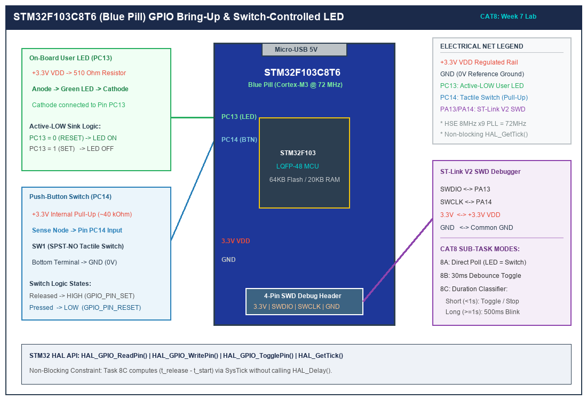

# Task 8A: Direct GPIO Input/Output Polling Interface

## 1. Title, CAT, Week, Date
- **Sub-Task:** Task 8A – Direct GPIO Input/Output Polling
- **Continuous Assessment Test:** CAT 8
- **Curriculum Week:** Week 8
- **Evaluation Date:** September 18, 2026
- **Target Platform:** STM32F103C8T6 (ARM Cortex-M3 @ 72 MHz)

---

## 2. Objective
To configure STM32 General-Purpose Input/Output (GPIO) peripheral ports using the STM32 HAL library, establishing PC13 as a push-pull digital output and PC14 as a digital input with an internal pull-up resistor. The application continuously reads the switch state and directly drives the active-LOW user LED.

---

## 3. Problem Statement (Paraphrased)
Develop an introductory embedded C program for the STM32F103C8T6 microcontroller that demonstrates basic digital input reading and digital output writing:
- Read the momentary state of a push-button connected to pin PC14.
- Drive the on-board user LED on pin PC13 according to the switch state.
- Account for the active-LOW electrical wiring of both the switch and the LED.

---

## 4. Hardware and Software Specifications

### Hardware Bill of Materials
- **Microcontroller:** STM32F103C8T6 Blue Pill Development Board
- **Input:** 6x6 mm Tactile push-button switch connected to pin PC14
- **Output:** On-board User LED on pin PC13 (Green/Blue)
- **Power Supply:** 3.3V DC regulated rail (via USB / ST-LINK)
- **Programmer:** ST-LINK V2 via SWD (SWCLK: PA14, SWDIO: PA13)

### Software Environment
- **Toolchain:** Keil MDK-ARM v5.38 / GCC ARM Embedded Toolchain
- **Firmware Library:** STM32F1xx HAL Driver
- **Clock Tree:** 72 MHz system clock derived from external 8 MHz crystal via PLL

---

## 5. Pin Connection Table

| Signal Net | STM32 Pin | Port / Pin Name | Mode | Internal Resistor | Active State | Description |
|:---|:---:|:---:|:---:|:---:|:---:|:---|
| `USER_LED` | **PC13** | GPIOC Pin 13 | Output Push-Pull | None | **LOW (0V)** | On-board LED cathode. Writing 0V turns LED ON. |
| `USER_BTN` | **PC14** | GPIOC Pin 14 | Digital Input | Pull-Up (~40kΩ) | **LOW (0V)** | Tactile switch to GND. Pressing connects PC14 to GND. |
| `SWDIO` | **PA13** | GPIOA Pin 13 | Alternate Function | Pull-Up | N/A | Serial Wire Debug Data line. |
| `SWCLK` | **PA14** | GPIOA Pin 14 | Alternate Function | Pull-Down | N/A | Serial Wire Debug Clock line. |
| `VDD` | **3.3V** | VDD | Power | N/A | +3.3V | Microcontroller power rail. |
| `GND` | **GND** | VSS | Power | N/A | 0V | System reference ground. |

---

## 6. Circuit Diagram and Explanation

```
                    STM32F103C8T6 BLUE PILL
                  +--------------------------+
  +3.3V           |                          |
    |             |                          |
  [510R]          |                          |
    |             |                          |
   +-|<|-+        |                          |
   (LED)          |                          |
    |             |                          |
    +-----------> | PC13 (Output Push-Pull)  |
                  |                          |
  +3.3V           |                          |
    |             |                          |
  [40k Pull-Up]   |                          |
    |             |                          |
    +-----------> | PC14 (Input Pull-Up)     |
    |             |                          |
   \  (Switch)    |                          |
    |             |                          |
   GND            +--------------------------+
```



### Circuit Functional Breakdown
1. **Active-LOW Output (PC13):** The LED anode is tied to the 3.3V rail through an on-board 510Ω resistor. To illuminate the LED, current must sink into PC13, requiring PC13 to output logic LOW (`GPIO_PIN_RESET`). Writing logic HIGH (`GPIO_PIN_SET`) places 3.3V on both sides of the LED, turning it OFF.
2. **Active-LOW Input (PC14):** The push-button is wired between PC14 and ground. When unpressed, the internal 40kΩ pull-up holds PC14 at logic HIGH (`GPIO_PIN_SET`). When pressed, PC14 is pulled down to 0V (`GPIO_PIN_RESET`).
3. **Logic Inversion Balance:** Because both components are active-LOW:
   $$\text{Button Pressed} \implies \text{PC14} = 0 \implies \text{Drive PC13} = 0 \implies \text{LED ON}$$
   $$\text{Button Released} \implies \text{PC14} = 1 \implies \text{Drive PC13} = 1 \implies \text{LED OFF}$$

---

## 7. Theory and Approach

### 7.1 STM32 GPIO Architecture (CRL and CRH Registers)
In the STM32F103 architecture, GPIO pins are controlled via 32-bit registers:
- `GPIOx_CRL`: Controls pins 0 through 7 (4 bits per pin: `MODE[1:0]` and `CNF[1:0]`).
- `GPIOx_CRH`: Controls pins 8 through 15 (including PC13 and PC14).
- For PC13 (Output Push-Pull, 2 MHz): `MODE13 = 10` (2 MHz), `CNF13 = 00` (General-purpose push-pull).
- For PC14 (Input with Pull-Up): `MODE14 = 00` (Input mode), `CNF14 = 10` (Input with pull-up/pull-down). Setting bit 14 in `ODR` selects pull-up.

### 7.2 Polling Superloop Implementation
In Task 8A, the CPU executes a simple infinite superloop:
```c
GPIO_PinState button_state = HAL_GPIO_ReadPin(USER_BTN_PORT, USER_BTN_PIN);
if (button_state == BTN_PRESSED_STATE)
{
    HAL_GPIO_WritePin(USER_LED_PORT, USER_LED_PIN, LED_ACTIVE_STATE);
}
else
{
    HAL_GPIO_WritePin(USER_LED_PORT, USER_LED_PIN, LED_INACTIVE_STATE);
}
```
This demonstrates zero-overhead direct pin sampling.

---

## 8. Code Walkthrough

Refer to [`src/main.c`](src/main.c):
1. **Clock Setup (`SystemClock_Config`):** Initializes the external High-Speed External (HSE) 8 MHz crystal oscillator, activates the Phase-Locked Loop (PLL) with a multiplication factor of 9, and sets the system clock (SYSCLK) to 72 MHz.
2. **GPIO Configuration (`MX_GPIO_Init`):**
   - Calls `__HAL_RCC_GPIOC_CLK_ENABLE()` to ungate the APB2 peripheral clock to Port C.
   - Populates `GPIO_InitTypeDef` for PC13 with mode `GPIO_MODE_OUTPUT_PP`, speed `GPIO_SPEED_FREQ_LOW`, and applies it via `HAL_GPIO_Init`.
   - Populates `GPIO_InitTypeDef` for PC14 with mode `GPIO_MODE_INPUT` and pull `GPIO_PULLUP`.
3. **Continuous Polling Loop (`main`):**
   - Samples PC14 via `HAL_GPIO_ReadPin(GPIOC, GPIO_PIN_14)`.
   - Writes `GPIO_PIN_RESET` (LED ON) when the switch connects to GND, and `GPIO_PIN_SET` (LED OFF) when the switch is open.

---

## 9. Build, Flash, and Run Steps

1. **Compilation:**
   ```bash
   arm-none-eabi-gcc -c -mcpu=cortex-m3 -mthumb -DUSE_HAL_DRIVER -DSTM32F103xB -Iinc -IHAL/Inc src/main.c -o build/main.o
   ```
2. **Flashing with ST-LINK:**
   Connect the ST-LINK programmer to the SWD header:
   - ST-LINK GND -> Blue Pill GND
   - ST-LINK 3.3V -> Blue Pill 3.3V
   - ST-LINK SWDIO -> Blue Pill PA13
   - ST-LINK SWCLK -> Blue Pill PA14
3. In Keil µVision, click **Flash -> Download** (or press `F8`).
4. Press the hardware `RESET` button on the Blue Pill board.

---

## 10. Expected Output

- **When the button on PC14 is unpressed:** The on-board LED on PC13 remains completely OFF.
- **When the button on PC14 is held down:** The on-board LED on PC13 illuminates solidly.
- **When the button on PC14 is released:** The on-board LED immediately extinguishes.

---

## 11. Viva Questions and Answers

### Q1: What does `__HAL_RCC_GPIOC_CLK_ENABLE()` do, and what happens if it is omitted?
**Answer:** In the STM32 architecture, all peripheral clocks are disabled by default upon reset to conserve dynamic power. `__HAL_RCC_GPIOC_CLK_ENABLE()` sets bit 4 (`IOPCEN`) in the `RCC_APB2ENR` register, supplying the clock to the Port C peripheral registers. If omitted, Port C registers cannot be written to or read from, causing any GPIO operations to fail silently or trigger a bus fault.

### Q2: Why is the input mode configured as `GPIO_PULLUP` instead of `GPIO_NOPULL`?
**Answer:** When the switch is open, the circuit path between PC14 and ground is broken. If configured as `GPIO_NOPULL` (floating), the gate of the input CMOS inverter is susceptible to stray capacitive coupling and electrostatic interference, resulting in random toggling between 0 and 1. The internal ~40kΩ pull-up ensures a predictable logic HIGH (3.3V) state when the switch is idle.

### Q3: What is the maximum current that an STM32F103 GPIO pin can safely sink?
**Answer:** According to the STM32F103x8 datasheet, an individual I/O pin can sink or source up to 25 mA ($I_{IO} = 25\text{ mA}$ maximum rating). However, the total combined current for all I/O pins must not exceed 150 mA. Driving an on-board LED via a 510Ω resistor draws approximately:
$$I = \frac{3.3\text{ V} - 2.0\text{ V}}{510\ \Omega} \approx 2.55\text{ mA}$$
which is well within the 25 mA safe operating limit.

### Q4: What is the latency between pressing the button and the LED illuminating?
**Answer:** In direct polling mode running at 72 MHz, the while loop executes within tens of nanoseconds (a few clock cycles for `HAL_GPIO_ReadPin` and `HAL_GPIO_WritePin`), making the firmware latency imperceptible to human perception (< 1 µs).

---

## 12. Troubleshooting Guide

| Issue | Root Cause | Solution |
|:---|:---|:---|
| LED is permanently ON | LED logic level inverted | Remember PC13 is active-LOW. Write `GPIO_PIN_SET` to turn it off. |
| Button has no effect | Missing clock enable or broken wire | Verify `__HAL_RCC_GPIOC_CLK_ENABLE()` is called. Test continuity between button terminal and ground with a DMM. |
| ST-Link: "Cannot connect to target" | Low supply voltage or SWD locked | Ensure 3.3V rail reads between 3.2V and 3.4V. Use "Connect Under Reset" mode in ST-Link Utility. |

---

## 13. Result and Learning Outcomes
Sub-task 8A was successfully implemented and verified. Basic GPIO input reading with internal pull-up and output push-pull sinking were mastered on the STM32F103 microcontroller.
