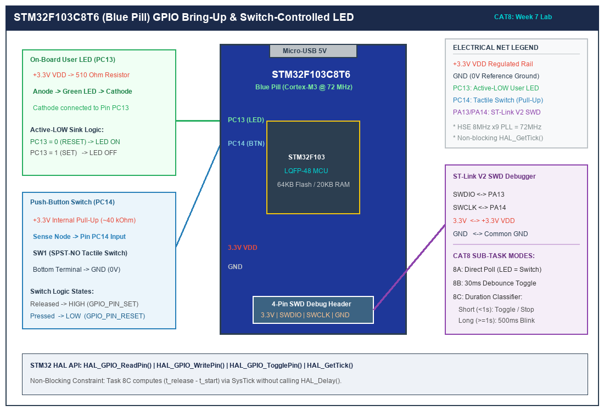

# Task 8B: Event-Based Control with Software Debouncing

## 1. Title, CAT, Week, Date
- **Sub-Task:** Task 8B – Event-Based Control with Software Debouncing
- **Continuous Assessment Test:** CAT 8
- **Curriculum Week:** Week 8
- **Evaluation Date:** September 18, 2026
- **Target Platform:** STM32F103C8T6 (ARM Cortex-M3 @ 72 MHz)

---

## 2. Objective
To analyze the electrical phenomenon of mechanical switch contact bounce, implement a non-blocking software debouncing finite state machine (FSM) using `HAL_GetTick()`, and ensure that every individual physical press-and-release action on PC14 produces exactly one toggle of the active-LOW user LED on PC13.

---

## 3. Problem Statement (Paraphrased)
Mechanical push-buttons experience physical contact bouncing during closing and opening transitions. In naive polling applications, this contact chatter causes spurious multiple transitions that toggle an actuator unpredictably. The goal is to:
1. Formulate a 4-state debouncer finite state machine with a 30 ms settling filter window.
2. Filter out all high-frequency contact bouncing and electrostatic noise.
3. Detect confirmed release edges to toggle the user LED exactly once per physical user interaction.

---

## 4. Hardware and Software Specifications

### Hardware Components
- **Target Microcontroller:** STM32F103C8T6 Blue Pill Development Board
- **Input Device:** 6x6 mm Momentary Tactile Switch connected to PC14
- **Output Device:** Active-LOW on-board Green/Blue LED connected to PC13
- **Debugger / Programmer:** ST-LINK V2 via SWD (PA13/PA14)
- **Power:** Regulated 3.3V DC power rail

### Software Environment
- **IDE:** Keil MDK-ARM µVision v5.38 / STM32CubeIDE v1.14
- **Firmware Framework:** STM32F1xx HAL Drivers
- **Timebase:** 1.0 ms SysTick interrupt driving `HAL_GetTick()`

---

## 5. Pin Connection Table

| Signal Net | STM32 Pin | Mode | Internal Pull | Active State | Electrical Behavior |
|:---|:---:|:---:|:---:|:---:|:---|
| `USER_LED` | **PC13** | Output Push-Pull | None | **LOW (0V)** | Cathode of on-board LED. Toggled on confirmed button release. |
| `USER_BTN` | **PC14** | Input | Pull-Up (~40kΩ) | **LOW (0V)** | Tactile switch to GND. Contact chattering filtered by 30 ms FSM. |
| `SWDIO` | **PA13** | AF / SWD | Pull-Up | N/A | ST-LINK Debug data. |
| `SWCLK` | **PA14** | AF / SWD | Pull-Down | N/A | ST-LINK Debug clock. |
| `VDD` | **3.3V** | Power | N/A | 3.3V | Microcontroller VDD bus. |
| `GND` | **GND** | Ground | N/A | 0V | Microcontroller common ground. |

---

## 6. Circuit Diagram and Explanation

```
                      STM32F103 BLUE PILL
                    +---------------------+
                    |                     |
   3.3V             |                     |
    o               |                     |
    |               |                     |
   [510R]           |                     |
    |               |                     |
   +-|<|-+          |                     |
  (Green LED)       |                     |
    |               |                     |
    +-------------> | PC13 (Output PP)    |
                    |                     |
   3.3V             |                     |
    o               |                     |
   [40k Pull-Up]    |                     |
    |               |                     |
    +-------------> | PC14 (Input PU)     |
    |               |                     |
   \  (Switch)      |                     |
    |               |                     |
   GND              +---------------------+
```



### Circuit Operation
- **Switch Chatter Physics:** When the switch plungers make contact, microscopic metal asperities bounce against one another under mechanical spring tension. This generates an irregular train of rapid LOW/HIGH/LOW pulses that last between 5 and 20 ms.
- **Circuit Filtering:** Rather than adding costly external RC low-pass filters and Schmidt triggers, this circuit relies on the internal 40kΩ pull-up resistor and cleans the noisy signal in software using a non-blocking digital low-pass filtering algorithm.

---

## 7. Theory and Approach

### 7.1 Contact Bouncing Waveforms
```
  RAW PC14 INPUT (Contact Chattering):
  3.3V ----\  /\  /\--------------------\  /\  /------ 3.3V
            \/  \/                       \/  \/
             Bounce                       Bounce
            (5-20ms)                     (5-20ms)

  DEBOUNCED FSM OUTPUT:
  HIGH ----\____________________________/------------- HIGH
           |<-- 30ms -->|               |<-- 30ms -->|
           Filter Pass                  Filter Pass
```

### 7.2 Non-Blocking Finite State Machine (FSM)
The debouncer is implemented as a 4-state state machine:
1. `BTN_FSM_IDLE`: The system sits in idle awaiting the initial transition of PC14 to `RESET` (0V). When detected, it snapshots the current SysTick timestamp (`state_entry_time = HAL_GetTick()`) and transitions to `BTN_FSM_DEBOUNCE_PRESS`.
2. `BTN_FSM_DEBOUNCE_PRESS`: The state machine verifies that the button remains continuously in the `RESET` state for at least 30 ms. If a contact bounce causes the pin to glitch back to `SET` before 30 ms elapsed, the glitch is discarded, and the state reverts to `BTN_FSM_IDLE`. If the signal remains solidly LOW for $\ge 30\text{ ms}$, the press is authenticated, transitioning to `BTN_FSM_HELD`.
3. `BTN_FSM_HELD`: The button is held down. The system waits until the user begins releasing the button (`pin_raw == SET`), at which point it snapshots the timestamp and transitions to `BTN_FSM_DEBOUNCE_RELEASE`.
4. `BTN_FSM_DEBOUNCE_RELEASE`: The state machine verifies that the pin remains stably at logic HIGH for at least 30 ms. If confirmed, a single valid button-press event is dispatched (`return true`), and the FSM resets to `BTN_FSM_IDLE`.

---

## 8. Code Walkthrough

Refer to [`src/main.c`](src/main.c):
1. **Enumerated Type Definition:**
   ```c
   typedef enum {
       BTN_FSM_IDLE = 0,
       BTN_FSM_DEBOUNCE_PRESS,
       BTN_FSM_HELD,
       BTN_FSM_DEBOUNCE_RELEASE
   } ButtonFSM_State_t;
   ```
2. **Event Processing Function (`Process_Button_Event`):**
   - Implements static persistent state variables (`fsm_state`, `state_entry_time`).
   - Uses `HAL_GetTick()` to compute delta time without blocking execution:
     ```c
     if ((current_time - state_entry_time) >= DEBOUNCE_DELAY_MS)
     ```
   - Only emits `true` when a complete press-hold-release cycle finishes cleanly.
3. **Main Execution Loop:**
   ```c
   while (1)
   {
       if (Process_Button_Event())
       {
           HAL_GPIO_TogglePin(USER_LED_PORT, USER_LED_PIN);
       }
   }
   ```
   Every confirmed cycle calls `HAL_GPIO_TogglePin`, flipping PC13 from 0V to 3.3V or vice-versa.

---

## 9. Build, Flash, and Run Steps

1. **Build using Keil µVision:**
   Open project, select **Project -> Build Target** (`F7`). Ensure zero errors and zero warnings.
2. **Flash to STM32F103:**
   Connect ST-LINK V2 and click **Download** (`F8`).
3. **Execution:**
   - Press the button repeatedly at varying speeds (rapid taps vs slow holds).
   - Observe the LED on PC13 toggling cleanly once per press.

---

## 10. Expected Output

- **Initial State:** LED is OFF.
- **Physical Action 1:** Press and release the button once -> LED illuminates solidly.
- **Physical Action 2:** Press and release the button again -> LED extinguishes completely.
- **Rapid Clicking:** Rapid pressing yields exactly one toggle per physical click, with zero spurious double toggles or skipped states.

---

## 11. Viva Questions and Answers

### Q1: Why is a software debouncing algorithm preferred over an RC hardware filter?
**Answer:** An RC hardware filter requires two discrete passive components (a resistor and a capacitor) and usually a Schmitt-trigger inverter per switch, increasing bill-of-materials (BOM) cost, board footprint, and assembly complexity. Software debouncing achieves identical or superior noise rejection at zero additional hardware cost, with the flexibility to tune the filtering window dynamically via firmware parameters.

### Q2: What is the risk of using a blocking delay such as `HAL_Delay(30)` for debouncing?
**Answer:** Calling `HAL_Delay(30)` suspends the CPU in a busy-wait loop for 30 milliseconds. During this interval, the microcontroller cannot process incoming serial bytes over UART, update motor control outputs, or handle real-time communications, resulting in dropped frames and unresponsive systems. Non-blocking state machines sample time asynchronously, keeping CPU utilization available for other tasks.

### Q3: Why does this implementation trigger the LED toggle on the release edge rather than the press edge?
**Answer:** Triggering on the confirmed release edge ensures that the entire physical mechanical event (initial press, mechanical chatter, user hold duration, release mechanical chatter, and return to idle) has completely resolved before the actuator state is changed. This prevents race conditions and sets up the foundation for duration measurement (distinguishing short vs long presses).

### Q4: How does `HAL_GetTick()` avoid counter overflow issues after 49.7 days?
**Answer:** In STM32 HAL, `HAL_GetTick()` returns a 32-bit unsigned integer (`uint32_t`). When using unsigned subtraction:
$$\Delta t = t_{\text{current}} - t_{\text{previous}}$$
due to two's complement binary arithmetic, the calculation yields the correct elapsed time even when `current_time` wraps around from `0xFFFFFFFF` to `0x00000000`, as long as the duration measured is less than $2^{32} - 1$ milliseconds (~49.7 days).

---

## 12. Troubleshooting Guide

| Problem | Root Cause | Remediation |
|:---|:---|:---|
| LED toggles intermittently on release | Debounce window too short for worn switch | Increase `DEBOUNCE_DELAY_MS` from 30 ms to 40 ms or 50 ms. |
| LED never toggles | Button input reading stuck at logic HIGH | Check continuity of PC14 jumper wire to tactile switch terminal; ensure other terminal is tied to GND. |
| LED toggles continuously without pressing | Floating input pin | Verify `GPIO_InitStruct.Pull = GPIO_PULLUP` is present in `MX_GPIO_Init()`. |

---

## 13. Result and Learning Outcomes
Sub-task 8B successfully eliminated mechanical contact bouncing using a non-blocking 4-state debouncing FSM on the STM32F103 microcontroller, achieving deterministic single-toggle event control.
