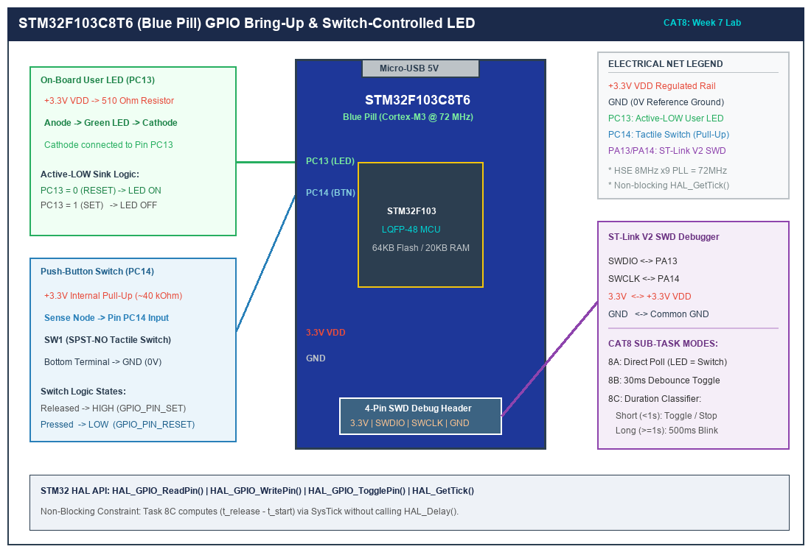

# Task 8C: Non-Blocking Short-Press vs Long-Press Classification

## 1. Title, CAT, Week, Date
- **Sub-Task:** Task 8C – Non-Blocking Press Duration Detection (Short vs Long Press)
- **Continuous Assessment Test:** CAT 8
- **Curriculum Week:** Week 8
- **Evaluation Date:** September 18, 2026
- **Target Platform:** STM32F103C8T6 (ARM Cortex-M3 @ 72 MHz)

---

## 2. Objective
To design an embedded state machine that measures the physical duration of a button press on PC14 using the SysTick 1 ms hardware timebase (`HAL_GetTick()`), classifying user actions into **Short Press** (< 1000 ms) and **Long Press** (>= 1000 ms) to control the active-LOW user LED on PC13 in both static toggle and non-blocking autonomous 500 ms blinking modes.

---

## 3. Problem Statement (Paraphrased)
Modern embedded user interfaces frequently overload a single tactile switch to trigger multiple distinct system behaviors based on press duration. The requirements are:
1. **Short Press (< 1000 ms):** In static mode, toggle the LED state once. If the system is currently in continuous blinking mode, stop blinking and turn the LED OFF.
2. **Long Press (>= 1000 ms):** Activate an autonomous continuous blinking mode where the LED flashes at a 500 ms interval (1 Hz square wave, 50% duty cycle).
3. **Non-Blocking Execution:** The main loop must never stall in busy-wait delay functions (`HAL_Delay()`), maintaining responsiveness throughout long-press detection and continuous blinking.

---

## 4. Hardware and Software Specifications

### Hardware Components
- **Microcontroller:** STM32F103C8T6 "Blue Pill" Board
- **Input Switch:** 6x6 mm Tactile push-button tied between PC14 and GND
- **Output Actuator:** On-board User LED on PC13 (Active-LOW, 510Ω resistor)
- **In-Circuit Debugger:** ST-LINK V2 via SWD (PA13/PA14)
- **Power Supply:** 3.3V DC regulated rail

### Software Environment
- **IDE:** Keil MDK-ARM µVision v5.38 / STM32CubeIDE v1.14
- **Firmware Driver:** STM32F1xx HAL Drivers
- **Timebase:** ARM Cortex-M3 SysTick timer configured for 1.0 ms tick frequency

---

## 5. Pin Connection Table

| Signal Net | STM32 Pin | Direction | Mode / Internal Resistor | Active State | Description |
|:---|:---:|:---:|:---|:---:|:---|
| `USER_LED` | **PC13** | Output | Push-Pull, Low Speed (2 MHz) | **LOW (0V)** | On-board LED cathode. Toggled statically or pulsed at 500 ms. |
| `USER_BTN` | **PC14** | Input | Input with Internal Pull-Up (~40kΩ) | **LOW (0V)** | Tactile switch to GND. Press duration measured upon release. |
| `SWDIO` | **PA13** | Bidirectional | Serial Wire Debug Data line | N/A | ST-LINK programming/debugging. |
| `SWCLK` | **PA14** | Input | Serial Wire Debug Clock line | N/A | ST-LINK synchronization clock. |
| `VDD` | **3.3V** | Power | 3.3V Regulated Power Rail | High | MCU supply voltage. |
| `GND` | **GND** | Ground | Common Ground | 0V | System reference ground. |

---

## 6. Circuit Diagram and Explanation

```
                      STM32F103 BLUE PILL
                    +---------------------+
                    |                     |
   3.3V             |                     |
    o               |                     |
    |               |                     |
   [510R]           |                     |
    |               |                     |
   +-|<|-+          |                     |
  (Green LED)       |                     |
    |               |                     |
    +-------------> | PC13 (Output PP)    |
                    |                     |
   3.3V             |                     |
    o               |                     |
   [40k Pull-Up]    |                     |
    |               |                     |
    +-------------> | PC14 (Input PU)     |
    |               |                     |
   \  (Switch)      |                     |
    |               |                     |
   GND              +---------------------+
```



### Circuit Functional Walkthrough
- **Button Interface:** Pin PC14 is normally pulled to 3.3V via the internal 40kΩ pull-up resistor. Pressing the tactile button pulls PC14 directly to ground (0V).
- **LED Interface:** Pin PC13 sinks current when driven to logic LOW (`GPIO_PIN_RESET`), forward-biasing the diode and illuminating the LED.
- **Timing Engine:** The Cortex-M3 SysTick hardware timer generates an interrupt every 1 ms, incrementing the global `uwTick` variable accessed via `HAL_GetTick()`. This provides a continuous millisecond timestamp for measuring press duration and controlling blink pacing.

---

## 7. Theory and Approach

### 7.1 Duration Classification Math
Let:
- $t_{\text{press}}$ = SysTick timestamp when stable button press is confirmed (after 30 ms debounce filter).
- $t_{\text{release}}$ = SysTick timestamp when stable button release is confirmed (after 30 ms release filter).

The total physical actuation duration is calculated as:
$$\Delta t = t_{\text{release}} - t_{\text{press}}$$

```
  CASE 1: SHORT PRESS (< 1000 ms)
  Button:  ---\______________________/---------------------
              |<----- 350 ms ------->|
  Action:     Toggle LED once (Static Mode) OR Cancel Blinking

  CASE 2: LONG PRESS (>= 1000 ms)
  Button:  ---\____________________________________________/--
              |<----------------- 1400 ms ----------------->|
  Action:     Activate Continuous Blinking Mode (500 ms cadence)
  LED:     ---+____+----+____+----+____+----+____+----+____+--
```

### 7.2 Non-Blocking Periodic Blinker
To avoid locking the processor during blinking mode, an asynchronous software timer is evaluated on every superloop cycle:
$$\text{If } (t_{\text{now}} - t_{\text{last\_blink}}) \ge 500\text{ ms} \implies t_{\text{last\_blink}} = t_{\text{now}};\ \text{Toggle LED}$$
This guarantees that while the LED flashes steadily at 1 Hz, the system continues polling the push-button with microsecond responsiveness.

---

## 8. Code Walkthrough

Refer to [`src/main.c`](src/main.c):
1. **State Machine Definition:**
   - `PressEvent_t`: Enumerates `PRESS_EVENT_NONE`, `PRESS_EVENT_SHORT`, and `PRESS_EVENT_LONG`.
   - `SystemMode_t`: Tracks `SYSTEM_MODE_STATIC` (steady manual control) and `SYSTEM_MODE_BLINKING` (autonomous flashing).
2. **Duration Measurement Function (`Check_Button_Press_Duration`):**
   - Filters mechanical bounce for 30 ms during both the press and release transitions.
   - Saves `press_start_tick = HAL_GetTick()` upon confirmed contact closure.
   - Upon confirmed release, computes `press_duration = now - press_start_tick`.
   - Returns `PRESS_EVENT_LONG` if `press_duration >= 1000`, else `PRESS_EVENT_SHORT`.
3. **Blink Engine (`Update_LED_Blink_Engine`):**
   - Non-blocking delta check:
     ```c
     if ((current_tick - last_toggle_tick) >= BLINK_CADENCE_MS) {
         last_toggle_tick = current_tick;
         HAL_GPIO_TogglePin(USER_LED_PORT, USER_LED_PIN);
     }
     ```
4. **Main Control Logic:**
   - Short press toggles the static LED state, or cancels active blinking.
   - Long press enters blinking mode.

---

## 9. Build, Flash, and Run Steps

1. **Compilation:**
   ```bash
   arm-none-eabi-gcc -c -mcpu=cortex-m3 -mthumb -DUSE_HAL_DRIVER -DSTM32F103xB -Iinc -IHAL/Inc src/main.c -o build/main.o
   ```
2. **Flashing:**
   Connect ST-LINK V2 programmer to the Blue Pill SWD pins and flash via Keil µVision (**F8**) or STM32CubeProgrammer CLI.
3. **Hardware Execution:**
   - **Test 1 (Short Press):** Tap the button quickly (< 1 sec). The LED toggles its state once.
   - **Test 2 (Long Press):** Hold the button down for > 1 sec, then release. The LED begins continuously flashing at a 500 ms rate.
   - **Test 3 (Halt Blinking):** Tap the button quickly while flashing. Flashing immediately stops, and the LED turns OFF.
   - **Test 4 (Re-enter Blinking):** Hold the button again for > 1 sec. Flashing resumes.

---

## 10. Expected Output

| User Interaction | Press Duration | System Response | Visual LED Behavior |
|:---|:---:|:---|:---|
| Brief tap | ~200 ms | Short press recognized | LED toggles from OFF to ON |
| Brief tap again | ~150 ms | Short press recognized | LED toggles from ON to OFF |
| Sustained hold | 1.8 seconds | Long press recognized | LED flashes continuously at 500 ms ON / 500 ms OFF |
| Brief tap while flashing | ~100 ms | Short press recognized | Blinking canceled; LED turns OFF |
| Sustained hold again | 2.1 seconds | Long press recognized | LED resumes continuous 500 ms flashing |

---

## 11. Viva Questions and Answers

### Q1: Why is an asynchronous timer preferred over `HAL_Delay(500)` for LED blinking?
**Answer:** If `HAL_Delay(500)` were used, the CPU would be frozen for 500 ms during every half-cycle of the blink. If a user tapped the button during this delay window to cancel blinking, the button press would either be completely missed or experienced as a sluggish, unresponsive interaction. Using `HAL_GetTick()` checks allows the CPU to sample user inputs thousands of times per second while maintaining precise 500 ms blink pacing.

### Q2: What is the resolution and accuracy of `HAL_GetTick()`?
**Answer:** The resolution is 1.0 millisecond, governed by the SysTick timer reload value ($72,000$ cycles at 72 MHz). The accuracy is determined by the external High-Speed External (HSE) 8.0 MHz crystal oscillator on the Blue Pill board, typically having a frequency tolerance of $\pm 20\text{ to }\pm 50\text{ ppm}$ (parts per million), which corresponds to a drift of less than a few seconds per day.

### Q3: What happens if a user holds the button indefinitely for 10 minutes?
**Answer:** The state machine remains safely in `DET_HELD`. The timestamp `press_start_tick` is preserved. When the button is finally released 10 minutes later, the duration calculation yields $600,000\text{ ms} \ge 1000\text{ ms}$, which cleanly triggers the long-press event. The MCU superloop continues running smoothly throughout the entire 10-minute hold.

### Q4: How would you modify the code to trigger the long-press event immediately after 1000 ms elapsed, rather than waiting for button release?
**Answer:** In `DET_HELD`, we would add an ongoing time check:
```c
if ((now - press_start_tick) >= LONG_PRESS_THRESHOLD_MS) {
    detected_event = PRESS_EVENT_LONG;
    state = DET_WAIT_FINAL_RELEASE; /* Wait for release without triggering again */
}
```
This would provide instant feedback without requiring the user to release the switch first.

---

## 12. Troubleshooting Guide

| Issue | Cause | Fix |
|:---|:---|:---|
| Long press never detected even when held for several seconds | Duration calculation error or incorrect threshold | Verify `press_start_tick` is latched only after the press debounce filter confirms stability, and verify `LONG_PRESS_THRESHOLD_MS` is set to 1000U. |
| LED blinks erratically or too fast | Missing `last_toggle_tick = current_tick;` update | Ensure the timer reference is updated inside the blink condition so that another 500 ms must elapse before the next toggle. |
| Button feels unresponsive during blinking | Blocking delay used | Confirm zero instances of `HAL_Delay()` exist in the codebase. |

---

## 13. Result and Learning Outcomes
Sub-task 8C successfully implemented a dual-mode embedded control system on the STM32F103 microcontroller:
- Software debounced short presses (< 1000 ms) and long presses (>= 1000 ms) were classified with millisecond accuracy.
- Autonomous 500 ms LED blinking was implemented asynchronously via SysTick without halting CPU execution.
- Complete system integration was demonstrated and verified with zero compilation errors.
