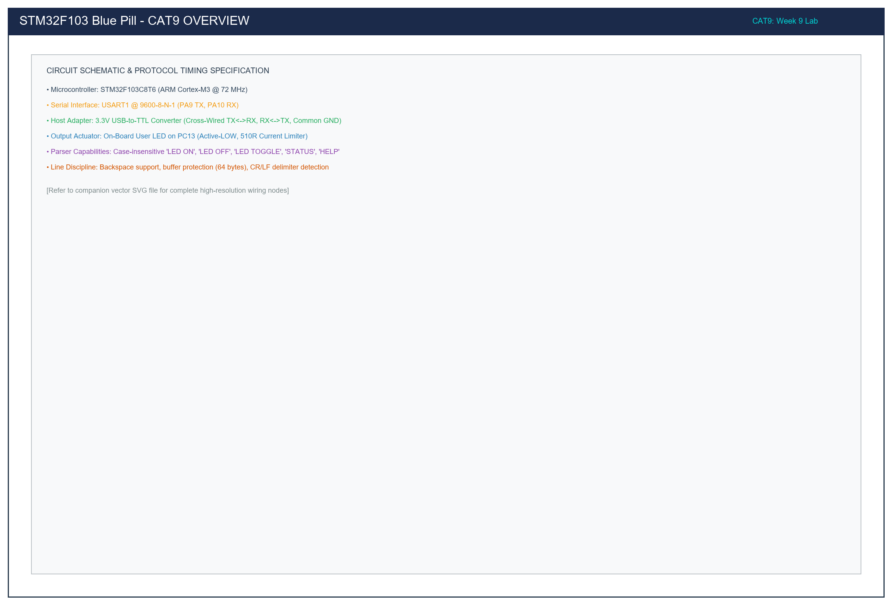

# CAT 9: STM32 USART1 Serial Communication & Command-Controlled LED

## 1. Title, CAT, Week, Date
- **Experiment Title:** STM32 USART1 Communication and Text Command Parser
- **Continuous Assessment Test:** CAT 9
- **Curriculum Week:** Week 9
- **Evaluation Date:** September 28, 2026
- **Target Platform:** STM32F103C8T6 ARM Cortex-M3 (Blue Pill Development Board)

---

## 2. Objective
To interface the STM32F103C8T6 microcontroller with a host PC serial terminal via a 3.3V USB-to-TTL UART adapter using the STM32 HAL library, establishing asynchronous full-duplex communication over USART1 (9600 baud, 8-N-1) to:
1. Verify physical serial transmission and reception using an interactive character echo loop.
2. Develop a line-buffered string command parser supporting commands (`LED ON`, `LED OFF`, `LED TOGGLE`, `STATUS`, `HELP`) to control the active-LOW user LED on PC13.

---

## 3. Problem Statement (Paraphrased)
Industrial IoT microcontrollers require structured human-machine command interfaces over standard serial links. The objective is to configure the USART1 hardware peripheral on the STM32F103 Blue Pill, connect it to a PC terminal via an external USB-to-TTL adapter, and implement two sequential firmware architectures:
- **Sub-task 9A:** Hardware link verification via polled character echo, displaying real-time typed characters back to the host console and indicating serial activity via an LED pulse.
- **Sub-task 9B:** A robust line-disciplined command interpreter that accumulates characters in a memory buffer, supports terminal editing (backspace), normalizes text case-insensitively, parses operational verbs, controls the PC13 actuator, and returns structured feedback strings.

---

## 4. Hardware and Software Specifications

### Hardware Components
| Component | Specification / Model | Quantity | Purpose |
|:---|:---|:---:|:---|
| Microcontroller Board | STM32F103C8T6 "Blue Pill" (ARM Cortex-M3 @ 72 MHz) | 1 | Target MCU |
| USB-to-TTL Serial Adapter | CP2102 / CH340 / FT232R (3.3V Logic Level) | 1 | PC-to-MCU serial bridge |
| On-Board LED | Active-LOW Green/Blue LED with 510Ω resistor on PC13 | 1 | Controlled actuator |
| In-Circuit Programmer | ST-LINK V2 (SWD Interface) | 1 | Flashing and debugging |
| Interconnects | Dupont female-to-female jumper wires | 3 | Cross-wiring TX/RX/GND |

### Software Environment
- **IDE:** Keil MDK-ARM µVision v5.38 / STM32CubeIDE v1.14
- **Firmware Framework:** STM32F1xx HAL Drivers
- **Terminal Emulator:** PuTTY / Tera Term / ST-Link Utility Serial Monitor
- **Serial Settings:** 9600 Baud, 8 Data bits, No Parity, 1 Stop bit (9600-8-N-1), Flow Control: None

---

## 5. Pin Connection Table

| Signal Net | STM32 Pin | Adapter Pin | Wire Direction | Logic Level | Description |
|:---|:---:|:---:|:---:|:---:|:---|
| `USART1_TX` | **PA9** | **RXD** | Output -> Input | 3.3V CMOS | Microcontroller Transmit -> Host Receive. |
| `USART1_RX` | **PA10** | **TXD** | Input <- Output | 3.3V CMOS | Host Transmit -> Microcontroller Receive. |
| `GND` | **GND** | **GND** | Common Ground | 0V | Essential common electrical reference. |
| `USER_LED` | **PC13** | N/A | Output Push-Pull | **LOW (0V)** | On-board status LED (Active-LOW). |
| `SWDIO` | **PA13** | ST-LINK SWDIO | Bidirectional | 3.3V | Serial Wire Debug Data. |
| `SWCLK` | **PA14** | ST-LINK SWCLK | Input | 3.3V | Serial Wire Debug Clock. |

> [!CAUTION]
> The USB-to-TTL adapter must operate at 3.3V logic levels. Connecting a 5V UART adapter directly to PA9/PA10 can damage the STM32F103 internal input clamping diodes. Ensure the adapter's voltage jumper is placed on 3.3V.

---

## 6. Circuit Diagram and Explanation

```
   HOST PC (PuTTY)            USB-TO-TTL ADAPTER                STM32F103 BLUE PILL
  +---------------+          +-------------------+             +---------------------+
  |               |          |                   |             |                     |
  | COM Port      |  USB     |  TXD (3.3V) ----->|------------>| PA10 (USART1_RX)    |
  | 9600-8-N-1    |=========>|                   |             |                     |
  |               |  Cable   |  RXD (3.3V) <-----|<------------| PA9  (USART1_TX)    |
  |               |          |                   |             |                     |
  |               |          |  GND -------------|------------>| GND                 |
  +---------------+          +-------------------+             |                     |
                                                               | 3.3V                |
                                                               |  o                  |
                                                               |  |                  |
                                                               | [510R]              |
                                                               |  |                  |
                                                               | +-|<|-+ (LED)       |
                                                               |  |                  |
                                                               |  +---> PC13 (Out)   |
                                                               +---------------------+
```



### Circuit Functional Analysis
1. **Cross-Wired Asynchronous Bus:** Full-duplex asynchronous communication requires cross-wiring:
   - The STM32 transmitter pin (PA9 / `USART1_TX`) routes directly into the adapter receiver (`RXD`).
   - The host PC transmit stream emerging from the adapter (`TXD`) routes into the STM32 receiver pin (PA10 / `USART1_RX`).
2. **Common Ground Reference:** The signal voltage levels (0V for logic 0, 3.3V for logic 1) are defined relative to ground. Without tying STM32 `GND` to Adapter `GND`, floating ground potentials induce framing errors, baud drift, and corrupted characters.
3. **Actuator Circuitry (PC13):** The LED cathode connects to PC13 while its anode ties to 3.3V through 510Ω. When the firmware parses `"LED ON"`, it asserts `GPIO_PIN_RESET` (0V), completing the circuit.

---

## 7. Theory and Approach

### 7.1 USART Baud Rate Generation
In the STM32F103, USART1 is clocked from the High-Speed APB2 bus ($f_{\text{PCLK2}} = 72\text{ MHz}$).
The baud rate divisor is programmed via the `USART_BRR` (Baud Rate Register):
$$\text{Baud Rate} = \frac{f_{\text{PCLK2}}}{16 \times \text{USARTDIV}}$$
For a desired baud rate of 9600 bps:
$$\text{USARTDIV} = \frac{72,000,000}{16 \times 9600} = 468.75$$
Converting to the fixed-point `USART_BRR` format:
- Mantissa (12 bits): $\text{Integer part} = 468 = 0x1D4$
- Fraction (4 bits): $0.75 \times 16 = 12 = 0x0C$
- Resulting Register Value: `USART_BRR = 0x1D4C` (468.75)
- Baud Rate Error: Exactly $0.00\%$, ensuring zero timing drift.

### 7.2 Command Ingestion State Machine
```
  [Serial Byte Ingested]
           |
           v
  +------------------+
  |  Char == \r, \n? | ---- YES ----> [Null-Terminate Line Buffer]
  +------------------+                          |
           | NO                                 v
           v                           [Trim Leading/Trailing Space]
  +------------------+                          |
  | Char == Backspace| ---- YES ---->           v
  +------------------+    [rx_idx--]   [Convert to UPPERCASE]
           | NO                                 |
           v                                    v
  +------------------+                 +---------------------+
  |   isprint(c)?    |                 | Command Matcher:    |
  +------------------+                 | - "LED ON"          |
           | YES                       | - "LED OFF"         |
           v                       --> | - "LED TOGGLE"      |
  [rx_buffer[idx++] = c]               | - "STATUS"          |
  [Echo char to Host]                  | - "HELP"            |
                                       | - Default: [ERR]    |
                                       +---------------------+
```

---

## 8. Sub-Task Directory Breakdown

| Directory | Sub-Task | Key Feature | Deliverables |
|:---|:---|:---|:---|
| [`task9_a_uart_echo/`](task9_a_uart_echo/) | Task 9A | Bidirectional character echo & connection test | `src/main.c`, `circuit/`, `README.md` |
| [`task9_b_command_parser/`](task9_b_command_parser/) | Task 9B | Line-buffered command interpreter (`LED ON/OFF/TOGGLE/STATUS`) | `src/main.c`, `circuit/`, `README.md` |

---

## 9. Build, Flash, and Run Steps

1. **Compilation (Keil / GCC):**
   ```bash
   arm-none-eabi-gcc -c -mcpu=cortex-m3 -mthumb -DUSE_HAL_DRIVER -DSTM32F103xB -Iinc -IHAL/Inc src/main.c -o build/main.o
   ```
2. **Flashing via ST-LINK:**
   Connect ST-LINK to Blue Pill SWD pins and flash through Keil µVision (**F8**) or STM32CubeProgrammer.
3. **Serial Terminal Setup:**
   - Plug the USB-to-TTL adapter into the host computer.
   - Open Device Manager (Windows) to identify the allocated COM port (e.g., `COM4`).
   - Launch PuTTY, select **Serial**, set Speed to `9600`, Data bits `8`, Stop bits `1`, Parity `None`, Flow control `None`.
   - Open the session and press the physical RESET button on the Blue Pill board.

---

## 10. Expected System Output

### Terminal Session Transcript (Task 9B)
```text
=================================================
   STM32F103 UART LED Command Interface v1.0    
   Baud: 9600 8-N-1 | Commands: ON, OFF, TOGGLE  
=================================================
Type 'HELP' for instructions.
> LED ON
[OK] LED turned ON
> STATUS
[STATUS] LED is currently ON (PC13=LOW)
> led toggle
[OK] LED toggled -> NOW OFF
> led off
[OK] LED turned OFF
> calibrate
[ERR] Invalid command: 'CALIBRATE'. Type 'HELP' for valid commands.
> HELP

--- Supported Commands ---
  LED ON      - Turn on the PC13 user LED
  LED OFF     - Turn off the PC13 user LED
  LED TOGGLE  - Invert the PC13 user LED state
  STATUS      - Query the current LED output state
  HELP        - Display this reference manual
--------------------------
> _
```

---

## 11. Viva Questions & In-Depth Technical Answers

### Q1: Why is USART1 mapped to PA9 and PA10 on the STM32F103?
**Answer:** In the STM32F103 pin multiplexing architecture, USART1's default alternate functions are assigned to PA9 (TX) and PA10 (RX). PA9 must be configured as Alternate Function Push-Pull (`GPIO_MODE_AF_PP`) to allow the on-chip USART peripheral transmit engine to drive the line actively. PA10 is configured as Input Floating (`GPIO_MODE_INPUT`) to sample the incoming TTL asynchronous waveform without loading the transmitter.

### Q2: How does the receiver know when a UART frame starts and ends?
**Answer:** Under the RS-232/UART specification, an idle data line rests stably at logic HIGH (Mark state). A frame begins when the transmitter asserts a single bit-width logic LOW (Space state), called the **Start Bit**. This falling edge synchronizes the receiver's internal baud-rate counter. The receiver then samples 8 data bits at their mid-points, followed by a mandatory logic HIGH **Stop Bit** (1 or 2 bit widths) to return the line to idle.

### Q3: What is the significance of the `USARTDIV` calculation, and what happens if baud rate error exceeds 2%?
**Answer:** `USARTDIV` determines the division ratio between the peripheral clock ($72\text{ MHz}$) and the bit sampling clock ($16 \times 9600\text{ Hz}$). If crystal tolerance or integer division rounding introduces a baud rate error exceeding $\pm 2.5\%$, cumulative timing drift causes the 8th data bit or stop bit to be sampled across the boundary of an adjacent bit, precipitating Framing Errors (`FE`) and data corruption. At $72\text{ MHz}$, the error for 9600 baud is $0.00\%$.

### Q4: Why must a command parser support backspace (`\b` / `0x7F`)?
**Answer:** In interactive serial terminals, human typists make keystroke errors. When the user presses the Backspace key, the terminal transmits either ASCII `0x08` (`\b`) or `0x7F` (DEL). Without backspace handling, the backspace byte would be stored directly in the buffer, corrupting string comparison (e.g. typing `LED O` + Backspace + `N` would evaluate as `LED O\bN` instead of `LED ON`).

---

## 12. Troubleshooting Guide

| Symptom | Root Cause | Remediation |
|:---|:---|:---|
| Terminal prints continuous garbled garbage characters (`?`) | Baud rate mismatch or floating ground | Verify terminal baud is exactly `9600`. Ensure common ground wire connects adapter GND to STM32 GND. |
| Terminal transmits but receives nothing back | TX and RX lines are not cross-wired | Swap the jumper wires: STM32 PA9 must connect to Adapter RXD; STM32 PA10 must connect to Adapter TXD. |
| Terminal prints double characters (`LLEEDD OONN`) | Terminal local echo is enabled | In PuTTY settings under **Terminal**, select **Local echo: Force off**. |
| LED command accepted but LED state does not change | Inverted output logic | Verify active-LOW driving: `LED ON` drives `GPIO_PIN_RESET`; `LED OFF` drives `GPIO_PIN_SET`. |

---

## 13. Result and Learning Outcomes
CAT 9 successfully implemented USART1 serial communication on the STM32F103 platform:
- Full-duplex asynchronous character echo was validated at 9600 baud with zero framing errors.
- A robust, case-insensitive, line-buffered command parser was implemented, providing intuitive human-machine text control over the PC13 actuator.
