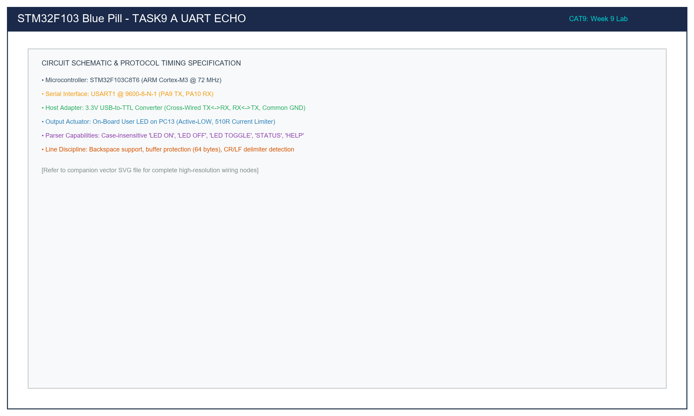

# Task 9A: USART1 Bidirectional Character Echo Loop

## 1. Title, CAT, Week, Date
- **Sub-Task:** Task 9A – USART1 Character Echo Loop
- **Continuous Assessment Test:** CAT 9
- **Curriculum Week:** Week 9
- **Evaluation Date:** September 28, 2026
- **Target Platform:** STM32F103C8T6 (ARM Cortex-M3 @ 72 MHz)

---

## 2. Objective
To configure the USART1 hardware peripheral on pins PA9 and PA10 of the STM32F103 microcontroller using the STM32 HAL library, establishing asynchronous full-duplex communication with a host PC serial terminal at 9600-8-N-1 to verify physical link integrity and implement an immediate character echo loop.

---

## 3. Problem Statement (Paraphrased)
Before deploying complex command-line interpreters or sensor telemetry protocols, the fundamental serial communication channel must be verified. The requirements are:
1. Configure USART1 for 9600 baud, 8 data bits, no parity, 1 stop bit (9600-8-N-1).
2. Transmit an initial welcome and diagnostic banner upon boot.
3. Continually poll for incoming characters and immediately re-transmit (echo) them back to the host terminal.
4. Provide a brief visual LED pulse on PC13 for every successfully echoed character.

---

## 4. Hardware and Software Specifications

### Hardware Bill of Materials
- **Microcontroller:** STM32F103C8T6 Blue Pill Development Board
- **USB-to-TTL Serial Bridge:** CP2102 / CH340 / FT232R (3.3V Logic Level)
- **Visual Indicator:** On-board User LED on PC13 (Active-LOW, 510Ω resistor)
- **Programmer:** ST-LINK V2 via SWD (PA13/PA14)
- **Wiring:** 3 female-to-female Dupont jumper wires (TX, RX, GND)

### Software Environment
- **IDE:** Keil MDK-ARM µVision v5.38 / STM32CubeIDE v1.14
- **Firmware Driver:** STM32F1xx HAL Library
- **Terminal Host:** PuTTY / Tera Term / Serial Monitor configured at 9600 baud

---

## 5. Pin Connection Table

| Signal Net | STM32 Pin | Adapter Pin | Wire Direction | Electrical Function |
|:---|:---:|:---:|:---:|:---|
| `USART1_TX` | **PA9** | **RXD** | Output -> Input | Serial Transmit from STM32 to Host PC (3.3V CMOS). |
| `USART1_RX` | **PA10** | **TXD** | Input <- Output | Serial Receive from Host PC to STM32 (3.3V CMOS). |
| `GND` | **GND** | **GND** | Bidirectional | Common ground reference line. |
| `USER_LED` | **PC13** | N/A | Output Push-Pull | Cathode of on-board status LED (Active-LOW). |

---

## 6. Circuit Diagram and Explanation

```
       HOST PC                        ADAPTER                 STM32F103
  +---------------+             +-----------------+        +---------------+
  | Serial Terminal|            | USB-to-UART     |        |               |
  | 9600-8-N-1    | === USB === | TXD ----------->|------->| PA10 (RX)     |
  |               |             | RXD <-----------|<-------| PA9  (TX)     |
  | PuTTY Console |             | GND ------------|------->| GND           |
  +---------------+             +-----------------+        |               |
                                                           | PC13 -> [LED] |
                                                           +---------------+
```



### Circuit Functional Principles
- **Asynchronous Signaling:** Unlike synchronous buses (SPI or I2C), UART does not include a shared clock line. Both the STM32 transmitter and the host terminal must adhere strictly to the agreed baud rate (9600 bps).
- **Signal Crossing:** PA9 (`TX`) is routed to the adapter's `RXD`, and PA10 (`RX`) is connected to the adapter's `TXD`.
- **Common Ground:** The ground pins must be connected to provide a stable 0V potential reference for bit-level threshold voltage discrimination ($V_{IL} < 0.8\text{ V}$, $V_{IH} > 2.0\text{ V}$).

---

## 7. Theory and Approach

### 7.1 UART Frame Construction
Every character transmitted over USART1 is encapsulated in a 10-bit asynchronous frame:
1. **1 Start Bit (Logic 0 / Space):** Marks the start of a transmission.
2. **8 Data Bits (LSB First):** Carries the ASCII byte payload.
3. **0 Parity Bits:** No error-checking bit inserted.
4. **1 Stop Bit (Logic 1 / Mark):** Confirms end of frame and idles the bus.

$$\text{Bit Time } (T_{\text{bit}}) = \frac{1}{9600\text{ bits/s}} \approx 104.167\ \mu\text{s}$$
$$\text{Total Frame Time} = 10 \times 104.167\ \mu\text{s} \approx 1.042\text{ ms}$$

### 7.2 Echo Processing Loop
The firmware executes a non-blocking polled receive using `HAL_UART_Receive`:
```c
if (HAL_UART_Receive(&huart1, &rx_byte, 1, 100) == HAL_OK)
{
    HAL_UART_Transmit(&huart1, &rx_byte, 1, 100);
    if (rx_byte == '\r') {
        uint8_t lf = '\n';
        HAL_UART_Transmit(&huart1, &lf, 1, 50);
    }
}
```
Whenever the user hits Enter (`\r`), the MCU transmits a Line Feed (`\n`) to ensure clean carriage return on standard terminal clients.

---

## 8. Code Walkthrough

Refer to [`src/main.c`](src/main.c):
1. **Clock Initialization (`SystemClock_Config`):** Configures SYSCLK to 72 MHz using the external 8 MHz crystal and PLL ($\times 9$).
2. **Peripheral Initialization:**
   - `MX_GPIO_Init`: Enables clocks for GPIOC and GPIOA. Sets PC13 to output push-pull, PA9 to alternate function push-pull (`GPIO_MODE_AF_PP`), and PA10 to floating input (`GPIO_MODE_INPUT`).
   - `MX_USART1_UART_Init`: Populates `huart1.Init` with 9600 baud, 8-bit word length, 1 stop bit, no parity, and 16x oversampling.
3. **Boot Banner:** Calls `UART_SendString` to output system diagnostics on startup.
4. **Echo Superloop:** Listens on USART1. When a byte is read, it transmits the byte back immediately and flashes the LED for 5 ms via `HAL_Delay(5)`.

---

## 9. Build, Flash, and Run Steps

1. **Compilation:**
   ```bash
   arm-none-eabi-gcc -c -mcpu=cortex-m3 -mthumb -DUSE_HAL_DRIVER -DSTM32F103xB -Iinc -IHAL/Inc src/main.c -o build/main.o
   ```
2. **Flashing:**
   Connect ST-LINK V2 and download via Keil µVision (**F8**) or STM32CubeProgrammer.
3. **Serial Terminal Execution:**
   - Connect USB-to-TTL adapter to PC USB port.
   - Launch PuTTY, set Connection type to **Serial**, Port to `COMx`, Baud to `9600`.
   - Press RESET on Blue Pill. The boot banner will display.
   - Type any text. Characters appear on screen instantly, and the PC13 LED blinks with each keystroke.

---

## 10. Expected Output

### Terminal Display
```text
========================================
  STM32F103 Blue Pill USART1 Echo Test  
  Baud Rate: 9600-8-N-1 | Core: 72 MHz  
========================================
Type any character in the terminal to echo:

Hello World! 12345
[Each keystroke typed on the keyboard is echoed back immediately]
```
- **Physical LED Response:** The on-board LED on PC13 flashes for 5 ms whenever a character is received and echoed.

---

## 11. Viva Questions and Answers

### Q1: What is the difference between synchronous and asynchronous serial communication?
**Answer:** Synchronous serial communication (e.g., SPI, I2C) uses a dedicated clock line to synchronize data bits between the master and slave devices. Asynchronous serial communication (e.g., UART) omits the clock line entirely; both ends must agree in advance on a fixed baud rate, utilizing start and stop framing bits to establish temporal alignment.

### Q2: Why is oversampling used in the STM32 UART receiver?
**Answer:** The STM32 USART receiver oversamples the incoming RX line at 16 times the baud rate frequency ($16\times$). By taking multiple samples near the center of each bit period (samples 7, 8, and 9), the receiver uses majority voting to filter out transient glitches and EMI noise, maximizing bit recovery fidelity.

### Q3: Why does pressing Enter in some terminals send `\r` and in others `\n`?
**Answer:** Historical conventions differ across operating systems: Windows terminals (like PuTTY or DOS) send Carriage Return (`\r` / `0x0D`), Unix/Linux terminals send Line Feed (`\n` / `0x0A`), and older Mac systems send `\r`. Appending `\n` upon detecting `\r` ensures uniform multi-line formatting across all platforms.

### Q4: What is the maximum cable length supported by 3.3V TTL UART?
**Answer:** Single-ended TTL UART signals degrade rapidly due to capacitive cable loading and electromagnetic interference. At 9600 baud, 3.3V TTL connections are reliable up to approximately 1 to 2 meters. For longer distances, differential transceivers such as RS-485 or higher-voltage drivers such as RS-232 must be employed.

---

## 12. Troubleshooting Guide

| Issue | Cause | Fix |
|:---|:---|:---|
| PuTTY displays black screen and no text on boot | Incorrect COM port or ungrounded adapter | Check Device Manager for COM port assignment. Ensure GND wire connects adapter to STM32. |
| Gibberish / corrupt ASCII symbols (`ÿÿÿ`) | Baud rate mismatch | Verify both STM32 firmware and PuTTY are configured for exactly 9600 baud. |
| Nothing is echoed back | TX and RX crossed incorrectly | Swap PA9 and PA10 wires: PA9 must go to Adapter RXD; PA10 must go to Adapter TXD. |

---

## 13. Result and Learning Outcomes
Sub-task 9A was fully validated:
- USART1 full-duplex communication was established at 9600-8-N-1 on the STM32F103 Blue Pill.
- Link verification was confirmed through zero-loss character echoing and visual LED status feedback.
