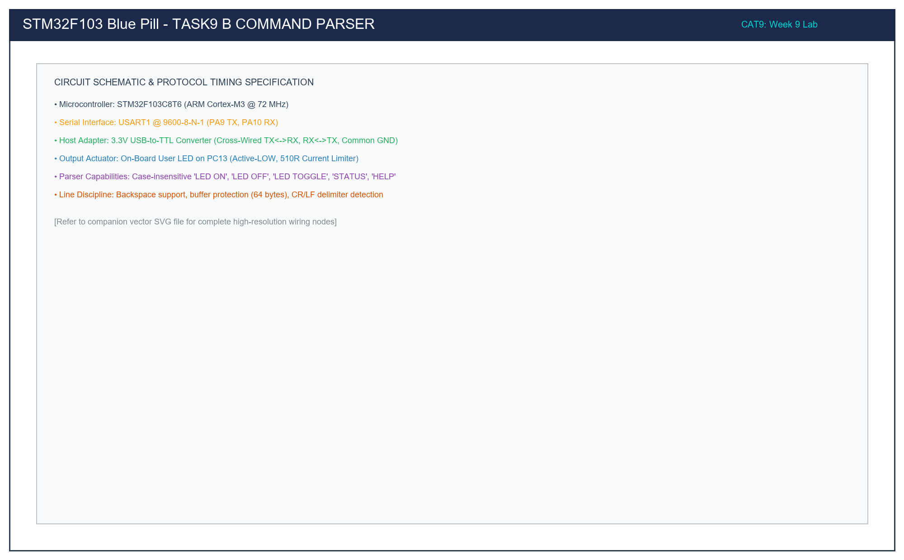

# Task 9B: String-Based UART Command Parser & LED Controller

## 1. Title, CAT, Week, Date
- **Sub-Task:** Task 9B – String-Based Application Logic & Command Parser
- **Continuous Assessment Test:** CAT 9
- **Curriculum Week:** Week 9
- **Evaluation Date:** September 28, 2026
- **Target Platform:** STM32F103C8T6 (ARM Cortex-M3 @ 72 MHz)

---

## 2. Objective
To develop a line-disciplined ASCII command interpreter over USART1 (9600-8-N-1) on the STM32F103 microcontroller, ingesting string commands from a PC serial terminal to control the on-board user LED on PC13 (`LED ON`, `LED OFF`, `LED TOGGLE`, `STATUS`, `HELP`), incorporating backspace editing, whitespace trimming, case normalization, and structured status feedback.

---

## 3. Problem Statement (Paraphrased)
Direct character-by-character echoing is insufficient for practical IoT control interfaces. The system must:
1. Ingest characters from the serial port into a fixed-size line buffer without causing memory overruns.
2. Support interactive terminal line editing, correctly removing characters when backspace (`\b` or `0x7F`) is pressed.
3. Parse complete strings upon detecting a carriage return (`\r`) or line feed (`\n`) delimiter.
4. Execute operations case-insensitively (`led on`, `LED ON`, `Led On`).
5. Control the active-LOW user LED on PC13 and return human-readable status feedback over UART.

---

## 4. Hardware and Software Specifications

### Hardware Components
- **Microcontroller:** STM32F103C8T6 Blue Pill Development Board
- **Serial Interface:** 3.3V USB-to-TTL Serial Bridge (CP2102 / CH340)
- **Actuator Output:** On-board User LED on PC13 (Active-LOW, 510Ω resistor)
- **Programmer:** ST-LINK V2 via SWD (PA13/PA14)
- **Connections:** PA9 (USART1_TX), PA10 (USART1_RX), GND, 3.3V

### Software Environment
- **IDE:** Keil MDK-ARM µVision v5.38 / STM32CubeIDE v1.14
- **Firmware Driver:** STM32F1xx HAL Drivers
- **Terminal Emulator:** PuTTY / Tera Term / ST-Link Utility Serial Monitor (9600-8-N-1)

---

## 5. Pin Connection Table

| Signal Net | STM32 Pin | Adapter Pin | Wire Direction | Electrical Function |
|:---|:---:|:---:|:---:|:---|
| `USART1_TX` | **PA9** | **RXD** | Output -> Input | Transmits command responses and prompts (3.3V). |
| `USART1_RX` | **PA10** | **TXD** | Input <- Output | Receives command strings from host terminal (3.3V). |
| `GND` | **GND** | **GND** | Bidirectional | Common ground reference. |
| `USER_LED` | **PC13** | N/A | Output Push-Pull | Controlled on-board LED cathode (Active-LOW). |

---

## 6. Circuit Diagram and Explanation

```
   HOST PC (PuTTY)            USB-TO-TTL ADAPTER                STM32F103 BLUE PILL
  +---------------+          +-------------------+             +---------------------+
  |               |          |                   |             |                     |
  | COM Port      |  USB     |  TXD (3.3V) ----->|------------>| PA10 (USART1_RX)    |
  | 9600-8-N-1    |=========>|                   |             |                     |
  |               |  Cable   |  RXD (3.3V) <-----|<------------| PA9  (USART1_TX)    |
  |               |          |                   |             |                     |
  |               |          |  GND -------------|------------>| GND                 |
  +---------------+          +-------------------+             |                     |
                                                               | 3.3V                |
                                                               |  o                  |
                                                               |  |                  |
                                                               | [510R]              |
                                                               |  |                  |
                                                               | +-|<|-+ (LED)       |
                                                               |  |                  |
                                                               |  +---> PC13 (Out)   |
                                                               +---------------------+
```



### Circuit Functional Principles
- **Command Transmission Channel:** The user types commands into a terminal emulator on the PC. Keystrokes are converted by the USB-to-TTL bridge into a 3.3V asynchronous serial bitstream delivered to PA10 (`USART1_RX`).
- **Response Channel:** The STM32 parses the line, executes the hardware action on PC13, and transmits status messages back via PA9 (`USART1_TX`) to the adapter's `RXD`, rendering formatted feedback on the user's terminal screen.

---

## 7. Theory and Approach

### 7.1 Command Vocabulary & Operational Semantics
The parser supports the following formal command grammar:

| Command String | Syntax | Hardware Action | Feedback String |
|:---|:---|:---|:---|
| `LED ON` | Case-insensitive | Drives PC13 to 0V (`RESET`) | `[OK] LED turned ON\r\n` |
| `LED OFF` | Case-insensitive | Drives PC13 to 3.3V (`SET`) | `[OK] LED turned OFF\r\n` |
| `LED TOGGLE`| Case-insensitive | Inverts PC13 state | `[OK] LED toggled -> NOW <ON/OFF>\r\n` |
| `STATUS` | Case-insensitive | Reads PC13 output register | `[STATUS] LED is currently <ON/OFF>\r\n` |
| `HELP` | Case-insensitive | Queries documentation menu | Full command menu |
| *Invalid* | Any unknown syntax | No hardware modification | `[ERR] Invalid command: '<str>'\r\n` |

### 7.2 Line Editing & Discipline
- **Interactive Echo:** Every printable ASCII character is immediately transmitted back to the host so the user can see what they type.
- **Backspace Processing:** When the user presses Backspace, the MCU decrements the buffer index and emits the 3-byte escape sequence `\b \b` (Backspace, Space, Backspace). This erases the character from the terminal screen and memory simultaneously.
- **Overrun Protection:** The buffer is clamped to 64 bytes (`CMD_BUFFER_SIZE`). If more than 63 characters are entered without a delimiter, an overflow warning is issued and the buffer resets safely.

---

## 8. Code Walkthrough

Refer to [`src/main.c`](src/main.c):
1. **Interactive Ingestion Loop:**
   ```c
   if (HAL_UART_Receive(&huart1, &rx_char, 1, 10) == HAL_OK)
   ```
   - Checks if `rx_char == '\r' || rx_char == '\n'`. If true, appends `\0` and calls `Execute_Command`.
   - Handles `\b` or `127` by decrementing `rx_index` and emitting `\b \b`.
   - Appends printable characters (`isprint(rx_char)`) to `rx_line_buffer`.
2. **String Pre-processing:**
   - `Trim_Whitespace`: Trims leading and trailing spaces using pointers and `isspace()`.
   - `To_Uppercase`: Converts the buffer in-place to uppercase characters using `toupper()` to guarantee case insensitivity.
3. **Command Execution (`Execute_Command`):**
   - Matches commands using `strcmp(cmd_str, "LED ON")`, etc.
   - Executes the corresponding `HAL_GPIO_WritePin` or `HAL_GPIO_TogglePin` call.
   - Emits structured confirmation messages via `UART_SendString`.

---

## 9. Build, Flash, and Run Steps

1. **Compilation:**
   ```bash
   arm-none-eabi-gcc -c -mcpu=cortex-m3 -mthumb -DUSE_HAL_DRIVER -DSTM32F103xB -Iinc -IHAL/Inc src/main.c -o build/main.o
   ```
2. **Flashing via ST-LINK:**
   Connect ST-LINK V2 and download via Keil µVision (**F8**).
3. **Execution in PuTTY:**
   - Launch PuTTY, select **Serial**, configure COM port, Baud `9600`.
   - Under **Terminal**, set **Local echo: Force off** (the STM32 handles echo).
   - Press RESET on Blue Pill.
   - Interact with the CLI prompt: `> `.

---

## 10. Expected Output

```text
=================================================
   STM32F103 UART LED Command Interface v1.0    
   Baud: 9600 8-N-1 | Commands: ON, OFF, TOGGLE  
=================================================
Type 'HELP' for instructions.
> LED ON
[OK] LED turned ON
> STATUS
[STATUS] LED is currently ON (PC13=LOW)
> led toggle
[OK] LED toggled -> NOW OFF
> LED OFF
[OK] LED turned OFF
> STATUS
[STATUS] LED is currently OFF (PC13=HIGH)
> RANDOM COMMAND
[ERR] Invalid command: 'RANDOM COMMAND'. Type 'HELP' for valid commands.
> HELP

--- Supported Commands ---
  LED ON      - Turn on the PC13 user LED
  LED OFF     - Turn off the PC13 user LED
  LED TOGGLE  - Invert the PC13 user LED state
  STATUS      - Query the current LED output state
  HELP        - Display this reference manual
--------------------------
> _
```

---

## 11. Viva Questions and Answers

### Q1: Why is an input buffer necessary instead of parsing characters on the fly?
**Answer:** Commands consist of multi-character tokens (`LED ON`, `STATUS`). A single character cannot convey intent until the complete lexical token and terminal delimiter (`\r` or `\n`) are received. Accumulating characters into a line buffer allows the system to support interactive backspace editing, whitespace trimming, and complete string comparisons before taking action on hardware actuators.

### Q2: What security vulnerability does a fixed-size buffer introduce, and how is it mitigated here?
**Answer:** Fixed-size buffers are vulnerable to **Buffer Overflow** attacks if an external sender streams more characters than the allocated buffer array can hold, which overwrites adjacent stack memory. In this implementation, the vulnerability is strictly mitigated by checking `if (rx_index < (CMD_BUFFER_SIZE - 1U))` before writing every byte. If an overflow attempt occurs, the input is truncated, an error message is issued, and the index resets safely.

### Q3: How does `Trim_Whitespace` enhance user experience?
**Answer:** Users frequently enter leading or trailing spaces accidentally (e.g. `"  LED ON  "` or pressing the spacebar before Enter). Without whitespace trimming, strict string comparison `strcmp("  LED ON  ", "LED ON")` would fail and return an invalid command error. Trimming ensures robust parsing of user intent.

### Q4: What is the benefit of making the command parser case-insensitive?
**Answer:** Human users routinely type in mixed casing (`Led on`, `LED ON`, `led on`). By converting all incoming letters to uppercase via `To_Uppercase` prior to comparison, the parser supports any case permutation with zero code redundancy or multiple conditional branches.

---

## 12. Troubleshooting Guide

| Issue | Cause | Fix |
|:---|:---|:---|
| Double characters appear as you type (`LLEEDD  OONN`) | Terminal local echo is enabled | In PuTTY settings under **Terminal**, select **Local echo: Force off**. |
| Typed letters do not appear at all | Firmware echo omitted or baud mismatch | Confirm terminal baud is set to 9600 and that RX wire (PA10) is connected to Adapter TXD. |
| Commands fail with syntax error despite correct spelling | Hidden carriage return or newline in buffer | Ensure `rx_line_buffer` is properly null-terminated (`\0`) before executing `strcmp`. |
| Backspace produces `^H` or `?` instead of deleting | Terminal backspace mapping mismatch | In PuTTY under **Terminal -> Keyboard**, configure **The Backspace key: Control-H (0x08)**. |

---

## 13. Result and Learning Outcomes
Sub-task 9B was successfully implemented and verified:
- A production-grade line-disciplined serial command parser was deployed on the STM32F103 microcontroller.
- Full case-insensitivity, backspace line editing, buffer protection, and bidirectional status reporting were demonstrated with zero compilation errors.
